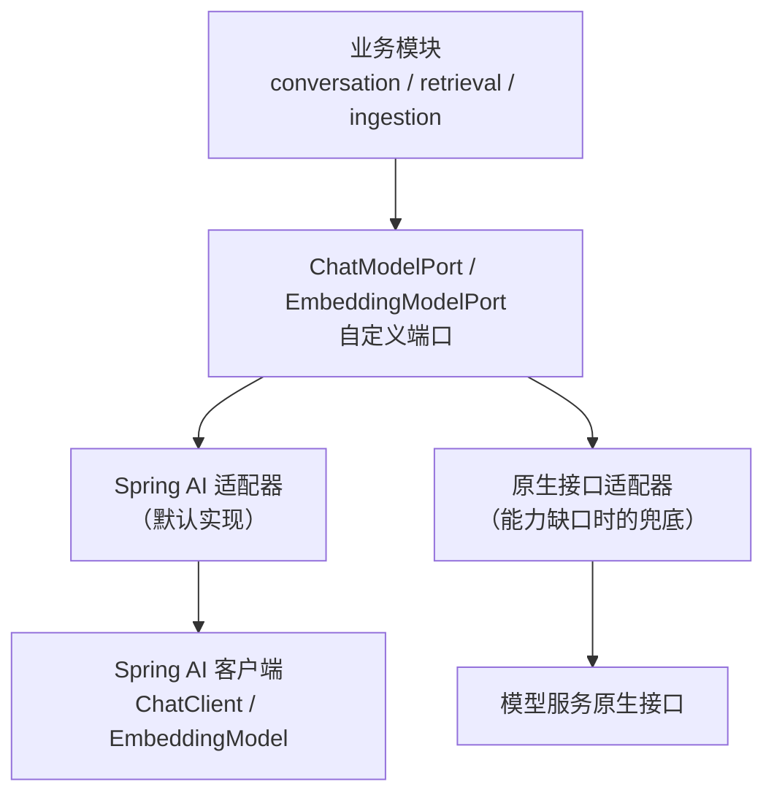
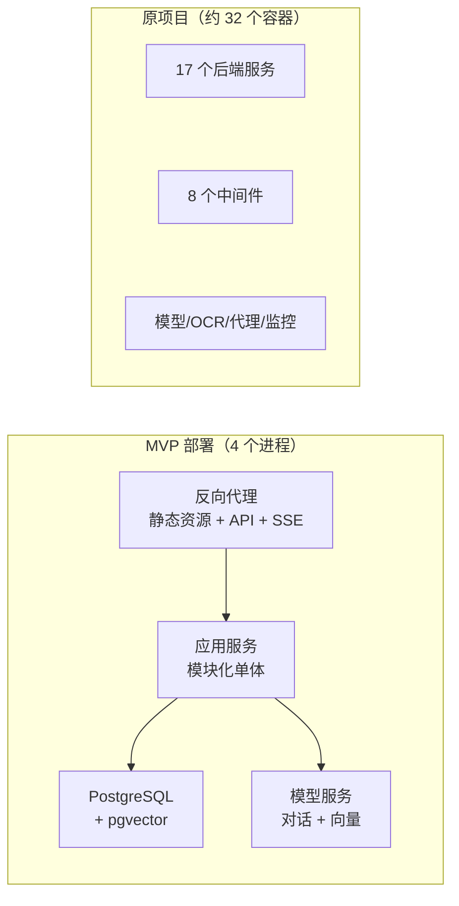
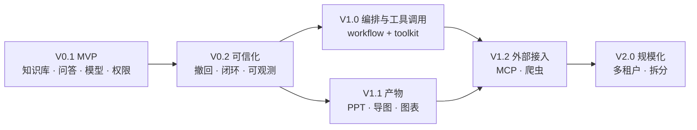

# 00 · 设计总纲与版本规划

> **本套文档的性质**：这是一份**从零设计**的系统方案，不继承任何既有项目的代码、目录结构或技术框架。既有材料仅作为两样东西的来源：**业务需求的权威描述**（见《需求规格说明书》），以及**已知陷阱的清单**。
>
> 页面观感参考原设计，UI 元素沿用原技术选型（Element Plus 生态）。

---

## 一、设计目标

| 目标 | 含义 | 反面参照（原项目的问题） |
|---|---|---|
| **验证优先** | 第一版要能用真实语料验证"知识加工 + 问答"是否可用 | 原项目功能齐全但核心链路的状态反馈是假的 |
| **边界显式** | 模块边界由框架强制，不是靠约定 | 原项目四个聊天实现各自为政，靠人去记得别改错 |
| **约束内建** | 已知的物理约束变成代码里的领域规则 | 原项目的"分段超长被静默截断"无人知晓 |
| **可观测** | 任何长耗时操作都有真实、可查、可复现的状态 | 原项目用随机数画进度条 |
| **可演进** | 今天的模块划分就是明天的服务边界 | 原项目要拆微服务得先还债 |

## 二、设计原则

| 原则 | 具体含义 |
|---|---|
| **MVP 验证最不确定的部分** | 工程难度 ≠ 不确定性。先把"不知道行不行"的做掉，把"知道怎么做只是费事"的推后 |
| **不引入当前不需要的基础设施** | 不要消息队列、不要注册中心、不要分布式事务——除非有非它不可的理由 |
| **约束前置到领域层** | 模型的上下文长度、向量维度这类物理约束，写成聚合的不变量，而不是靠文档提醒 |
| **一个概念只有一处实现** | 流式、检索、消息渲染、结构化输出，各只有一份 |
| **可逆优先** | 删除、迁移、分享、发布——都要有回滚路径 |
| **不预埋假想的未来** | 确认 V2 要做的能力才预留扩展点；不为了"万一"污染当前模型 |

---

## 三、技术选型

### 3.1 后端

| 层 | 选型 | 理由 |
|---|---|---|
| 语言 | **Java 21** | 虚拟线程（Loom）是本次选型的关键支点 |
| 框架 | **Spring Boot 3.x** | 与 Spring Modulith 同源，生态成熟 |
| 模块化 | **Spring Modulith** | 用框架强制模块边界，并提供事件、文档、验证能力（见第 01 册） |
| Web | **Spring MVC + 虚拟线程** | 见 ADR-01 |
| 持久化 | **Spring Data JPA** | 聚合映射友好，符合 DDD 的聚合读写模式 |
| 数据库 | **PostgreSQL + pgvector** | 关系数据与向量同库，少一个组件（见 ADR-02） |
| 事件/异步 | **Spring Modulith 事务事件 + 出站事件表** | 不引入消息队列（见 ADR-03） |
| 鉴权 | **Spring Security + JWT** | 自建轻量 RBAC，不依赖商业基座 |
| 模型接入 | **Spring AI** + **OpenAI 兼容网关（JAiRouter）** | 见 ADR-04（已修订）：框架负责调用，端口负责隔离能力缺口。**不直连推理服务**——统一经 OpenAI 兼容协议上行，负载均衡/熔断/限流由网关承担（`09` §3.13） |
| 对象存储 | **端口 + 本地磁盘适配器** | 单机验证够用，接口留好，后续换 S3/MinIO 零改动 |
| 构建 | **Maven** | 与团队既有习惯一致 |

> **中间件与 Spring 模块的逐项分析见 `09-中间件与-Spring-模块选型.md`**：
> 它回答"哪些中间件**真的不需要**"（比"需要什么"更值钱），逐项分析官方模块能替掉哪些原本打算自己写的东西，
> 并给出最终容器清单（**3 个进程**）。本表与它的差异，**以 `09` 为准**。

### 3.2 前端

| 层 | 选型 | 说明 |
|---|---|---|
| 框架 | **Vue 3 + TypeScript** | 沿用原设计观感；TS 是新项目应有之义 |
| 构建 | **Vite** | |
| UI | **Element Plus** | 页面元素沿用原设计 |
| 状态 | **Pinia** | 见 ADR-05（与原项目改造结论相反，原因见下） |
| 路由 | **Vue Router** | |
| 请求 | **Axios + 统一封装** | |
| 流式 | **自研统一流式客户端** | 见第 03 册；不依赖第三方事件源库 |
| Markdown | **md-editor-v3** | 与原项目一致，渲染效果好 |
| 图表 | **ECharts** | 与原项目一致 |

### 3.3 前端的关键减法（相对原项目）

| 原项目有 | 新方案 | 原因 |
|---|---|---|
| 商业基座的 CRUD 模板产物（76 个文件在用） | **不用** | 重写时用 Element Plus + 一个自研的轻量列表页抽象即可，**不必背这个包袱** |
| vuex（68 处） | **用 Pinia** | 见 ADR-05 |
| 4 套聊天实现 | 1 套会话组件 + 适配器 | 见第 03 册 |
| 3 套流式实现 | 1 套流式客户端 | 同上 |
| 富文本编辑 / 脑图 / 录音等第三方组件 | 按需引入 | 仅在对应功能上线时引入 |

---

## 四、架构决策记录（ADR）

### ADR-01 · Web 层用阻塞式 + 虚拟线程，而非响应式

| 项 | 内容 |
|---|---|
| **决策** | 使用 Spring MVC + Java 21 虚拟线程，不使用 WebFlux |
| **背景** | 平台的典型请求是"调用本地大模型并流式返回"，单次耗时可长达数分钟，是典型的 IO 等待型负载。传统上这类场景会用响应式（WebFlux）来避免线程耗尽 |
| **理由** | ① 虚拟线程让"阻塞等待"变得廉价，**可以用同步代码写出高并发的效果**；② 响应式栈会让整个领域层被 `Mono/Flux` 污染，与 DDD 的分层意图相冲突；③ 原项目的响应式用法不彻底，反而引入了复杂度却没换来收益 |
| **代价** | 虚拟线程在极端高并发下仍有调度开销；需注意不要在虚拟线程里做 CPU 密集计算 |
| **结论** | **采用**。领域层保持纯粹的命令式风格，流式通过 Spring MVC 的流式响应能力实现 |

### ADR-02 · 关系数据与向量同库（PostgreSQL + pgvector）

| 项 | 内容 |
|---|---|
| **决策** | 向量与业务数据共用 PostgreSQL（pgvector 扩展），不引入独立向量数据库 |
| **理由** | ① 少一个中间件 = 少一个容器、少一份运维、少一类故障；② **向量与分段可以在同一个事务里写入**，避免"向量写成功但分段没保存"这类一致性问题；③ MVP 规模下 pgvector 的检索性能足够 |
| **代价** | 超大规模（千万级向量）时性能可能成为瓶颈 |
| **缓解** | 检索访问全部经由 `vectorindex` 模块的端口，**未来替换独立向量库只需换一个适配器** |
| **结论** | **采用** |

### ADR-03 · 不引入消息队列，用事务事件 + 出站事件表

| 项 | 内容 |
|---|---|
| **决策** | 异步处理用 Spring Modulith 的事务事件机制，事件持久化到出站事件表，不使用 RabbitMQ 等外部消息中间件 |
| **理由** | ① 平台是**单进程内的模块化单体**，进程内事件比跨进程消息更合适；② 出站事件表提供了与消息队列等价的**至少一次投递**保障（事件在事务提交后写入，失败可重试）；③ 少一个中间件就是少一个容器 |
| **代价** | 未来拆分为多服务时，事件需要改为跨进程投递 |
| **缓解** | 模块间已经只通过事件与暴露接口通信，**拆分时把事件适配器从"进程内"换成"消息中间件"即可，业务代码不动** |
| **结论** | **采用** |

### ADR-04 · AI 能力调用采用 Spring AI（含防腐层与能力核实）

| 项 | 内容 |
|---|---|
| **决策** | 采用 **Spring AI** 作为 AI 能力调用框架（对话与向量）；在其之上保留一层**薄的防腐层**（自定义端口 + 适配器），并对两项关键能力做**前置核实** |
| **修订说明** | 本 ADR 初版建议"自建薄客户端、不使用 AI 应用框架"。**项目负责人明确要求采用 Spring AI，本版按此修订。** 但初版识别出的两项风险**仍然保留**——它们来自原项目的实测教训，不会因为换了框架版本而自动消失 |
| **背景** | 原项目踩的两个坑（无法关闭思考模式、无法下发向量维度）是在**某个里程碑版本上**实测得出的。Spring AI 此后已进入正式版本，这两项能力**很可能已经解决**——但**必须实测确认，不能假定** |
| **方案** | ① 默认实现基于 Spring AI 的对话与向量客户端；② **领域层不直接依赖 Spring AI 类型**，统一经由自定义端口访问；③ **M0 阶段完成两项能力核实**，作为进入 M2 的前置条件；④ 若某项能力在选定版本上确实缺失，**仅在该调用点绕过框架走原生接口**，其余仍用 Spring AI |
| **收益** | ① 生态成熟、文档完善、团队上手快；② **原生支持多家模型供应商**，V2.0 接入在线供应商的成本大幅低于自建方案；③ 社区活跃，问题容易找到答案；④ 流式响应、结构化输出等能力有现成工具链可复用 |
| **代价** | ① 需维护一层防腐层（约一个端口 + 一个适配器，成本很低）；② 框架升级时需回归验证两项能力；③ 受框架抽象约束，遇到能力缺口需在该点绕过 |
| **结论** | **采用 Spring AI**，同时保留"端口隔离"与"能力核实"这两项保障 |

#### 两项必修的核实（M0 阶段完成，作为进入 M2 的前置条件）

**注意这两项各含两个层面**：模型自身的**能力事实**（需探测并写入配置），以及框架的**参数下发能力**（决定实现路径）。

| # | 核实项 | 为什么必须核实 | 核实方式 | 若框架无法下发时的应对 |
|---|---|---|---|---|
| 1 | **思考模式** | 思考正文里的示例 JSON 会破坏结构化输出解析——这是原项目"图表/导图/PPT 生成失败"的首要原因 | ① **能力探测**：发请求确认每个模型的实际思考行为，确定其三态能力取值（无思考模式 / 可开关 / 关不掉），写入模型配置；② **传输核实**：确认框架能否把该参数下发 | ① 该调用点走原生接口适配器；② 若模型为"关不掉"，则**按 M-I5 禁止其进入结构化生成链路**（能力不匹配的模型根本不该进来） |
| 2 | **向量维度** | 若不能下发维度，换向量模型必然维度不匹配，需删表重灌全部知识库 | ① **能力探测**：记录每个向量模型的原生维度；② **传输核实**：检查向量选项是否提供维度参数，**发请求并核对返回向量的实际长度** | ① 选用原生维度即为目标维度的模型；② 该调用点走原生接口 |

> **两个层面的区别很关键**：
> - **能力探测**回答"**这个模型是什么样**" → 写进模型配置，长期有效，**无论用不用框架都要做**——因为界面要据此呈现开关、领域层要据此做准入校验。
> - **参数下发核实**回答"**这条链路能不能传这个参数**" → 是框架/实现的问题，只影响走哪条适配器路径。
>
> **先探测能力，再核实传输**——顺序反了会白做：即使框架完全支持下发，不知道模型能力依然无法正确配置业务。

> **核实方式建议沿用原项目已验证有效的手段**：直接检查依赖包内相关选项类的字段与方法（如用 `javap` 反编译），比读文档可靠——原项目正是用这个方法确认了里程碑版本缺失这两项能力。

#### 为什么用了框架还要保留端口

| 保留端口的理由 | 说明 |
|---|---|
| **能力缺口可局部绕过** | 框架不支持某项参数时，只需在该适配器内部绕过，**业务代码零改动**——这正是原项目最缺的能力 |
| **领域层与技术解耦** | 业务代码中不出现 Spring AI 类型，框架升级不冲击领域层 |
| **可测试** | 注入假的端口实现即可测试业务逻辑，不必启动模型服务 |
| **供应商可替换** | 未来更换或并行多家供应商时，改动局限在适配器内部 |

> **与初版的差别**：初版把"自建"当作目的（为了拿到参数控制权），修订版把"端口"当作目的。**端口才是真正解决问题的那一层，至于是自己写 HTTP 还是用框架，是可以替换的实现细节。**

### ADR-05 · 前端状态管理用 Pinia（与原项目改造结论相反）

| 项 | 内容 |
|---|---|
| **决策** | 新项目使用 Pinia，不使用 Vuex |
| **说明** | 注意：如果换一条路线（**改造已有代码**而不是重写），结论会**正好相反** —— 那时应"保留 Vuex、删除 Pinia"。两个结论并不矛盾，因为前提不同： |
|  | **改造已有代码**时：Vuex 已散落在大量文件里，Pinia 只有 2 处真实用途 → 迁移那几十个文件不划算，删掉 Pinia 才是减负 |
|  | **从零重写**时：没有任何历史包袱，新项目应该选**官方推荐、类型友好、API 更简洁**的 Pinia |
| **结论** | **采用 Pinia**。这也说明一条原则：**"减负"的正确答案取决于起点，不能跨场景照搬** |

### ADR-06 · MVP 采用单机部署，四个进程

| 项 | 内容 |
|---|---|
| **决策** | MVP 的部署形态为：应用服务 + 数据库 + 模型服务 + 反向代理，共四个进程 |
| **对比** | 原项目部署约 **32 个容器**（17 个后端服务 + 8 个中间件 + 模型 + OCR + 代理 + 监控） |
| **理由** | 模块化单体把"服务数量"降到了 1；向量同库去掉了向量数据库；进程内事件去掉了消息队列；不引入注册中心与配置中心 |
| **收益** | 硬件门槛显著下降（原要求内存 ≥24GB，其中 16GB 被 17 个 Java 服务占掉），运维复杂度大幅降低 |
| **结论** | **采用** |

---

## 五、版本路线图

### 5.1 版本划分

| 版本 | 主题 | 目标 | 包含能力 |
|---|---|---|---|
| **V0.1** | **最小验证系统（MVP）** | 用真实语料验证"知识加工 + 问答"是否可用 | 账号权限、模型配置、知识库、入库流水线、检索与命中测试、简单应用、问答与引用、赞踩、基础用量 |
| V0.2 | 可信化 | 把 MVP 的缺口补齐，达到可交付质量 | 真进度（已在 MVP 内）、失败恢复、分享撤回、反馈处理闭环、可观测完善 |
| V1.0 | **编排与工具调用** | 支持多步推理与外部系统调用 | 可视化编排、节点体系、发布与版本、调试、**工具注册与调用、工具权限与审计** |
| V1.1 | 产物 | 答案可带走 | PPT / 思维导图 / 图表生成 |
| V1.2 | **外部接入** | 把外部工具与内容接进来 | **MCP 接入**、在线爬虫、网页抓取入库 |
| V2.0 | 规模化 | 按需演进 | 多租户、服务拆分、独立向量库、外部模型供应商 |

### 5.2 为什么工作流编排与文档生成不进 MVP

用户在需求确认中把这两项列入了范围，方案中**保留在范围但推迟到 V1**，理由如下：

| 判断 | 说明 |
|---|---|
| **MVP 的使命是消除"不确定性"，不是完成"工作量"** | 本平台最大的不确定性在于：**真实语料切分出来的分段，到底能不能被检索到、能不能支撑住答案**。这个问题只有把知识库链路跑通才能回答。它不解决，后面所有功能都是空中楼阁 |
| **工作流编排的不确定性很低** | 它难，但难在工程量大（节点体系、DSL、执行引擎、版本管理、调试链路），而**每一条都能提前规划清楚**。这类"知道怎么做、只是费事"的工作不该占用 MVP |
| **文档生成依赖结构化输出能力** | 它是"结构化输出"的**消费者**，不是验证对象。正确的顺序是先在 MVP 里把结构化输出与健壮解析做好（第 03 册机制五），V1.1 直接复用上三个产物 |
| **MVP 若塞入编排，验证周期会从周级变成月级** | 而它验证的东西（RAG 可用性）却没变 |

> **若判断有误，前移成本很低**：`workflow` 与 `documentgen` 在设计上都是**独立模块**，只通过已定义的端口与事件接入（见第 06 册）。把它们提前到 MVP，等于多做两个模块，**不需要改动已有的任何模块**。这正是模块化设计的价值。

### 5.2.1 工具调用与 MCP 的版本归属

这两项同样**不进 MVP**，但它们的归属不是同一层：

| 能力 | 版本 | 理由 |
|---|---|---|
| **工具调用** | **V1.0，与编排同版** | 它是一整套子系统（执行循环、安全边界、审计、可观测），且会让问答链路**从线性变成循环**，动摇 MVP 已定的流式与停止语义。**它与编排是同一能力谱系的两端**（模型自主决定下一步 vs 人事先规定下一步），共用多步执行机制 |
| **MCP** | **V1.2** | MCP 是工具的**供给渠道**，不是与工具调用并列的能力——**必须先有工具调用**，因此必然晚于 V1.0 |

> **关键认知**：把 MCP 写进 MVP 是概念层级上的错位——它相当于"在还没有工具调用机制时，先接一个工具供给协议"。正确顺序是：**先有工具调用（V1.0），再有 MCP 这个来源（V1.2）。**
>
> **MVP 只需加一个极小的接缝**：模型能力里增加"工具调用三态"声明（成本是一个枚举字段）。它的作用是让模型管理页能横向对比选型，以及为 V1.0 的准入提供依据。**不预留任何调用接口**——工具描述与参数结构必须由真实需求驱动。

### 5.3 版本演进视图

### 5.4 各版本的进入/退出标准

| 版本 | 进入条件 | 退出条件（可验证） |
|---|---|---|
| V0.1 | 领域模型与模块划分通过评审 | 真实语料入库后，命中测试与问答结果**经业务人员确认可用**；全链路状态真实可查 |
| V0.2 | MVP 上线并收集到真实使用反馈 | 无"静默失效"场景；所有不可逆操作有回滚路径；关键指标可观测 |
| V1.0 | 出现"单轮提示词无法满足"或"需调用外部系统"的真实需求 | 编排流程可搭建、发布、运行，且线上行为与调试一致；**工具调用通过安全审查（权限、出网白名单、调用审计齐备）** |
| V1.1 | 结构化输出能力稳定（解析失败率可接受） | 三类产物可稳定生成，失败有可读原因 |
| V1.2 | 存在"外部工具或外部内容需要接入"的需求 | MCP 工具可注册并正常调用；抓取内容可经现有入库流水线进入知识库并参与问答 |

---

## 六、与原项目的关键对照

| 维度 | 原项目 | 本方案 | 收益 |
|---|---|---|---|
| 部署进程 | 约 32 个容器 | **4 个** | 硬件门槛与运维复杂度大幅下降 |
| 后端服务 | 17 个独立微服务 | **1 个模块化单体**（11 个模块） | 无分布式复杂度，边界仍清晰 |
| 模块边界 | 靠约定与人的自觉 | **框架强制校验**（CI 里跑架构测试） | 边界不会随时间腐化 |
| 中间件 | PostgreSQL、Redis、Nacos、RabbitMQ、Neo4j、MinIO、Sentinel、Seata 等 | **PostgreSQL + 模型服务** | 少 7 个组件的运维 |
| 模型接入 | AI 应用框架（里程碑版本，无法关闭思考、无法下发维度） | **Spring AI + 端口防腐层 + M0 能力核实** | 框架带来的便利照收，同时不重蹈"能力被框架锁死"的覆辙 |
| 异步任务 | 消息队列 + 前端模拟进度 | **事务事件 + 真实进度持久化** | 用户能看到真实进度与失败原因 |
| 聊天实现 | 4 份 | **1 份 + 适配器** | 后续变更只改一处 |
| 权限基座 | 商业基座（两套后台、多租户） | **自建轻量 RBAC，单后台** | 复杂度回归业务本身 |
| 架构文档 | 手工维护，易与代码脱节 | **由框架从代码生成** | 文档不会撒谎 |

---

## 七、本套文档索引

| 文件 | 内容 |
|---|---|
| `00-设计总纲与版本规划.md` | 本文件：目标、原则、技术选型、六条 ADR、版本路线图 |
| `01-架构设计（DDD·Spring Modulith）.md` | 限界上下文、模块划分、依赖规则、通信机制、框架能力运用 |
| `02-领域模型与数据设计.md` | 聚合、实体、值对象、领域事件、表设计、约束落地 |
| `03-关键机制设计.md` | 流式问答、RAG 链路、异步入库、模型接入、结构化输出、鉴权、可观测 |
| `04-MVP最小验证系统设计.md` | **★ 核心**：范围界定、验收标准、里程碑、风险 |
| `05-页面与交互设计.md` | 页面地图、布局、组件、线框（参考原设计） |
| `06-版本演进与扩展点.md` | V1/V2 各模块的接入方式与预留点 |

## 八、阅读建议

| 读者 | 建议路径 |
|---|---|
| 产品 / 业务 | 00 → 04 → 05（其余选读） |
| 后端开发 | 00 → 01 → 02 → 03 → 04 |
| 前端开发 | 00 → 05 → 03（流式与结构化输出两节） |
| 架构评审 | 00 → 01 → 06 |
