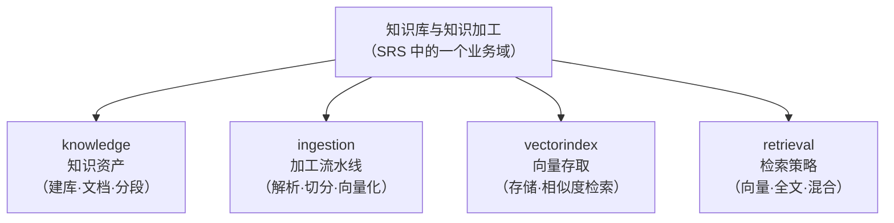
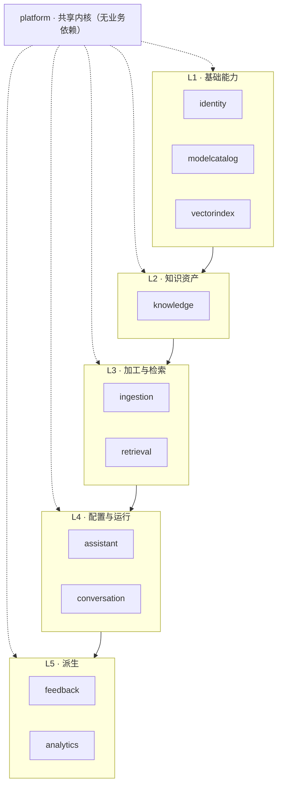
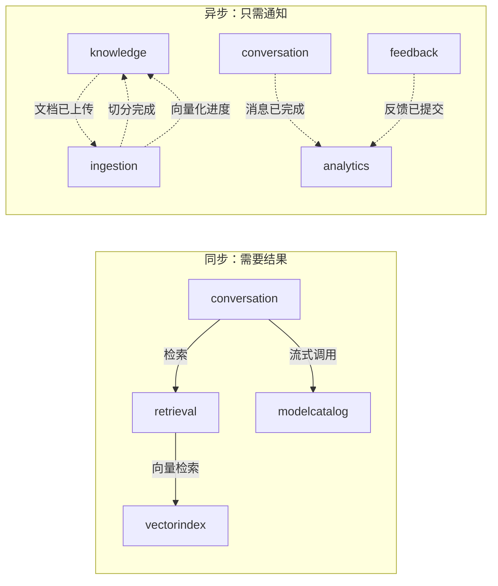

# 01 · 架构设计（DDD · Spring Modulith）

> 本册回答三个问题：**系统切成哪几块**、**块与块之间怎么通信**、**谁来保证边界不被破坏**。
>
> 核心立场：**用模块化单体拿到微服务的边界清晰度，但不付微服务的运维代价。**

---

## 一、从业务域到限界上下文

《需求规格说明书》中的业务域是**面向用户的划分**，限界上下文是**面向模型的划分**，两者不是一一对应。映射关系如下：

| 业务域（SRS） | 限界上下文 | 划分依据 |
|---|---|---|
| 角色与权限 | `identity` | 独立的生命周期与安全边界 |
| 模型与提示词管理 | `modelcatalog` | 模型的"配置"与"调用"是同一概念的两面，合并 |
| 知识库与知识加工 | `knowledge` + `ingestion` | **拆开**：知识资产的生命周期（建库、文档、分段）与加工流水线（解析、切分、向量化）的变化频率完全不同 |
| 知识库与知识加工（检索部分） | `vectorindex` + `retrieval` | **拆开**：向量的"存取"是基础设施能力，检索的"策略"是业务能力 |
| 智能问答与应用会话 | `conversation` | 运行时状态，与配置分离 |
| 应用接入与开放能力（应用配置部分） | `assistant` | 配置态，与运行时分离 |
| 运营统计与用户反馈 | `feedback` + `analytics` | 反馈是用户输入，统计是派生读模型 |
| （横切） | `platform` | 共享内核：值对象基类、领域事件、异常、审计 |

**两个关键拆分决策：**



| 为什么拆 | 说明 |
|---|---|
| **knowledge ↔ ingestion** | 知识资产是**低频变更、长期存在**的（一个知识库建好会用很久）；加工流水线是**高频执行、瞬时状态**的（每次上传都跑一遍，还会失败重试）。放在一个模块里，会导致"改一次流水线重试逻辑要动知识库聚合" |
| **vectorindex ↔ retrieval** | `vectorindex` 是**可替换的基础设施**（今天 pgvector，明天可能是独立向量库），`retrieval` 是**会持续演进的业务策略**（加混合权重、加重排、加查询改写）。分开后，换向量库不影响检索策略 |
| **assistant ↔ conversation** | 应用配置是**低频写、高频读**的配置态；会话是**高频写**的运行时态。混在一起会让配置模块承担运行时的扩展压力 |

---

## 二、模块清单

MVP 共 **11 个模块**。其中 `platform` 是共享内核，其余 10 个是业务模块。

| # | 模块 | 职责 | 核心概念 | 对外提供 |
|---|---|---|---|---|
| 1 | `platform` | 共享内核：值对象基类、领域事件基类、业务异常、ID 生成、时钟、审计、文件存储端口 | — | 基础类型与工具 |
| 2 | `identity` | 账号、角色、权限点、认证与授权 | 用户、角色、权限点 | 当前用户解析、权限校验、用户信息查询 |
| 3 | `modelcatalog` | 模型目录（供应商、基础模型、启用模型）+ **模型接入**（对话/向量端口；底层由 Spring AI 实现，原生接口兜底） | 模型、供应商、模型能力 | 对话流式调用、向量生成、模型可用性校验 |
| 4 | `vectorindex` | 向量的存储与相似度检索 | 向量条目、维度、距离度量 | 向量写入、向量检索 |
| 5 | `knowledge` | 知识库、分类、文档、分段的生命周期管理 | 知识库、文档、分段 | 知识库/文档/分段查询与变更 |
| 6 | `ingestion` | 文档加工流水线：解析 → 切分 → 向量化 → 状态回写 | 加工任务、切分策略 | 触发加工、查询加工进度 |
| 7 | `retrieval` | 检索策略：向量 / 全文 / 混合，参数校验，命中测试 | 检索请求、命中分段、相似度 | 统一检索接口、命中测试 |
| 8 | `assistant` | 应用（智能体）配置、发布、访问凭证 | 应用、提示词配置、检索配置、能力开关、访问凭证 | 应用配置查询、发布状态、凭证校验 |
| 9 | `conversation` | 会话、消息、RAG 编排、流式问答 | 会话、消息、引用来源、生成物 | 问答流式接口、会话与消息查询 |
| 10 | `feedback` | 赞踩与评分 | 反馈 | 提交反馈、反馈查询 |
| 11 | `analytics` | 运营指标（派生读模型，订阅事件） | 指标、日聚合 | 看板查询 |

> **`platform` 为什么包含文件存储端口**：文件上传被知识库文档、应用图标、（未来的）PPT 模板等多处使用，属于**跨模块的通用能力**，放在共享内核里比让每个模块各写一份合适。

---

## 三、依赖规则

### 3.1 分层与依赖方向

模块按"被依赖深度"分为四层，**依赖只能向下，禁止向上与横向**：



### 3.2 模块依赖矩阵

下表的含义：**行**模块可以依赖**列**模块。

| ↓依赖者 \ 被依赖→ | platform | identity | modelcatalog | vectorindex | knowledge | ingestion | retrieval | assistant | conversation | feedback | analytics |
|---|---|---|---|---|---|---|---|---|---|---|---|
| **platform** | — | | | | | | | | | | |
| **identity** | ✓ | — | | | | | | | | | |
| **modelcatalog** | ✓ | | — | | | | | | | | |
| **vectorindex** | ✓ | | | — | | | | | | | |
| **knowledge** | ✓ | ✓ | ✓ | | — | | | | | | |
| **ingestion** | ✓ | | ✓ | ✓ | ✓ | — | | | | | |
| **retrieval** | ✓ | | ✓ | ✓ | ✓ | | — | | | | |
| **assistant** | ✓ | ✓ | ✓ | | ✓ | | | — | | | |
| **conversation** | ✓ | ✓ | ✓ | | | | ✓ | ✓ | — | | |
| **feedback** | ✓ | ✓ | | | | | | | ✓ | — | |
| **analytics** | ✓ | | | | | | | | | | — |

**这张表就是架构约束的可执行形式**——它会作为代码里的显式声明（见第五节），并由 CI 强制校验。

### 3.3 几个刻意的取舍

| 取舍 | 说明 |
|---|---|
| **`conversation` 不直接依赖 `knowledge`** | 问答需要的是"命中分段的完整引用信息"（标题、内容、文档名、库名、排名），这是 `retrieval` 的返回值。让 `conversation` 依赖 `retrieval` 就够了——**少一个依赖，少一处耦合** |
| **`analytics` 不依赖任何业务模块** | 它只订阅领域事件、维护自己的读模型。**这是"分析不影响业务"的架构保障**——统计逻辑再重也不会拖慢问答 |
| **`identity` 不被 `knowledge` 依赖于"权限判断"** | 权限校验在应用层统一做（见第 03 册），领域层只持有"归属者 ID"这样的值对象，不做权限逻辑 |
| **`vectorindex` 不认识"知识库"** | 它只认识"向量 + 元数据 + 维度"。切分语义、知识库归属都是调用方的事。**这让它成为真正可替换的基础设施** |

---

## 四、模块间通信

**两条通道，各有明确适用场景：**

| 通道 | 用于 | 语义 |
|---|---|---|
| **同步调用** | 调用方需要**立即拿到结果**才能继续 | 通过被依赖模块的暴露接口（`api` 包） |
| **异步事件** | 调用方**不需要结果**，只是"通知发生了某事" | 发布领域事件，订阅方各自处理 |



### 4.1 领域事件清单（MVP）

| 事件 | 发布者 | 订阅者 | 用途 |
|---|---|---|---|
| `DocumentUploaded` | knowledge | ingestion | 触发解析与切分 |
| `SegmentationCompleted` | ingestion | knowledge | 更新文档状态为"待向量化" |
| `SegmentationFailed` | ingestion | knowledge | 更新状态为"分段失败"并记录原因 |
| `EmbeddingStarted` | ingestion | knowledge | 更新状态为"向量化中" |
| `EmbeddingProgressed` | ingestion | knowledge | 更新"已处理/总段数"（**真实进度的来源**） |
| `EmbeddingCompleted` | ingestion | knowledge | 更新状态为"成功" |
| `EmbeddingFailed` | ingestion | knowledge | 更新状态为"失败"并记录原因 |
| `AssistantPublished` | assistant | analytics | 记录发布行为 |
| `MessageCompleted` | conversation | analytics | 用量、Token、耗时、是否含引用 |
| `FeedbackSubmitted` | feedback | analytics | 满意度统计 |

> **注意事件的命名都是"过去式"**——事件描述**已经发生的事实**，不描述"希望对方做什么"。这是避免事件演化成隐式远程调用的关键。

### 4.2 同步接口的设计约定

跨模块接口只暴露**用例级的方法**，不暴露实体：

```java
// knowledge 对外暴露的接口（示意）
public interface KnowledgeQueryApi {
    KnowledgeBaseView getRequired(KnowledgeBaseId id);      // 查不到则抛业务异常
    List<KnowledgeBaseView> findByIds(Collection<KnowledgeBaseId> ids);
    boolean exists(KnowledgeBaseId id);
}

// 返回的是只读视图（record），不是 JPA 实体
public record KnowledgeBaseView(KnowledgeBaseId id, String name, String categoryName, boolean enabled) {}
```

| 约定 | 原因 |
|---|---|
| **只返回只读视图（record）** | 防止调用方持有并可修改别的模块的聚合；也避免 JPA 懒加载跑出事务边界 |
| **不暴露仓储接口** | 仓储是模块内部实现细节 |
| **不暴露 JPA 实体** | 一旦暴露，模块的表结构就成了公共契约，再也改不动 |
| **批量方法优先** | 避免调用方在循环里逐个查询（N+1） |

---

## 五、框架能力的具体运用

Spring Modulith 不是一个"额外的框架"，它是对 Spring 既有能力（组件扫描、事务事件、异步）的**结构化封装**。本方案会用到它的六项能力：

| # | 能力 | 怎么用 | 解决什么问题 |
|---|---|---|---|
| 1 | **模块结构校验** | 一个测试：加载应用后校验模块依赖无环、无越界访问 | **边界腐化**。原项目的四个聊天实现就是没有这层保护的结果 |
| 2 | **显式声明依赖** | 在每个模块的包上标注允许依赖的模块 | 让依赖关系可读、可评审，而不是从 import 里推 |
| 3 | **事务事件监听** | 用 `@ApplicationModuleListener`（= 异步 + 事务提交后触发） | 避免"事件在事务内发布、事务回滚了但监听方已执行"的经典错误 |
| 4 | **事件持久化（出站事件表）** | 开启事件发布注册表，事件落库 | **事件不丢**：进程崩溃后未处理的事件可重发 |
| 5 | **架构文档生成** | 构建期从代码生成组件图与模块画布 | **文档不会与实现脱节**——它就是从实现生成的 |
| 6 | **模块切片测试** | 每个模块可独立启动测试上下文 | 测试快、失败定位准；也逼迫模块真正解耦（否则切片启动不了） |

### 5.1 边界校验测试（CI 必跑）

```java
class ArchitectureTest {

    @Test
    void 模块边界必须合法() {
        ApplicationModules modules = ApplicationModules.of(PlatformApplication.class);
        modules.verify();        // 校验：无循环依赖、无越界访问、无未声明依赖
    }
}
```

**这一条测试的价值远超它的代码量。** 它把"架构约定"从文档里的君子协定，变成了**构建失败级的硬约束**——任何人试图让 `knowledge` 直接调用 `conversation`，CI 立刻红。

### 5.2 依赖声明（示意）

```java
@ApplicationModule(allowedDependencies = {"platform", "modelcatalog", "vectorindex", "knowledge"})
package com.example.platform.retrieval;

@ApplicationModule(allowedDependencies = {"platform", "retrieval", "assistant", "modelcatalog", "identity"})
package com.example.platform.conversation;
```

### 5.3 事件监听（示意）

```java
@Component
class EmbeddingPipeline {

    // 事务提交后异步执行；事件已落库，崩溃可重发
    @ApplicationModuleListener
    void on(DocumentUploaded event) {
        // 解析 → 切分 → 向量化
    }

    @ApplicationModuleListener
    void on(SegmentationCompleted event) {
        // 逐段向量化，过程中持续发布进度事件
    }
}
```

> **注意**：`@ApplicationModuleListener` 已经隐含"异步 + 事务提交后"两个语义。**不要额外加 `@Async` 或手动开启事务**，重复配置会导致语义混乱。

### 5.4 架构文档自动生成

构建期调用 Modulith 的文档生成能力，产出：

- **组件图**（模块级依赖，含 PlantUML 源码与渲染图）
- **模块画布**（每个模块的组成：聚合、事件、暴露接口）

产物落到 `docs/architecture/` 下。**这直接对冲了"文档会与实现脱节"这个老毛病**——架构文档由代码生成，改代码就更新文档。

---

## 六、包结构规范

### 6.1 顶层结构

```
com.example.platform
├── PlatformApplication.java
│
├── platform/                    ← 模块 1：共享内核
│   ├── domain/                  值对象基类、领域事件基类、业务异常
│   ├── storage/                 文件存储端口
│   └── util/
│
├── identity/                    ← 模块 2
│   ├── api/                     ★ 唯一对外可见的包
│   ├── domain/                  聚合、实体、值对象、领域服务、仓储接口
│   ├── application/             应用服务（用例编排、事务边界）
│   ├── infrastructure/          仓储实现、外部适配器
│   └── web/                     RestController、请求/响应 DTO
│
├── modelcatalog/                ← 模块 3（同结构）
├── vectorindex/                 ← 模块 4
├── knowledge/                   ← 模块 5
├── ingestion/                   ← 模块 6
├── retrieval/                   ← 模块 7
├── assistant/                   ← 模块 8
├── conversation/                ← 模块 9
├── feedback/                    ← 模块 10
└── analytics/                   ← 模块 11
```

### 6.2 模块内部的分层职责

| 包 | 职责 | 允许依赖 | 禁止出现 |
|---|---|---|---|
| `api` | 对外暴露的接口与只读视图 | `domain`（仅类型） | 实体、仓储、JPA |
| `domain` | 聚合、实体、值对象、领域服务、仓储**接口**、领域事件 | `platform` | Web、事务、外部调用 |
| `application` | 用例编排、事务边界、权限校验、事件发布 | `domain`、其他模块的 `api` | Web DTO、HTTP |
| `infrastructure` | 仓储实现、外部系统适配器 | `domain` | 业务规则 |
| `web` | 控制器、请求/响应 DTO、参数校验、异常映射 | `application` | 直接调仓储 |

> **访问保护的实现方式**：用 `@NamedInterface` 标记 `api` 包，其余包默认对模块外不可见。**跨模块只能访问 `api`。**

### 6.3 一条务实的妥协（需要明确记录）

**DDD 教科书主张领域模型完全纯净、持久化映射放在独立层**。本方案**采取务实的折中**：

| 做法 | 理由 |
|---|---|
| **允许在聚合上直接使用 JPA 注解** | 维护"领域模型 + 持久化模型"两套模型并写转换代码，在 MVP 阶段是**纯粹的额外成本**，且转换代码本身容易出错 |
| **但仓储接口必须定义在 `domain` 包** | 保证依赖倒置：领域层不依赖具体的持久化技术 |
| **领域服务保持纯净** | 不放 JPA 注解、不引用框架类型 |
| **复杂查询走独立的查询服务** | 读模型可以用原生 SQL 或投影，不必经过聚合 |

> **为什么要把这条妥协写进文档**：这是团队最容易产生分歧的地方（"这算不算违背 DDD？"）。**明确记录为"有意识的取舍"，比争论不休更有价值。** 未来若确需分离，`infrastructure` 包已经预留了位置。

---

## 七、模块与未来服务拆分的对应关系

模块化单体的最大价值之一是：**今天的模块就是明天的服务边界**。拆分时不需要重新划分，只需要"搬出去 + 把事件通道换成消息中间件"。

| 模块 | 拆分的可能性 | 依据 |
|---|---|---|
| `conversation` | **最可能先拆** | 长连接流式请求，连接数与并发模式与其他模块差异最大 |
| `ingestion` | **次可能** | 批处理型负载，CPU 与 IO 密集，与在线请求的资源竞争 |
| `analytics` | 可能 | 聚合查询重，容易影响在线请求；且已天然解耦（只订阅事件） |
| `modelcatalog` | 可能（作为独立推理网关） | 被多个模块依赖，且是唯一需要横向扩容（多模型实例）的模块 |
| `vectorindex` | 可能（换独立向量库时） | 已通过端口隔离，替换成本最低 |
| `identity` / `knowledge` / `assistant` / `retrieval` / `feedback` | **不需要拆** | 低频 CRUD 型负载，拆开只增加运维成本 |

> **拆分优先级反映了架构判断**：拆分的依据不是"模块大小"，而是**负载特征的差异**。把两个都是低频 CRUD 的模块拆成两个服务，只会得到两份运维成本和一个分布式事务问题。

---

## 八、架构评审要点

评审本架构时，建议重点确认以下几点：

| # | 确认项 | 判断标准 |
|---|---|---|
| 1 | 模块划分是否符合团队的心智模型 | 开发人员能否用一句话说清每个模块负责什么 |
| 2 | 依赖矩阵是否可接受 | 是否存在"这两个模块为什么会有依赖"的疑问 |
| 3 | ADR-04（采用 Spring AI + 端口防腐层）是否有异议 | 这是最容易被质疑、也最影响成败的一条。**重点确认两项能力核实（关闭思考、下发维度）是否被列为 M0 的硬性前置** |
| 4 | 务实的 JPA 妥协是否被接受 | 见 6.3，需要团队明确共识 |
| 5 | 是否认可"编排与文档生成推到 V1" | 见第 00 册 5.2，若不同意则调整路线图 |
