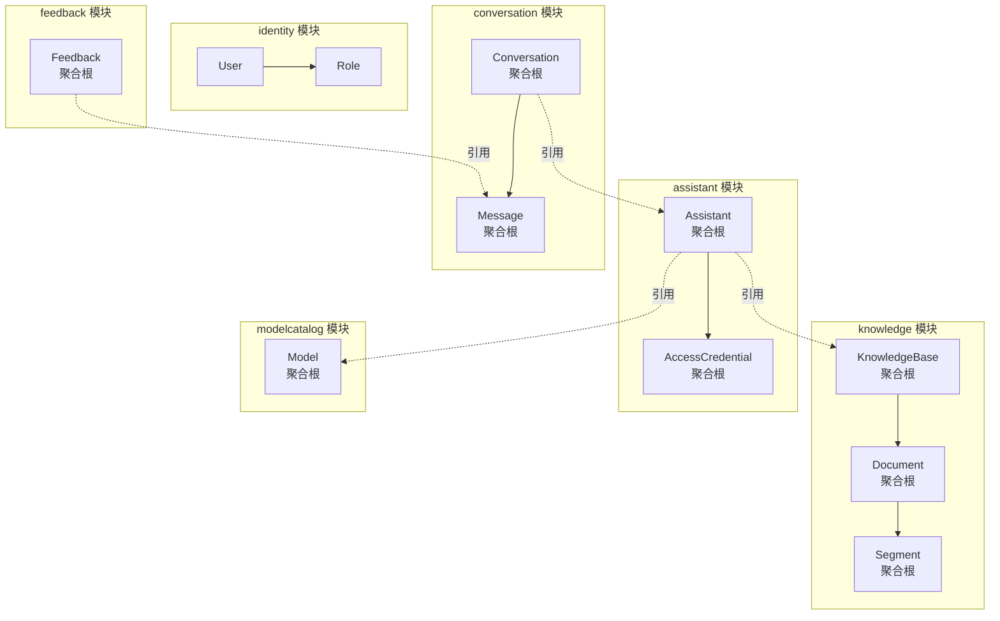
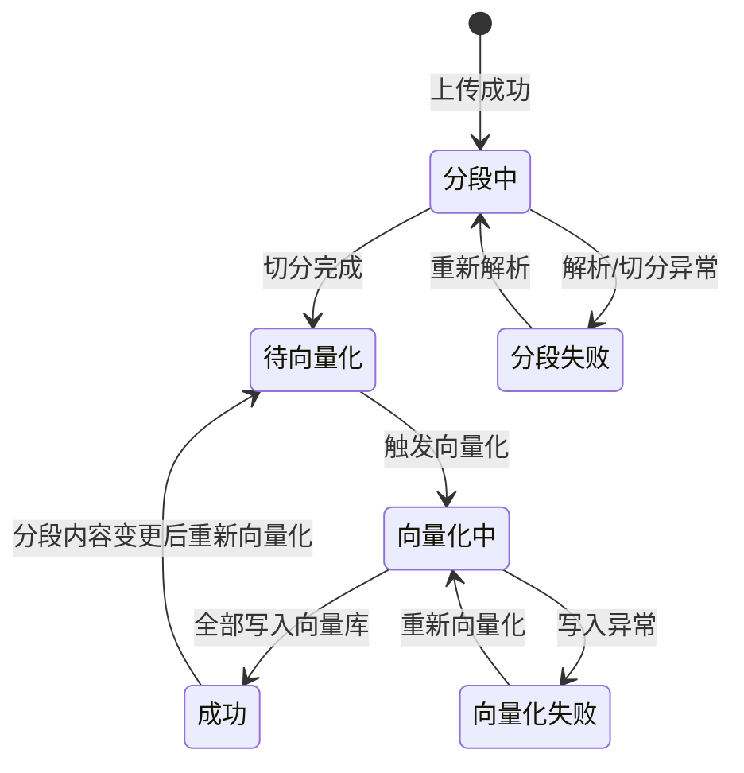
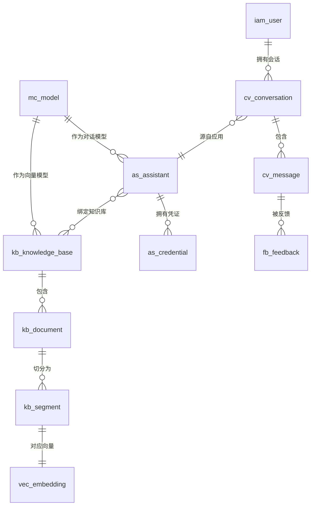

# 02 · 领域模型与数据设计

> 本册是设计的核心。它做一件原项目没做的事：**把散落在文档、注释和口头约定里的约束，变成代码里不可绕过的规则。**

---

## 一、聚合划分



> 实线为**聚合内包含**（同事务保证一致性），虚线为**跨聚合引用**（只存 ID，最终一致）。

### 1.1 划分依据（三条判断标准）

| 标准 | 含义 | 应用示例 |
|---|---|---|
| **一致性强弱** | 必须同事务一致的一起；可最终一致的分开 | `Document` 与其 `Segment` 分开——文档状态变化与单个分段编辑不需要同事务 |
| **生命周期长短** | 生命周期差异大的分开 | `Assistant`（长期配置）与 `Conversation`（每次交互新建）分开 |
| **数据量级** | 一对多且量级悬殊的，多的那侧独立 | 一个 `Document` 可能有数千 `Segment`，绝不做成大聚合 |

### 1.2 三个关键的划分决策

| 决策 | 理由 |
|---|---|
| **`Segment` 独立成聚合根，而不是 `Document` 的内部实体** | ① 一个文档可能有数千段，整体加载不可行；② 分段可**单独**编辑、启停、删除、迁移——它有独立生命周期；③ 分段是检索与引用的**最小单位**，必须能独立寻址 |
| **`Message` 独立成聚合根，而不是 `Conversation` 的内部实体** | ① 流式生成会**高频修改**消息内容（每个 chunk 都可能触发写入），若在会话聚合内会造成大量并发冲突；② 消息是追加为主的，历史消息极少修改 |
| **`AccessCredential` 独立成聚合根** | 访问凭证有自己的生命周期（生成、撤销、过期），且要独立支持"多凭证分别撤销" |

---

## 二、聚合详细设计

### 2.1 `KnowledgeBase` · 知识库

| 字段 | 类型 | 说明 |
|---|---|---|
| `id` | `KnowledgeBaseId` | |
| `name` | `KnowledgeBaseName` | 值对象，1–30 字 |
| `description` | `Description` | 值对象，≤200 字 |
| `categoryId` | `CategoryId` | 分类 |
| `icon` | `IconRef` | 预设图标或上传文件引用 |
| `embeddingModelId` | `ModelId` | 绑定的向量模型 |
| `enabled` | `boolean` | 停用后不参与检索，数据保留 |
| `hasVectorizedContent` | `boolean` | **派生状态，用于锁定向量模型** |
| 审计字段 | | 创建人/时间、更新人/时间 |

**不变量（代码强制，无法绕过）：**

| # | 不变量 | 违反时的行为 |
|---|---|---|
| KB-I1 | 名称非空且 ≤30 字 | 创建/改名被拒绝 |
| KB-I2 | 描述 ≤200 字 | 同上 |
| KB-I3 | **绑定的向量模型必须是"向量类型且已加载成功"的模型** | 绑定被拒绝并提示原因 |
| KB-I4 | **若已有文档成功向量化，禁止更换向量模型** | 拒绝并提示"需先清空或走迁移流程" |

> **KB-I4 是原项目最痛的一个坑的正面解决。** 原项目里换向量模型会导致维度不匹配，必须删表重灌全部知识库——但**没有任何地方阻止你这么做**，也没有任何提示。这里把它变成一条硬约束：**要做就等于走一次显式的迁移流程，而不是随手改个配置。**

**行为：**

```
rename(newName)              // 校验 KB-I1
changeDescription(desc)      // 校验 KB-I2
changeCategory(categoryId)
changeEmbeddingModel(model)  // 校验 KB-I3、KB-I4
enable() / disable()
markHasVectorizedContent()   // 由向量化完成事件触发
```

---

### 2.2 `Document` · 文档

| 字段 | 类型 | 说明 |
|---|---|---|
| `id` | `DocumentId` | |
| `knowledgeBaseId` | `KnowledgeBaseId` | 所属知识库 |
| `name` | `DocumentName` | 可重命名 |
| `sourceType` | `SourceType` | `UPLOAD`（本地上传）/ `ONLINE`（在线抓取，V1.2） |
| `fileRef` | `FileRef` | 值对象：存储键、原始文件名、大小、内容类型 |
| `status` | `DocumentStatus` | 见下方状态机 |
| `failReason` | `FailureReason` | **失败时必须写入可读原因** |
| `charCount` | `long` | 总字符数 |
| `segmentCount` | `int` | 总分段数 |
| `processedSegments` | `int` | **已处理分段数（真实进度的来源）** |
| `enabled` | `boolean` | 停用后不参与检索 |
| 审计字段 | | |

**状态机（严格受控的状态转换）：**



**不变量：**

| # | 不变量 | 说明 |
|---|---|---|
| DOC-I1 | **状态转换必须符合状态机**，非法转换抛业务异常 | 防止"从失败直接跳到成功"这类脏状态 |
| DOC-I2 | 状态为失败时，`failReason` 必须非空 | **消除"静默失败"**——原项目的失败原因字段一直存在却从不展示 |
| DOC-I3 | `0 ≤ processedSegments ≤ segmentCount` | 进度的基本合法性 |
| DOC-I4 | 状态为成功时，`processedSegments == segmentCount` | 防止"显示完成但实际没处理完" |
| ★ **DOC-I6** | `docType` / `deptId` / `classification` **不允许为空**（建档必填） | 让过滤有依据，而不是靠一个默认值 —— ★ **密级默认"未知"要么全放行要么全拦**（`12 §5.3` 纪律 2） |
| ★ **DOC-I7** | `effectiveTo` 已过期 ⇒ 文档**默认不参与检索**（可配为降权） | 过期的报销标准被召回出来，比召回不到更糟（`12 §5.3` 纪律 4） |
| DOC-I5 | 只有状态为 `待向量化` / `向量化失败` 的文档可触发向量化 | 防止重复触发导致重复写入向量 |

**行为（每个方法对应一个状态转换）：**

```
startSegmenting()
markSegmented(segmentCount, charCount)   // → 待向量化
markSegmentFailed(reason)                // → 分段失败
startEmbedding()                         // → 向量化中
reportEmbeddingProgress(processed)       // 持续更新 processedSegments
markReady()                              // → 成功，processedSegments 归位为 segmentCount
markEmbeddingFailed(reason)              // → 向量化失败
enable() / disable()
rename(newName)
moveTo(targetKnowledgeBaseId)            // 搬移语义
```

> **`reportEmbeddingProgress` 是"真实进度"的落地方式。** 进度不是前端算出来的，而是后端每处理完一批分段就回写的事实数据。**这就是原项目"随机进度条"的正确替代方案。**

---

### 2.3 `Segment` · 分段

| 字段 | 类型 | 说明 |
|---|---|---|
| `id` | `SegmentId` | |
| `documentId` | `DocumentId` | 所属文档 |
| `knowledgeBaseId` | `KnowledgeBaseId` | **冗余存储**，便于按库检索而无需连表 |
| `title` | `SegmentTitle` | 值对象，≤256 字 |
| `content` | `SegmentContent` | **值对象，含长度上限校验**（★ 原文） |
| ★ `searchText` | `String` | ★ **检索用文本 = 结构化前缀 + 正文**（`12 §4.2`）：进**向量**与 **`content_tsv`**；**展示与引用仍用 `content`** |
| ★ `titlePath` | `String` | ★ **章节路径**（`12 §3.4`）：如 `报销管理办法 > 第三章 差旅费 > 3.2 住宿标准`；它是前缀的主体，也是"引用来自哪里"的最好材料 |
| ★ `isTable` / `isCode` / `oversizedRisk` | `boolean` | ★ 分块器的标注（`12 §3.2`）：表格/代码**不跨块切**；`oversizedRisk` = 被 L4 硬切过 |
| `ordinal` | `int` | 在文档中的顺序 |
| `enabled` | `boolean` | 停用后不参与检索 |
| `embeddingStatus` | `EmbeddingStatus` | `PENDING` / `EMBEDDED` / `STALE`（内容变更后需重新向量化） |
| `contentHash` | `String` | 用于判断是否需要重新向量化 |
| 审计字段 | | |

**不变量 —— 这一条最重要：**

| # | 不变量 | 说明 |
|---|---|---|
| SEG-I1 | **`SegmentContent` 的字符数不得超过向量模型的上下文上限对应的字符数** | 见下方详解 |
| SEG-I2 | 内容变更后，`embeddingStatus` 必须置为 `STALE` | 保证"改过的分段一定会被重新向量化" |
| SEG-I3 | 停用的分段不参与检索 | 检索层过滤 |
| SEG-I4 | 迁移分段时，必须同时在目标位置重建向量（内容哈希不变时可复用） | 保证向量与分段始终对应 |
| ★ **SEG-I5** | **`searchText` 的字符数 ≤ 向量模型上限** —— ★ 注意：`SEG-I1` 现在约束的是 **`searchText`**，不是 `content` | 因为进向量的是**含前缀**的 `searchText` ⇒ **前缀会挤占预算**，`segmentLength` 的默认值必须扣掉前缀长度（`12 §9.1`） |
| ★ **SEG-I6** | `titlePath` ≤512 字 | 防止异常层级撑爆列 |
| ★ **SEG-I7** | **前缀的任何组成部分（文种 / 部门 / 文档标题 / 章节路径）变更 ⇒ `contentHash` 必须变** | 保证"改了标签一定会重新向量化"（`12 §4.2` 纪律 3）—— 否则会出现"标签改了但向量还是旧的"的静默不一致 |

#### SEG-I1 详解：把隐藏的物理约束变成显式规则

原项目的真实情况是：

| 事实 | 后果 |
|---|---|
| 向量模型的上下文窗口约 **1K token** | 超出部分被**静默截断** |
| 但界面允许把分段长度设到 **4096 字符** | 运营人员**在完全不知情的情况下**切出了大量会被截断的分段 |
| 向量只覆盖了分段的前半部分 | 召回质量自然差，而**没有任何地方提示这件事** |

本方案的处理方式：

```
SegmentContent（值对象）
├── 构造时校验：字符数 ≤ 上限（上限由绑定的向量模型能力换算得出）
├── 超限时拒绝创建，并给出可执行建议
│     "该内容 3280 字，超出当前向量模型上限 1200 字。
│      建议按段落切分为 3 段，或切换至长上下文向量模型。"
└── 上限不是硬编码常量，而是随向量模型变化的领域配置
```

> **关键区别**：原项目把约束藏在模型里（截断时无声无息），本方案把约束提到值对象上（构造即校验、拒绝时给建议）。**同一个物理限制，一个是隐性损失，一个是显性规则。**

---

### 2.4 `Assistant` · 应用（智能体）

| 字段 | 类型 | 说明 |
|---|---|---|
| `id` | `AssistantId` | |
| `name` / `description` / `icon` / `categoryId` | | 基础信息 |
| `type` | `AssistantType` | `SIMPLE`（MVP）/ `WORKFLOW`（V1.0） |
| `published` | `boolean` | 是否已发布 |
| `modelId` | `ModelId` | 绑定模型 |
| `knowledgeBaseIds` | `Set<KnowledgeBaseId>` | 绑定知识库（可多选） |
| `prompt` | `PromptConfig` | 值对象：角色设定 + 提示词 |
| `opening` | `OpeningConfig` | 值对象：开场白 + 快速提问 |
| `retrieval` | `RetrievalConfig` | 值对象：检索参数 |
| `dialogue` | `DialogueConfig` | 值对象：多轮开关、历史轮数、推荐问题开关 |
| `capabilities` | `CapabilityConfig` | 值对象：图表 / 导图 / PPT 开关（V1.1 启用） |
| `sensitiveWords` | `SensitiveWordSet` | 敏感词 |
| 审计字段 | | |

**值对象细节：**

```java
record PromptConfig(String systemPrompt, String userPrompt) {
    // systemPrompt 可空；userPrompt 必填
}

record RetrievalConfig(
    RetrievalMode mode,        // VECTOR / FULLTEXT / HYBRID
    SimilarityThreshold similarity,  // 0.0 – 1.0
    TopN topN,                 // 1 – 50
    MaxChars maxChars,         // 单分段拼装上限
    NoReferencePolicy policy,  // REFUSE（拒答）/ FREE（允许自由回答）
    boolean rewriteEnabled,    // 问题改写（★ 10 册把语义收窄为"要不要做查询理解这一步"）
    // ★ 以下为 10 册新增，与契约 RetrievalParams 的同名可选字段一一对齐
    int queryCount,            // 0 – 5：1 = 只改写；0 = 不做；缺省 3
    boolean decomposeEnabled,  // 多意图是否拆子问题，缺省 true
    int maxSubQuestions,       // 1 – 5，缺省 3
    boolean multiHopEnabled,   // ★ 缺省 false（保首字延迟，见 10 §3.4.2）
    int maxHops,               // 1 – 3（含首轮），缺省 2
    int retrievalBudgetMs,     // 1000 – 8000，缺省 5000
    Integer perIntentQuota     // 可空 ⇒ 由 topN / M 推导（10 §3.3.3）
) {}

record DialogueConfig(boolean multiTurn, int historyRounds, boolean suggestionEnabled) {}
```

**不变量：**

| # | 不变量 |
|---|---|
| AS-I1 | 必须绑定一个模型 |
| AS-I2 | **发布前校验：绑定的模型状态必须是"已加载成功"** |
| AS-I3 | 发布前校验：若绑定了知识库，每个知识库必须存在且处于启用状态 |
| AS-I4 | 必须至少配置一项输出（提示词或知识库），否则应用无法产生有意义的回答 |
| AS-I5 | 检索参数必须在合法区间内（相似度 0–1、TopN 1–50、历史轮数 ≥0）。★ `10` 册扩充：`queryCount` 0–5 · `maxSubQuestions` 1–5 · `maxHops` 1–3 · `retrievalBudgetMs` 1000–8000 |

> **AS-I2 解决的是原项目的一个典型故障**：应用可以绑定一个"加载中"甚至"加载失败"的模型，配置阶段毫无提示，直到用户提问时才报错。**把校验提前到发布时刻**，错误暴露在配置者面前而不是使用者面前。

**行为：**

```
updateBasicInfo(...)   updatePrompt(cfg)   updateOpening(cfg)
updateRetrieval(cfg)   updateDialogue(cfg) updateCapabilities(cfg)
bindKnowledgeBases(ids)  // 校验 AS-I3
changeModel(modelId)     // 校验 AS-I2
publish()                // 执行 AS-I2/I3/I4/I5 全部校验
unpublish()
```

---

### 2.5 `AccessCredential` · 访问凭证

| 字段 | 类型 | 说明 |
|---|---|---|
| `id` | `CredentialId` | |
| `assistantId` | `AssistantId` | **凭证自带应用上下文** |
| `token` | `CredentialToken` | 值对象，不可猜测 |
| `enabled` | `boolean` | |
| `expiresAt` | `Instant` | 可空表示长期有效（**默认建议设有限期**） |
| `accessCount` | `long` | 访问计数 |
| `lastAccessAt` | `Instant` | |
| `revokedAt` | `Instant` | 撤销时间，非空即终态 |

**不变量：**

| # | 不变量 |
|---|---|
| CR-I1 | 已撤销（`revokedAt` 非空）的凭证**不可重新启用**，只能重新生成 |
| CR-I2 | 过期时间不得早于创建时间 |
| CR-I3 | 凭证令牌全局唯一且不可预测 |

> **CR-I1 为什么是终态**：撤销意味着"因为怀疑泄露而停用"。若允许重新启用，等于给了一条"撤销后再打开"的后门，而这个操作往往发生在无人复核的情况下。**重新生成一个新凭证的成本极低，安全性却完全不同。**

> **凭证自带应用上下文，是原项目一个隐患的根治。** 原项目的免登录场景把租户标识**硬编码为默认值**，导致任何公开链接都读到默认租户的知识库。这里凭证直接携带 `assistantId`，上下文由凭证决定——**不存在"默认上下文"这个概念。**

---

### 2.6 `Conversation` 与 `Message`

**`Conversation`（轻量聚合）**

| 字段 | 说明 |
|---|---|
| `id` / `userId` / `assistantId`（可空＝通用问答） | |
| `title` | 默认取首个问题前若干字，可重命名 |
| `messageCount` / `lastMessageAt` | 用于列表展示与排序 |
| ★ `maxClassification` | **会话累计密级**（`13 §2.2`）：= `max(该会话历史里所有引用过的 chunk)`，**单调递增、写侧维护**（引用落库的同事务内取 max）。★ 载体是 `cv_conversation.max_classification`（§5.2），**不是**每次读消息集合现算 —— 理由是"抬升"单调，见 `13 §2.2` 与 `#27` |

**`Message`（独立聚合）**

| 字段 | 类型 | 说明 |
|---|---|---|
| `id` | `MessageId` | |
| `conversationId` | `ConversationId` | |
| `role` | `MessageRole` | `USER` / `ASSISTANT` |
| `content` | `String` | Markdown 文本 |
| `status` | `MessageStatus` | `PENDING` / `STREAMING` / `DONE` / `STOPPED` / `ERROR` |
| `references` | `List<SourceRef>` | 引用来源（JSON 列） |
| `artifacts` | `List<Artifact>` | 图表/导图/PPT/推荐问题（JSON 列，V1.1 启用） |
| `attachments` | `List<Attachment>` | 附件引用。★ 附件**挂在消息上**（本节就是这个口径）；而"附件的内容算什么"——归属哪个检索域、生命周期、密级怎么传播——见 `13 §十一` |
| `tokens` | `TokenUsage` | 值对象 |
| `durationMs` | `long` | 生成耗时 |
| `modelId` | `ModelId` | 实际使用的模型 |
| `failReason` | `String` | |

**不变量：**

| # | 不变量 |
|---|---|
| MSG-I1 | 状态转换合法：`PENDING → STREAMING → (DONE \| STOPPED \| ERROR)` |
| MSG-I2 | `STOPPED` 与 `ERROR` 状态下内容保留（**部分答案不能丢**） |
| MSG-I3 | 用户消息的状态只能是 `DONE` |
| MSG-I4 | 引用来源只在助手消息上存在 |
| ★ MSG-I5 | **重新生成 = 覆盖本条，不新增消息对**（见下） |

**行为：**

```
startStreaming()
appendChunk(text)            // 流式追加
attachReferences(refs)
attachArtifact(artifact)
complete(tokens, durationMs)
stop()                       // 保留已生成内容
fail(reason)
restart()                    // 重新生成：覆盖本条（见 MSG-I5）
```

### ★ MSG-I5：重新生成的六样一起清（第 18 周 · `0.5.0` 落地）

契约 `api/stream-types.ts:172` 逐字：「`REGENERATE` **覆盖** `targetMessageId` 对应的原答案
（**不新增消息对**）」⇒ 旧答案被覆盖、**不保留**。
★ 想"保留历史答案"是**改契约**（新增版本概念），不是实现时顺手保留。

`restart()` 必须**一起清六样**（少清一样就是数据自相矛盾）：

| 清什么 | 不清的症状 |
|---|---|
| 正文 | "生成中"却显示上一轮的答案 |
| 引用快照 | 引用是"**这条答案**引了哪些分段"，答案换了它必然重算 |
| 失败原因 / 提示 / 耗时 | 新答案还在生成，却带着上次的失败原因 |
| ★★ **赞踩（`feedback`）** | ★ 「**新答案带着旧评价**」：用户赞过、重生成、界面仍显示已赞，而新答案他根本没看过 |
| 用量（`prompt_tokens`/`completion_tokens`） | "这条答案花了多少"同时算上两次生成 ⇒ 成本读数是错的 |

★ **赞踩那一格是最容易漏、后果最严重的**：它是 `V35` 新引入的列，而语义上它指向的是
**被覆盖掉的那条回答**。★ 用量清零的代价如实写：**上一次的用量会丢**（要留就得另存一列，
现在没有那个位）—— 这是有意的取舍。

**重新生成的三条口径**（契约没定，本版定死）：

1. **问题取自「同会话里 target 之前最近的一条 `USER` 消息」** ——
   取"会话第一条"或"最后一条"都会答非所问，而**界面上只是"重生成了一次"**，用户不会发现；
2. **引用重新检索**（不沿用旧快照）；密级沿用会话当前水位（`#27` 单调抬升，**不回退**）；
3. **公开面（免登录）不做重新生成** —— 公开面的目标消息归属只能靠"链接归属人"间接判定，
   而重生成会**覆盖**那条答案，覆盖面比"读"大得多。★ 请求进来时**显式 400**，
   **不静默当 `NEW`**（那会新增一问一答，与契约直接矛盾，而界面看起来完全正常）。
   ★ 拒绝必须在**任何落库之前** —— 放在落库之后再拒会留下"一条永远生成不完的空消息"。

★ **`CONTINUE`（继续生成）本版未实现，且显式拒绝**：静默降级成 `NEW` 同样会新增一条消息。

> **MSG-I2 值得强调**：原项目在"停止生成"后已生成内容会保留，但**状态并不明确**。把"停止"设计为一个**有内容的一等状态**，前端才能正确处理（显示"已停止"并提供"继续/重新生成"）。

---

### 2.7 其余聚合（简要）

| 聚合 | 关键字段 | 关键行为 |
|---|---|---|
| `User` | 用户名、密码哈希、显示名、邮箱、状态 | 改密、锁定/解锁、分配角色、审核 |
| `Role` | 名称、编码、权限点集合 | 授予/回收权限 |
| `Model` | 名称、供应商、类型、基础模型、接入配置、状态、上下文窗口、**维度**、**思考能力**、**工具调用能力** | 开始加载、标记就绪、标记失败、声明能力 |
| `Feedback` | 消息、会话、用户、赞踩、评分、评论 | 切换赞踩（互斥可撤销）、提交评分 |

#### `Model` 的思考能力声明（**核心：能力决定业务开关是否可用**）

模型的"思考模式"不是一个平台级开关，而是**每个模型各自的能力**。模型配置负责**声明这个事实**，业务侧只能在其允许的范围内做选择。

```java
public enum ThinkingCapability {
    NONE,          // 模型本身没有思考模式（如 instruct 版本）→ 输出天然干净
    TOGGLEABLE,    // 有思考模式，且可以开关
    ALWAYS_ON      // 有思考模式，且无法关闭
}
```

| 取值 | 含义 | 应用侧"启用思考"开关 | 可否用于结构化生成（PPT/导图/图表） |
|---|---|---|---|
| `NONE` | 无思考模式 | **不展示**（该开关无意义） | ✅ 可以（输出天然干净） |
| `TOGGLEABLE` | 有思考模式，可开关 | **展示且可切换** | ✅ 可以（生成时强制关闭思考） |
| `ALWAYS_ON` | 有思考模式，无法关闭 | **展示但只读为"开启"**，不可关闭 | ⚠️ **禁止**（见下方不变量 M-I5） |

> **为什么要把"是否有思考模式"和"能否关闭"合并成一个三态能力**：原项目把这件事当成一个平台级的技术问题（"框架能不能关"），结果是**所有模型一刀切**，既无法针对 instruct 模型隐藏无意义的开关，也无法阻拦 ALWAYS_ON 模型用于结构化生成。
>
> 把它声明为模型能力后：**① 界面能按模型正确呈现开关；② 领域层能拦住"以为关了其实没关"的情况；③ 结构化生成能按模型准入。** 一个字段解决三类问题。

**`Model` 的不变量：**

| # | 不变量 | 违反时的行为 |
|---|---|---|
| M-I1 | **供应商与基础模型必须属于同一平台**（原项目有这条校验，是好的经验，保留） | 保存被拒绝 |
| M-I2 | **向量模型的维度在创建后不可变更**；且同一知识库内使用的向量模型维度必须一致 | 变更被拒绝 |
| M-I3 | **思考能力是模型的事实声明，创建后不可随意变更**（除非重新探测） | 变更需走"重新探测能力"流程 |
| M-I4 | 若模型为 `NONE`，**应用层不得设置"启用思考"** | 配置被拒绝（开关根本不应出现） |
| M-I5 | **`ALWAYS_ON` 的模型不得用于结构化生成**（PPT / 思维导图 / 图表） | 生成调用被拒绝，并提示"该模型无法关闭思考，输出会污染结构化解析，请更换模型" |
| M-I6 | 若模型为 `ALWAYS_ON`，应用层**不得设置"关闭思考"** | 配置被拒绝（做不到的事不应该被选择） |

> **M-I5 是这套设计最直接的价值**。原项目的"图表/导图/PPT 生成失败"根因就是：模型的思考正文里混入示例 JSON，破坏了结构化解析——**而当时没有任何机制阻止把一个"关不掉思考"的模型用于生成**。
>
> 现在它是一条领域不变量：**能力不匹配的模型根本进不了生成链路**，错误在配置阶段就暴露，而不是等用户点击生成后静默失败。

**跨聚合的约束（在应用层校验）：**

| 约束 | 说明 |
|---|---|
| `Assistant` 的"启用思考"配置，必须在 `Model.thinkingCapability` 允许的范围内 | 换模型时必须重新校验该项配置 |
| 结构化生成任务的模型选择，必须通过 M-I5 | 在生成入口与发布校验两处都检查 |

> 这两条是**跨聚合约束**，无法放在单个聚合内部保证。落在应用层（用例编排）里校验，对应第 01 册 6.2 中 `application` 包的职责。

#### `Model` 的工具调用能力声明（MVP 只声明，V1.0 起用于准入）

与思考模式**同一个模式**：能力是模型的事实，平台负责声明，业务只能在其允许的范围内选择。

```java
public enum ToolCallingCapability {
    UNSUPPORTED,          // 不支持工具调用
    SUPPORTED,            // 支持工具调用
    PARALLEL_SUPPORTED    // 支持并行调用多个工具
}
```

| 取值 | 模型管理页呈现 | MVP 是否影响配置 | V1.0 起的准入规则 |
|---|---|---|---|
| `UNSUPPORTED` | 标签"不支持工具" | 无（MVP 没有工具配置） | **不能为其配置工具集** |
| `SUPPORTED` | 标签"支持工具" | 无 | 可配置工具集 |
| `PARALLEL_SUPPORTED` | 标签"支持并行工具" | 无 | 可配置工具集，且允许并行执行 |

**MVP 阶段的处理：只声明与展示，不做任何准入。**

| 项 | 说明 |
|---|---|
| **MVP 做什么** | 模型注册时探测并记录该能力；模型管理页展示，供运营**横向对比选型** |
| **MVP 不做什么** | **不预留工具调用的调用接口**——不在 `ChatRequest` 中加 `tools` 字段，不定义工具描述结构 |
| **为什么不预留调用接口** | 工具描述、参数 schema、结果回灌格式这些**结构必须由真实需求驱动**。提前猜大概率猜错，而**猜错的结构比没有结构更难清理**（见第 06 册"预留接口，不预留结构"原则） |
| **为什么能力声明要现在加** | 成本只是一个枚举字段；**且没有它，将来无法判断"某个模型能否用于工具场景"**，运营只能靠反复试错 |

**不变量：**

| # | 不变量 | 说明 |
|---|---|---|
| M-I7 | 工具调用能力是模型的事实声明，创建后不可随意变更（需重新探测） | 与 M-I3 同构 |
| M-I8 | **`UNSUPPORTED` 的模型不得被配置工具集**（V1.0 起生效） | 与 M-I5 同构：能力不匹配的模型不进对应链路 |

> **这两条能力声明（思考模式、工具调用）用同一个模式处理，是这次设计的一个整体收益**：模型能力的表达方式统一为"**声明三态事实 → 界面按能力呈现 → 领域层按能力准入**"。**将来再出现第三类模型能力（如多模态、结构化输出支持度），沿用同一模式即可，不需要新的设计讨论。**

---

## 三、值对象清单

值对象是**不可变的、由属性定义相等性的**领域概念。本方案用它承载约束。

| 值对象 | 承载的约束 |
|---|---|
| `KnowledgeBaseName` | 非空、1–30 字、去首尾空白 |
| `Description` | ≤200 字 |
| `SegmentTitle` | ≤256 字 |
| **`SegmentContent`** | **非空、字符数 ≤ 向量模型上限（核心）** |
| `ChunkStrategy` | 规则类型、长度 50–4096、重叠 0–1000 |
| `SimilarityThreshold` | 0.0–1.0 |
| `TopN` | 1–50 |
| `MaxChars` | >0，且 ≤ 模型上下文上限 |
| `TokenUsage` | 非负 |
| `ModelDimension` | >0；**与已存在的向量表维度一致** |
| **`ThinkingCapability`** | **三态（NONE / TOGGLEABLE / ALWAYS_ON）**；决定业务侧"启用思考"开关的可用性，以及是否准入结构化生成 |
| **`ToolCallingCapability`** | **三态（UNSUPPORTED / SUPPORTED / PARALLEL_SUPPORTED）**；MVP 仅声明与展示，V1.0 起决定是否可配置工具集 |
| `FileRef` | 存储键非空、大小 >0、大小 ≤ 单文件上限（100MB） |
| `CredentialToken` | 长度足够、不可预测 |
| `SensitiveWordSet` | 去重、非空项过滤 |
| 各类 ID | 强类型，避免"把文档 ID 传给知识库 ID" |

> **强类型 ID 的实际价值**：原项目所有 ID 都是 `Long`。于是"把分段 ID 当文档 ID 传"这类错误**编译器完全帮不上忙**，只能在运行时表现为空数据或错数据。用强类型 ID 后，这类错误在**编译期**就被拦下。

---

## 四、领域事件

事件是模块间解耦的载体。命名统一为**过去式**，内容只描述**事实**。

| 事件 | 携带内容 | 说明 |
|---|---|---|
| `DocumentUploaded` | 文档 ID、知识库 ID、文件引用 | 触发加工流水线 |
| `SegmentationCompleted` | 文档 ID、分段数、总字符数 | |
| `SegmentationFailed` | 文档 ID、失败原因 | |
| `EmbeddingStarted` | 文档 ID、总分段数 | |
| **`EmbeddingProgressed`** | 文档 ID、已处理段数、总段数 | **真实进度的数据源** |
| `EmbeddingCompleted` | 文档 ID、总段数 | |
| `EmbeddingFailed` | 文档 ID、失败原因 | |
| `AssistantPublished` | 应用 ID | |
| `MessageCompleted` | 消息 ID、应用 ID、Token 用量、耗时、是否含引用 | 用量统计 |
| `FeedbackSubmitted` | 消息 ID、应用 ID、反馈类型、评分 | 满意度统计 |

> **`EmbeddingProgressed` 是整条流水线里最"接地气"的一个事件**：它存在的唯一目的，就是让前端能显示真实的处理进度。原项目用随机数替代的正是这个事件。

---

## 五、数据设计

### 5.1 命名与通用约定

| 约定 | 规则 | 理由 |
|---|---|---|
| **表名** | `<模块前缀>_<实体>`，如 `kb_segment` | **表名直接体现模块归属**，为未来拆库预留 |
| **主键** | UUID（`uuid`） | 避免依赖自增序列、便于跨环境迁移与数据合并 |
| **审计字段** | `created_at` / `created_by` / `updated_at` / `updated_by` | 统一由基类处理 |
| **软删除** | 仅聚合根使用 `deleted_at` | 值对象与子表不做软删除 |
| **多租户字段** | **MVP 不设** | 见第 06 册的取舍说明 |
| **JSON 列** | 仅用于"不参与查询的结构化数据"（引用、产物、配置快照） | 可查询的字段一律独立成列 |
| **迁移管理** | Flyway，**每个模块独立一个 migration 目录** | 模块自治，便于未来拆库 |

**模块前缀分配：**

| 前缀 | 模块 |
|---|---|
| `pf_` | platform |
| `iam_` | identity |
| `mc_` | modelcatalog |
| `vec_` | vectorindex |
| `kb_` | knowledge |
| `as_` | assistant |
| `cv_` | conversation |
| `fb_` | feedback |
| `an_` | analytics |

### 5.2 核心表设计

**`kb_document`（加工状态与真实进度的载体）**

```sql
CREATE TABLE kb_document (
    id                 uuid PRIMARY KEY,
    knowledge_base_id  uuid        NOT NULL REFERENCES kb_knowledge_base(id),
    name               varchar(255) NOT NULL,
    source_type        varchar(16)  NOT NULL,          -- UPLOAD / ONLINE
    storage_key        varchar(512),
    original_file_name varchar(255),
    file_size          bigint,
    content_type       varchar(128),
    status             varchar(32)  NOT NULL,          -- 六态
    fail_reason        text,                           -- DOC-I2：失败必填
    char_count         bigint       NOT NULL DEFAULT 0,
    segment_count      integer      NOT NULL DEFAULT 0,
    processed_segments integer      NOT NULL DEFAULT 0,-- 真实进度
    enabled            boolean      NOT NULL DEFAULT true,
    -- ★ 文档级标签与加工产物（12 §五）：建档必填的是前三个（DOC-I6）
    doc_type           varchar(32)  NOT NULL,          -- 文种：合同 / 制度 / 报销规定…
    dept_id            uuid         NOT NULL,          -- 责任部门
    classification     varchar(16)  NOT NULL,          -- 密级（★ P0 建档必填；见 13 册）
    labels             text[],                         -- ★ 密级标签（无序，如 财务/人事；13 §1.1）
    effective_from     date,                           -- 生效日期
    effective_to       date,                           -- ★ 到期后默认不参与检索（DOC-I7）
    summary            text,                           -- ★ L2 异步摘要（12 §6.2）
    summary_status     varchar(16)  NOT NULL DEFAULT 'PENDING',  -- PENDING/DONE/FAILED/SKIPPED
    removed_noise_lines integer     NOT NULL DEFAULT 0, -- ★ 噪声剥离计数（12 §2.4，可观测）
    created_at         timestamptz  NOT NULL,
    created_by         uuid,
    updated_at         timestamptz  NOT NULL,
    updated_by         uuid,
    deleted_at         timestamptz,
    -- DOC-I3 / DOC-I4 的数据层兜底
    CONSTRAINT chk_progress CHECK (processed_segments BETWEEN 0 AND segment_count),
    CONSTRAINT chk_ready    CHECK (status <> 'READY' OR processed_segments = segment_count),
    CONSTRAINT chk_failure  CHECK (status NOT LIKE '%FAILED%' OR fail_reason IS NOT NULL)
);
CREATE INDEX idx_doc_kb     ON kb_document (knowledge_base_id) WHERE deleted_at IS NULL;
CREATE INDEX idx_doc_status ON kb_document (status) WHERE deleted_at IS NULL;
```

> **注意最后三条 `CHECK` 约束**：它们把领域不变量**在数据库层再兜一道**。应用层的校验是为了给出好错误信息，数据库约束是为了防止绕过应用层的数据污染。**两层都要有。**

**`kb_segment`（检索的最小单位）**

```sql
CREATE TABLE kb_segment (
    id                uuid PRIMARY KEY,
    document_id       uuid        NOT NULL,
    knowledge_base_id uuid        NOT NULL,           -- 冗余，免连表
    classification    varchar(16) NOT NULL,           -- ★★ 冗余自文档密级（13 §6.4）—— 过滤必须能在本表直接生效，不 join
    labels            text[],                         -- ★ 同上（无序标签）
    title             varchar(256) NOT NULL DEFAULT '',
    title_path        varchar(512) NOT NULL DEFAULT '', -- ★ 章节路径（12 §3.4）
    content           text        NOT NULL,           -- ★ 原文（展示 / 编辑 / 引用）
    search_text       text        NOT NULL,           -- ★ 检索用文本 = 结构化前缀 + 正文（12 §4.2）
    char_count        integer     NOT NULL,
    ordinal           integer     NOT NULL,
    enabled           boolean     NOT NULL DEFAULT true,
    is_table          boolean     NOT NULL DEFAULT false,  -- ★ 分块器标注：不跨块切
    is_code           boolean     NOT NULL DEFAULT false,  -- ★ 同上
    oversized_risk    boolean     NOT NULL DEFAULT false,  -- ★ 被 L4 硬切过（12 §3.2）
    embedding_status  varchar(16) NOT NULL DEFAULT 'PENDING',  -- PENDING/EMBEDDED/STALE
    content_hash      varchar(64) NOT NULL,           -- ★ 必须包含前缀的组成（SEG-I7）
    created_at        timestamptz NOT NULL,
    updated_at        timestamptz NOT NULL
);
CREATE INDEX idx_seg_doc   ON kb_segment (document_id, ordinal);
CREATE INDEX idx_seg_kb    ON kb_segment (knowledge_base_id) WHERE enabled;
CREATE INDEX idx_seg_stale ON kb_segment (embedding_status) WHERE embedding_status <> 'EMBEDDED';
-- 全文检索（PostgreSQL 原生能力，支撑"全文检索"模式）
-- ★ 中文必须"先分词再进 tsvector"：直接写 to_tsvector('simple', 正文) 会把**整段中文当成一个 token**
--   （中文没有空格），这一路等于永远检索不到东西（09 §10.2 #3）。
--   定法：**装 zhparser 扩展 + 建自定义分词配置 chinese_zh** —— 表结构不变，不需要中间列。
--   ★ 职责切分（这一条最容易做错）：
--     · 扩展（CREATE EXTENSION zhparser / vector）——**要超级用户** ⇒ 放**镜像 initdb**，不放迁移；
--     · 分词配置（下面两条）——**不需要超管** ⇒ 放**本迁移里**；
--     · 启动时**自检**（扩展在不在 + to_tsvector('chinese_zh','合同违约金') 分词对不对）—— 缺了就是静默失效。
CREATE TEXT SEARCH CONFIGURATION chinese_zh (PARSER = zhparser);
ALTER TEXT SEARCH CONFIGURATION chinese_zh
    ADD MAPPING FOR n,v,a,i,e,l,x WITH simple;  -- ★ 自定义词的 token 类型是 x，漏了它进不了 tsvector
ALTER TABLE kb_segment ADD COLUMN content_tsv tsvector
    GENERATED ALWAYS AS (to_tsvector('chinese_zh', search_text)) STORED;
-- ★ 生成源是 search_text（已含结构化前缀），不是 content —— 见 12 §4.2
CREATE INDEX idx_seg_tsv ON kb_segment USING gin (content_tsv);
```

> **`content_tsv` 这一列值得注意**：原项目的"全文检索"是单独的接口实现。这里用 PostgreSQL 的原生全文检索列，**不需要额外组件**就能实现全文检索模式，且能与向量检索在同一条 SQL 里做混合检索。
> ★ **中文的前提是"装分词扩展"**：`simple` 配置会把整段中文当成一个 token，等于检索不到（`09 §10.2 #3`）。
> 所以 PG 镜像里要带 **`zhparser`** 并建一个 `chinese_zh` 配置 —— **代价是多了一个自制镜像要长期维护**。
> ★ **词典可以加业务词，但 tsvector 不会自动重算**：改词典（合同 / 制度的专有名词）之后必须重建
> （`UPDATE … SET content_tsv = to_tsvector('chinese_zh', …)` 或 `REINDEX`）⇒ `knowledge` 需要一个
> **"重建全文索引"的运维动作**。这与"改过分段要重新向量化"是同一类问题 —— **别指望它自动生效**。

> ★★ **会话域的文档 / 分段没有库行**（`scope_kind = 'CONVERSATION'`，形状见 `13 §11.2` / `§11.6`）：
> 左连接 `kb_knowledge_base.name` 得到的 `kb_name` 是 **`NULL`**，而引用契约把 `kbName` 当**必填** ⇒
> ★ **显示名由引用装配点用约定常量补**（`platform/retrieval/SourceLabels.CONVERSATION_ATTACHMENT`，值「会话附件」），
> **不许在端口出口 / 数据层补值** —— 在那里补会让 `kbId`（来自**行**）与 `kbName`（来自**约定**）**不同源**，
> 于是"这一行到底有没有库"这个结构性事实在端口出口处就消失了（下游再也分不出"会话附件"与"名字叫「会话附件」的库"）。
> 口径、装配点与判据见 `13 §11.4.1`。

**`vec_embedding`（向量存储）**

```sql
-- ★ 表结构以 Spring AI 的 `PgVectorStore` 为准 —— 它的**列名在源码里硬编码、不可配置**
--   （`id` / `content` / `metadata` / `embedding`），别的字段一律放 `metadata`。完整约束见 09 §九。
-- ★ **维度是"列类型"（`vector(N)`）⇒ 一张表只能装一个维度** ⇒ **按维度分表**，
--   由 `vectorindex` 负责"按 modelId / 维度路由到对应表"（09 §9.3）。
CREATE TABLE vec_embedding_768 (
    id        uuid PRIMARY KEY,        -- ★ 值 = segmentId（应用侧生成的**时间有序** UUID，与 kb_segment 一对一）
    content   text NOT NULL,           -- 分段文本（框架读写它；顺带省掉"检索后回表取文本"这一步）
    metadata  json,                    -- 可过滤字段：kb_id / document_id / model_id / embedding_model_id
    embedding vector(768) NOT NULL     -- pgvector
);
-- 近似最近邻索引（★ 参数我们显式写：框架自建的索引不带 WITH，用的是扩展默认值）
CREATE INDEX idx_vec_768_hnsw ON vec_embedding_768
    USING hnsw (embedding vector_cosine_ops) WITH (m = 16, ef_construction = 64);
-- ★ 元数据过滤走 jsonpath（框架把 filterExpression 编译成 `metadata::jsonb @@ …`）
CREATE INDEX idx_vec_768_kb ON vec_embedding_768 ((metadata::jsonb -> 'kb_id'));
```

> **`model_id` 与 `dimension` 随行记录** —— ★ 在框架的硬约束下它们**落在 `metadata` 里**（`09 §9.2`），
> 让"这份向量是谁生成的"永远可追溯；而且**可以直接用过滤表达式查**（`metadata.model_id == '…'`），
> 所以"**哪些向量是旧模型生成的、需要重灌**"是一个可执行的查询。
> 原项目把这个信息散在配置里，换模型后无从判断哪些向量是旧的。

**`cv_conversation`（会话 · ★ 第 17 周建表时带上 `max_classification`）**

```sql
CREATE TABLE cv_conversation (
    id                   uuid PRIMARY KEY,
    user_id              uuid         NOT NULL,
    assistant_id         uuid,                       -- 可空 = 通用问答（02 §2.6）
    title                varchar(256) NOT NULL DEFAULT '',
    message_count        integer      NOT NULL DEFAULT 0,   -- 展示用；★ 见 #44（冗余计数列）
    last_message_at      timestamptz,
    -- ★★ 会话累计密级（13 §2.2：max(该会话历史里所有引用过的 chunk)）—— 写侧维护、单调递增
    max_classification   varchar(16)  NOT NULL DEFAULT 'PUBLIC',
    created_at           timestamptz  NOT NULL,
    updated_at           timestamptz  NOT NULL,
    deleted_at           timestamptz,
    CONSTRAINT chk_conv_max_classification
      CHECK (max_classification IN ('PUBLIC', 'INTERNAL', 'SECRET', 'CONFIDENTIAL'))
);
CREATE INDEX idx_conv_user ON cv_conversation (user_id, last_message_at DESC) WHERE deleted_at IS NULL;
```

> ★★ **`max_classification` 是 `#27` 的落点，也是"现在不做就得返工"的定义**：
> 会话表**今天还不存在**（`conversation` 模块只有一个 `package-info.java`），所以这一列的全部价值
> 就是**第 17 周建表时带上它**——一旦表已建成、已写入会话，再补这一列就要**回填**
> （而会话密级无法从消息集合之外猜出：它等于"历史上引用过哪些 chunk"，引用快照那一半还没落）。
> ★ **写侧维护、单调递增（O(1)）**：**写入点 = "本轮回答的引用集合落库"那一刻**
> （`Message.attachReferences(refs)` 的同事务内）：
> `max_classification = max(现值, max(本轮 refs 的 classification))`，**只增不减**。
> **不为它单独开一个异步 job** —— 它是同事务的一行 `UPDATE`，异步化只会制造"引用已落库、会话密级还没跟上"的窗口。
> ★ **为什么不"每次由消息集合算"**（每次问答多一次聚合查询，且聚合口径要在每个读点各写一遍
> ⇒ 漂移点随读点线性增长）—— 见 `13 §2.2` 的那张表，它在**同一处**给了定义与实现方式。
> ★ 枚举取值一律 `SCREAMING_SNAKE_CASE`（`14 §2.1`），与 `kb_document.classification` /
> `kb_knowledge_base.max_classification` / `as_access_credential.max_classification` **同名同域**。

**`cv_message`（消息）**

```sql
CREATE TABLE cv_message (
    id              uuid PRIMARY KEY,
    conversation_id uuid        NOT NULL,
    role            varchar(16) NOT NULL,      -- USER / ASSISTANT
    content         text        NOT NULL DEFAULT '',
    status          varchar(16) NOT NULL,      -- PENDING/STREAMING/DONE/STOPPED/ERROR
    references      jsonb,                     -- 引用来源
    artifacts       jsonb,                     -- 图表/导图/PPT/推荐问题
    attachments     jsonb,
    prompt_tokens     integer,
    completion_tokens integer,
    duration_ms     bigint,
    model_id        uuid,
    fail_reason     text,
    created_at      timestamptz NOT NULL,
    updated_at      timestamptz NOT NULL
);
CREATE INDEX idx_msg_conv ON cv_message (conversation_id, created_at);
```

> ★★ **2026-10-14（第 17 周 SSE 第二段a）：上面这段 DDL 的三处与实现不一致，已按"契约优先"定案 —— 以此为准。**
> 落地实现 = 迁移 **`conversation/V33__conversation_message.sql`**，它有**三条刻意的偏差**（每条都有理由，逐条记在迁移文件头）：
>
> | # | 本段原写 | 实际落地 | 为什么 |
> |---|---|---|---|
> | 1 | `status`：`PENDING/STREAMING/DONE/STOPPED/ERROR`（**五态**） | ★ **契约四态** `GENERATING/GENERATED/STOPPED/FAILED`（`frontend/src/api/stream-types.ts` 的 `MessageStatus`） | ★ **`10 §8.3` 契约优先**：类型名 `MessageStatus` **只存在于契约侧**，五态只是本节注释；`PENDING` 归并进 `GENERATING`（前端没有第三种"还没开始"）。★ 库层 CHECK 会**拒绝** `'DONE'`/`'STREAMING'`/`'PENDING'`/`'ERROR'` —— 有测试钉住 |
> | 2 | 只有 `fail_reason`（一个 `text`） | ★ 另加 **`fail_hint`** 列 | 契约 `ChatMessage.failHint` + `stream-types.ts` 把 error 帧定义成"**原因与下一步**" ⇒ 只落一个 `fail_reason`，后半句**无处可存** |
> | 3 | 列名 `references` | ★ 列名 **`reference_snapshot`** | ★ `references` 是 **PostgreSQL 保留关键字**：裸写让整条迁移 `syntax error at or near "references"`（**实测踩到**，真栈测试类整类起不来）。加引号会把"记得加引号"变成处处约定 ⇒ 换名更省 |
>
> ★ 其余列（`role` / `content` / `artifacts` / `attachments` / `prompt_tokens` / `completion_tokens` / `duration_ms` / `model_id` / `created_at` / `updated_at`）与本节一致。
> ★ **`tokens` 的口径**：库里是**两列**（可为 `NULL` = 没调用），**不存第三个分量**；契约那一个 `tokens: number` 由 `TokenUsage.total()`（= prompt + completion）**导出** —— 映射层属**读端点**那一批。

**`as_credential`（访问凭证）**

```sql
CREATE TABLE as_credential (
    id            uuid PRIMARY KEY,
    assistant_id  uuid        NOT NULL,
    token         varchar(128) NOT NULL UNIQUE,
    enabled       boolean     NOT NULL DEFAULT true,
    expires_at    timestamptz,
    access_count  bigint      NOT NULL DEFAULT 0,
    last_access_at timestamptz,
    revoked_at    timestamptz,
    created_at    timestamptz NOT NULL,
    created_by    uuid,
    -- CR-I1：撤销是终态
    CONSTRAINT chk_revoked CHECK (revoked_at IS NULL OR enabled = false)
);
CREATE INDEX idx_cred_token ON as_credential (token) WHERE revoked_at IS NULL;
```

**平台层表**

```sql
-- Spring Modulith 出站事件表（框架约定表名）
CREATE TABLE event_publication ( ... );

-- 审计日志
CREATE TABLE pf_audit_log (
    id uuid PRIMARY KEY,
    actor_id uuid, action varchar(64), resource_type varchar(64),
    resource_id varchar(64), detail jsonb, created_at timestamptz NOT NULL
);
```

### 5.3 关系总览



### 5.4 数据初始化

需要随应用初始化的**参考数据**：

| 数据 | 来源 | 说明 |
|---|---|---|
| 权限点 | 代码内定义，启动时同步 | 权限点与代码强相关，放代码里比放数据库里更不易脱节 |
| 供应商与基础模型目录 | 配置文件或启动时同步 | 它们是"平台能力清单"，不是业务数据 |
| 分类字典（知识库分类、应用分类、模型类型） | 数据库字典表 + 初始数据 | 业务可维护 |
| 内置管理员账号 | 首次启动初始化，**强制首登改密** | |

> **权限点放进代码而不是数据库**，是对原项目的一个重要修正。原项目把菜单与按钮权限都放在数据库里，导致：**新功能上线时必须手工配菜单和权限，忘配就"功能存在但没人能看见"**——这正是原项目"业务菜单树不在交付 SQL 里"那个复现障碍的根源。
>
> 本方案把权限点定义为代码常量，启动时同步到数据库（幂等）。**新增功能时权限点自动出现，不需要有人记得去配。**

---

## 六、与原项目陷阱的对照表

这张表是本册的"验收核心"——**每一个原项目的坑，都能在这里找到对应的设计手段**：

| 原项目的问题 | 本方案的设计手段 | 位置 |
|---|---|---|
| 分段超出模型上下文被静默截断 | `SegmentContent` 值对象构造即校验，超限拒绝并给建议 | SEG-I1 |
| **"关不掉思考"的模型被用于生成，输出污染解析** | **`ThinkingCapability` 三态能力声明 + M-I5 禁止 `ALWAYS_ON` 模型进入结构化生成链路** | **M-I5** |
| **无思考模式的模型仍展示"启用思考"开关（无意义的配置）** | `NONE` 能力的模型在界面不展示该开关（M-I4） | M-I4 |
| 换向量模型致维度不匹配，需全量重灌 | `KnowledgeBase` 禁止对已有向量内容更换向量模型 | KB-I4 |
| 向量来源不可追溯，换模型后不知道哪些是旧的 | 向量表随行记录模型 ID 与维度 | `vec_embedding` |
| 应用可绑定未就绪的模型，提问时才报错 | 发布时校验模型状态 | AS-I2 |
| 文档失败无原因可看 | `failReason` 必填 + 数据库 CHECK 约束 | DOC-I2 |
| 进度是前端随机数 | 已处理段数由后端持续回写 | `reportEmbeddingProgress` |
| 状态可以非法跳转，脏数据积压 | 状态机强约束 + 数据库 CHECK | DOC-I1/I3/I4 |
| 停止生成后状态含义不清 | `STOPPED` 是一等状态且内容保留 | MSG-I2 |
| 公开链接读到默认租户的数据 | 凭证自带应用上下文，无"默认上下文" | `AccessCredential` |
| 新增功能忘配菜单权限，功能"隐形" | 权限点为代码常量，启动时幂等同步 | 5.4 |
| ID 都是长整型，传错参数编译期无感 | 强类型 ID 值对象 | 第三节 |
| 删除/迁移不可逆 | 聚合行为显式命名（`moveTo`），并为 V0.2 的回收站预留源信息 | DOC 行为 |

---

## 七、领域设计的评审要点

| # | 确认项 | 判断标准 |
|---|---|---|
| 1 | 聚合边界是否符合业务直觉 | 能否说清"什么操作是原子的" |
| 2 | 不变量清单是否覆盖了真实痛点 | 对照第六节的对照表逐条确认 |
| 3 | `Segment` 独立成聚合是否被接受 | 这是最大的一个划分决策，影响读写模式 |
| 4 | 值对象带来的约束是否过严 | 例如 SEG-I1 会让一些历史分段无法直接编辑（需先切分），确认业务可接受 |
| 5 | 权限点放代码是否被接受 | 与"运营可自助配权限"的诉求可能冲突，需确认 |
