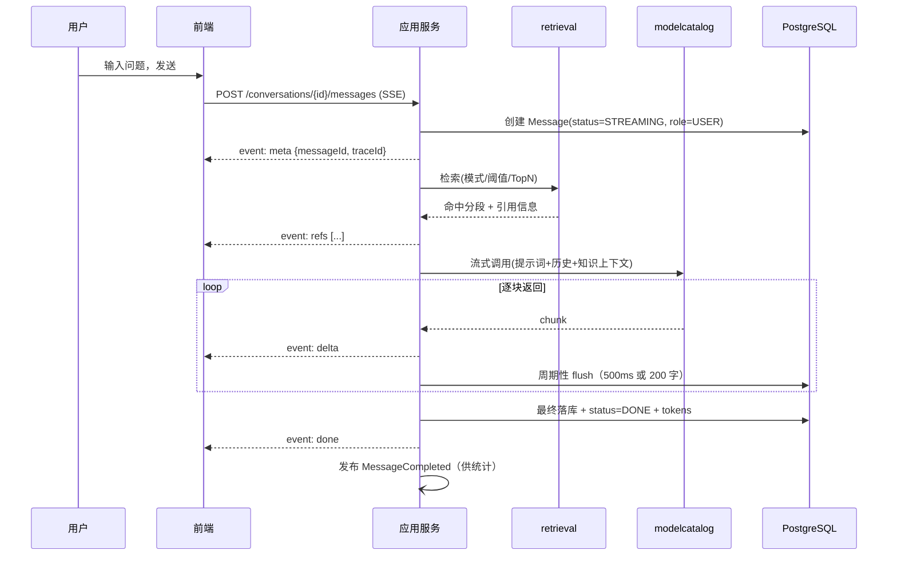
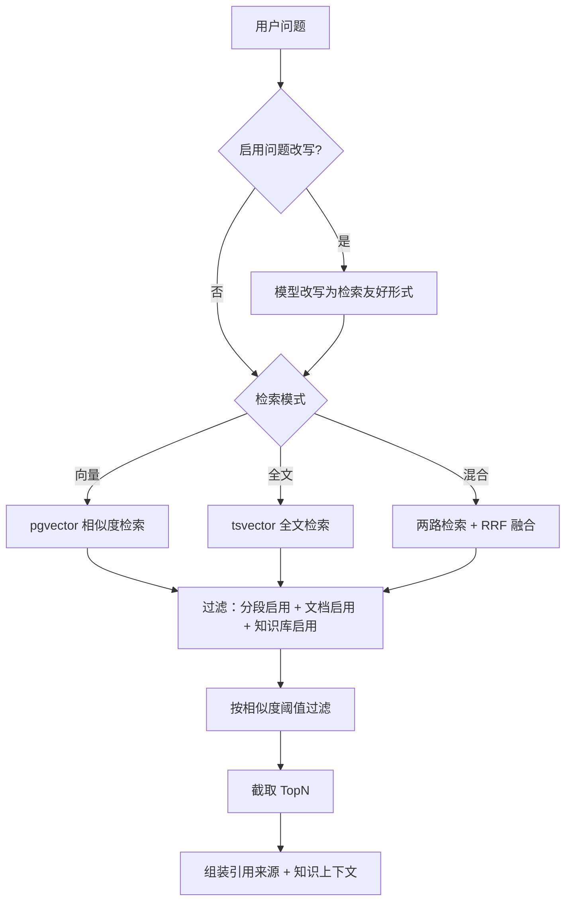
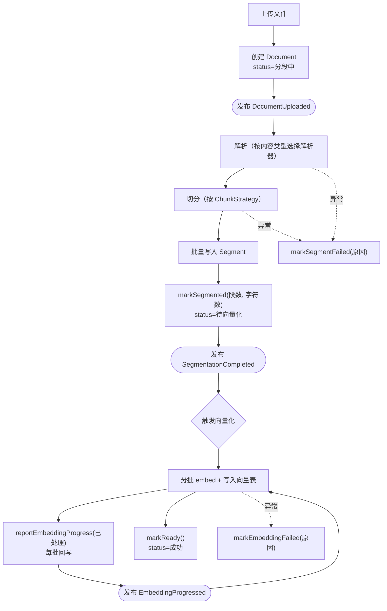
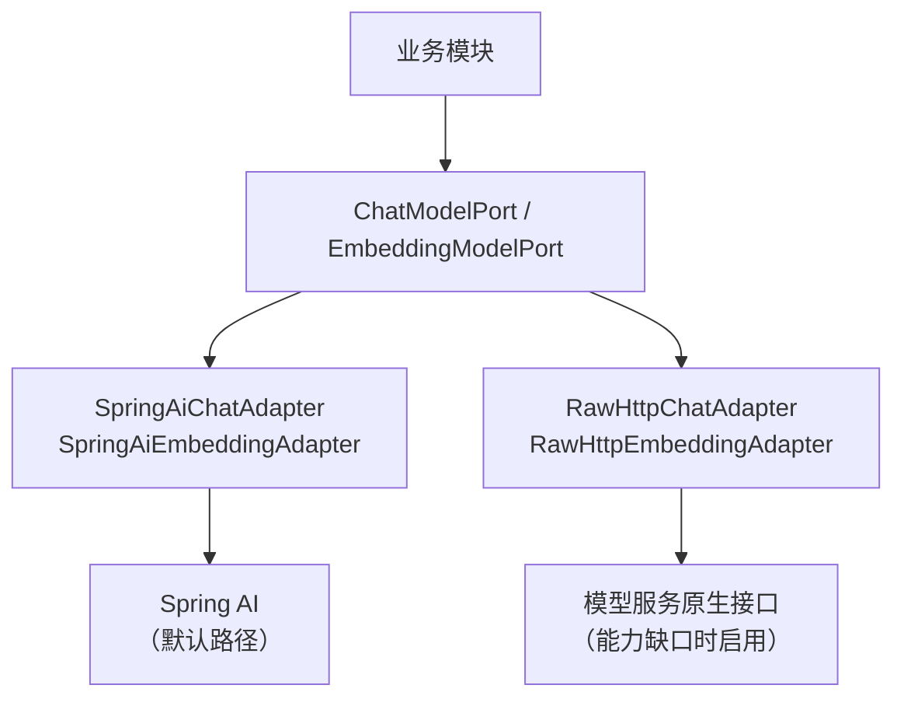
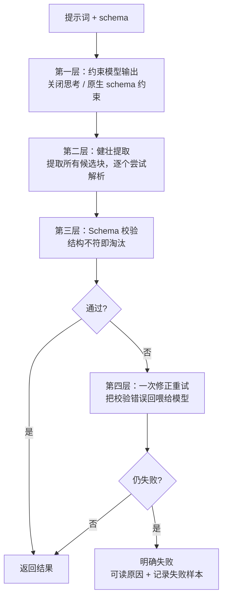
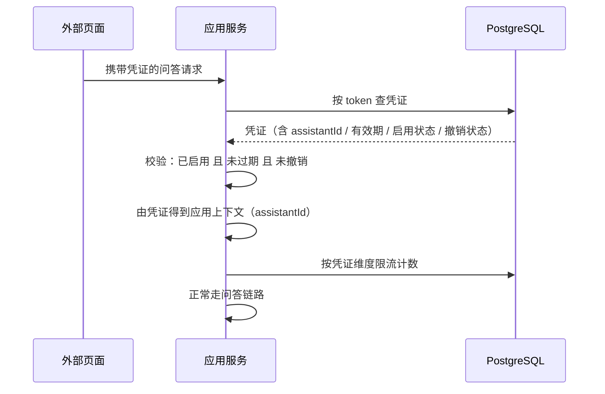

# 03 · 关键机制设计

> 本册覆盖八个"设计得好与坏会决定产品成败"的机制。每个机制都遵循同一思路：**先说明原项目在这里踩了什么坑，再给出设计。**

---

## 机制一 · 流式问答链路

### 1.1 原项目的坑

| 坑 | 后果 |
|---|---|
| 三套流式实现并存（事件源库、手写流解析、原生 fetch 流） | 同一件事三份代码，改一处漏两处 |
| 引用来源、生成物混在文本流里靠页面各自"猜" | 解析逻辑散落，格式一变就崩 |
| 停止生成后状态语义不清 | 前端无法正确区分"生成完了"和"被停了" |
| 超时只在网关侧放宽，应用侧无统一约束 | 长回答容易被截断 |

### 1.2 协议设计：统一事件类型

**核心改进：把"文本流"升级为"结构化事件流"。** 每个事件有明确类型，前端不做任何猜测。

```
event: meta
data: {"messageId":"...","conversationId":"...","traceId":"...","model":"..."}

event: refs
data: {"references":[{"index":1,"segmentId":"...","title":"...","docName":"...",
                      "baseName":"...","score":0.83,"rank":1}]}

event: delta
data: {"text":"根据"}

event: delta
data: {"text":"文档规定…"}

event: artifact
data: {"type":"suggestions","payload":{"items":["...","..."]}}

event: done
data: {"status":"DONE","tokens":{"prompt":820,"completion":340,"total":1160},
       "durationMs":4210,"finishReason":"stop"}

# 出错时
event: error
data: {"code":"MODEL_UNAVAILABLE","message":"模型服务无响应，请稍后重试","retryable":true}
```

| 事件 | 时机 | 用途 |
|---|---|---|
| `meta` | **连接建立后立即** | 前端一上来就拿到 `messageId`，**这是能"停止""重生成"的前提**；同时带回 `traceId`，便于用户报障 |
| `refs` | 检索完成后、生成开始前 | 引用来源先到，用户**边看答案边能点击引用** |
| `delta` | 持续 | 增量文本 |
| `artifact` | 生成过程中或结束时 | 推荐问题、图表等（V1.1） |
| `done` | 结束 | 用量与耗时 |
| `error` | 异常 | **含 `retryable` 标识**，告诉前端"该不该提供重试按钮" |

> **这套事件类型是可扩展的，这正是它的价值。** 后续引入工具调用（V1.0）时，只需**新增一种 `tool` 事件**（用于告知前端"模型正在调用某工具""工具返回了什么"），**不需要改动既有的 meta/refs/delta/done 语义**，前端也只需为新事件类型加一个渲染分支。
>
> 对比原项目"把引用和产物混在文本流里靠页面各自猜"的做法——**协议本身的扩展性，决定了后续功能能否低代价接入。**

> **`meta` 事件是最容易被忽略但最有价值的一个设计。** 原项目前端在流式过程中拿不到消息 ID，导致"停止"和"重新生成"必须等生成结束才能操作。**先发 meta，这两个操作就能在生成中随时可用。**

### 1.3 时序



### 1.4 落库策略：周期性 flush

**问题**：流式生成的每个 chunk 都写库会造成写放大；完全不写则崩溃或刷新会丢内容。

**方案**：**周期性 flush，取时间与长度的先到者。**

| 参数 | 建议值 | 权衡 |
|---|---|---|
| 时间间隔 | 500ms | 太长→丢内容多；太短→写放大 |
| 累积字符数 | 200 字 | 长回答时控制 DB 压力 |

| 场景 | 行为 |
|---|---|
| 生成中用户刷新页面 | 拉到 `status=STREAMING` 的消息，**已生成内容可见**，提示"生成已中断" |
| 生成中服务重启 | 同上。消息停留在 `STREAMING`，由定时任务标记为 `ERROR`（超过一定时长未更新） |
| 正常结束 | 最终 flush → `DONE` |
| 用户点停止 | flush → `STOPPED`，**内容保留** |

### 1.5 停止生成：显式接口 + 连接断开兜底

**两条路径都要有：**

| 路径 | 触发 | 处理 |
|---|---|---|
| **显式停止** | 前端调 `POST /messages/{id}/stop` | 服务端取消模型调用 → flush → `STOPPED` |
| **连接断开** | 客户端关闭/网络中断 | 服务端感知输出流异常 → 同样 flush → `STOPPED` |

> **为什么强调"显式接口"**：只靠连接断开是不行的——连接断开可能发生在网络抖动时，而用户意图其实是"继续等"。**显式停止表达的是用户意图，连接断开只是故障信号。两者要区分。**

### 1.6 超时与保活

| 项 | 设计 |
|---|---|
| 首字超时 | 从发起到第一个 chunk，超过阈值（如 60s）判为失败并给出可读错误 |
| 总时长超时 | 整体上限（如 10 分钟），防止无限生成 |
| 心跳保活 | **每 20s 发送注解行**（`: keep-alive`），防止反向代理判定连接空闲而切断 |
| 网关超时 | 反向代理对 SSE 路径单独放宽（原项目设为 600s，本方案建议同时配置应用侧上限，两侧一致） |

> **心跳这一条容易被漏**：SSE 连接在生成间隙（尤其模型"思考"时）可能长时间无数据，很多反向代理会在默认 60s 后切断。**表现为"偶发的中途断开"，且很难复现定位。**

---

## 机制二 · RAG 检索链路

### 2.1 三种检索模式

| 模式 | 实现 | 适用 |
|---|---|---|
| **向量检索** | pgvector 余弦相似度 + HNSW 索引 | 自然语言提问，语义相近即可命中 |
| **全文检索** | PostgreSQL `tsvector` + `ts_rank`（**用生成列 + GIN 索引**） | 专有名词、编号、精确措辞 |
| **混合检索** | 向量与全文**用 RRF 融合** | 通用场景的推荐值 |

### 2.2 混合检索为什么用 RRF

**RRF（Reciprocal Rank Fusion，倒数排名融合）** 的基本做法是把两路结果的**排名**做倒数加权求和：

```
score(d) = Σ  1 / (k + rank_i(d))        k 取常数（通常 60）
```

| 为什么选它 | 说明 |
|---|---|
| **不需要分数归一化** | 余弦相似度是 0–1，全文检索的 `ts_rank` 是无界值，直接加权毫无意义。RRF 只看排名，天然免疫量纲问题 |
| **不需要调权重** | 加权求和需要一个"向量占 0.7 还是 0.6"的超参数，而这个参数只能靠试。RRF 没有这个负担 |
| **实现极简** | 一条 SQL 就能完成（两路 CTE + 排名 + 求和） |
| **鲁棒** | 对单路的异常结果不敏感 |

> **这是一个"用简单方法解决复杂问题"的典型**。原项目的混合检索设计不透明，运营人员无法解释"为什么这条命中了"。RRF 可以一句话说清楚：**"在两种检索里都排得靠前的，总体排最前。"**

### 2.3 检索流程



**校验规则：**

| 规则 | 说明 |
|---|---|
| 三个层级的启用状态都要检查 | 知识库停用 / 文档停用 / 分段停用 → 都不参与检索 |
| 阈值过滤在 TopN 之前 | 否则会出现"取了 10 条但都不达标"的情况 |
| 去重 | 同一分段可能被向量与全文同时命中（混合模式下），需去重 |
| 引用编号连续 | 引用编号从 1 开始连续，便于模型引用与用户点击 |

### 2.4 知识上下文的拼装

```
系统提示：
你是{应用名}。{角色设定}
请严格依据以下资料回答，并在引用处标注编号，如 [1]。
若资料中没有相关信息，{按无引用策略：直接说明未找到 / 可自由回答}。

资料：
[1] {分段1内容}
[2] {分段2内容}
...

用户问题：{问题}
```

| 设计点 | 说明 |
|---|---|
| **引用编号显式要求** | 明确要求模型用 `[n]` 标注，输出才可解析出"哪句依据哪段" |
| **单分段字符上限** | 由 `MaxChars` 控制，同时受模型上下文窗口约束（**总拼装长度也要检查**） |
| **上下文总长度守卫** | 拼装后若超过模型上下文窗口，**按引用相关度从低到高裁剪**，并记录告警（不是静默截断） |
| **无引用策略可配** | "拒答"适合严谨场景（法规、财务）；"自由回答"适合开放咨询 |

> **"上下文总长度守卫"是新增的一层保护。** 原项目只约束了单分段长度，但如果 TopN=10 且每段都很长，总长仍会超出模型窗口——**而模型会静默丢弃中间内容**（典型的"lost in the middle"现象），表现为"答案忽略了某条资料"。这里显式裁剪并告警，让问题可见。

> ★ **本机制只回答"怎么检一次"。** "**检几次、检什么、什么时候停、失败了怎么退**"
> （问题改写与扩展、多问题分解与**配额合并**、多跳迭代、上下文配额分配、预算与降级阶梯）
> 见 **[`10-RAG-检索策略设计.md`](10-RAG-检索策略设计.md)** ——
> **本机制的所有规则（三级过滤 / 阈值先于 TopN / 去重 / 长度守卫）一条都不变**，
> `10` 只是在它外面包一层策略。做检索时**两册一起读**：本册定形状，`10` 定次数与退路。

---

## 机制三 · 异步入库流水线

### 3.1 原项目的坑

| 坑 | 后果 |
|---|---|
| 进度条是前端 `Math.random()` | 用户无法判断该不该等、是否卡住 |
| 失败原因字段存在但从不展示 | 排障必须翻日志 |
| 列表轮询代码写好但被注释 | 上传后必须手动刷新 |
| 没有幂等设计 | 事件重投或重复点击会造成重复向量 |

### 3.2 流水线设计



### 3.3 幂等设计（事件至少一次投递的前提）

模块间用出站事件表保证"至少一次投递"，**意味着消费者可能收到重复事件**。消费端必须幂等：

| 环节 | 幂等手段 |
|---|---|
| 解析 + 切分 | **以文档状态为幂等键**：仅当 `status=分段中` 时才执行；已完成则直接跳过 |
| 分段写入 | 先删除该文档的旧分段再写入（重跑安全）；或按 `(documentId, ordinal)` 唯一约束 upsert |
| 向量写入 | **`segment_id` 是向量表主键** → 天然 upsert 幂等 |
| 进度回写 | `processedSegments` 用**覆盖写**而非累加（累加会在重投时翻倍） |
| 完成标记 | 仅当 `status=向量化中` 时才置为成功 |

> **`processedSegments` 必须覆盖写而不是 `+= 1`**，这是一个非常容易写错的地方：单次执行看起来完全正确，只有在事件重投时才暴露为"进度变成 200%"。

### 3.4 真实进度的实现

**进度数据全部来自后端事实，前端只负责展示：**

| 展示项 | 数据来源 |
|---|---|
| 当前阶段 | `Document.status` |
| 已完成段数 / 总段数 | `processedSegments` / `segmentCount` |
| 失败原因 | `failReason` |
| 整体进度 | 由后端聚合：已完成文档数 / 总文档数（沿用第四梯队"阶段+计数"的设计） |

**前端轮询策略：**

| 规则 | 说明 |
|---|---|
| 仅在有进行中任务时轮询 | 全部完成即停止，避免无意义请求 |
| 间隔 2 秒 | 进度回写本身是批级的，更快没有意义 |
| 页面不可见时暂停 | 监听可见性变化，切回来立即刷新一次 |
| 失败退避 | 请求失败时拉长间隔 |
| 始终提供手动刷新 | 兜底 |

### 3.5 失败恢复

| 能力 | 说明 |
|---|---|
| **重试单个文档** | 从失败阶段继续（分段失败→重新分段；向量失败→重新向量化） |
| **批量重试** | 一键重试当前知识库所有失败文档 |
| **分段级重试** | 若仅部分分段向量失败（`embedding_status <> EMBEDDED`），只重试这些 |
| **失败原因可见** | 列表与详情都显示 `failReason` |
| **失败样本留存** | 解析失败的原始文件与异常摘要保留一段时间，便于定位 |

> **"分段级重试"是一个实用的细节**：一次处理 500 个分段，其中 3 个因模型偶发超时失败。若只能整篇重试，要重跑 497 个已成功的分段。**按 `embedding_status` 筛选未完成的分段重试，代价从分钟级降到秒级。**

---

## 机制四 · 模型接入

> 这是 ADR-04 的落地。**本机制是整套方案中最重要的一个**——它直接针对原项目两个最顽固的故障源。
>
> **框架选型（已修订）**：AI 能力调用采用 **Spring AI**，但**业务模块只依赖下面的端口，不依赖 Spring AI**。端口是解决问题的那一层，框架只是默认的实现方式。

### 4.1 端口设计

```java
// modelcatalog 对外暴露（业务模块只依赖这一层）

public interface ChatModelPort {
    ChatStream open(ChatRequest request);
    interface ChatStream extends AutoCloseable {
        Stream<ChatChunk> chunks();
        void cancel();                     // 停止生成
    }
}

public record ChatRequest(ModelId modelId, List<ChatTurn> turns, ChatOptions options) {}

public record ChatOptions(
    Double temperature,
    Integer maxTokens,
    boolean think,          // ★ 是否输出思考过程
    JsonSchema format       // ★ 结构化输出约束（可空）
) {}

public interface EmbeddingModelPort {
    List<float[]> embed(ModelId modelId, List<String> texts);
    int dimension(ModelId modelId);        // ★ 显式声明维度
}
```

### 4.2 端口的实现策略：Spring AI 为主，原生接口兜底



| 策略 | 说明 |
|---|---|
| **默认走 Spring AI** | 绝大多数调用用框架实现，享受其流式、重试、可观测等能力 |
| **能力缺口时局部绕过** | 若 M0 核实发现某项能力（关闭思考 / 下发维度）框架不支持，**只在该调用点走原生接口适配器**，其余调用不受影响 |
| **由配置决定走哪条路** | 每个端口实现按其能力声明选择路径；**业务代码完全无感知** |
| **两条路可共存** | 同一进程内，对话走框架、向量走原生，或反之，都是允许的 |

> **这个结构是对原项目教训的直接回应。** 原项目的问题不是"用了框架"，而是**框架不支持某项能力时，整个链路被困住了**——因为业务代码直接依赖框架类型，没有中间层可以插入绕行方案。加了这层端口，**框架能力缺口从"产品缺陷"降级为"一个适配器里的 if 分支"**。

### 4.3 三个显式控制点（原项目的痛点）

> 以下三点**无论走框架还是走原生接口，都必须保证参数可控**。这是 M0 阶段能力核实的直接目标。

#### 控制点 1 · 思考模式：由模型能力决定，而非平台一刀切

**这件事必须拆成两层看**，混在一起是原项目出问题的原因之一：

| 层 | 它是什么 | 由谁决定 | 落在哪里 |
|---|---|---|---|
| **第一层 · 模型能力** | 这个模型**有没有**思考模式？**能不能**关掉？ | **模型自身的事实** | `Model.ThinkingCapability` 声明（见 02 册 M-I3～M-I6） |
| **第二层 · 参数下发** | 框架能否把这个参数**传到**模型 | 传输实现的能力 | 端口 → 适配器映射；框架不支持时走原生适配器 |

> 原项目把两层混成了一个平台级问题（"框架能不能关"），结果是**所有模型一刀切**：既无法针对无思考模式的模型隐藏无意义的开关，也无法阻挡"关不掉思考"的模型进入结构化生成。

**第一层的设计（核心）：能力决定业务是否可用**

| 模型能力 | 含义 | 应用侧"启用思考"开关 | 是否准入结构化生成 |
|---|---|---|---|
| `NONE` | 无思考模式（如 instruct 版） | **不展示**——该开关无意义 | ✅ 准入 |
| `TOGGLEABLE` | 有思考模式，可开关 | **展示且可切换** | ✅ 准入（生成时强制关闭） |
| `ALWAYS_ON` | 有思考模式，无法关闭 | **展示但只读为"开启"**，不可关 | ⛔ **禁止**（M-I5） |

| 规则 | 说明 |
|---|---|
| **能力是声明，不是选择** | 模型配置声明事实；业务侧只能在事实允许的范围内选择。**做不到的事不应该出现在选项里** |
| **无能力则该配置不存在** | `NONE` 模型下，应用配置里根本没有"启用思考"这一项（M-I4） |
| **能力不足则准入被拒** | `ALWAYS_ON` 模型用于结构化生成时，**在配置与发布两处校验**，明确提示原因（M-I5） |
| **换模型需重新校验** | 应用从 `TOGGLEABLE` 换到 `NONE` 模型时，原有的"启用思考"配置随即失效，需重新确认 |

**第二层的设计：参数下发**

| 项 | 内容 |
|---|---|
| **本方案** | 通过端口**显式传 `think` 参数**；在适配器层映射到所选实现（Spring AI 选项 / 原生请求体） |
| **若框架不支持下发** | ① 该调用点走原生接口适配器；② 优先改用无思考模式的模型，从源头规避 |
| **M0 核实** | ① **能力探测**：发请求确认模型的实际思考行为（用于确定三态取值）；② **传输核实**：确认框架能否把该参数传到模型 |

> **把"能力探测"与"传输核实"分开做，是这次设计细化的直接收益**：
> - 探测回答"**这个模型是什么样**" → 写入模型配置，长期有效；
> - 核实回答"**这条链路能不能传这个参数**" → 是框架能力问题，只影响实现路径。
>
> 即使框架完全支持下发参数，**我们仍然需要知道每个模型的真实能力**——否则界面无法正确呈现开关，领域层也无法做准入校验。

#### 控制点 2 · 显式下发向量维度

| 项 | 内容 |
|---|---|
| **原项目问题** | 框架只实现了读取维度，**没有下发维度的方法**。导致换向量模型必然维度不匹配，必须删表重灌 |
| **本方案** | embedding 请求**显式带 `dimensions`**；`ModelDescriptor` 显式声明维度 |
| **启动即校验** | 应用启动时校验：**已注册向量模型声明的维度，必须与向量表维度一致**。不一致则**启动失败并给出明确指引**，而不是等到运行时才报错 |
| **运行时校验** | 每次写入向量前，校验返回向量的实际长度与表维度一致 |

> **"启动即失败"是一个重要设计选择。** 维度不匹配这类问题，**让它早点失败比晚点失败好得多**：启动时失败，部署人员立刻看到明确原因；运行时失败，则是用户提问时报错，排查成本高十倍。

#### 控制点 3 · 结构化输出约束

| 项 | 内容 |
|---|---|
| **本方案** | 若模型/供应商支持（如 JSON Schema 约束），**优先用原生约束**；不支持则退化为提示词约束 + 健壮解析（机制五） |
| **能力探测** | 模型注册时记录其"结构化输出支持程度"，供调用方选择策略 |

#### 控制点 4 · 工具调用能力（MVP 只声明，V1.0 起启用）

| 项 | 内容 |
|---|---|
| **能力声明** | 模型注册时探测并记录三态：不支持 / 支持 / 支持并行调用（见 02 册 M-I7） |
| **MVP 阶段** | **仅声明与展示**——无调用链路，**且不预留调用接口**（不在请求结构中加工具字段） |
| **V1.0 起** | 作为工具场景的准入条件（M-I8）：不支持工具的模型不进入工具配置候选 |
| **为什么现在只声明不实现** | 工具调用不是"多一个参数"，而是一整个子系统（执行循环、安全边界、审计、可观测）。它的引入**不应动摇 MVP 已定的流式与停止语义**——详见第 06 册的版本论证 |
| **为什么声明要现在加** | 成本只是一个枚举字段，但没有它，将来无法判断"某个模型能否用于工具场景" |

### 4.4 超时、重试与取消

| 场景 | 首字超时 | 总超时 | 重试 | 取消 |
|---|---|---|---|---|
| 流式对话 | 60s | 10min | **不重试**（重试会产生重复输出） | 支持 |
| 向量生成 | — | 30s / 批 | 指数退避重试 3 次 | 支持（批级） |
| 结构化生成 | 60s | 5min | 失败后**一次修正重试**（把错误回喂） | 支持 |

> **流式对话为什么不重试**：已经开始输出后重试，用户会看到重复内容。**首字超时是唯一可以安全重试的时机**——此时还没有任何输出。

### 4.5 供应商适配的组织

```
modelcatalog/
├── domain/
│   ├── Model.java                    聚合根
│   ├── ModelDescriptor.java          模型能力描述
│   │                                 （含：上下文窗口、维度、是否支持关闭思考）
│   └── port/
│       ├── ChatModelPort.java        ★ 端口（业务模块只依赖它）
│       └── EmbeddingModelPort.java   ★ 端口
└── infrastructure/
    ├── springai/                     Spring AI 适配器（默认路径）
    │   ├── SpringAiChatAdapter.java
    │   └── SpringAiEmbeddingAdapter.java
    ├── raw/                          原生接口适配器（能力缺口时兜底）
    │   ├── RawHttpChatAdapter.java
    │   └── RawHttpEmbeddingAdapter.java
    └── router/
        └── ModelPortRouter.java      按能力声明选择走框架还是走原生
```

> **适配器的分工很清晰**：`springai/` 是默认路径，`raw/` 是兜底路径，`router/` 决定用哪一个。**新增一个供应商时，优先在 `springai/` 下加配置（Spring AI 原生支持多家），只有当某供应商的能力框架覆盖不到时才在 `raw/` 下新增适配器。**
>
> 这与初版"为每家供应商手写适配器"相比，**工作量显著更低**——这正是采用 Spring AI 的收益所在。

### 4.6 与初版设计的差别（修订记录）

| 维度 | 初版（自建薄客户端） | 修订版（Spring AI + 防腐层） |
|---|---|---|
| 对话/向量调用 | 全部自己写 HTTP | **Spring AI 实现，原生适配器仅作兜底** |
| 参数控制权 | 完全自控 | 依靠端口 + 适配器映射；**框架有缺口时局部绕过** |
| 多供应商成本 | 每家写一个适配器 | **框架原生支持，配置为主** |
| 团队上手成本 | 需熟悉模型原生协议 | **框架生态熟悉，文档齐全** |
| 唯一硬性前置 | 无 | **M0 必须完成两项能力核实** |

---

## 机制五 · 结构化输出与健壮解析

### 5.1 原项目的坑与成因

**现象**：图表、思维导图、PPT 生成经常失败。

**成因链**：

```
模型输出思考过程
   ↓
思考正文里出现了示例 JSON（"例如：```json {...}```"）
   ↓
平台用非贪婪正则抓取第一个 ```json 块
   ↓
抓到的是示例，不是真实结果
   ↓
JSON 解析失败或结构不对
   ↓
静默失效（用户只看到"没生成"）
```

### 5.2 四层防御



| 层 | 做法 | 关键点 |
|---|---|---|
| 一 | **准入 + 约束**：先用 M-I5 把 `ALWAYS_ON` 的模型挡在生成链路之外；准入的模型按能力处理（`NONE` 天然干净，`TOGGLEABLE` 强制关闭思考）；优先启用模型原生结构化输出 | **从源头减少污染**——最好的一层防御是"不合适的模型进不来" |
| 二 | **提取所有候选 JSON 块，逐个尝试解析** | **取"最后一个能成功解析且通过校验的"，而不是"第一个匹配的"** |
| 三 | 用 JSON Schema 校验结构 | 用结构正确性来筛选候选，而不是靠正则的贪婪/非贪婪 |
| 四 | 失败后把校验错误作为反馈回喂模型，重试一次 | 显著提升成功率；仍失败则**明确报错** |

> **第二层的"取最后一个能解析的"是核心改进。** 原项目的思路是"正则尽量精确"，但**再精确的正则也无法区分"示例 JSON"和"真实结果 JSON"**——它们的语法结构完全一样。
>
> 唯一可靠的判别方式是**语义校验**：哪个块的结构符合我们要求的 schema？所以正确顺序是"先全提取，再逐个校验"。

### 5.3 统一接口与可观测

```java
public interface StructuredGenerator {
    <T> StructuredResult<T> generate(
        ModelId modelId, String prompt, JsonSchema schema, Class<T> type
    );
}

public record StructuredResult<T>(
    T value,                        // 解析成功的结果
    String rawOutput,               // 原始输出，便于排障
    List<String> warnings,          // 例如"首次解析失败，修正重试成功"
    int attempts
) {}
```

**必须暴露的指标：**

| 指标 | 为什么重要 |
|---|---|
| 生成成功率 | 让"模型输出质量"成为一个可监控的数字，而不是靠用户投诉发现 |
| 修正重试成功率 | 衡量第四层的有效性 |
| 失败样本留存 | 用于迭代提示词，是**提升生成质量的正反馈回路** |

> **这是与原项目最大的行为差异**：原项目把失败咽下去了。本方案**把失败变成一个被度量、被留存、被复盘的信号**。

---

## 机制六 · 鉴权与权限

### 6.1 认证

| 项 | 设计 |
|---|---|
| 令牌 | JWT：访问令牌（短，30 分钟）+ 刷新令牌（长，7 天） |
| 刷新 | 刷新时**轮换刷新令牌**（防止旧刷新令牌被长期盗用） |
| 前端处理 | 401 时静默刷新并重放原请求，**仅重试一次**；二次失败清空登录态并跳登录页 |
| 密码存储 | 强哈希（BCrypt/Argon2） |
| 登录方式（MVP） | **仅账号密码**。手机号、社交、SSO 均推迟（见第 06 册） |
| 首登强制改密 | 内置管理员首次登录必须改密 |

> **"仅账号密码"是刻意的减法。** 每多一种登录方式，就多一组回调地址、一套异常处理、一类边界测试。内网私有化部署场景下，账号密码就够了。

### 6.2 授权：权限点模型

| 项 | 设计 |
|---|---|
| 权限点命名 | `<资源>:<操作>`，如 `knowledge:create`、`knowledge:document:upload`、`assistant:publish` |
| 权限点定义 | **代码中的常量枚举**，启动时幂等同步到数据库 |
| 后端校验 | **Spring Security 官方能力**：方法级 `@PreAuthorize("hasAuthority('knowledge:create')")` + 端点级 `AuthorizationManager`。**不自研注解与 AOP**。落地方案与责任链组成见 `08 §4.2 / §4.3` |
| 前端校验 | 登录时下发权限点列表，用指令 `v-permission` 控制按钮显隐 |
| 角色 | 角色 = 权限点集合；用户 = 角色集合 |

> **权限点放代码，是对原项目一个重要修正。** 原项目把菜单与按钮权限放数据库，后果是：**上线新功能时必须有人手工配菜单、配按钮权限，忘配就是"功能存在但没人看得见"**——这正是"业务菜单树不在交付 SQL 里"那个复现障碍的根源。
>
> 权限点在代码里定义、启动时同步后，**新增功能时权限点自动出现**，只需要把它分配给角色。

### 6.3 数据权限（MVP 的取舍）

| 方案 | 说明 |
|---|---|
| **MVP 采用**：全部登录用户可见全部数据 | 简单、可预测，符合"先验证核心链路"的目标 |
| V2 再引入 | 按创建人/部门的数据范围过滤（对应原项目的数据权限模块） |

> **为什么 MVP 不做数据权限**：它是一层横切能力，会渗透到每一个查询。**在核心链路还没验证通之前引入它，会让每次调试都多一个变量。** 而且它不影响领域模型——`createdBy` 字段本来就有，将来加过滤条件即可。

### 6.4 免登录场景（公开链接与嵌入）



| 设计点 | 说明 |
|---|---|
| **上下文由凭证决定** | 客户端**不能**通过参数指定应用或租户。这从根本上消除了原项目"硬编码默认租户导致读到错误数据"的隐患 |
| 校验三要素 | 启用、未过期、未撤销（撤销是终态，不可重启用） |
| 限流 | **按凭证维度限流**，防单凭证滥用；也便于定位是哪个渠道在超量 |
| 访问计数 | **异步更新**，不阻塞问答主链路 |
| 缓存 | 凭证校验结果可短缓存（如 30s），但**撤销必须能快速生效** → 撤销时主动清缓存 |

> **"撤销必须快速生效"是个容易被忽略的细节。** 如果凭证校验结果被缓存 5 分钟，那"撤销"这个动作就要等 5 分钟才真正生效——**而撤销恰恰发生在怀疑泄露的紧急时刻**。方案是撤销时主动失效缓存。

### 6.5 权限矩阵（MVP）

| 权限域 | 知识运营 | 应用配置 | 普通用户 | 管理员 |
|---|---|---|---|---|
| 知识库管理 | ✓ | 只读 | — | ✓ |
| 文档上传与加工 | ✓ | — | — | ✓ |
| 分段治理与命中测试 | ✓ | 只读 | — | ✓ |
| 应用配置与发布 | — | ✓ | — | ✓ |
| 问答 | ✓ | ✓ | ✓ | ✓ |
| 反馈查看与处理 | ✓ | — | 仅提交 | ✓ |
| 模型管理 | — | — | — | ✓ |
| 账号与权限 | — | — | — | ✓ |
| 运营看板 | 只读 | 只读 | — | ✓ |

---

## 机制七 · 可观测

### 7.1 追踪

| 项 | 设计 |
|---|---|
| traceId | 入口生成（或从请求头继承），贯穿**含异步链路**（通过 MDC + 事件携带） |
| **流式链路的特殊处理** | traceId **随 `meta` 事件返回给前端**，用户报障时可直接提供 |
| 事件链路 | 领域事件携带发起方的 traceId，异步处理日志可与原始请求关联 |

> **"异步链路要传递 traceId"是模块化单体里最实用的一个可观测要求。** 入库流水线是异步的，若 traceId 在跨线程时丢失，"上传失败"的日志和"上传请求"的日志就断成了两截。

### 7.2 指标

| 指标 | 类型 | 为什么重要 |
|---|---|---|
| **首字延迟** | 直方图 | **用户感知的核心指标**，比总耗时更重要 |
| 生成总耗时 | 直方图 | 容量规划 |
| 生成中断率 | 计数器比例 | 反映模型服务稳定性 |
| 检索命中数 | 直方图 | **反映知识库覆盖质量**——命中数长期偏低说明知识库需要补充 |
| 结构化输出失败率 | 计数器比例 | 模型输出质量的直接度量 |
| 入库各阶段耗时 | 直方图 | 定位流水线瓶颈（解析慢还是向量化慢） |
| 向量化吞吐 | 计数率 | 段/秒，用于评估批量参数 |
| 凭证调用量 | 计数器（按凭证维度） | 发现异常调用来源 |

### 7.3 日志

| 项 | 设计 |
|---|---|
| 格式 | 结构化 JSON，便于检索与聚合 |
| 关键字段 | traceId、userId、module、operation、durationMs、outcome |
| 敏感信息 | **令牌、密钥、密码一律不落日志**；分段内容按需记录（默认不记，避免日志膨胀与信息泄露） |
| 用户可见的错误 | 业务异常带"可读原因 + 错误码"，前端直接展示；技术异常只记日志，前端展示通用提示 |

### 7.4 健康检查

| 检查项 | 说明 |
|---|---|
| 应用存活 | 标准健康端点 |
| 数据库 | 连接 + 迁移状态 |
| 模型服务 | 可达性 + **模型是否已加载** |
| **向量维度一致性** | 已注册向量模型维度 vs 向量表维度 |
| 磁盘（文件存储） | 可用空间（入库会持续占用） |

---

## 机制八 · 文件与对象存储

| 项 | 设计 |
|---|---|
| 抽象 | `FileStorePort`（端口在 `platform`，MVP 适配本地磁盘） |
| 存储键 | 按日期与哈希分目录，避免单目录文件过多 |
| 上传方式 | 先落临时位置 → 校验（类型、大小）→ 移入正式位置 → 创建业务记录 |
| 大小限制 | 单文件上限由配置提供（对齐原设计的 100MB） |
| 类型校验 | **校验真实内容类型而非仅扩展名**（防止改扩展名绕过） |
| 清理 | 业务记录删除后，文件进入延迟删除队列（避免误删无法恢复）；定期清理长期无引用的文件 |
| 未来替换 | 换 S3/MinIO 只需新增一个适配器，业务代码零改动 |

> **"先落临时位置再移入"的顺序很重要**：如果先创建业务记录再存文件，存文件失败就会留下一条指向不存在文件的脏记录。**先存后记，失败时无残留。**

---

## 机制汇总：一个问题对应一个机制

| 原项目问题 | 本方案的机制 |
|---|---|
| 三套流式实现、引用靠猜 | 机制一：结构化事件流（meta/refs/delta/done/error） |
| 停止与断开不区分 | 机制一：显式停止接口 + 断开兜底 |
| 中途偶发断开 | 机制一：心跳保活 |
| 混合检索不透明、无法解释 | 机制二：RRF（"两路都靠前的排最前"） |
| 上下文超长被静默丢弃 | 机制二：上下文长度守卫 + 告警 |
| 进度是假的 | 机制三：进度由后端事实回写 |
| 事件重投造成重复向量 | 机制三：幂等设计（覆盖写、upsert、状态守卫） |
| 只能整篇重试 | 机制三：分段级重试 |
| 思考模式污染结构化输出 | 机制四：`ThinkingCapability` 三态能力声明 + M-I5 准入拦截；机制五第一层从源头减少污染 |
| 无法下发维度 → 换模型必崩 | 机制四：显式维度 + 启动即校验 |
| JSON 抓错块、静默失效 | 机制五：四层防御 + 失败可观测 |
| 新增功能忘配权限 → 功能隐形 | 机制六：权限点为代码常量 |
| 免登录读错租户数据 | 机制六：上下文由凭证决定 |
| 撤销不生效（缓存问题） | 机制六：撤销主动失效缓存 |
| 异步链路日志断裂 | 机制七：traceId 跨异步传递 |
| 上传失败留下脏记录 | 机制八：先存文件后记业务 |
| 将来要接工具调用，但模型能力不明 | 机制四控制点 4：`ToolCallingCapability` 三态声明（MVP 起就记录，V1.0 起准入） |
| 将来要接工具调用，但流式协议不支持扩展 | 机制一：事件类型可扩展——**新增一种 `tool` 事件即可，既有语义不变** |
