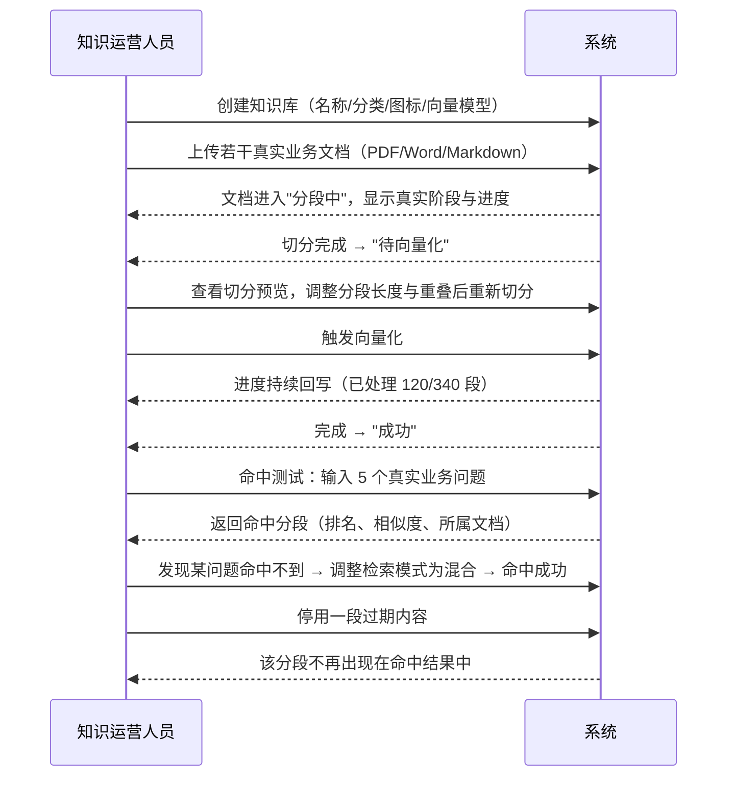
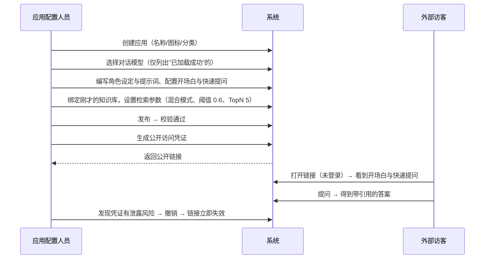
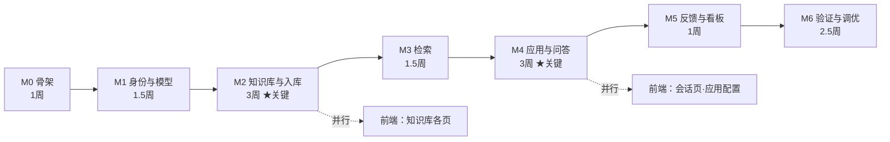
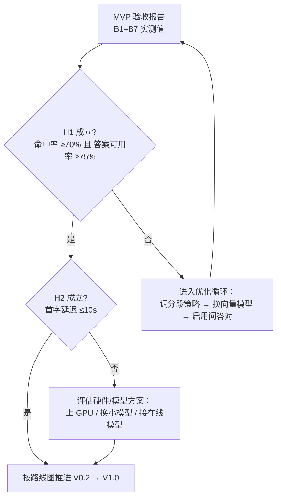

# 04 · MVP 最小验证系统设计

> **本册是整套方案的核心。** 前面三册定义了"系统长什么样"，本册回答"**第一版具体做什么、做到什么程度算成功**"。
>
> **一句话定位**：MVP 不是"功能少的正式版"，而是**用来回答几个关键问题的实验装置**。问题答完了，它的使命就完成了。

---

## 一、MVP 要验证什么

先明确假设，再定范围。**没有明确假设的 MVP，最后一定会变成"什么都要但什么都浅"的正式版。**

### 1.1 三个核心假设

| # | 假设 | 为什么它最不确定 | 若假设不成立，意味着什么 |
|---|---|---|---|
| **H1** | **真实业务语料经自动切分后，能够被检索到并支撑出正确答案** | 这是"RAG 到底行不行"的根本问题。切分粒度、向量模型能力、语料特性三者交互，**无法靠推演得出结论，只能实测** | 整个产品的价值主张不成立。需要换向量模型、改分段策略，甚至需要人工沉淀问答对 |
| **H2** | **本地 CPU 推理的响应速度与答案质量，业务人员能够接受** | 本地部署无 GPU 时，模型规模受限（约 4B）。质量与速度是一对矛盾，**能否接受只有真实用户能回答** | 需要上 GPU、换更大模型、或改为接在线模型——**直接影响部署形态与成本** |
| **H3** | **非技术人员能独立完成"建库 → 导入 → 调优 → 发布"全流程** | 原项目这条链路上有大量隐式知识（什么时候该改分段长度、命中测试怎么读、参数怎么调） | 产品定位需要调整：要么大幅简化流程，要么配套培训与实施服务 |

### 1.2 一个次要假设

| # | 假设 | 验证方式 |
|---|---|---|
| H4 | 模块化单体的边界划分合理，开发效率符合预期 | 在 M2（入库流水线）与 M4（问答链路）两个最复杂的模块上观察：**是否存在"本该属于 A 模块的逻辑被迫放在 B 模块"的频繁纠结**。若频繁发生，说明边界划错了 |

> **H4 值得单独验证的原因**：模块边界这种东西，**在纸上永远是对的**。只有在真正写代码、遇到"这段逻辑该放哪"时，才能暴露问题。早发现可以调，晚了就是一堆补丁。

---

## 二、范围界定

### 2.1 MVP 包含（In Scope）

| # | 能力 | 关键子项 | 优先级 |
|---|---|---|---|
| ① | **账号与权限** | 账号密码登录、令牌刷新、用户与角色管理、权限点校验、按钮权限 | P0 |
| ② | **模型配置** | 模型注册、加载与状态、**能力探测与声明（思考模式三态 / 上下文窗口 / 向量维度）** | P0 |
| ③ | **知识库与文档** | 建库、分类、图标、启停、文档列表与状态、启停、重命名、删除 | P0 |
| ④ | **入库流水线** | 上传（多格式）、解析、切分（含参数调节与预览）、向量化、**真实进度**、**失败原因**、重试 | **P0** |
| ⑤ | **检索与命中测试** | 三种检索模式、参数调节、命中结果展示、引用信息组装 | **P0** |
| ⑥ | **简单应用配置** | 应用 CRUD、提示词与开场白、知识库绑定、检索参数、发布、公开访问链接与凭证 | P0 |
| ⑦ | **问答** | 流式输出、引用溯源、多轮上下文、停止、重新生成、历史会话、附件提问 | **P0** |
| ⑧ | **反馈与用量** | 赞踩（互斥可撤销）、会话评分、基础指标（提问数/用户数/Token/满意度） | P1 |

### 2.2 MVP 不包含（Out of Scope）

**每一条都写明了"为什么现在不做"和"什么时候做"**，避免范围蔓延时无据可依。

| 不做的能力 | 为什么现在不做 | 计划版本 |
|---|---|---|
| **工作流编排** | 原判断是整体后推，理由是"难在工程量大（节点体系、执行引擎、版本、调试），但**不确定性低**——每步都能提前规划清楚，这类'知道怎么做、只是费事'的工作不该占用 MVP"。**但复盘后把这一项拆开了**：难的是**后端执行引擎**，不是配置界面；而产品侧确实需要"简单应用配提示词、复杂应用配流程"两档并存。因此 **配置界面（画布 + 节点面板 + 流程定义存取/校验/发布）进 MVP，执行引擎仍留 V1.0** —— 详见下方 §2.2.1 | **配置界面：MVP** **执行引擎：V1.0** |
| **PPT / 思维导图 / 图表生成** | 它是"结构化输出能力"的消费者，不是验证对象。顺序应该是先做好结构化输出的基础设施（已在机制五设计），再上三个产物 | **V1.1** |
| **在线爬虫** | 知识采集是"知识进得来"的补充路径。MVP 优先验证"进来的知识能不能用" | **V1.2** |
| **工具调用（函数调用）** | 它不是"多一个参数"，而是一整个子系统：执行循环、参数校验、**安全边界（平台将代用户调用外部系统）**、审计、可观测。更关键的是它会让问答链路**从线性变成循环**，动摇 MVP 已定的流式与停止语义。**MVP 要验证的是"知识能不能用"，与工具无关** | **V1.0（随编排）** |
| **MCP 接入** | MCP 是工具的**供给渠道**之一，不是与工具调用并列的能力——**必须先有工具调用**。因此必然晚于 V1.0 | **V1.2（外部接入）** |
| **多租户** | 当前是单客户内网私有化部署，SaaS 能力是为不存在的需求付出的复杂度 | **V2.0** |
| **多模型供应商** | 内网离线场景只用本地模型。保留供应商适配端口（机制四），未来新增适配器即可 | **V2.0** |
| **分享链接撤回 / 过期** | 属"可信化"范畴，不影响核心验证 | **V0.2** |
| **反馈处理闭环（状态流转、指派）** | 同上 | **V0.2** |
| **迁移回滚（回收站）** | 同上 | **V0.2** |
| **知识图谱** | 依赖后端实体抽取质量（不确定），且是只读展示，**不参与问答主链路**。在 H1 未验证前投入它是本末倒置 | **V0.2** |
| **数据权限（按部门/人员过滤）** | 横切能力，会渗透每个查询。核心链路未验证前引入，会让每次调试多一个变量 | **V2.0** |
| **手机号 / 社交 / SSO 登录** | 内网场景账号密码足够；每种登录方式都要一套回调与异常处理 | **按需** |
| **短信 / 报表 / 代码生成等基座模块** | 与业务无关，自建方案里根本不存在这些包袱 | **不做** |

### 2.2.1 工作流编排：配置界面进 MVP，执行引擎留 V1.0

原判断把编排整体后推。复盘后拆开：**难的是后端执行引擎，不是配置界面**；而产品侧确实需要两档并存的能力。所以：

| | 进 MVP | 留 V1.0 |
|---|---|---|
| **内容** | 画布编辑器、节点配置面板、流程定义存取、发布前校验、版本与回滚、画布内调试、流程记录列表 | **后端执行引擎**、工具调用、条件分支的运行时判定 |
| **为什么能拆** | 只要**流程定义格式先冻结**，配置界面就能独立落地、独立验收 | 执行引擎涉及运行时循环、并发、超时、审计，与 MVP 要验证的"知识能不能用"无关 |
| **验收口径** | 能画出流程、能存草稿、能校验、能发布出带版本的流程；**mock 只跑线性流程**（开始 → AI 对话 → 指定回复）以证明形态可用 | 编排应用能真正按图执行，含条件分支 |

**两档应用类型**（这是本次拆分的直接产物）：

| 类型 | 配置面 | 适用 |
|---|---|---|
| **简单应用** | 提示词约束 + 知识库绑定 + 检索参数（见 `api/assistants.ts`） | 绝大多数场景 |
| **编排应用** | 画布式流程（见 `api/workflow.ts`） | 需要多步、分支、条件判断的场景 |

`Assistant.type` **创建时选定，之后不可更改** —— 改类型等于换了一个应用，应新建。

**与旧系统的三处刻意差异**：

1. **不把 10 个幽灵节点带回来，但保留枚举。** 旧系统枚举 17 种节点、只实现 7 种（`function-lib` `function` `reranker` `application` `document-extract` `image-understand` `form` `text-to-speech` `speech-to-text` `image-generate` 均有枚举与图标、无组件）。本设计**保留全部 17 种枚举**，但用 `implemented` 显式标记，未实现的在节点菜单里标注「规划中」且**不可拖拽** —— 保留枚举是为了让规划可见，标记不可拖拽是为了不让界面暗示一个不存在的能力。
2. **旧系统的通用件必须上提。** 旧 `views/workflow/` 共 155 文件 / 17,302 行，其中约 **6,157 行不是编排专用**（`dynamics-form` 动态表单引擎约 3,459 行、markdown 渲染约 558 行、logo/icons 等）。这些应上提到 `src/components/` 共享 —— 否则应用配置、知识库向导都要各抄一份。
3. **节点配置做成类型判别联合**，不再是各自 `config: any`。配置面板与后端都按节点类型收窄，避免"字段名靠口头约定"。

> **流程定义格式已冻结在 `frontend/src/api/workflow.ts`**，后端按它实现引擎与版本管理。改该文件 = 破坏性变更。

### 2.3 一个边界项：问答对（问题-分段关联）

| 项 | 说明 |
|---|---|
| 原项目有 | 人工把"用户会怎么问"与"答案在哪一段"显式绑定，用于提升召准率 |
| **MVP 是否做** | **列为 P2，暂不实现，但数据模型预留**（`kb_question` / `kb_question_segment` 表结构在设计中保留） |
| **决策规则** | **若 H1 验证不达标（命中率低于目标），立即把它提升为 P0** —— 因为它是提升召回最直接的手段 |
| 为什么不默认做 | 它是"补救手段"而非"基础能力"。若切分与向量模型本身够用，人工绑定是多余工作量 |

> **这是一个"用验证结果决定要不要做"的典型设计**。把它放在边界上、并预先写好启用条件，比一开始就做（可能浪费）或完全不做（可能来不及）都更合理。

---

## 三、端到端验证场景

MVP 完成的标志，是**以下三个场景全部走通**。它们同时也是验收测试用例的来源。

### 场景 S1 · 知识运营：把文档变成可检索的知识

**这个场景验证 H1 与 H3。**

### 场景 S2 · 应用配置：把知识发布成问答服务

**这个场景验证 H3，以及免登录链路的安全性。**

### 场景 S3 · 终端用户：问答与反馈

| 步骤 | 期望 |
|---|---|
| 登录 → 进入首页 | 看到智能体列表与输入框 |
| 直接提问（通用问答） | 流式作答，无引用（未挂知识库） |
| 进入某应用提问 | 流式作答，**带引用编号** |
| 点击引用 | 看到分段原文、所属文档、所属知识库 |
| 连续追问 5 轮 | 上下文正确（能指代前文） |
| 生成中点"停止" | 已生成内容保留，状态显示"已停止" |
| 点"重新生成" | 用同一问题重新作答 |
| 点赞 → 取消赞 | 状态正确切换并持久化（刷新后仍在） |
| 上传一份文件后提问 | 附件随消息保存，历史中可见 |
| 提交会话评分 | 管理端可查到 |

---

## 四、页面清单

MVP 需要的页面共 **15 个**（原 14 个 + 编排应用配置）。页面设计详见第 05 册。

| # | 页面 | 所属模块 | 说明 |
|---|---|---|---|
| 1 | 登录页 | identity | 账号密码 + 首登改密 |
| 2 | 问答首页 | conversation | 输入框 + 智能体卡片列表 |
| 3 | 问答会话页 | conversation | **统一会话组件**，支持通用与应用两种模式 |
| 4 | 智能体广场 | assistant | 应用卡片列表 + 分类筛选 + 搜索 |
| 5 | 知识库列表 | knowledge | 卡片式 + 分类筛选 + 启停 |
| 6 | 知识库创建向导 | knowledge + ingestion | 四步骤：基本信息 → 上传文档 → 分段设置 → 导入结果 |
| 7 | 知识库详情 · 文档 | knowledge | 文档列表 + 状态 + **真实进度** + 失败原因 + 重试 |
| 8 | 知识库详情 · 分段 | knowledge | 分段卡片 + 编辑 + 启停 + 批量操作 |
| 9 | 知识库详情 · 命中测试 | retrieval | 三种模式 + 参数 + 命中结果 |
| 10 | 应用管理 | assistant | 列表 + 配置（**按类型分两档**：简单应用配提示词/知识库/检索/发布；编排应用进画布） |
| 11 | 应用概览 | assistant + analytics | 用量指标 + 公开链接与凭证管理 |
| 12 | 模型管理 | modelcatalog | 模型列表 + 引导式添加 + 加载状态 |
| 13 | 系统管理 | identity | 用户 + 角色 + 权限点分配 |
| 14 | 运营看板 | analytics | 简版：提问数 / 用户数 / Token / 满意度 |
| 15 | **编排应用配置（画布）** | workflow | 节点目录（17 种，10 种标「规划中」不可拖拽）+ 画布 + 节点配置面板 + 存草稿/校验/发布/版本回滚 + 画布内调试。**执行引擎不在 MVP**（见 §2.2.1） |

> **注意第 10 项**：应用分**两档**。简单应用只配提示词约束；编排应用进画布。`Assistant.type` 创建时选定、之后不可更改。两档共用应用元信息（名称/图标/发布态/凭证），差异只在配置体 —— 所以应用列表是一个页面，不是两个。

> **注意第 3 项**：MVP 只有**一个**会话页。通用问答与应用问答的差异由**适配器**处理，不是两个页面。这是第 02 册结构收敛设计的直接落地，**也是 MVP 阶段就做对的关键点**——如果这里分成两个页面，后面必然要合并。

> **注意第 6 项**：向导实际是**四步**，比原设计多一步「基本信息」。原设计把建库信息当成向导之外的入口，但原型实现时发现：名称、分类、图标、向量模型这些字段在创建时一次性选定最省事，也最符合「导入类型创建后不可更改」（BR-03-01）这类一次性约束。**以原型为准**，本表已回写。
>
> 向导的「上传文档」步骤里另有一个**「在线抓取」标签页**，属 **V1.2** 能力（见 §2.2）。原型里保留它是为了演示两个入口的**共存形态**（本地与在线最终都汇入同一条入库流水线），并不代表 MVP 交付该项；后端不实现时该标签页应整项隐藏，而不是留一个点了没反应的入口。

---

## 五、功能清单与优先级

| 模块 | P0（必须） | P1（应该） | P2（可选） |
|---|---|---|---|
| identity | 登录、令牌刷新、用户 CRUD、角色 CRUD、权限点校验 | 首登改密、账号锁定 | 注册、审核 |
| modelcatalog | 模型注册、加载、状态、**能力探测与声明（思考三态/窗口/维度）**、按能力约束应用配置可用性 | 重新加载、删除保护（被引用时禁止删）、能力重新探测 | — |
| knowledge | 建库、分类、启停、文档列表、文档启停、重命名、删除 | 文档迁移、导出 | — |
| ingestion | 上传、解析、切分、参数调节、预览、向量化、真实进度、失败原因、重试 | 分段级重试、批量重试 | — |
| retrieval | 三种模式、参数、命中展示、引用信息 | 模式对比 | — |
| assistant | CRUD、**类型两档（简单 / 编排）**、提示词、开场白、知识库绑定、检索参数、发布、公开凭证 | 应用导入导出 | 仿真调试面板 |
| **workflow** | **流程定义存取、节点目录、发布前校验、版本与回滚、画布内调试、流程记录列表** | 流程模板 | 执行引擎（V1.0） |
| conversation | 流式、引用、多轮、停止、重生成、历史会话、附件 | 推荐问题、会话重命名、分享 | — |
| feedback | 赞踩、评分 | 反馈列表（只读） | — |
| analytics | 提问数、用户数、Token、满意度 | 趋势图、应用维度筛选 | — |
| **问答对** | — | — | **P2（H1 不达标时升为 P0）** |

---

## 六、验收标准

> **验收标准必须可量化、可复现。** 下表中的数值是**初始目标**，需在与业务共同准备测试语料后校准。

### 6.1 前置条件：准备测试语料与问题集

| 项 | 要求 |
|---|---|
| 语料 | **不少于 50 份真实业务文档**（不是演示文档），覆盖主要格式（PDF / Word / Markdown），总量不少于 200 万字 |
| 问题集 | **不少于 50 个真实业务问题**，每个问题标注"期望命中的文档与段落" |
| 评审人 | 至少 2 名业务人员，独立评定答案可用性 |

> **这一步不能省。** 用演示数据验证出来的结论没有意义——**RAG 的效果强依赖语料特性**，而演示语料通常过于"干净"。

### 6.2 功能验收

| # | 验收项 | 通过标准 |
|---|---|---|
| A1 | 全链路可走通 | 场景 S1 / S2 / S3 全部无阻塞完成 |
| A2 | 状态真实性 | 任意时刻的进度与状态，与数据库实际状态一致；**刷新页面不重置** |
| A3 | 失败可见 | 人为构造解析失败与向量化失败，界面均展示**可读的失败原因**与重试入口 |
| A4 | 引用可溯源 | 任意一条引用都能展开看到分段原文、来源文档、来源知识库 |
| A5 | 停止与重生成 | 生成中停止能保留已生成内容；重生成使用同一问题 |
| A6 | 多轮上下文 | 连续 10 轮对话，第 10 轮仍能正确指代第 1 轮提到的实体 |
| A7 | 权限生效 | 无权限用户看不到对应按钮，且直接调用接口被拒绝 |
| A8 | 免登录安全 | 撤销凭证后，原链接在 1 分钟内失效 |
| A9 | 架构约束 | 模块边界校验测试通过；越界依赖会导致构建失败 |

### 6.3 量化指标

| # | 指标 | 初始目标 | 测量方式 |
|---|---|---|---|
| B1 | **命中率** | **≥ 70%** | 问题集中，TopN=5 内包含期望分段的比例 |
| B2 | **答案可用率** | **≥ 75%** | 业务人员盲评"回答可用于实际工作"的比例 |
| B3 | 引用准确率 | ≥ 80% | 引用分段确实支撑了答案要点的比例 |
| B4 | **首字延迟** | **≤ 10 秒** | CPU 推理环境（4B 模型），提问到首个 token 出现 |
| B5 | 完整回答耗时 | ≤ 60 秒 | 中等长度回答（约 300 字）的总耗时 |
| B6 | 入库吞吐 | ≥ 3 段/秒 | 向量化阶段的平均速度 |
| B7 | 稳定性 | 连续 200 次问答无未处理异常 | 压测 |
| B8 | 结构化输出失败率（预留） | — | MVP 阶段仅埋点，V1.1 起考核 |

> **B1 与 B2 是整个 MVP 成败的核心指标。** 若这两个指标不达标，**不是"功能没做完"，而是"假设 H1 不成立"** ——此时正确的动作是回到机制二（检索策略）与问答对（P2）上做优化，而不是继续加功能。
>
> **B4 是 H2 的核心。** 首字延迟超过 10 秒，用户会开始怀疑系统卡死。若实测超标，必须评估 GPU 或更小模型。

### 6.4 完成定义（DoD）

一个功能算"完成"需要满足：

| # | 条件 |
|---|---|
| 1 | 功能按设计实现，且**领域不变量在应用层与数据库层都有兜底** |
| 2 | 有对应的自动化测试（领域逻辑单测 + 关键链路集成测试） |
| 3 | 失败路径有可读提示，**不存在静默失效** |
| 4 | 关键操作有日志与指标埋点 |
| 5 | 前端按钮权限已接入权限点 |
| 6 | 模块边界校验测试通过 |
| 7 | 已在真实语料上手工验证过 |

---

## 七、里程碑

> **里程碑的唯一权威版本已移到 [`../ROADMAP.md`](../ROADMAP.md)**（那份是开发计划，本册保留设计理由）。
> 两处与本表不同，以 ROADMAP 为准：
> 1. **本表漏了「编排配置面」的落位** —— §2.2.1 明说配置界面进 MVP，但下表没有给它里程碑。ROADMAP 补为 **M5.5**，
>    因此总工期 **13.5 → 15 周**。
> 2. **M0 不再包含「前端骨架」** —— 前端早已成工程（261 源文件 / 150 `.vue`），该假设已过期。
>
> 另：**M4 被拆成 M4a（应用配置与发布）/ M4b（问答链路）** —— 原 M4 含 35 个端点且含全项目最难的单点（SSE），
> 拆开可让 M4a 与 M3 并行，关键路径从 M2→M3→M4 收紧为 **M2 → M3 → M4b**。

**假设团队规模**：后端 2 人 + 前端 1 人 + （兼）测试 1 人。若人力不同，按比例缩放。

| 里程碑 | 内容 | 交付物 | 预计 |
|---|---|---|---|
| **M0 · 骨架** | 工程骨架、模块划分与边界校验、数据库迁移框架、鉴权框架、CI、本地部署脚本、前端骨架、**Spring AI 接入验证 + 模型能力探测（思考三态/维度）+ 参数下发核实** | 可启动的空系统 + 架构校验测试通过 + **能力探测结论**（各模型三态取值）与**下发核实结论** | 1 周 |
| **M1 · 身份与模型** | 登录、令牌刷新、用户/角色/权限点、模型注册与加载 | 能登录、能注册并加载一个模型 | 1.5 周 |
| **M2 · 知识库与入库** | 建库、上传、解析、切分、预览、向量化、**真实进度**、失败与重试 | **能上传文档并变成可检索的分段** | 3 周 |
| **M3 · 检索与命中测试** | 三种检索模式、参数、引用信息组装、命中测试页 | 能看到命中结果并调参 | 1.5 周 |
| **M4 · 应用与问答** | 应用配置与发布、公开凭证、流式问答、引用、多轮、停止/重生成 | **能问答并看到引用** | 3 周 |
| **M5 · 反馈与看板** | 赞踩、评分、基础指标 | 能收集反馈并看到用量 | 1 周 |
| **M6 · 端到端验证与调优** | 准备语料与问题集、跑指标、调优切分与检索参数、性能调优 | **验收报告（含 B1–B7 实测值）** | 2.5 周 |

**关键路径：M2 → M3 → M4。** 这三段占总量约 60%，且 M2 的进度会直接决定 M4 能否顺利（分段质量影响问答质量）。

### 7.1 里程碑依赖

### 7.2 建议的并行策略

| 并行项 | 说明 |
|---|---|
| 前端页面开发可提前 | 页面结构依赖接口契约，**契约先定好，前后端可并行**（契约见第 05 册） |
| M3 与 M2 存在重叠 | 检索可以在分段表结构定稿后立即开始，不必等入库流水线完全完成 |
| M6 的准备可提前启动 | **测试语料与问题集的准备应尽早开始**（业务人员参与，周期长），建议在 M2 期间就启动 |

> **"尽早准备测试语料"是最容易拖延、代价最大的一件事。** 若等到 M6 才开始准备，会发现业务人员需要两三周才能整理出 50 份文档和 50 个问题——**整个项目会在这里空等。**

---

## 八、风险与应对

| # | 风险 | 影响 | 概率 | 应对 |
|---|---|---|---|---|
| R1 | **本地模型质量不足**（H2 不成立） | 高 | 中 | ① 设计上模型可替换（已支持）；② 准备一个更大模型作为备选；③ **M1 结束后立即做小规模问答试跑**，不要等到 M6 才发现 |
| R2 | **切分质量不达标**（H1 部分不成立） | 高 | 中 | ① 切分参数可调 + 分段可编辑（已在设计中）；② **预留问答对功能（P2）作为补救手段**；③ 在 M2 就用真实文档试切分，不要用演示文档 |
| R3 | 解析质量差（PDF 表格、扫描件、复杂版式） | 中 | **高** | ① 解析器分级：文本型 PDF 直读，复杂版式走更强的解析器；② **MVP 明确不支持扫描件**（需 OCR，属 V1.2 之后）；③ 解析失败给出可读原因并提供替代路径（如人工转 Markdown 后用分段编辑） |
| R4 | 团队对 DDD 不熟，导致过度设计 | 中 | **高** | ① 第 01 册 6.3 已明确"务实的 JPA 妥协"边界；② **聚合只做必要的**，不为每个概念建聚合；③ 代码评审时问一句"这个抽象现在有第二个使用者吗" |
| R5 | Spring Modulith 团队不熟 | 中 | 中 | 在 **M0 阶段专门做技术验证**：跑通模块划分 + 边界校验 + 事件 + 出站事件表，再进入业务开发 |
| **R9** | **模型思考能力探测不准，或 Spring AI 无法下发思考开关参数** | **高** | **中** | ① **M0 完成两件事**：**能力探测**（确定各模型的三态取值）+ **传输核实**（框架能否下发该参数）——不要等到 M4 问答链路才暴露；② 应对手段已内置：探测所得能力写入模型配置，业务侧按能力呈现开关（M-I3～M-I6）；③ 框架不支持下发时，该调用点走原生接口适配器，**端口已隔离，绕过不影响业务代码** |
| R6 | 性能调优超预期（CPU 推理慢） | 中 | 中 | ① MVP 就把性能基线（B4/B5/B6）纳入验收；② 早测早暴露；③ 备选：GPU 或更小模型 |
| R7 | 范围蔓延（"顺便把 XX 也做了"） | 高 | **高** | ① 本册 2.2 的"不做清单"就是挡箭牌；② 任何新增需求走变更流程，**明确记录到哪个版本** |
| R8 | 测试语料准备落后 | 中 | 中 | 在 M2 期间启动语料准备，设专人跟进 |

> **R3（解析质量）的概率被低估了。** 真实业务文档里 PDF 表格与扫描件的比例往往远超预期。**建议在 M0 阶段就拿 10 份真实文档做解析测试**，而不是等到 M2——解析器选型是这个项目里最容易被低估的技术风险。

---

## 九、明确不做的清单（防止蔓延）

以下请求在 MVP 期间**一律拒绝并记录到对应版本**：

| 请求 | 回应 |
|---|---|
| "能不能支持工作流编排？" | **配置界面在 MVP 内**（见 §2.2.1）；**执行引擎在 V1.0**。流程定义格式已冻结，后端可按格式先做引擎 |
| "能不能生成 PPT？" | 在 V1.1 规划内；结构化输出基础设施会在 MVP 阶段打好 |
| "能不能抓取网站内容？" | 在 V1.2 规划内 |
| "能不能按部门隔离数据？" | 在 V2.0 规划内；MVP 采用"全员可见" |
| "能不能接 GPT / 通义？" | 端口与适配器已预留（机制四）；MVP 只做本地 |
| "能不能加审批流程？" | 不在规划内（原项目的通用流程引擎已被判定为无业务价值而裁剪） |
| "能不能做个手机端？" | 不在规划内，需单独评估 |
| "分享链接能不能设密码？" | 属 V0.2 的"可信化"范畴 |

---

## 十、MVP 结束后的决策点

MVP 完成时，基于实测数据做一次**正式的复盘决策**：

| 决策 | 触发条件 | 动作 |
|---|---|---|
| **正常推进** | H1、H2 均成立 | 进入 V0.2（可信化），随后按路线图推进 |
| **优化知识链路** | H1 不成立 | 优先做三件事：调整分段策略 → 评估换向量模型 → **启用问答对（P2 升 P0）** |
| **调整部署形态** | H2 不成立 | 评估 GPU 或接在线模型，会改变部署成本模型 |
| **重新评估产品定位** | H3 不成立（运营人员无法独立完成流程） | 需要考虑大幅简化流程，或明确"实施服务"是交付的一部分 |

> **这个决策点的存在，本身就是 MVP 设计的价值。** 它把"要不要继续投入"变成一个**有数据支撑的判断**，而不是靠直觉或进度压力。
