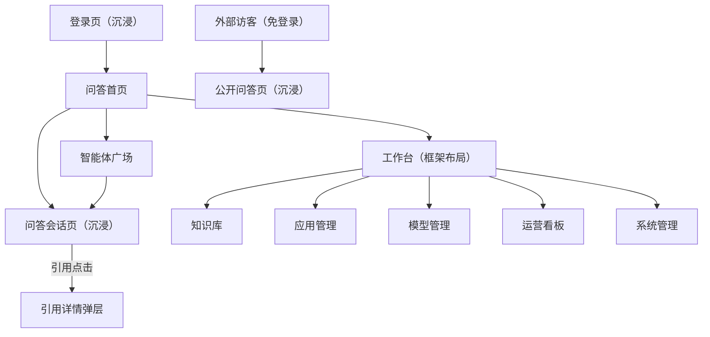
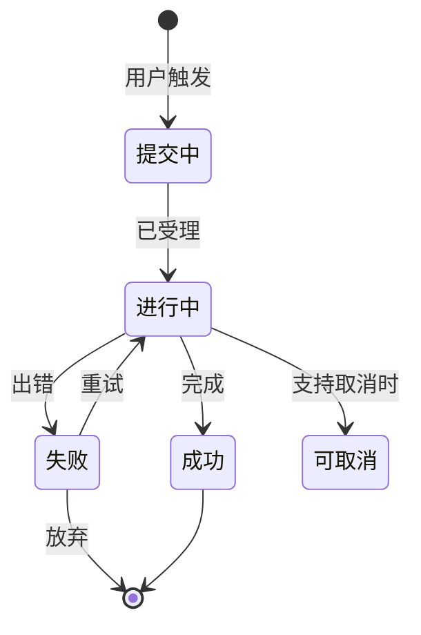

# 05 · 页面与交互设计

> **设计基调**：沿用原项目的观感与元素体系（Element Plus、图标、卡片风格、左侧导航 + 顶部栏 + 内容区），但在**信息结构与交互反馈**上做本方案要求的改进。
>
> 本册的线框是**结构示意**，不是视觉稿。视觉细节沿用原设计。

---

## 一、设计原则

| 原则 | 具体含义 | 反面参照 |
|---|---|---|
| **状态永远真实** | 进度、状态、失败原因全部来自后端事实 | 原项目的随机进度条 |
| **失败必须说话** | 任何失败都在界面上给出可读原因与下一步 | 原项目的静默失效 |
| **一个概念一个页面** | 通用问答与应用问答是**同一个会话页**，不是两个 | 原项目的四份聊天实现 |
| **引用可点、可回溯** | 引用编号可点击，展开看到原文与来源 | — |
| **破坏性操作有退路** | 删除、迁移、撤销都要有确认与回滚说明 | 原项目的迁移不可逆 |
| **窄屏可用** | 问答页在 1280px 宽度下仍完整可用 | — |

## 二、技术选型与元素沿用

| 项 | 选型 |
|---|---|
| UI 组件库 | **Element Plus**（沿用） |
| 图标 | **Element Plus Icons + 原项目的 iconfont**（沿用） |
| Markdown 渲染 | **md-editor-v3 的预览组件**（沿用） |
| 图表 | **ECharts**（沿用） |
| 主题色 | Element Plus 默认蓝（沿用） |
| 卡片/圆角/间距 | 沿用原设计的卡片风格（8px 圆角、浅灰背景、细边框） |
| **不用** | 商业基座的 CRUD 模板产物、vuex、第三方事件源库 |

---

## 三、整体布局

### 3.1 两种布局

| 布局 | 适用 | 结构 |
|---|---|---|
| **框架布局** | 管理类页面（知识库、应用、模型、系统管理、看板） | 左侧导航 + 顶部栏 + 内容区 + 面包屑 |
| **沉浸布局** | 问答会话页、登录页、公开分享页 | 无左侧导航，全屏内容 |



### 3.1.1 与实现的两点差异（以原型为准）

线框稿里的导航有两处重复，实现时做了收敛。这两处**以原型的实现为准**，本节记录原因，避免后来者把它当 Bug 修回去。

| 项 | 线框稿 | 原型实现 | 为什么改 |
|---|---|---|---|
| **顶栏一级导航** | 顶栏放「问答 / 知识库 / 应用」 | **顶栏不放一级导航**，只放全局动作（新建、搜索、角色切换）与「去问答」回跳；一级导航只在左栏 | 线框稿里顶栏与左栏各有一套一级导航，同一件事有两个入口。问答页是沉浸布局、本来就没有左栏，从框架布局回问答只需要一个明确出口 |
| **左栏分区** | 一列平铺：知识库 / 应用管理 / 模型管理 / 运营看板 ─ 系统管理 | 三层分组：**问答与知识**（智能体广场、知识库）／**配置与运营**（应用管理、模型管理、运营看板、反馈处理）／**管理**（系统管理） | 平铺看不出「哪些是日常运营、哪些是管理」，分组让信息架构自解释；智能体广场进入侧栏，避免它成为只能从问答首页够到的孤儿页 |

### 3.2 框架布局结构

```svg
<svg viewBox="0 0 680 300" xmlns="http://www.w3.org/2000/svg" font-family="-apple-system, 'PingFang SC', 'Microsoft YaHei', sans-serif">
  <rect width="680" height="300" fill="#ffffff"/>

  <!-- 顶部栏 -->
  <rect x="0" y="0" width="680" height="44" fill="#ffffff" stroke="#e5e6eb" stroke-width="0.5"/>
  <circle cx="30" cy="22" r="9" fill="#409EFF"/>
  <text x="46" y="22" font-size="13" font-weight="500" fill="#1f2329" dominant-baseline="central">知识助理平台</text>
  <rect x="380" y="12" width="52" height="20" rx="4" fill="#f2f3f5"/>
  <text x="406" y="22" font-size="11" fill="#606266" text-anchor="middle" dominant-baseline="central">问答</text>
  <rect x="438" y="12" width="52" height="20" rx="4" fill="#f2f3f5"/>
  <text x="464" y="22" font-size="11" fill="#606266" text-anchor="middle" dominant-baseline="central">知识库</text>
  <rect x="496" y="12" width="52" height="20" rx="4" fill="#f2f3f5"/>
  <text x="522" y="22" font-size="11" fill="#606266" text-anchor="middle" dominant-baseline="central">应用</text>
  <circle cx="600" cy="22" r="9" fill="#e5e6eb"/>
  <text x="616" y="22" font-size="11" fill="#606266" dominant-baseline="central">管理员</text>

  <!-- 顶部导航分隔 -->
  <line x1="368" y1="8" x2="368" y2="36" stroke="#e5e6eb" stroke-width="0.5"/>

  <!-- 左侧导航 -->
  <rect x="0" y="44" width="132" height="256" fill="#f7f8fa" stroke="#e5e6eb" stroke-width="0.5"/>
  <rect x="8" y="56" width="116" height="26" rx="6" fill="#e8f1fe"/>
  <text x="20" y="69" font-size="12" fill="#409EFF" dominant-baseline="central">知识库</text>
  <text x="20" y="99" font-size="12" fill="#606266" dominant-baseline="central">应用管理</text>
  <text x="20" y="128" font-size="12" fill="#606266" dominant-baseline="central">模型管理</text>
  <text x="20" y="157" font-size="12" fill="#606266" dominant-baseline="central">运营看板</text>
  <line x1="16" y1="176" x2="116" y2="176" stroke="#e5e6eb" stroke-width="0.5"/>
  <text x="20" y="197" font-size="12" fill="#606266" dominant-baseline="central">系统管理</text>

  <!-- 内容区 -->
  <rect x="148" y="60" width="516" height="32" fill="#ffffff" stroke="#e5e6eb" stroke-width="0.5" rx="6"/>
  <text x="164" y="76" font-size="12" fill="#8a9099" dominant-baseline="central">面包屑 / 页面标题 / 右侧操作按钮</text>

  <rect x="148" y="104" width="516" height="180" fill="#ffffff" stroke="#e5e6eb" stroke-width="0.5" rx="8"/>
  <text x="406" y="194" font-size="12" fill="#8a9099" text-anchor="middle" dominant-baseline="central">内容区（卡片 / 表格 / 表单）</text>
</svg>
```

---

## 四、核心页面线框

### 4.1 统一会话页（**MVP 最重要的页面**）

一个页面同时服务**通用问答**与**应用问答**。差异只体现在顶部的应用信息区是否展示。

```svg
<svg viewBox="0 0 680 470" xmlns="http://www.w3.org/2000/svg" font-family="-apple-system, 'PingFang SC', 'Microsoft YaHei', sans-serif">
  <rect width="680" height="470" fill="#f7f8fa"/>

  <!-- 顶部栏 -->
  <rect x="0" y="0" width="680" height="42" fill="#ffffff"/>
  <line x1="0" y1="42" x2="680" y2="42" stroke="#e5e6eb" stroke-width="0.5"/>
  <text x="24" y="21" font-size="12" fill="#606266" dominant-baseline="central">← 返回</text>
  <text x="340" y="21" font-size="12" fill="#1f2329" text-anchor="middle" dominant-baseline="central">新建会话</text>
  <text x="656" y="21" font-size="12" fill="#606266" text-anchor="end" dominant-baseline="central">分享</text>

  <!-- 左侧历史会话 -->
  <rect x="12" y="54" width="148" height="404" rx="8" fill="#ffffff" stroke="#e5e6eb" stroke-width="0.5"/>
  <text x="26" y="74" font-size="11" fill="#8a9099" dominant-baseline="central">历史会话</text>
  <rect x="20" y="88" width="132" height="28" rx="6" fill="#e8f1fe"/>
  <text x="32" y="102" font-size="11" fill="#409EFF" dominant-baseline="central">合同风险审查要点</text>
  <text x="32" y="132" font-size="11" fill="#606266" dominant-baseline="central">报销制度咨询</text>
  <text x="32" y="158" font-size="11" fill="#606266" dominant-baseline="central">供应商准入条件</text>
  <line x1="20" y1="176" x2="152" y2="176" stroke="#e5e6eb" stroke-width="0.5"/>
  <text x="26" y="192" font-size="10" fill="#c0c4cc" dominant-baseline="central">昨天</text>
  <text x="32" y="212" font-size="11" fill="#606266" dominant-baseline="central">季度考核指标说明</text>
  <text x="32" y="238" font-size="11" fill="#606266" dominant-baseline="central">入职流程问题</text>
  <rect x="20" y="410" width="132" height="34" rx="6" fill="#f2f3f5"/>
  <text x="86" y="427" font-size="11" fill="#606266" text-anchor="middle" dominant-baseline="central">+ 新建会话</text>

  <!-- 主区：应用信息 -->
  <rect x="172" y="54" width="496" height="48" rx="8" fill="#ffffff" stroke="#e5e6eb" stroke-width="0.5"/>
  <rect x="186" y="66" width="24" height="24" rx="6" fill="#e8f1fe"/>
  <text x="198" y="78" font-size="10" fill="#409EFF" text-anchor="middle" dominant-baseline="central">A</text>
  <text x="220" y="72" font-size="12" font-weight="500" fill="#1f2329" dominant-baseline="central">合同审查助手</text>
  <text x="220" y="88" font-size="10" fill="#8a9099" dominant-baseline="central">基于《合同管理制度》与风险清单，辅助审查合同条款</text>
  <rect x="590" y="66" width="66" height="22" rx="4" fill="#f2f3f5"/>
  <text x="623" y="77" font-size="10" fill="#606266" text-anchor="middle" dominant-baseline="central">更换模型</text>

  <!-- 消息区 -->
  <rect x="172" y="110" width="496" height="290" rx="8" fill="#ffffff" stroke="#e5e6eb" stroke-width="0.5"/>

  <!-- 用户消息 -->
  <rect x="440" y="126" width="212" height="36" rx="8" fill="#e8f1fe"/>
  <text x="456" y="144" font-size="11" fill="#1f2329" dominant-baseline="central">审查这份采购合同有什么风险？</text>

  <!-- 助手回答 -->
  <circle cx="196" cy="192" r="10" fill="#409EFF"/>
  <text x="196" y="192" font-size="9" fill="#ffffff" text-anchor="middle" dominant-baseline="central">AI</text>
  <rect x="214" y="180" width="438" height="96" rx="8" fill="#f7f8fa"/>
  <text x="230" y="198" font-size="11" fill="#1f2329" dominant-baseline="central">该合同存在以下风险：</text>
  <text x="230" y="218" font-size="11" fill="#1f2329" dominant-baseline="central">1. 付款条款未约定逾期违约责任 [1]</text>
  <text x="230" y="236" font-size="11" fill="#1f2329" dominant-baseline="central">2. 验收标准表述模糊，缺少量化指标 [2]</text>
  <text x="230" y="254" font-size="11" fill="#1f2329" dominant-baseline="central">3. 争议解决条款约定为对方所在地法院 [1]</text>

  <!-- 引用来源 -->
  <text x="196" y="292" font-size="10" fill="#8a9099" dominant-baseline="central">引用来源</text>
  <rect x="196" y="302" width="150" height="30" rx="6" fill="#ffffff" stroke="#409EFF" stroke-width="0.5"/>
  <text x="208" y="317" font-size="10" fill="#409EFF" dominant-baseline="central">[1] 合同管理制度 · P12 · 0.87</text>
  <rect x="354" y="302" width="150" height="30" rx="6" fill="#ffffff" stroke="#409EFF" stroke-width="0.5"/>
  <text x="366" y="317" font-size="10" fill="#409EFF" dominant-baseline="central">[2] 采购验收规范 · P4 · 0.81</text>

  <!-- 操作按钮 -->
  <text x="196" y="352" font-size="10" fill="#8a9099" dominant-baseline="central">复制</text>
  <text x="236" y="352" font-size="10" fill="#8a9099" dominant-baseline="central">赞</text>
  <text x="264" y="352" font-size="10" fill="#8a9099" dominant-baseline="central">踩</text>
  <text x="292" y="352" font-size="10" fill="#8a9099" dominant-baseline="central">重新生成</text>
  <text x="356" y="352" font-size="10" fill="#8a9099" dominant-baseline="central">分享</text>

  <!-- 推荐问题 -->
  <rect x="196" y="370" width="204" height="22" rx="4" fill="#ffffff" stroke="#e5e6eb" stroke-width="0.5"/>
  <text x="208" y="381" font-size="10" fill="#606266" dominant-baseline="central">这些风险如何规避？</text>

  <!-- 输入区 -->
  <rect x="172" y="408" width="496" height="50" rx="8" fill="#ffffff" stroke="#e5e6eb" stroke-width="0.5"/>
  <text x="190" y="422" font-size="11" fill="#c0c4cc" dominant-baseline="central">输入问题，Enter 发送 / Shift+Enter 换行</text>
  <text x="190" y="442" font-size="10" fill="#8a9099" dominant-baseline="central">📎 附件</text>
  <text x="256" y="442" font-size="10" fill="#8a9099" dominant-baseline="central">💡 提示词</text>
  <rect x="594" y="424" width="60" height="24" rx="6" fill="#409EFF"/>
  <text x="624" y="436" font-size="11" fill="#ffffff" text-anchor="middle" dominant-baseline="central">发送</text>
</svg>
```

**关键交互说明：**

| 交互 | 设计 |
|---|---|
| 流式展示 | 答案逐字出现，末尾显示光标；生成中"发送"变为"停止" |
| 引用交互 | 点击引用卡片 → 右侧滑出抽屉，展示分段原文 + 来源文档 + 知识库 + 相似度 |
| 停止 | 点击"停止"→ 内容保留，状态标签显示"已停止"，提供"继续/重新生成" |
| 重新生成 | 使用**同一个问题**重新请求，覆盖原答案 |
| 赞踩 | 互斥、可撤销；刷新后状态保留 |
| 附件 | 上传后以标签展示在输入框上方，可移除 |
| 空应用提示 | 应用未挂知识库时，答案无引用属正常，**不显示"引用来源"区块**（避免用户误以为出了故障） |

### 4.2 知识库创建向导

四步向导，**第三步（分段设置）是核心**（决定切分质量）。

> **与线框稿的差异（以原型为准）**：下面的线框画的是三步（上传 → 分段设置 → 导入），实现时在前面加了一步**「基本信息」**（名称、分类、描述、图标、向量模型）。原因是「导入类型创建时选定后不可更改」（BR-03-01）这类一次性约束需要在这一步落定，且向量模型决定后续维度校验，越早选越好。
>
> 「上传文档」这一步内含**本地文档 / 在线抓取**两个标签页。**在线抓取属 V1.2**（见 04 §2.2），原型保留它是为演示两个入口最终汇入同一条入库流水线；后端不实现时应整项隐藏。

```svg
<svg viewBox="0 0 680 400" xmlns="http://www.w3.org/2000/svg" font-family="-apple-system, 'PingFang SC', 'Microsoft YaHei', sans-serif">
  <rect width="680" height="400" fill="#ffffff"/>

  <!-- 步骤条 -->
  <circle cx="180" cy="40" r="11" fill="#67c23a"/>
  <text x="180" y="40" font-size="11" fill="#ffffff" text-anchor="middle" dominant-baseline="central">✓</text>
  <text x="198" y="40" font-size="11" fill="#67c23a" dominant-baseline="central">上传文档</text>
  <line x1="268" y1="40" x2="320" y2="40" stroke="#e5e6eb" stroke-width="1"/>

  <circle cx="340" cy="40" r="11" fill="#409EFF"/>
  <text x="340" y="40" font-size="11" fill="#ffffff" text-anchor="middle" dominant-baseline="central">2</text>
  <text x="358" y="40" font-size="11" fill="#409EFF" font-weight="500" dominant-baseline="central">分段设置</text>
  <line x1="428" y1="40" x2="480" y2="40" stroke="#e5e6eb" stroke-width="1"/>

  <circle cx="500" cy="40" r="11" fill="#e5e6eb"/>
  <text x="500" y="40" font-size="11" fill="#8a9099" text-anchor="middle" dominant-baseline="central">3</text>
  <text x="518" y="40" font-size="11" fill="#8a9099" dominant-baseline="central">导入</text>

  <line x1="24" y1="62" x2="656" y2="62" stroke="#e5e6eb" stroke-width="0.5"/>

  <!-- 左：分段参数 -->
  <rect x="24" y="76" width="286" height="248" rx="8" fill="#ffffff" stroke="#e5e6eb" stroke-width="0.5"/>
  <text x="40" y="96" font-size="12" font-weight="500" fill="#1f2329" dominant-baseline="central">分段规则</text>
  <rect x="40" y="110" width="118" height="28" rx="6" fill="#e8f1fe" stroke="#409EFF" stroke-width="0.5"/>
  <text x="99" y="124" font-size="11" fill="#409EFF" text-anchor="middle" dominant-baseline="central">智能分段</text>
  <rect x="166" y="110" width="118" height="28" rx="6" fill="#f7f8fa" stroke="#e5e6eb" stroke-width="0.5"/>
  <text x="225" y="124" font-size="11" fill="#606266" text-anchor="middle" dominant-baseline="central">自定义</text>

  <text x="40" y="160" font-size="11" fill="#606266" dominant-baseline="central">分段长度</text>
  <rect x="40" y="172" width="240" height="6" rx="3" fill="#e5e6eb"/>
  <rect x="40" y="172" width="118" height="6" rx="3" fill="#409EFF"/>
  <circle cx="158" cy="175" r="7" fill="#ffffff" stroke="#409EFF" stroke-width="1"/>
  <text x="286" y="175" font-size="11" fill="#1f2329" text-anchor="end" dominant-baseline="central">500</text>

  <text x="40" y="204" font-size="11" fill="#606266" dominant-baseline="central">重叠长度</text>
  <rect x="40" y="216" width="240" height="6" rx="3" fill="#e5e6eb"/>
  <rect x="40" y="216" width="30" height="6" rx="3" fill="#409EFF"/>
  <circle cx="70" cy="219" r="7" fill="#ffffff" stroke="#409EFF" stroke-width="1"/>
  <text x="286" y="219" font-size="11" fill="#1f2329" text-anchor="end" dominant-baseline="central">60</text>

  <!-- 超限提示（本方案新增） -->
  <rect x="40" y="240" width="244" height="46" rx="6" fill="#fdf6ec" stroke="#e6a23c" stroke-width="0.5"/>
  <text x="52" y="256" font-size="10" fill="#b88230" dominant-baseline="central">⚠ 当前向量模型上限约 1200 字</text>
  <text x="52" y="272" font-size="10" fill="#b88230" dominant-baseline="central">超出部分将被截断，影响召回</text>

  <rect x="40" y="296" width="244" height="26" rx="6" fill="#409EFF"/>
  <text x="162" y="309" font-size="11" fill="#ffffff" text-anchor="middle" dominant-baseline="central">生成预览</text>

  <!-- 右：预览 -->
  <rect x="322" y="76" width="334" height="248" rx="8" fill="#ffffff" stroke="#e5e6eb" stroke-width="0.5"/>
  <text x="338" y="96" font-size="12" font-weight="500" fill="#1f2329" dominant-baseline="central">切分预览 · 共 128 段</text>
  <text x="640" y="96" font-size="10" fill="#8a9099" text-anchor="end" dominant-baseline="central">可编辑</text>

  <rect x="338" y="110" width="302" height="60" rx="6" fill="#f7f8fa"/>
  <text x="348" y="126" font-size="10" fill="#8a9099" dominant-baseline="central">#1 · 142 字</text>
  <text x="348" y="142" font-size="10" fill="#606266" dominant-baseline="central">第一条 为规范合同管理，防范经营风险…</text>
  <text x="348" y="158" font-size="10" fill="#606266" dominant-baseline="central">适用范围包括采购、销售、服务类合同。</text>

  <rect x="338" y="178" width="302" height="60" rx="6" fill="#f7f8fa"/>
  <text x="348" y="194" font-size="10" fill="#8a9099" dominant-baseline="central">#2 · 118 字</text>
  <text x="348" y="210" font-size="10" fill="#606266" dominant-baseline="central">第二条 合同订立前应完成对方主体资格…</text>
  <text x="348" y="226" font-size="10" fill="#606266" dominant-baseline="central">审查，包括营业执照、资质证书等。</text>

  <rect x="338" y="246" width="302" height="60" rx="6" fill="#fdf6ec" stroke="#e6a23c" stroke-width="0.5"/>
  <text x="348" y="262" font-size="10" fill="#b88230" dominant-baseline="central">#3 · 1680 字 ⚠ 超长</text>
  <text x="348" y="278" font-size="10" fill="#b88230" dominant-baseline="central">第三条 付款方式…（该段将被向量模型截断）</text>
  <text x="348" y="294" font-size="10" fill="#b88230" dominant-baseline="central">建议：按段落切分为 2 段，或调小分段长度</text>

  <!-- 底部按钮 -->
  <rect x="456" y="344" width="96" height="32" rx="6" fill="#f2f3f5"/>
  <text x="504" y="360" font-size="11" fill="#606266" text-anchor="middle" dominant-baseline="central">上一步</text>
  <rect x="560" y="344" width="96" height="32" rx="6" fill="#409EFF"/>
  <text x="608" y="360" font-size="11" fill="#ffffff" text-anchor="middle" dominant-baseline="central">开始导入</text>
</svg>
```

> **本方案相对原设计的两处新增**：① 左侧实时提示"当前向量模型上限"；② 预览中对超长分段**逐个标红并给出建议**。这两处直接对应领域不变量 SEG-I1 —— **把"静默截断"变成"当场可见"。**

### 4.3 知识库详情 · 文档页（真实进度与失败原因）

**这是"用真实状态替代假进度"的落地页面。**

```svg
<svg viewBox="0 0 680 380" xmlns="http://www.w3.org/2000/svg" font-family="-apple-system, 'PingFang SC', 'Microsoft YaHei', sans-serif">
  <rect width="680" height="380" fill="#ffffff"/>

  <!-- 左菜单 -->
  <rect x="0" y="0" width="132" height="380" fill="#f7f8fa" stroke="#e5e6eb" stroke-width="0.5"/>
  <rect x="8" y="20" width="116" height="28" rx="6" fill="#e8f1fe"/>
  <text x="20" y="34" font-size="11" fill="#409EFF" dominant-baseline="central">文档</text>
  <text x="20" y="62" font-size="11" fill="#606266" dominant-baseline="central">分段</text>
  <text x="20" y="90" font-size="11" fill="#606266" dominant-baseline="central">命中测试</text>
  <text x="20" y="118" font-size="11" fill="#606266" dominant-baseline="central">设置</text>

  <!-- 工具栏 -->
  <rect x="146" y="20" width="200" height="28" rx="6" fill="#ffffff" stroke="#e5e6eb" stroke-width="0.5"/>
  <text x="160" y="34" font-size="11" fill="#c0c4cc" dominant-baseline="central">搜索文档名</text>
  <rect x="358" y="20" width="86" height="28" rx="6" fill="#f2f3f5"/>
  <text x="401" y="34" font-size="11" fill="#606266" text-anchor="middle" dominant-baseline="central">全部状态</text>
  <rect x="454" y="20" width="60" height="28" rx="6" fill="#f2f3f5"/>
  <text x="484" y="34" font-size="11" fill="#606266" text-anchor="middle" dominant-baseline="central">刷新</text>
  <rect x="524" y="20" width="130" height="28" rx="6" fill="#409EFF"/>
  <text x="589" y="34" font-size="11" fill="#ffffff" text-anchor="middle" dominant-baseline="central">+ 上传文档</text>

  <!-- 全局进度条（本方案新增） -->
  <rect x="146" y="60" width="508" height="44" rx="8" fill="#e8f1fe"/>
  <text x="162" y="76" font-size="11" fill="#409EFF" font-weight="500" dominant-baseline="central">正在处理 3 个文档</text>
  <rect x="162" y="88" width="380" height="6" rx="3" fill="#ffffff"/>
  <rect x="162" y="88" width="180" height="6" rx="3" fill="#409EFF"/>
  <text x="560" y="88" font-size="10" fill="#409EFF" dominant-baseline="central">已完成 7 / 12</text>

  <!-- 表头 -->
  <rect x="146" y="116" width="508" height="28" fill="#f7f8fa" rx="4"/>
  <text x="162" y="130" font-size="10" fill="#8a9099" dominant-baseline="central">文档名</text>
  <text x="330" y="130" font-size="10" fill="#8a9099" dominant-baseline="central">分段/字符</text>
  <text x="426" y="130" font-size="10" fill="#8a9099" dominant-baseline="central">状态</text>
  <text x="544" y="130" font-size="10" fill="#8a9099" dominant-baseline="central">操作</text>

  <!-- 行1：成功 -->
  <line x1="146" y1="144" x2="654" y2="144" stroke="#f2f3f5" stroke-width="0.5"/>
  <text x="162" y="160" font-size="11" fill="#1f2329" dominant-baseline="central">采购管理制度.pdf</text>
  <text x="330" y="160" font-size="11" fill="#606266" dominant-baseline="central">128 / 6.2万字</text>
  <circle cx="432" cy="160" r="3" fill="#67c23a"/>
  <text x="442" y="160" font-size="11" fill="#67c23a" dominant-baseline="central">成功</text>
  <text x="544" y="160" font-size="10" fill="#409EFF" dominant-baseline="central">查看分段</text>
  <text x="610" y="160" font-size="10" fill="#409EFF" dominant-baseline="central">重命名</text>

  <!-- 行2：向量化中（真实进度） -->
  <line x1="146" y1="182" x2="654" y2="182" stroke="#f2f3f5" stroke-width="0.5"/>
  <text x="162" y="198" font-size="11" fill="#1f2329" dominant-baseline="central">合同模板汇总.docx</text>
  <text x="330" y="198" font-size="11" fill="#606266" dominant-baseline="central">340 / 12.8万字</text>
  <circle cx="432" cy="198" r="3" fill="#409EFF"/>
  <text x="442" y="198" font-size="11" fill="#409EFF" dominant-baseline="central">向量化中</text>
  <rect x="524" y="191" width="80" height="12" rx="6" fill="#e5e6eb"/>
  <rect x="524" y="191" width="46" height="12" rx="6" fill="#409EFF"/>
  <text x="626" y="198" font-size="10" fill="#409EFF" dominant-baseline="central">196/340</text>

  <!-- 行3：失败（真实原因 + 重试） -->
  <line x1="146" y1="220" x2="654" y2="220" stroke="#f2f3f5" stroke-width="0.5"/>
  <text x="162" y="236" font-size="11" fill="#1f2329" dominant-baseline="central">扫描件_履约材料.pdf</text>
  <text x="330" y="236" font-size="11" fill="#c0c4cc" dominant-baseline="central">— / —</text>
  <circle cx="432" cy="236" r="3" fill="#f56c6c"/>
  <text x="442" y="236" font-size="11" fill="#f56c6c" dominant-baseline="central">分段失败</text>
  <text x="524" y="236" font-size="10" fill="#409EFF" dominant-baseline="central">查看原因</text>
  <text x="590" y="236" font-size="10" fill="#409EFF" dominant-baseline="central">重试</text>

  <!-- 失败原因展开（本方案新增） -->
  <rect x="146" y="252" width="508" height="60" rx="6" fill="#fef0f0" stroke="#f56c6c" stroke-width="0.5"/>
  <text x="162" y="270" font-size="10" fill="#c45656" font-weight="500" dominant-baseline="central">失败原因</text>
  <text x="162" y="288" font-size="10" fill="#c45656" dominant-baseline="central">该 PDF 为扫描件，未检测到文本层，无法提取内容。</text>
  <text x="162" y="304" font-size="10" fill="#c45656" dominant-baseline="central">建议：转为可检索 PDF 或改用 Markdown 格式后重新上传。</text>

  <!-- 行4：待向量化 -->
  <line x1="146" y1="322" x2="654" y2="322" stroke="#f2f3f5" stroke-width="0.5"/>
  <text x="162" y="338" font-size="11" fill="#1f2329" dominant-baseline="central">供应商准入条件.md</text>
  <text x="330" y="338" font-size="11" fill="#606266" dominant-baseline="central">42 / 1.8万字</text>
  <circle cx="432" cy="338" r="3" fill="#e6a23c"/>
  <text x="442" y="338" font-size="11" fill="#e6a23c" dominant-baseline="central">待向量化</text>
  <text x="524" y="338" font-size="10" fill="#409EFF" dominant-baseline="central">开始向量化</text>
</svg>
```

**这一页相对原设计的核心改进：**

| 改进 | 对应设计 |
|---|---|
| 顶部**全局真实进度**（已完成 7/12） | 机制三 · 真实进度 |
| 行内**逐文档进度**（196/340） | `processedSegments / segmentCount` |
| 失败行**展开显示可读原因与建议** | DOC-I2 · 失败必填原因 |
| 失败行提供**重试** | 机制三 · 失败恢复 |
| 自动刷新（有进行中任务时才轮询） | 机制三 · 前端轮询策略 |

### 4.4 应用配置页（左表单 + 右调试）

```svg
<svg viewBox="0 0 680 400" xmlns="http://www.w3.org/2000/svg" font-family="-apple-system, 'PingFang SC', 'Microsoft YaHei', sans-serif">
  <rect width="680" height="400" fill="#ffffff"/>

  <!-- 顶部操作条 -->
  <text x="24" y="28" font-size="13" font-weight="500" fill="#1f2329" dominant-baseline="central">合同审查助手</text>
  <rect x="470" y="16" width="76" height="26" rx="6" fill="#f2f3f5"/>
  <text x="508" y="29" font-size="11" fill="#606266" text-anchor="middle" dominant-baseline="central">保存草稿</text>
  <rect x="560" y="16" width="96" height="26" rx="6" fill="#409EFF"/>
  <text x="608" y="29" font-size="11" fill="#ffffff" text-anchor="middle" dominant-baseline="central">发布</text>
  <line x1="0" y1="48" x2="680" y2="48" stroke="#e5e6eb" stroke-width="0.5"/>

  <!-- 左：配置表单 -->
  <rect x="24" y="62" width="330" height="322" rx="8" fill="#ffffff" stroke="#e5e6eb" stroke-width="0.5"/>

  <text x="40" y="82" font-size="11" font-weight="500" fill="#1f2329" dominant-baseline="central">对话模型</text>
  <rect x="40" y="94" width="298" height="28" rx="6" fill="#ffffff" stroke="#e5e6eb" stroke-width="0.5"/>
  <text x="52" y="108" font-size="11" fill="#1f2329" dominant-baseline="central">qwen3:4b-instruct（已加载）</text>

  <text x="40" y="142" font-size="11" font-weight="500" fill="#1f2329" dominant-baseline="central">角色设定</text>
  <rect x="40" y="154" width="298" height="46" rx="6" fill="#f7f8fa" stroke="#e5e6eb" stroke-width="0.5"/>
  <text x="52" y="172" font-size="10" fill="#606266" dominant-baseline="central">你是企业合同审查助手，需严格依据</text>
  <text x="52" y="188" font-size="10" fill="#606266" dominant-baseline="central">提供的制度文件给出风险提示。</text>

  <text x="40" y="220" font-size="11" font-weight="500" fill="#1f2329" dominant-baseline="central">提示词</text>
  <rect x="40" y="232" width="298" height="40" rx="6" fill="#f7f8fa" stroke="#e5e6eb" stroke-width="0.5"/>
  <text x="52" y="252" font-size="10" fill="#606266" dominant-baseline="central">逐条列出风险，标注依据编号，并给出</text>
  <text x="52" y="266" font-size="10" fill="#606266" dominant-baseline="central">可执行的修改建议。</text>

  <text x="40" y="292" font-size="11" font-weight="500" fill="#1f2329" dominant-baseline="central">知识库</text>
  <rect x="40" y="304" width="140" height="24" rx="6" fill="#e8f1fe"/>
  <text x="110" y="316" font-size="10" fill="#409EFF" text-anchor="middle" dominant-baseline="central">合同管理制度 ✕</text>
  <text x="40" y="346" font-size="11" font-weight="500" fill="#1f2329" dominant-baseline="central">检索模式</text>
  <rect x="106" y="336" width="80" height="22" rx="4" fill="#e8f1fe"/>
  <text x="146" y="347" font-size="10" fill="#409EFF" text-anchor="middle" dominant-baseline="central">混合检索</text>
  <text x="200" y="347" font-size="10" fill="#606266" dominant-baseline="central">阈值 0.6 · TopN 5</text>

  <!-- 右：调试区 -->
  <rect x="368" y="62" width="288" height="322" rx="8" fill="#f7f8fa" stroke="#e5e6eb" stroke-width="0.5"/>
  <text x="384" y="82" font-size="11" font-weight="500" fill="#1f2329" dominant-baseline="central">调试预览</text>
  <text x="640" y="82" font-size="10" fill="#8a9099" text-anchor="end" dominant-baseline="central">配置未发布</text>

  <rect x="384" y="96" width="256" height="34" rx="8" fill="#e8f1fe"/>
  <text x="400" y="113" font-size="10" fill="#1f2329" dominant-baseline="central">这份合同有什么风险？</text>

  <rect x="384" y="140" width="256" height="112" rx="8" fill="#ffffff"/>
  <text x="398" y="158" font-size="10" fill="#1f2329" dominant-baseline="central">存在以下风险：</text>
  <text x="398" y="176" font-size="10" fill="#1f2329" dominant-baseline="central">1. 付款条款缺少逾期违约责任 [1]</text>
  <text x="398" y="194" font-size="10" fill="#1f2329" dominant-baseline="central">2. 验收标准未量化 [2]</text>
  <line x1="398" y1="208" x2="626" y2="208" stroke="#f2f3f5" stroke-width="0.5"/>
  <text x="398" y="224" font-size="10" fill="#8a9099" dominant-baseline="central">引用分段 2 · 耗时 3.8s · 消耗 1120 token</text>
  <text x="398" y="240" font-size="10" fill="#409EFF" dominant-baseline="central">[1] 合同管理制度 P12（0.87）</text>

  <rect x="384" y="262" width="256" height="28" rx="6" fill="#ffffff" stroke="#e5e6eb" stroke-width="0.5"/>
  <text x="398" y="276" font-size="10" fill="#c0c4cc" dominant-baseline="central">输入调试问题…</text>
  <rect x="596" y="266" width="36" height="20" rx="4" fill="#409EFF"/>
  <text x="614" y="276" font-size="10" fill="#ffffff" text-anchor="middle" dominant-baseline="central">发送</text>

  <text x="384" y="316" font-size="10" fill="#8a9099" dominant-baseline="central">调试使用当前草稿配置，不产生正式会话记录</text>
  <rect x="384" y="330" width="256" height="40" rx="6" fill="#fdf6ec" stroke="#e6a23c" stroke-width="0.5"/>
  <text x="396" y="346" font-size="10" fill="#b88230" dominant-baseline="central">⚠ 发布前校验：知识库「采购验收规范」</text>
  <text x="396" y="362" font-size="10" fill="#b88230" dominant-baseline="central">已被停用，将无法参与检索</text>
</svg>
```

> **右侧调试区展示"耗时 / token / 引用分段数"**，这是原设计已有的能力，本方案保留并**补上了"发布前校验的预警"**——把 AS-I2/AS-I3 的校验结果提前暴露在配置界面上，而不是等发布时才报错。

### 4.5 思考模式开关：按模型能力呈现（**本方案新增**）

原设计的应用配置里，"是否启用思考模式"是一个无条件展示的开关。本方案改为**由模型能力决定它如何呈现**（对应 02 册 M-I3～M-I6）。

| 模型能力 | 界面呈现 | 交互 |
|---|---|---|
| `NONE`（无思考模式） | **整项不渲染** | 该配置不存在。避免运营对着一个无效开关反复调试 |
| `TOGGLEABLE`（可开关） | 正常开关，默认**关闭** | 可自由切换；下方一行说明"开启后回答更审慎，但更慢、更耗 token" |
| `ALWAYS_ON`（关不掉） | 开关**置为开启且禁用**，附角标 | 悬停提示"该模型始终输出思考过程，无法关闭"；**在结构化生成相关的模型选择处，该模型直接不出现在候选列表中** |

**关键交互规则：**

| 规则 | 说明 |
|---|---|
| **不渲染无意义的配置** | `NONE` 模型下不出现该开关——**不展示比展示后禁用更清晰** |
| **禁用时要说明原因** | `ALWAYS_ON` 的开关禁用，必须给出可读原因，而不是灰掉不说 |
| **换模型时即时重新校验** | 从 `TOGGLEABLE` 换到 `NONE`，原"启用思考"配置随即消失并在界面上提示；从 `NONE` 换到 `TOGGLEABLE`，开关出现 |
| **生成场景的模型候选会收窄** | 在 PPT / 思维导图 / 图表的模型选择处，`ALWAYS_ON` 模型**不进入候选**，并给出"该类模型无法关闭思考，会污染结构化输出"的说明 |
| **能力来源要可见** | 模型管理页展示每个模型的三态能力值，并标注是"探测所得"还是"手工声明" |

#### 模型管理页的能力展示

| 列 | 内容 |
|---|---|
| 模型名 / 类型 / 状态 | 沿用原设计 |
| **思考能力** | 三态标签：无思考模式 / 可开关 / 关不掉 |
| **工具调用** | 三态标签：不支持工具 / 支持工具 / 支持并行工具。**MVP 阶段仅作选型参考**（无工具配置入口），V1.0 起成为工具场景的准入依据 |
| **维度**（向量模型） | 显式展示，与向量表维度不一致时标红 |
| **上下文窗口** | 用于分段长度提示（对应 SEG-I1） |
| 能力来源 | "探测" / "手工声明" |

> **把能力值摆在模型列表上，而不是藏在详情里**，是因为运营在做配置时需要**横向对比**"哪个模型适合做生成、哪个适合做问答"。藏起来就得逐个点开看。新增模型时提供"探测能力"操作，自动填充三态与维度，避免运营手工填写错（这也是第 04 册 M1 范围里"模型能力声明"那条需求的落地方式）。

---

## 五、交互规范

### 5.1 状态与反馈的统一约定

| 场景 | 表现 |
|---|---|
| 加载中 | 骨架屏（列表）或按钮 loading（操作） |
| 空数据 | 插画 + 一句说明 + **一个明确的下一步动作**（如"上传第一份文档"） |
| 操作成功 | 轻提示（自动消失） |
| 操作失败 | **可读原因 + 可选的下一步动作**（如"重试"/"查看详情"） |
| 耗时操作 | 进度或阶段提示，**不阻塞其他操作** |
| 破坏性操作 | 二次确认，并说明后果与是否可回滚 |
| 权限不足 | 按钮**不渲染**（而非渲染后报错） |

### 5.2 长耗时操作的统一模式（入库 / 生成 / 发布）



| 规则 | 说明 |
|---|---|
| **提交即返回** | 界面不阻塞等待，立即展示"已受理"并转入进行中 |
| **进行中可见** | 阶段 + 计数（不用百分比估算） |
| **可离开** | 用户可切换页面，进度在列表页继续可见 |
| **失败必述** | 展示可读原因与建议 |
| **可重试** | 从失败阶段继续，不从头重来（能分段级就分段级） |

### 5.3 引用交互

| 交互 | 设计 |
|---|---|
| 悬停 | 引用编号高亮，显示来源文档名的浮层 |
| 点击 | 右侧抽屉展开：分段原文、来源文档、来源知识库、相似度排名 |
| 抽屉内 | 可"跳转到分段管理"（便于直接修正内容） |
| 键盘 | 支持 Esc 关闭抽屉 |

### 5.4 权限与按钮

```vue
<!-- 语义示意 -->
<el-button v-permission="'knowledge:create'">新建知识库</el-button>
```

| 规则 | 说明 |
|---|---|
| 权限点字符串与后端常量一致（**代码常量，启动时同步**） | 避免"菜单配了但权限点写错" |
| 无权限则不渲染 | 而非禁用后提示 |
| 敏感操作二次确认 | 删除、迁移、撤销凭证、停用知识库 |

---

## 六、接口契约（前后端并行的前提）

**先定契约，再并行开发。** 以下为 MVP 的核心端点。

### 6.1 通用约定

| 项 | 约定 |
|---|---|
| 前缀 | `/api/v1` |
| 认证 | `Authorization: Bearer <jwt>` |
| 统一响应 | `{ "code": 0, "message": "ok", "data": {...} }`；错误时 `code` 非 0 |
| 分页请求 | `?page=1&size=20` |
| 分页响应 | `{ "records": [], "total": 0, "page": 1, "size": 20 }` |
| 错误码 | 分模块段位：`1xxxx` 通用 / `2xxxx` 身份 / `3xxxx` 知识库 / `4xxxx` 检索 / `5xxxx` 应用 / `6xxxx` 问答 / `7xxxx` 模型 |
| 时间格式 | ISO-8601（`2026-02-13T11:18:37Z`） |
| 流式 | `Content-Type: text/event-stream`，事件类型见机制一 |

### 6.2 核心端点

| 域 | 方法与路径 | 说明 |
|---|---|---|
| 认证 | `POST /auth/login` | 登录，返回访问令牌与刷新令牌 |
| 认证 | `POST /auth/refresh` | 刷新令牌 |
| 认证 | `GET /auth/me` | 当前用户 + 权限点列表 |
| 用户 | `GET/POST /users`、`GET/PUT/DELETE /users/{id}` | 用户管理 |
| 角色 | `GET/POST /roles`、`PUT /roles/{id}/permissions` | 角色与权限分配 |
| 模型 | `GET/POST /models`、`POST /models/{id}/reload`、`GET /models/available` | 模型管理与可用列表 |
| 知识库 | `GET/POST /knowledge-bases`、`PUT/DELETE /knowledge-bases/{id}` | 知识库 CRUD |
| 知识库 | `POST /knowledge-bases/{id}/enable`、`/disable` | 启停 |
| 分类 | `GET/POST /knowledge-categories` | 分类树 |
| 文档 | `POST /knowledge-bases/{id}/documents`（上传） | 上传并触发加工 |
| 文档 | `GET /knowledge-bases/{id}/documents` | 列表（含状态与进度） |
| 文档 | `GET /documents/{id}` | 详情（含失败原因） |
| 文档 | `POST /documents/{id}/embed`、`/retry` | 触发向量化 / 重试 |
| 文档 | `PUT /documents/{id}`、`DELETE /documents/{id}` | 改名 / 删除 |
| 文档 | `POST /documents/{id}/move` | 迁移 |
| 分段 | `GET /documents/{id}/segments`、`POST /segments`、`PUT/DELETE /segments/{id}` | 分段治理 |
| 分段 | `POST /segments/{id}/enable`、`/disable` | 启停 |
| 分段 | `POST /documents/{id}/segmentation/preview` | **切分预览（含超限标记）** |
| 检索 | `POST /retrieval/test` | 命中测试（模式、阈值、TopN） |
| 应用 | `GET/POST /assistants`、`PUT/DELETE /assistants/{id}` | 应用 CRUD |
| 应用 | `POST /assistants/{id}/publish`、`/unpublish` | 发布（含校验，返回校验结果） |
| 凭证 | `POST /assistants/{id}/credentials` | 生成凭证 |
| 凭证 | `GET /assistants/{id}/credentials`、`POST /credentials/{id}/revoke` | 列表 / 撤销 |
| 会话 | `GET/POST /conversations` | 会话列表 / 新建 |
| 会话 | `GET /conversations/{id}`、`DELETE /conversations/{id}` | 详情 / 删除 |
| 问答 | `POST /conversations/{id}/messages` | **流式问答（SSE）** |
| 问答 | `POST /messages/{id}/stop` | 停止生成 |
| 问答 | `POST /messages/{id}/regenerate` | 重新生成 |
| 反馈 | `POST /messages/{id}/vote` | 赞踩 |
| 反馈 | `POST /conversations/{id}/feedback` | 会话评分 |
| 公开 | `POST /public/chat` | **免登录问答**（凭证在请求头） |
| 公开 | `GET /public/assistant` | 凭证换取应用信息 |
| 看板 | `GET /analytics/overview`、`/analytics/trend` | 指标与趋势 |

### 6.3 契约先行的工作方式

| 步骤 | 动作 |
|---|---|
| 1 | 先定**请求/响应 DTO**（可用 OpenAPI 描述） |
| 2 | 后端按契约实现，前端用 **Mock 数据**并行开发 |
| 3 | 契约变更**必须双方确认**，并记录变更 |
| 4 | 契约稳定后禁止随意改动字段类型与语义 |

> **契约先行是 MVP 能在 13 周内完成的前提。** 若前端等后端接口做完再开发，总工期会拉长近一倍。

---

## 七、页面清单与优先级对照

| 页面 | 里程碑 | 依赖的接口域 |
|---|---|---|
| 登录页 | M1 | auth |
| 系统管理（用户/角色） | M1 | users, roles |
| 模型管理 | M1 | models |
| 知识库列表 | M2 | knowledge-bases, categories |
| 知识库创建向导 | M2 | documents（上传）, segmentation/preview |
| 知识库详情 · 文档 | M2 | documents |
| 知识库详情 · 分段 | M2 | segments |
| 知识库详情 · 命中测试 | M3 | retrieval/test |
| 应用管理 | M4 | assistants |
| 应用概览 | M4 | assistants, credentials, analytics |
| 问答首页 | M4 | assistants（列表） |
| 问答会话页 | M4 | conversations, messages, public/chat |
| 智能体广场 | M4 | assistants |
| 运营看板 | M5 | analytics |
| 公开问答页 | M4 | public/* |

> **建议第 2、6、7 个页面（知识库三页）与第 12 个页面（会话页）提前启动**：前者依赖的接口简单、可先用 Mock 开发；后者是 MVP 最复杂的前端组件，值得早投入。
