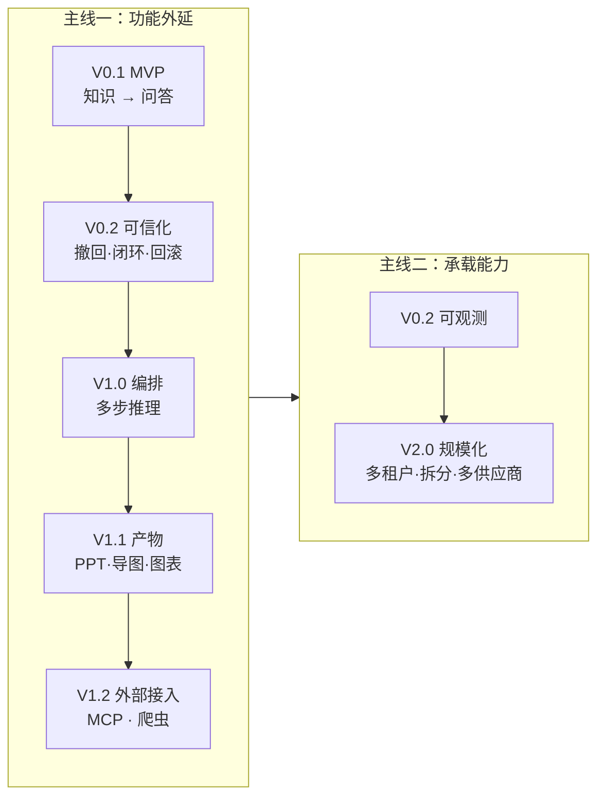
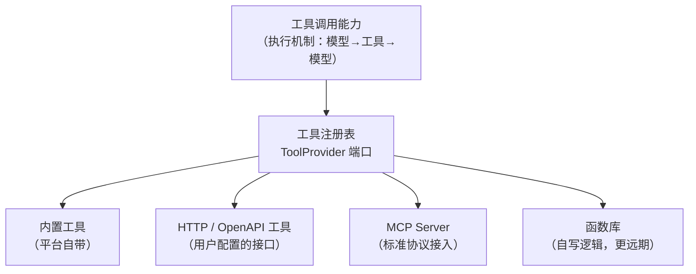
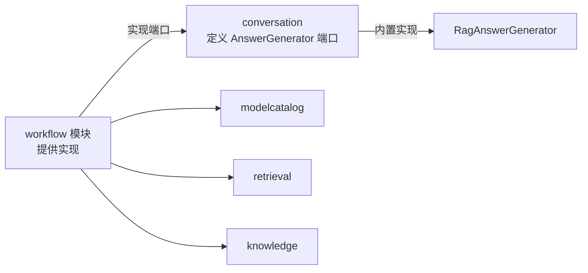
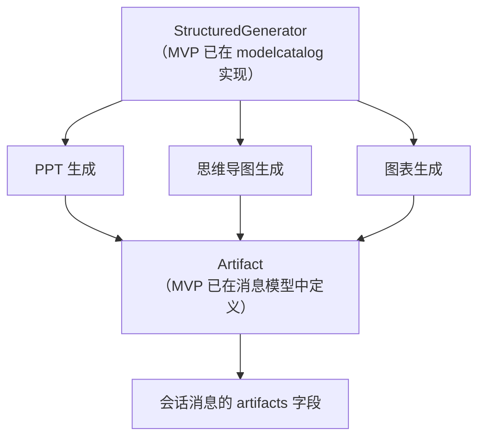

# 06 · 版本演进与扩展点

> 本册回答一个问题：**今天的设计，如何支撑后面四个版本的增量，而不需要推倒重来。**
>
> 核心立场：**预留"接口"，不预留"结构"。** 前者成本极低且总是有用；后者是为想象中的需求写的代码，大概率写错。

---

## 一、演进的两条主线



| 主线 | 关注 | 演进方式 |
|---|---|---|
| **功能外延** | 能力覆盖更广 | **新增模块**，通过既有端口与事件接入 |
| **承载能力** | 支撑更大规模 | **替换适配器 / 拆分模块**，业务代码基本不动 |

**判断演进是否健康的标准**：新增一个版本的模块时，**是否需要修改已发布版本的模块的内部代码**。如果需要改的地方多，说明前面的边界划错了。

---

## 二、V0.2 · 可信化（不新增模块）

这一版的目标是把 MVP 的缺口补齐，达到"可交付"质量。**全部在既有模块内完成，不引入新模块。**

### 2.1 分享链接（可撤回）

| 项 | 设计 |
|---|---|
| 归属 | `conversation` 模块新增聚合 `ShareSnapshot` |
| 为什么放在 conversation | 分享的对象是"若干消息的快照"，与会话强内聚 |
| 数据 | 快照内容、创建人、**过期时间**、访问计数、撤销时间、撤销人 |
| 行为 | 创建（可选有效期）、撤销（终态）、记录访问 |
| 与凭证的区别 | 应用凭证对应用（持续可用）；分享快照对内容（一次快照）。**两者是不同概念，不共用实现** |
| 默认值 | **默认有限期**（建议 30 天） |

> **为 V1.0 埋的接缝**：未来"分享一个编排应用的运行结果"时，`ShareSnapshot` 只需扩展快照内容类型，不需要改结构。这是自然延伸，无需现在设计。

### 2.2 反馈处理闭环

| 项 | 设计 |
|---|---|
| 模块 | `feedback` 内扩展 |
| 新增字段 | 状态、处理人、处理时间、处理说明 |
| 状态机 | 待处理 → 处理中 → 已处理 / 已忽略；可重新打开 |
| 关键联动 | 从反馈**跳转到对话日志**（依赖 conversation 的查询接口）；从反馈**执行"优化答案"**（依赖知识库的问答对能力） |
| 统计 | 待处理数、平均处理时长 |

> **"优化答案"依赖问答对能力**。若 MVP 因 H1 达标而未启用问答对，这里需要**同时启用问答对**（P2 → P0）。这是一个版本间的依赖，需在规划时注意。

### 2.3 迁移可回滚（回收站）

| 项 | 设计 |
|---|---|
| 模块 | `knowledge` 内新增聚合 `RecycleEntry` |
| 设计 | 删除/迁移时写入回收记录（原位置、操作人、时间、类型、内容快照引用） |
| 保留期 | 默认 30 天，可配置 |
| 还原 | 还原到原位置；**若原知识库已不存在，提示选择目标** |
| **关键提示** | 还原后**必须明确告知"需要重新向量化"**，并提供一键入口 |
| 清理 | 到期自动清理 + 手动清空 |

> **为什么必须提示"需要重新向量化"**：回收站保存的是**分段文本**，不是向量。用户以为"还原了就能立刻用"，结果发现检索不到——**这个落差比不给回收站更伤信任**。

### 2.4 应用导入导出

| 项 | 设计 |
|---|---|
| 模块 | `assistant` 内扩展 |
| 导出包 | 配置 + **依赖清单**（模型、知识库、角色词）+ 可选内容（知识库文档） |
| 导入校验 | 逐项比对清单与目标环境，列出"已满足 / 缺失" |
| 跳过引用 | 允许缺失时导入，但**明确告知降级了什么** |
| 格式版本 | 导出包带格式版本号，导入时校验兼容性 |

### 2.5 其他

| 项 | 内容 |
|---|---|
| 知识图谱 | 在 `knowledge` 内新增图谱查询能力（只读展示） |
| 可观测完善 | 补齐机制七的指标与告警；接入监控面板 |
| 性能调优 | 基于 MVP 实测数据做针对性优化（索引、批量参数、缓存） |

---

## 三、V1.0 · 编排与工具调用

> **为什么这两件事放在同一个版本**：工具调用是"模型自主决定下一步做什么"，编排是"人预先规定下一步做什么"——**两者是同一个能力谱系的两端，共用同一套底层机制**（多步执行、节点/工具注册、执行记录、调试）。
>
> 而且**编排的执行引擎本来就处理非线性流程**（判断器、分支），因此工具调用的"执行循环"在这里是自然的，不需要额外改造。

### 3.0 工具调用（V1.0 的并列主题）

#### 3.0.1 先厘清一个关系：**MCP 不是与工具调用并列的能力**

这是决定版本归属的关键认知：



| 概念 | 它是什么 | 层次 |
|---|---|---|
| **工具调用** | 一种**执行机制**：模型输出工具调用意图 → 平台执行 → 结果回灌 → 模型继续 | 能力层 |
| **MCP** | 工具的**供给渠道**之一：一种标准协议，从外部获取工具定义与执行 | 来源层 |

> **所以 MCP 必须先有工具调用才能谈。** 把 MCP 写进 MVP，等于要先有工具调用——而工具调用本身就不该进 MVP（理由见第 04 册）。
>
> **反过来说**：设计工具注册表时，"工具来源"本来就是一个必需维度（内置 / HTTP / …），**MCP 只是这个维度上的第三个取值**。所以 V1.0 设计工具注册表时天然为 MCP 留了位置，**不需要额外预留成本**。

#### 3.0.2 工具调用的设计要点

| 项 | 说明 |
|---|---|
| **工具注册表** | `ToolProvider` 端口 + 工具元数据（名称、描述、参数 JSON Schema）；模型按 tools 描述决定调用 |
| **执行循环** | 模型 → 工具 → 模型 → …；必须设**最大步数上限**与**循环检测**（防止模型反复调用同一工具） |
| **流式语义扩展** | **新增 `tool` 事件**（既有的 meta/refs/delta/done 语义不变，见第 03 册机制一）。前端据此展示"正在查询订单…" |
| **停止语义扩展** | 停止时需处理"工具正在执行"的状态：取消工具调用、回灌中断标记 |
| **准入** | 按 `Model.ToolCallingCapability` 过滤候选模型（M-I8） |
| **安全边界** | **这是最重要的设计点**：平台将代用户调用外部系统，需要工具级权限（谁能配、谁能用）、出网白名单（防 SSRF）、参数校验、调用审计 |
| **审计** | 每次工具调用留痕：谁、什么工具、什么参数、什么结果、耗时、成败。**企业内部合规的硬要求** |
| **可观测** | 工具调用成功率、耗时分布、被拒率、单次会话内的平均调用轮数 |

> **安全边界为什么值得单列**：工具调用让平台获得了"代表用户访问外部系统"的能力——**这是原平台完全没有的攻击面**。原项目的问答是纯读（检索本地知识），而工具调用可以写。**因此权限、白名单、参数校验必须在 V1.0 一并设计，不能事后补。**

#### 3.0.3 两种接入方式（同一套底层能力）

| 方式 | 适用 | 用户操作 |
|---|---|---|
| **简单应用绑定工具集** | 轻量场景（"查一下我的订单"） | 在应用配置里勾选可用工具，无需画布 |
| **编排应用的工具节点** | 精细控制（何时调用、失败如何分支） | 在画布上放置工具节点，连线控制流程 |

> **两种方式都由 `AnswerGenerator` 端口承载，这正是 MVP 预留那个端口的回报**：
> - 简单应用 → 新增 `ToolCallingAnswerGenerator`（内部封装执行循环，**对外仍是线性流式**）
> - 编排应用 → `WorkflowAnswerGenerator`（工具节点是图中的一个节点类型）
>
> **对外接口完全一致**，会话模块不需要知道内部是循环还是图。

### 3.1 新增模块

| 项 | 内容 |
|---|---|
| 模块名 | `workflow` |
| 依赖 | `platform`、`modelcatalog`、`retrieval`、`knowledge`、`conversation`（**实现其定义的端口**） |
| 核心聚合 | `WorkflowDefinition`（节点图 + 版本 + 发布状态）、`WorkflowExecution`（一次执行的记录） |
| **V1.0 伴生模块** | `toolkit`（工具注册表、工具执行、调用审计）——与 `workflow` 并列，服务两类接入方式 |

### 3.2 关键设计：用端口反转依赖，避免循环

**问题**：会话要执行编排流程，但编排也依赖会话吗？如果处理不当就会形成循环依赖。

**方案**：会话定义端口，编排实现它。

```java
// conversation 模块定义（MVP 阶段就定义好，仅一个实现）
public interface AnswerGenerator {
    AnswerStream generate(AnswerContext context);
    boolean supports(AssistantType type);   // 是否负责这种类型的应用
}

// MVP：内置实现（在 conversation 内）
class RagAnswerGenerator implements AnswerGenerator { ... }

// V1.0：workflow 模块提供的实现
@Component
class WorkflowAnswerGenerator implements AnswerGenerator {
    boolean supports(AssistantType type) { return type == AssistantType.WORKFLOW; }
    AnswerStream generate(AnswerContext context) {
        // 按 WorkflowDefinition 的节点图执行
    }
}
```



**依赖方向：`workflow → conversation`，单向，无循环。**

> **这是本套设计里最重要的一个接缝。** 它在 MVP 阶段只花一个接口的成本，却让 V1.0 的编排能力**以新增模块的方式接入，而不是改造会话模块**。

### 3.3 编排能力规划

| 组件 | 说明 |
|---|---|
| 节点类型（初始 7 类） | 开始、基本信息、AI 对话、知识库检索、判断器、指定回复、问题优化 |
| 执行引擎 | 按图拓扑执行；支持条件分支；记录每个节点的输入输出（便于调试） |
| ★ 中断点 | **只识别、不执行**：图 → 执行计划阶段扫到"人工介入"点 ⇒ **该图拒绝发布**，错误码写明本版本不支持。**不实现真挂起**（判据见 `09 §5.3.2 ②`：宁可发布时拒绝，不要运行时假装支持） |
| ★ 检查点分层 | **L1 执行记录**（与业务同事务，人看）+ **L2 进程内重试**（内存）**做**；**L3 跨进程检查点只占字段位置**（快照而非日志、随图版本存），实体留到真有"流程要等人/崩溃续跑"的需求（见 `09 §5.3.2 ③`） |
| ★ 观测 | 复用 `03 机制七`（**不新起一套**）：run 级 + node 级两层，指标带 `appId` + `graphVersion` 标签；★ **不做官方的"边级"埋点**（图是冻结 JSON，边无执行语义） |
| ★ 与检索链路的关系 | **图执行**（用户画的图 ⇒ 解释器）与**检索链路**（写死的十步 ⇒ 不需要解释器）**不统一、只共享**：共享节点执行器注册表 / 重试超时 / 观测埋点 / 状态更新契约。见 `09 §5.3.3` |
| 版本与发布 | 草稿与已发布版本并存；支持历史版本查看与回滚 |
| 调试链路 | **与正式链路使用同一执行引擎**（避免"调试通过线上失败"） |
| 与编排画布联动 | 画布结构以 JSON 持久化；前端用画布库渲染 |

> **关于编排节点的教训**：原项目的编辑器在类型枚举里定义了 17 种节点，实际只实现 7 种——**这会让新人误以为平台支持那些节点，也会让需求评审产生"已交付"的误判**。
>
> 本方案的规则：**枚举里只放已实现的类型**。规划中的节点放在独立的"规划清单"里，不进运行时枚举。

### 3.4 与 MVP 的其他接缝

| 接缝 | MVP 阶段已有 | V1.0 如何用 |
|---|---|---|
| `AssistantType` 枚举 | MVP 只有 `SIMPLE` | 新增 `WORKFLOW`（枚举扩展，不破坏兼容） |
| 消息的 `artifacts` 字段 | MVP 已设计（预留 JSON 列） | 编排节点的中间产物可挂载在此 |
| `AnswerGenerator` 端口 | MVP 已定义 | 新增实现 |
| 事件机制 | 已就绪 | 新增 `WorkflowExecuted` 事件供统计 |

---

## 四、V1.1 · 文档生成

### 4.1 新增模块

| 项 | 内容 |
|---|---|
| 模块名 | `documentgen` |
| 依赖 | `platform`、`modelcatalog`（用其结构化生成能力）、`conversation`（回传产物） |
| 核心聚合 | `PptTemplate`、`GenerationRecord` |

### 4.2 核心：复用结构化生成能力

**这一版几乎不需要新的基础能力**，因为机制五（结构化输出与健壮解析）已经在 MVP 阶段打好：



| 产物 | 步骤 |
|---|---|
| PPT | 模型生成大纲（结构化）→ 按条目数选模板版式 → 填充 → 产出文件 → 记录下载地址 |
| 思维导图 | 模型生成层级结构（结构化）→ 前端渲染 |
| 图表 | 模型提取数据序列（结构化）→ 前端渲染 |

| 设计点 | 说明 |
|---|---|
| **失败必须可读** | 依赖机制五的四层防御；失败时给出"模型未按格式返回，可重试"这类明确提示 |
| **失败率可观测** | 使用机制五的指标埋点，把生成失败率作为可监控数字 |
| **模板是人工素材** | PPT 模板由业务人员用办公软件预制作上传，系统只做填充（**系统不生产版式**） |
| **生成记录可追溯** | 记录主题、类型、状态、产物地址 |

> **为什么这一版能"轻"下来**：因为最难的部分（约束模型输出、健壮解析、失败可观测）在 MVP 就已经做完了。**如果 MVP 没有做机制五，这一版就要先把机制五补上再加三个产物**——这就是顺序设计的价值。

---

## 五、V1.2 · 外部接入（MCP + 爬虫）

> **这一版的主题统一为"把外部的东西接进来"**：MCP 接入外部**工具**，爬虫接入外部**内容**。两者都不是新能力的发明，而是**把已有能力连到外部世界**——所以放在同一个版本内聚。

### 5.0 MCP 接入（工具来源的第三个渠道）

MCP 的价值在于**把工具接入标准化**：不必为每个外部系统手写适配器，只要对方提供 MCP Server，即可获得其工具定义与执行能力。

| 项 | 说明 |
|---|---|
| **实现位置** | `toolkit` 模块（V1.0 已建）中新增一个 `ToolProvider` 实现 |
| **为什么不需要改架构** | 工具注册表在 V1.0 设计时就有"工具来源"这一维度；**MCP 只是该维度上的第三个取值，不引入新的抽象** |
| 能力发现 | 从 MCP Server 拉取工具清单与参数 schema，注册为可用工具 |
| 认证与连接 | MCP Server 的连接配置、凭据管理 |
| **安全** | MCP Server 可能是外部进程/远端服务，需**白名单 + 凭据隔离 + 调用审计**（沿用 V1.0 已建的安全边界） |
| 版本风险 | MCP 协议仍在演进，适配层需与业务隔离；**协议变化不应波及 `toolkit` 的领域模型** |

> **注意 MCP 与 V1.0 的关系**：它**不是**"再加一个功能"，而是"给已有注册表加一个来源"。这就是把工具注册表抽象在 V1.0 做对的回报——**V1.2 的工作量主要在协议适配与安全配置，不在平台改造。**

### 5.1 新增模块

| 项 | 内容 |
|---|---|
| 模块名 | `crawler` |
| 依赖 | `platform`、`knowledge`（**创建文档**）、`modelcatalog` |
| 核心聚合 | `SpiderConfig`、`CrawlJob`、`ProxyChannel` |

### 5.2 核心：复用入库流水线（这是模块化的直接回报）

```mermaid
flowchart LR
  CR["crawler 模块<br/>抓取网页内容"] -->|调用 knowledge API<br/>创建 Document(sourceType=ONLINE)| KN["knowledge"]
  KN -->|发布 DocumentUploaded| IN["ingestion"]
  IN --> SPLIT["解析 · 切分 · 向量化"]
  SPLIT --> SEG["分段可被检索"]
```

| 设计点 | 说明 |
|---|---|
| **爬虫不需要知道切分与向量化怎么做** | 它把内容交给知识库，剩下的整条流水线自动接管 |
| **抓取结果天然有真实状态与失败原因** | 因为它走的是与上传完全相同的链路 |
| **分段级重试等能力自动获得** | 同上 |
| 爬虫自身的复杂度 | 集中在抓取侧：渲染方式、分页、字段提取、代理、限流、重试 |

> **这是模块化设计最直观的一次回报**：如果爬虫和入库逻辑混在一起，这一版就要重写一半；现在它只是"往流水线入口投递内容"。

### 5.3 抓取侧的关键设计

| 项 | 说明 |
|---|---|
| 渲染方式 | 静态 / JS 渲染 / 模拟点击分页（**选择错误是最常见的失败原因**） |
| 调试工具 | 入口可访问性、列表正则、正文提取、字段提取逐项测试 + **根据正文反推推荐提取规则** |
| 配置迁移 | 蜘蛛配置支持导出/导入（JSON），便于跨环境迁移 |
| 幂等与去重 | 以 URL 为幂等键；重复抓取不产生重复文档 |
| 合规 | 遵守目标站点 robots 与访问频率；提供限速配置 |

---

## 六、V2.0 · 规模化

这一版是**承载能力**的演进，与功能外延分开考虑。

### 6.1 多租户

| 项 | 设计 |
|---|---|
| 方式 | 数据行级隔离（在聚合与查询中携带租户标识） |
| 需要改动 | ① 聚合与表新增租户字段；② 查询统一注入租户条件；③ 事件携带租户信息；④ 免登录链路按凭证确定租户 |
| **为什么 MVP 不预埋** | 加字段是**低成本的机械改动**（Flyway 加列 + 实体加属性），而**为不存在的需求在每条查询里加过滤条件**，会让 MVP 期间每次调试都多一个变量 |

> **这是一个刻意的"不预留"决策，值得说明理由**：很多人会主张"现在加个 `tenantId` 字段反正不费事"。但真正的成本不在字段，而在**所有查询与所有缓存键都要考虑它**——以及**测试复杂度成倍上升**（每个用例要考虑跨租户场景）。**只有确认要做 SaaS 时，这个成本才值得付。**

### 6.2 服务拆分

| 优先级 | 模块 | 拆分依据 |
|---|---|---|
| 1 | `conversation` | 长连接流式请求，连接模型与其他模块差异最大 |
| 2 | `ingestion` | 批处理负载，与在线请求争夺资源 |
| 3 | `analytics` | 聚合查询重（已天然解耦：只订阅事件） |
| 4 | `modelcatalog` | 被多方依赖，且是唯一需要横向扩容的模块 |
| 不拆 | `identity` / `knowledge` / `assistant` / `retrieval` / `feedback` | 低频 CRUD，拆开只得到两份运维成本 |

**拆分时的改动清单（体现"模块即边界"的价值）：**

| 改动 | 说明 |
|---|---|
| 事件通道 | 从"进程内事件 + 出站事件表"换成"消息中间件"（因 ADR-03 已预留此路径） |
| 同步调用 | 从"Java 接口"换成"HTTP/gRPC 客户端"（因接口已设计为用例级、只返回只读视图） |
| 数据存储 | 按模块前缀独立 schema，可平滑拆为独立库（因表名已按模块前缀命名） |
| 业务代码 | **基本不改动** |

> **这正是 ADR-03 和模块前缀命名的意义**：模块化单体不是"等以后重构"，而是"已经在按服务边界组织，只是暂时部署在一起"。

### 6.3 其他规模化项

| 项 | 设计 | 为什么成本低 |
|---|---|---|
| 独立向量库 | 替换 `vectorindex` 的适配器 | 端口已隔离，业务代码不动 |
| 多模型供应商 | 在 `modelcatalog` 按 Spring AI 的供应商支持新增配置；覆盖不到时才新增原生适配器 | 端口已定义（机制四）；**框架原生支持多家，成本低于自建方案** |
| 对象存储换云 | 替换 `FileStorePort` 适配器 | 端口已隔离（机制八） |
| 数据权限 | 在应用层统一注入数据范围过滤 | `createdBy` 等字段已存在 |
| 缓存层 | 按需引入（凭证校验、模型能力、分类字典） | 有明确的热点路径 |

### 6.4 演进方向：把"检索"也变成一个工具（V1.0 之后的自然演进）

工具调用成熟后，一个顺理成章的演进是**取消"检索永远是前置固定步骤"这一假设**：

| 现在（MVP 起） | 演进后（可选） |
|---|---|
| 每次问答**必先**检索知识库，再把命中分段拼进提示词 | **把"知识库检索"注册为一个普通工具**，由模型自主决定是否检索、检索几次、用哪个知识库 |
| 检索参数由应用配置固定 | 模型可自主调整查询词与检索范围 |

| 收益 | 代价 |
|---|---|
| 简单问题不必检索（省一次向量查询与提示词长度） | 依赖模型能力，弱模型可能不检索或乱检索 |
| 复杂问题可多轮检索（先宽后窄） | 行为不确定性上升，可解释性下降 |
| 多知识库场景可让模型自己选库 | 需要更完善的调试与可观测 |
| **与工具调用共用同一套执行机制，不是新系统** | 需保留"强制检索"模式作为兜底（严谨场景仍需要确定性） |

> **这个方向值得提前知道，但不必现在实现**。它的意义在于说明一件事：**当前的"固定前置检索"是一个有意的产品选择，而不是架构限制**。将来若要改成"模型自主检索"，因为检索早已是独立模块（`retrieval`），只需把它包装成一个工具即可，是很小的改动。
>
> **反过来说**：如果当初把检索逻辑写死在问答服务里，这个演进就得重写问答链路。**这正是"知识加工/检索独立成模块"在长期的价值。**

### 6.5 引入新基础设施的判断标准

**不要因为"以后可能需要"而提前引入中间件。** 引入标准：

| 中间件 | 什么时候才引入 | 不引入时的替代 |
|---|---|---|
| 消息队列 | 模块被拆成独立服务**之后** | 事务事件 + 出站事件表 |
| 缓存（Redis） | 出现明确的、测量到的热点（QPS 或延迟瓶颈） | 应用内缓存 |
| 独立向量库 | 向量规模导致 pgvector 检索延迟超标（实测） | pgvector + HNSW 索引 |
| 注册中心/配置中心 | 服务数量超过约 5 个，手工配置开始出错 | 配置文件 + 环境变量 |
| 分布式事务 | **尽量避免**；优先改为"最终一致 + 补偿" | 单库事务 |
| 独立搜索引擎 | pgvector + PostgreSQL 全文检索不够用时（实测） | PostgreSQL 原生能力 |

> **这张表的作用是抵抗"技术选型的滑坡"**：几乎每个项目都会有人提议"上一个 ES 吧""加个 Redis 吧"。**要求这些提议先给出实测数据**，绝大多数会自行消失。

---

## 七、扩展点清单

**这张表是本套设计对未来的全部承诺。** 只有列在这里的东西是被设计预留的，其余都需要在对应版本重新设计。

| # | 扩展点 | 类型 | 位置 | 服务版本 | 预留成本 |
|---|---|---|---|---|---|
| 1 | **`AnswerGenerator` 端口** | 端口（接口） | conversation | V1.0 编排与工具调用 | 一个接口 |
| 2 | `AssistantType` 枚举 | 枚举 | assistant | V1.0 | 已存在，加常量 |
| 3 | 消息 `artifacts` 字段 | 数据 + 事件 | conversation | V1.1 产物 | 一个 JSON 列 + 一种事件 |
| 4 | `StructuredGenerator` | 平台能力 | modelcatalog | V1.1 产物 | **MVP 就需要，非预留** |
| 5 | 入库流水线入口 | 模块 API | knowledge/ingestion | V1.2 爬虫 | 已存在（上传即用） |
| 6 | 模块前缀表命名 | 约定 | 全部 | V2.0 拆库 | 零成本（命名约定） |
| 7 | 事件机制 | 基础设施 | 全局 | V2.0 拆分 | **MVP 就需要，非预留** |
| 8 | `VectorIndexPort` | 端口 | vectorindex | V2.0 换向量库 | 一个接口 |
| 9 | 供应商适配（Spring AI 已原生支持多家） | 适配器 | modelcatalog | V2.0 多供应商 | **采用 Spring AI 的收益：以配置为主，非新写适配器** |
| 10 | `FileStorePort` | 端口 | platform | V2.0 换存储 | 一个接口 |
| 11 | 模块边界校验 | 测试 | 全局 | 全版本 | **MVP 就需要，非预留** |
| 12 | **`Model.ToolCallingCapability`** | 能力声明 | modelcatalog | V1.0 准入 | **一个枚举字段**（MVP 起记录与展示） |
| 13 | **`tool` 流式事件** | 协议扩展 | conversation | V1.0 工具调用 | **零成本**——事件模型本就可扩展，加一种类型即可，既有语义不变 |
| 14 | **`ToolProvider` 端口** | 端口 | toolkit（V1.0 新建） | V1.2 MCP | **零额外成本**——工具注册表天然需要"来源"维度，MCP 是该维度上的一个取值 |

> 注意第 4、7、11 项标注为"非预留"——它们不只是为未来准备的，**MVP 本身就需要**。把它们与真正的"预留"区分开，是为了避免把所有设计都归因为"为了将来"。

---

## 八、明确不预留的东西

**这一节与上一节同等重要。** 以下内容**刻意不做预留**，理由写在旁边：

| 不预留 | 理由 | 真要做时的成本 |
|---|---|---|
| **多租户的租户字段** | 成本不在加字段，而在每条查询、每个缓存键、每个测试用例都要考虑它。只有确认做 SaaS 才值得付 | 低（机械改动：迁移脚本 + 查询过滤器） |
| **编排节点类型体系** | 节点设计必须由真实业务需求驱动；提前设计大概率写错并固化 | 中（需真实需求输入） |
| **编排画布的 DSL 结构** | 同上 | 中 |
| **分享功能的通用"可共享资源"抽象** | MVP/ V0.2 只有一个共享场景（消息快照）。为单一场景做通用抽象是过度设计 | 低（需要时提取） |
| **分布式事务 / 补偿事务框架** | 单库单进程内不需要 | 高（但那时应该先考虑是否真的该拆） |
| **微服务的注册与配置中心接入** | 服务数量为 1 时引入是自找麻烦 | 低（拆分时一并做） |
| **数据权限的过滤框架** | 见 MVP 6.4；`createdBy` 字段已有，需要时加过滤条件 | 中（横切改动） |
| **工具描述与参数 schema 的结构** | 工具调用的核心数据结构必须由真实需求驱动（工具的粒度、参数表达方式、结果回灌格式）。提前设计大概率写错，且写错的结构比没有更难清理 | 中（V1.0 设计） |
| **MCP 的协议适配层** | 协议仍在演进，现在写等于替一个未定型的标准做实现 | 中（V1.2 做） |
| **多模态能力（图片理解、语音）** | 需求未出现 | 高（需模型与界面配套） |
| **前端的多端适配（移动端）** | 需求未出现 | 高（需独立设计） |

> **判断"该不该预留"的一条实用标准**：
>
> - 是**接口**（一个 Java interface）→ **预留**，成本极低且总有测试收益
> - 是**字段**（数据库加列）→ **看是否已有明确需求**，无需求不预留
> - 是**结构**（一套抽象、一层框架、一个枚举体系）→ **无明确需求绝不预留**

---

## 九、版本升级的技术保障

要让增量演进不破坏既有功能，需要几条纪律：

| 项 | 规则 |
|---|---|
| **数据库迁移** | Flyway 管理；**只加列不删列、不改列语义**；加列必须可空或有默认值；删表删列需单独评审 |
| **API 版本** | 路径带 `/api/v1`；破坏性变更走 `/api/v2`，`v1` 保留过渡期 |
| **事件兼容** | 事件**只加字段不删字段**；消费者必须**忽略未知字段**（反序列化配置为宽松模式） |
| **权限点** | 只增不改；废弃权限点保留一段时间再清理 |
| **模块边界** | 边界校验测试在 CI 必跑；**新增跨模块依赖必须显式声明并通过评审** |
| **数据回滚能力** | 每个版本的迁移脚本配对应的回滚脚本（或至少明确"无法回滚"） |

### 9.1 版本发布的判定

| 类型 | 版本号变化 | 示例 |
|---|---|---|
| 新增模块 / 新增业务能力 | 次版本 `+1` | V1.0 → V1.1 |
| 既有功能增强 / 缺陷修复 | 修订号 `+1` | V0.1.1 |
| 破坏性变更（API、数据模型语义） | 主版本 `+1`，且需迁移方案 | V1.x → V2.0 |

---

## 十、演进健康度的自检

每个版本结束时，用以下问题自检：

| # | 自检问题 | 若答案是否定，说明什么 |
|---|---|---|
| 1 | 新功能是否以**新增模块**为主，而非改造既有模块？ | 模块边界划错了，或端口预留不足 |
| 2 | 既有模块的内部代码改动是否**局限在少数文件**？ | 抽象层次不对，耦合过深 |
| 3 | 新增能力是否**复用了既有的流水线/机制**（如入库、结构化输出、事件）？ | 之前没有把通用能力抽出来 |
| 4 | 是否出现了**为了新功能而修改已发布的数据语义**？ | 领域模型设计有缺陷 |
| 5 | 团队是否仍在**主动**运行模块边界校验？ | 架构纪律开始松驰，这是腐化的起点 |

> **第 5 条最容易被忽略，也最重要。** 架构腐化从来不是一次性发生的，而是从"这次先绕过一下，下次再改"开始的。**边界校验测试如果没有人看，就等于不存在。**

---

## 十一、★ 版本路线图（`0.5.0` 之后 · 2026-10-14 定 · 兑现 `#76`）

> **本节的位置**：前三节（§二–§六）回答**"每档要有什么能力、要预留什么接口"**；本节回答 **"哪一档是哪个版本号、谁在什么时候做、做完的判据是什么"**。
> ★ **两份计划的交界（本节存在的理由）**：`ROADMAP` 管**到"可用阶段"为止**（终点行 = `0.5.0` / 第 18 周），**`ROADMAP` 之后一律归本册**。
> 交界处不空着 —— `ROADMAP §4.4` 表末有一行指向本节（`#76` 判据②）。**两处只写一次**（`#40` 的教训）。

### 11.1 ★ 先解决一个冲突：`§二 V0.2` 里塞了 7 件事，而编号规则不允许它们同版

`§二` 的 V0.2 一口气列了 **7 项**（分享撤回 · 反馈闭环 · 回收站 · 导入导出 · 知识图谱 · 可观测 · 性能），
而 `§9.1` 自己定的编号规则是「**新增模块 / 新增业务能力 ⇒ 次版本 `+1`**」，`ROADMAP §4.3` 又规定**补丁位 = 周**。

⇒ **两者合起来只有一个结论：`§二` 的 7 项必须分成多个阶段版本。**
★ 这解释了 `#76` 说的"突兀"从何而来 —— 在 `§二` 里，`0.5.0` 之后**看起来只有一跳**就进了 V1.0 的编排，
而中间那 7 项成熟化工作**没有地址**。下面的表就是给它们地址。

★ **因此本节把"阶段"定义得更细（不改 `§二` 的内容，只给它排期）**：
`§二` 的 7 项按**依赖与风险**拆成 `0.7 – 0.9`，前面补上已排定的编排配置面（`0.6`），后面接企业级的承载面（`0.10`），再进 `1.0.0`。

### 11.2 ★ 路线图表（`0.6.0` → `2.0.0`）

| 版本 | 周区间 | 对应 `§二–§六` | 这一档**能演示什么** | 阶段退出标准（**可复核**） |
|---|---|---|---|---|
| **0.6.0** | 第 19–20 周 | `ROADMAP §11.2` 已排的 M5.5 | **编排应用的"配置面"闭环**：画布接契约 → 存草稿 → 校验 → 发布版本 → 回滚 → 看流程记录 | ① `workflow` 的 **10 个端点全部落地**（现在是 0）② ★ 前端 `workflowApi` **不再是零引用**（`Index.vue` 改掉 `@/api/legacy/setting` 的别名绕行）③ ★ 发布校验**拒绝**缺 `start`/`base` 的图（`04 AC-04-02`）④ ★ 断言 **`Assistant.type=workflow` 仍不可问答**（引擎未到 ⇒ 防"配了就等于能跑"被误读） |
| **0.7.0** | 第 21–23 周 | `§2.1` + `§2.2` | **可信的前提**：分享可撤回 · 反馈有闭环 | ① 分享快照**撤销是终态**（撤销后旧链接立即失效，**不是**等到期）② ★ 反馈四态流转 + 处理人/时间/说明落库，**从反馈能跳到对话日志**③ ★ **反馈闭环的"优化答案"在问答对未接入时必须显式置灰并给出原因**（不允许按钮在、点了没反应）④ 待处理数/平均处理时长**从库里算出来**（不是前端近似） |
| **0.8.0** | 第 24–26 周 | `§2.3` + `§2.4` | **敢做迁移**：误删能还原 · 应用能搬环境 | ① 回收站写入 + 还原到原位置 + 到期清理 ② ★★ **还原后必须提示"需要重新向量化"并给一键入口**（`§2.3` 的判据：回收站存的是分段文本、不是向量）③ 导出包含依赖清单（模型/知识库/角色词）+ **格式版本号** ④ 导入逐项比对并列出"已满足 / 缺失"，缺引用可导入但**必须写明降级了什么** |
| **0.9.0** | 第 27–29 周 | `§2.5` | **跑得稳、看得见** | ① 机制七的指标与告警**补齐**（`#73` 的三条已落地 ⇒ 本档补**面板 + 阈值告警**）② 知识图谱查询（只读展示）可用 ③ ★ 基于 0.5.0 的 **B1–B7 实测**做针对性调优，**每个调优项带"调前/调后"两个数**（无读数不许改参数） |
| **0.10.0** | 第 30–35 周 | ★ **本节新增档**（`ROADMAP §11.3.1` 的"实体"段） | **企业级承载面**：企业敢把它放进内网的六件 | 逐条见 **§11.3**（每件都有独立判据；★ 本档**不是**"把 `#72`–`#88` 全做完"，而是**做完下面 §11.3 列的那六件的实体**） |
| ★ **1.0.0** | 第 36 周起 | `§三` | **编排真能跑 + 工具能调** | ① `WorkflowAnswerGenerator` 上线：**按图执行**（含条件分支运行时判定），★ 与画布内调试**同一执行引擎**（`§3.3`：避免"调试通过线上失败"）② 画布内未实现的 **10 个节点仍不可拖拽**（纪律见 `§3.3` 的节点教训）③ **工具调用**：注册表 + `ToolProvider` 端口 + 执行循环（**最大步数上限 + 循环检测**）④ ★★ **工具级权限 + 出网白名单（防 SSRF）+ 参数校验 + 调用审计** —— `§3.0.2` 明写"必须在 V1.0 一并设计，不能事后补" ⑤ 新增 `tool` 流式事件（既有 `meta/refs/delta/done` 语义不变）⑥ ★ 执行引擎**三件补充设计**落地：状态更新策略 · 中断点**识别即拒绝发布** · 检查点 L1+L2（见 `09 §5.3.2`） |
| **1.1.0** | 待定（依赖 1.0.0 实测） | `§四` | **产物**：PPT / 导图 / 图表 | ① 复用 `StructuredGenerator`（`§4.2`）② ★ 依赖**会话虚拟执行目录的实体**（`#77`：缝已在 `13 §11.6.1` 定形，本档落表与实现）③ 产物挂 `artifacts` 字段 |
| **1.2.0** | 待定 | `§五` | **外部接入**：MCP + 爬虫 | ① MCP 走 `ToolProvider` 的**第三个来源取值**（`§3.0.1`：零额外预留成本）② 爬虫**复用入库流水线**（`§5.2`）③ 抓取侧关键设计见 `§5.3` |
| **2.0.0** | 待定 | `§六` | **规模化**：多租户 / 拆分 / 多供应商 | ★ `§6.5` 的准入表 —— **每一件都要先有实测数据**；`§八` 已明确"多租户租户字段**刻意不预留**" |

> ⚠️ **`0.10.0` 这个编号要说清**：它是 `0.x` 线的**最后一档承载面**，不是"次版本到 10"。
> 按 `§9.1` 的规则它属"新增业务能力 ⇒ 次版本 +1"，所以编号合法；★ 它存在的意义是**让"企业级"有地址**（`ROADMAP §11.3.1` 的 B 类实体段）。
> 若团队更希望它直接叫 `0.6.0` 之后的连续档，改编号即可 —— **判据与内容不受影响**（这才是重点）。

### 11.3 ★ `0.10.0` 的六件（`#72`–`#88` 的"实体"归位，逐条可核）

> ★ **分栏纪律**：这六件**全部来自** `ROADMAP §11.3.1` 的 B 类"**实体**"列 + `§11.9` 的口径组落地。
> **已认账的不重复登记**；本表只回答"**哪一档做、做完的判据是什么**"。

| # | 项 | 出处 | 退出判据（可复核） |
|---|---|---|---|
| 1 | **数据外发闸门**（密级 × 模型供应商） | `#72` · `13` 新增节 | ① 迁移加列（模型侧"允许处理密级上限"）② 调用侧出站闸门：超限 ⇒ **拒绝并给可读原因**（不是静默降级）③ ★ **与工具调用共用同一份出网白名单**（`§3.0.2`）④ 出站留痕可查 |
| 2 | **指标 / 告警 / 成本** | `#73` | ① 接告警系统（阈值触发可验证：**故意压过阈值 ⇒ 必须告警**）② 成本报表（按应用/模型维度）③ ★ **容量上限**（并发数 / 单库分段数 / 索引重建窗口）有数字且**超限行为明确** |
| 3 | **用量配额与限流** | `#73` | 超限 ⇒ **拒绝 + 可读原因 + 审计**（★ 与第 16 周"只加列不拦截 + 断言钉住不拦"形成对照：**那时的不拦是留缝，这时的不拦是缺陷**） |
| 4 | **国密 / 密评** | `#74` | 按客户需求加 SM 适配器 —— `CryptoPort` 已在第 16 周抽好 ⇒ ★ **本档只加一个实现**，不改调用点（这就是留缝的回报） |
| 5 | **数据生命周期** | `#75` | ① 彻底删除（级联 + 脱敏摘要）② 归档清理 ③ ★ **一次真实的恢复演练并记下 RPO/RTO 数字**（`§11.7.5` 把"备份恢复演练"列进不做清单 ⇒ 本档是它的归位） |
| 6 | **可观测的 trace 层** | `#73` / `#87` | ★ 一次请求的 **prompt / 响应 / token 用量 / 延迟 / 中间检索与工具步骤**可串起来看；★ 与 `#87`（忠实度 / 噪声敏感度读数）**同批**——两者都属"答案对不对"的观测面 |

> ★ **明确不在 `0.10.0` 的**（避免这一档被读成"企业级全做完"）：**连接器与 ACL 同步**（`#81`）· **AD/LDAP/SCIM 目录同步**（`#82`）· **合规四件套**（`#83`）· **间接提示注入**（`#84`）· **PII 出站脱敏**（`#85`）· **文档版本**（`#86`）· **对照实验**（`#88`）。
> 理由分两类：**`#81`/`#82` 依赖外部系统与组织实体**（属 V2.0 规模化那一档，`§六`）；**`#83`–`#86`/`#88` 是"口径组/留缝"已定的项**，其**实体**排在 `1.1.0` 之后按客户需求驱动 —— ★ **现在给它们地址就是过度排期**（`§八` 的判断标准：无明确需求不预留结构）。

### 11.4 ★ 对 `ROADMAP` 的两条接口约定（本节生效）

| # | 约定 | 落点 |
|---|---|---|
| 1 | **`ROADMAP` 管到"可用阶段"为止**：它的最后一行就是 `0.5.0` / 第 18 周 | `ROADMAP §4.4` 表末加一行指向本节（`#76` 判据②）；`§11.2` 的"第 19 周起"改为指向本节（判据④） |
| 2 | **本册管 `0.5.0` 之后**：版本号 · 估值 · 退出标准一律以 **§11.2** 为准 | 本节即权威；`§二–§六` 只补充"要预留什么接口" |

> ★ **为什么这条约定本身很重要**：`#40` 的教训是"**同一个状态在四处各写一份**"。
> 只要"哪份文档管到哪"不写清，下一轮必然又出现"两处都写一点" ⇒ 本节第 2 条**就是**那条防漂移的口径。

---
