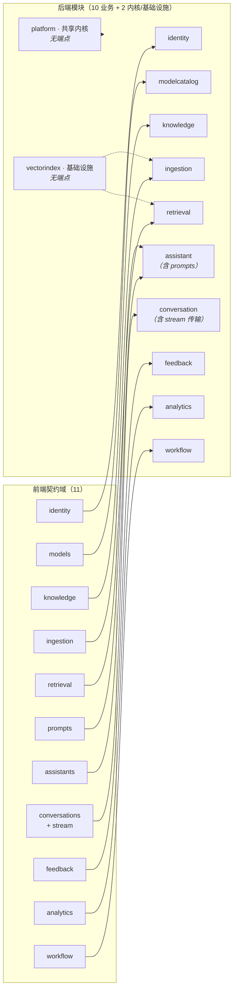

# 08 · 后端模块对应与通用能力支撑

> **本篇与 `01` 的分工**：`01` 讲**架构怎么组织**（限界上下文、依赖矩阵、通信方式、包结构），
> 本篇讲**契约落到哪个模块**与**通用能力归谁**——即"前端那 11 个契约域、115 个端点，后端各自由谁实现"。
>
> **为什么需要这一篇**：`01` 写在前端"先行"之前。前端把界面真做了一遍之后，**契约长出了
> 一批当初没有的东西**（分享写、收藏、标签、暂存上传、三种重向量化、我的口径聚合、
> 提示词类型读写分离、SSE 心跳契约化……）。模块计划必须吸收这些增量，否则后端会照着
> 写在前面的清单实现，回头再补一輪。
>
> **不重复的东西**：依赖矩阵、包结构、Modulith 六项能力的用法、DDD 的那条务实妥协
> —— 全在 `01`，本篇只**引用**并在有增量时**标注增量**。

---

## 一、一句话总览

**10 个业务模块 ↔ 11 个前端契约域**（`prompts` 与 `stream` 不单列模块），
外加 2 个无对外端点的模块（共享内核 `platform`、基础设施 `vectorindex`）⇒ **共 12 个模块**。



`prompts` 与 `stream` **不单列模块**，理由：

| 契约文件 | 为什么不单列模块 | 落到哪 |
|---|---|---|
| `api/prompts.ts` | 提示词是**应用的配置数据**——它没有独立生命周期，也被 `assistant` 的聚合引用。前端为它留独立契约文件只是文件组织，不代表后端要独立模块 | `assistant` 的 `domain` + `api` 包 |
| `api/stream.ts` | 它是**传输方式**，不是业务域。域是"会话与消息" | `conversation` 的 `web` 层 + `platform` 的 SSE 封装 |

---

## 二、模块总表（职责 · 契约 · 聚合 · 对外暴露什么）

> 「对外暴露」一列就是各模块 `api` 包的内容。**跨模块只能访问 `api` 包**（`@NamedInterface`），
> 且只暴露**只读视图（record）与用例级方法**，不暴露实体与仓储——见 `01 §四.2`。

| # | 模块 | 职责 | 契约域 | 端点数 | 核心聚合 | 对外暴露（`api` 包） |
|---|---|---|---|---|---|---|
| 1 | **`platform`** | 共享内核：值对象基类、领域事件基类、业务异常与错误码、ID、时钟、审计、**文件存储端口**、**幂等**、**SSE 封装**、**`OwnedResource` 值对象与 `AccessScopePort`（接口）**、**公开令牌解析端口**（安全组件本身不自研，见 §4.2） | — | — | — | 基础类型、工具、`FileStorePort`、`IdempotencyStore`、`OwnedResource`、`AccessScopePort` |
| 2 | **`vectorindex`** | 向量表读写、HNSW 索引维护、批量写入与进度回写 | — | — | 向量条目 | 向量写入、相似度检索 |
| 3 | **`identity`** | 账号、角色、权限点、认证、**数据范围与资源可见性判定的唯一实现** | `identity` | 12 | `User` `Role` | 当前用户解析、权限校验实现、**`AccessScope` 实现**、用户信息查询 |
| 4 | **`modelcatalog`** | 模型注册/加载/能力探测 + **模型接入**（对话/向量端口） | `models` | 8 | `Model` | 对话流式调用、向量生成、能力与可用性校验 |
| 5 | **`knowledge`** | 知识库、分类、启停；文档与分段的**生命周期管理**与治理 | `knowledge` | 7 | `KnowledgeBase` `Document` `Segment` | 知识库/文档/分段查询与变更 |
| 6 | **`ingestion`** | 加工流水线：上传 → 解析 → 切分 → 向量化 → 状态与**真实进度**回写；重试与重向量化 | `ingestion` | 20 | 加工任务、切分策略 | 触发加工、查询进度、暂存上传 |
| 7 | **`retrieval`** | 向量 / 全文 / 混合三模式、参数、命中测试 | `retrieval` | 3 | 检索请求、命中分段 | 统一检索接口、命中测试 |
| 8 | **`assistant`** | 应用配置与发布、公开凭证、导入导出、**收藏与标签**、**分享写**、**提示词（类型 + 配置）** | `assistants` + **`prompts`** | 23 + 8 | `Assistant` `AccessCredential` `PromptType` `PromptConfig` `AssistantFavorite` | 应用配置查询、发布状态、**凭证校验**、提示词查询 |
| 9 | **`conversation`** | 会话、消息、RAG 编排、流式问答、**会话分享**、**免登录公开问答** | `conversations` + **`stream`** | 14 | `Conversation` `Message` `ConversationShare` | 问答流式接口、会话与消息查询、**公开令牌解析** |
| 10 | **`feedback`** | 赞踩、评分、处理闭环（状态流转 / 指派 / 重新打开 / **批量**） | `feedback` | 5+ | `Feedback` | 提交反馈、反馈查询 |
| 11 | **`analytics`** | 运营指标与**「我的」口径**（派生读模型，只订阅事件） | `analytics` | 5 | 指标、日聚合 | 看板查询 |
| 12 | **`workflow`** | 流程定义存取、发布前校验、版本与回滚、画布内调试、运行记录；**执行引擎在 V1.0** | `workflow` | 10 | `WorkflowDraft` `WorkflowVersion` | 草稿读写、校验、发布、版本、节点类型目录 |

**`workflow` 的交付节奏与其它模块不同**（配置面进 MVP、执行引擎在 V1.0）—— 见 `backend/README.md`，
本篇不重复。节点枚举 17 种、已实现 7 种、其余标 `implemented: false` 不可拖拽，同理。

---

## 三、契约对账：逐域的端点落到哪

> 口径：端点数按 `frontend/src/api/**` 机械枚举（共 **115 个唯一端点**，排除 `legacy/*` 垫片——
> 垫片**不新增任何端点**，它只是画布旧调用点的形状适配）。

### 3.1 `identity` · 12 端点 → 模块 `identity`

| 端点 | 归属位置 | 备注 |
|---|---|---|
| `POST /auth/login` · `POST /auth/logout` | `web` + `application` | 双令牌 |
| `GET /users` · `POST /users` · `PUT /users/:id` · `DELETE /users/:id` | `web` + `application` | 需 `system:manage` |
| `GET /users/me` · `PUT /users/me/password` | `web` + `application` | 本人即可，**不受 `system:manage` 限制** |
| `GET /roles` · `PUT /roles/:id/permissions` | `application` | 角色 = 权限点集合 |
| **`PUT /roles/:id/data-scope`** | `application` | `{ dataScope, dataScopeRule? }`；**上一篇（07）才引入的维度** |
| `GET /permissions` | `application` | 权限点清单（**代码常量**，启动时同步） |

**增量提醒**：`dataScope` 与 `dataScopeRule` 是 07 才引入的。后端**必须从第一天就带上**——
详见 §4.4。

### 3.2 `models` · 8 端点 → 模块 `modelcatalog`

`GET /models` · `GET /models/base-models` · `POST /models` · `PUT /models/:id` · `DELETE /models/:id` ·
`POST /models/:id/load` · `POST /models/:id/probe` · `POST /models/probe`

要点：**能力三态**（思考模式 / 工具调用）与**显式维度**是契约的一等字段，启动即校验（`03` 机制四）。
`GET /models/base-models` 是**基础模型目录**（画布"新建模型"弹窗的卡片列表就来自它）。

> **⚠️ 上游经 OpenAI 兼容网关，不直连推理服务**（`09` §3.13）：实际推理调用走网关，
> **负载均衡 / 限流 / 熔断 / 降级由网关承担**。
> 因此本模块的边界是「**平台模型资产**」（要被应用引用、要声明能力、要参与权限与数据范围）；
> 「**上游实例**」（哪个实例、健康、权重）是网关的事，**我们不在平台里维护第二份上游清单**。
>
> **`POST /models/:id/load` 的语义（已定，`09` §3.13.4）**：**平台启用位 + 上游可用性校验**，
> **不尝试操纵上游实例**（"载入显存"是网关/上游的事，且各适配器语义不统一 —— vLLM / 外部 API 根本没有"加载"）。
> 契约四态（`未加载 / 加载中 / 已加载 / 加载失败`）**保留**，映射为：
> 未启用 → `未加载`；正在校验上游 → `加载中`；已启用且上游清单里有 → `已加载`；网关不可达或上游无此模型 → `加载失败`。
>
> ⚠️ **连带修正：`DELETE /models/:id` 的拒绝条件不应是"已加载"**（那是 Ollama 时代的判据，
> 而契约里只有 `load`、没有 `unload` ⇒ 会造成"**加载过的模型永远删不掉**"）。
> 拒绝条件应是 **"被应用 / 知识库引用"**（真正的引用完整性约束）；删除时顺带清掉启用位。

### 3.3 `knowledge` · 7 端点 → 模块 `knowledge`

`GET /knowledge-bases` · `GET /knowledge-bases/:id` · `POST /knowledge-bases` · `PUT /knowledge-bases/:id` ·
`DELETE /knowledge-bases/:id` · `PATCH /knowledge-bases/:id/enabled` · `GET /knowledge-bases/categories`

要点：
- **`POST /knowledge-bases` 认 `clientRequestId`（幂等）** —— 前端在向导里"建库成功但上传失败"后重试
  会再次建库，靠它返回**既有库**而不是报「名称已存在」。这是 §4.5 的第一个落地场景。
- `categories` 是**用户自建的 CRUD**，不是预置字典（`10` 册把它当缺字典，是误判）。

### 3.4 `ingestion` · 20 端点 → 模块 `ingestion`（+ `vectorindex`）

| 分组 | 端点 | 备注 |
|---|---|---|
| 文档 | `GET/POST /knowledge-bases/:kbId/documents` · `PATCH /documents/:id` · `PATCH /documents/:id/enabled` · `DELETE /documents/:id` | 归属校验走 `knowledge` |
| 进度 | `GET /knowledge-bases/:kbId/ingestion-progress` | **真实进度**，来自 `EmbeddingProgressed` |
| 分段 | `GET /segments` · `PUT /segments/:id` · `PATCH /segments/:id/enabled` · `DELETE /segments/:id` · `DELETE /segments/batch` | `SegmentQuery.kbId` 必带（防跨库批量） |
| **暂存上传** | `POST /knowledge-bases/:kbId/uploads` → `{ uploadIds }` | **前端先行后才长出来的**：让"按用户自己的文件预览切分"成立 |
| 切分预览 | `POST /segmentation/preview`（+ `uploadIds`、`segmentationPlan`） | 同上 |
| 重试/重向量化 | `POST /documents/:id/retry` · `POST /documents/:id/embedding` · **`POST /segments/:id/embedding`** · **`POST /documents/:id/reembed`** · **`POST /knowledge-bases/:kbId/reembed`** | 后三个是新增的：**改过分段后必须有重向量化入口，否则改动永不生效** |
| 上传策略 | `GET /knowledge-bases/:kbId/upload-policy` | `{ maxFileSizeMB, acceptedExtensions }` |

**导入的部分失败回执**：`POST …/documents` 的响应形状为 `{ accepted, rejected[] }`——
**不是** `DocumentItem[]`。前端遇到这个变更时用的办法是「**新开一个导出、旧导出保留**」
（`importDocuments` / `uploadDocuments`），后端同一原则：**不改既有字段的类型与含义**。

### 3.5 `retrieval` · 3 端点 → 模块 `retrieval`

`GET/PUT /knowledge-bases/:kbId/retrieval` · `POST /retrieval/test`

要点：**新库的检索参数应返回默认值而不是 404**（前端曾因此回落到硬编码值）。
混合检索用 RRF（`03` 机制二）。

### 3.6 `assistants` + `prompts` · 23 + 8 端点 → 模块 `assistant`

**应用本体**：`GET/POST /assistants` · `GET/PUT/DELETE /assistants/:id` · `PATCH /assistants/:id/published` ·
`GET /assistants/:id/publish-check`

**凭证与 Key**：`GET/POST /assistants/:appId/credentials` · `PATCH /assistants/:appId/credentials/:id/enabled` ·
`POST /assistants/:appId/credentials/:id/revoke` · `GET/POST /assistants/:appId/api-keys` ·
`PATCH /assistants/:appId/api-keys/:id/enabled`

**导入导出**：`GET /assistants/:id/export` · `POST /assistants/import` · `POST /assistants/import/check` ·
`POST /assistants/:id/debug`

**应用市场（前端先行后新增）**：
| 端点 | 用途 |
|---|---|
| `GET /assistants/tags` | 标签清单（**静态段路由，必须排在 `:id` 之前**） |
| `POST /assistants/:id/favorite` · `DELETE /assistants/:id/favorite` | 收藏（**按用户**，幂等） |
| 查询参数 `origin=official\|shared\|mine` · `sort=popular\|latest\|name` · `tag` · `favorite` | 来源分段 / 排序 / 筛选 |
| 响应字段 `ownerName?` · `favorited?` · `tags?` · `createdAt?` · `builtin` | **卡片的三态徽标**（官方 / 由 X 分享 / 我的）靠前两个字段 |

**分享写（前端先行后新增）**：`PATCH /assistants/:id/visibility` · `PUT /assistants/:id/grants`
—— 07 只有**读**的口径，**分享是写**，必须新增。

**提示词**（`api/prompts.ts`，归本模块）：
`GET/POST/PUT/DELETE /prompt-types` · `GET/POST/PUT/DELETE /prompt-configs`

**权限口径（本轮前端刚收紧的，后端必须一致）**：

| 操作 | 权限点 | 理由 |
|---|---|---|
| 读 `prompt-types` | `assistant:edit` | 配置表单要靠它填下拉 |
| **写 `prompt-types`** | **`system:manage`** | 类型是**分类法（契约）**——改了它所有配置的归类都变 |
| 读/写 `prompt-configs` | `assistant:edit` | 配置是**内容**，应用配置者日常编辑 |

> 同族先例：**权限点清单**住在系统管理（管理员维护），而"给角色挂权限点"这个动作在角色管理里。
> 分类法与内容分开，是同一个判据的复用。

### 3.7 `conversations` + `stream` · 14 端点 → 模块 `conversation`

`GET/POST /conversations` · `GET/PATCH/DELETE /conversations/:id` ·
`GET /conversations/:conversationId/messages` · `POST /messages/:messageId/feedback`

**流式问答**：`POST /conversations/chat`（SSE；`api/stream.ts` 是它的传输面）

**会话分享（新增）**：`POST /conversations/:id/shares` · `GET /conversations/:id/shares` ·
`DELETE /conversations/:id/shares/:token`

**免登录公开问答**：`GET /public/:token` · `GET /public/:token/messages`
（还有 `POST /public/:token/...` 的问答面，与 chat 同一条 SSE 链）

**文件上传**：`POST /files` → 实现在 **`platform`** 的 `FileStorePort`，契约摆在 `conversations` 域里
（前端把它放在这个文件里只是为了就近）。

**两条必须写进契约的保证**（前端已按此写死，后端不实现就会坏）：

1. **三态终态**：`已生成 | 已停止 | 失败`；**任何终止路径恰好一次 `done`**；`error` 之后**仍走 `done`** 收尾；
   **不允许无错无终态**（这是前端踩过的坑：半途断流既不 done 也不 error，气泡永远转圈）
2. **心跳**：`HEARTBEAT_INTERVAL_MS = 20s` 与 `IDLE_TIMEOUT_MS = 60s` 的关系是**契约写死的** `20 × 3 ≤ 60`；
   心跳帧形如 `:keep-alive`（注释帧），必须能被客户端的 `splitFrames` 跳过
3. **任务不依赖前端连接**：任务推进的**唯一真相源在后端**；前端断连**不得**导致后端停止或回滚任务

### 3.8 `feedback` · 5+ 端点 → 模块 `feedback`

`GET /feedbacks`（**`mine=true` 与 `requesterId` 是新增的**）· `GET /feedbacks/:id` · `GET /feedbacks/stats` ·
`PATCH /feedbacks/:id` · `POST /feedbacks/:id/reopen` · **`PATCH /feedbacks/batch`（批量办理，本轮补）**

### 3.9 `analytics` · 5 端点 → 模块 `analytics`

`GET /analytics/overview` · `GET /analytics/trend` · `GET /analytics/assistants` · `GET /analytics/quality` ·
**`GET /analytics/me/summary`（新增）** → `{ myQuestionCount, myConversationCount, lastActiveAt, myUp, myDown }`

要点：`analytics` **不依赖任何业务模块**，只订阅事件、维护自己的读模型——**这是"分析不影响业务"的架构保障**。
「我的」口径要求事件里带**操作用户 id**（`MessageCompleted` 加 `userId`，`FeedbackSubmitted` 加 `requesterId`）。

### 3.10 `workflow` · 10 端点 → 模块 `workflow`

草稿读写 · 校验 · 发布 · 版本 · 回滚 · 调试 · 运行记录 · 节点类型目录。契约格式**已冻结**，改它 = 破坏性变更。

---

## 四、通用能力支撑

**判据**：一样东西如果**多于一个模块需要**、且**不表达任何单一业务域的概念**，它就不属于任何业务模块。
这些能力有两条去处：

| 去处 | 放什么 | 为什么 |
|---|---|---|
| **`platform`（共享内核）** | **接口 / 注解 / 值对象 / 工具** —— 无业务语义 | 所有模块都已依赖 `platform`（`01 §三.2` 矩阵第一列），**放这里不新增任何依赖边** |
| **`identity`（实现）** | 权限与数据范围的**唯一实现** | 它拥有角色、权限点、`dataScope` —— 是这些概念的家 |

### 4.0 能力总表

| # | 能力 | 接口/注解放哪 | 实现放哪 | 契约表现 | 前端已按什么写死 |
|---|---|---|---|---|---|
| 1 | 响应包络与错误码 | `platform` | — | `{ code, message, data, hint? }` **单层** | **单层**（画布旧调用点读双层，由 `api/legacy/*` 吸收） |
| 2 | 认证（双令牌） | **Spring Security**：`SecurityFilterChain` + `oauth2ResourceServer().jwt()`（官方，**不自研 filter**） | `identity`（链装配 + 令牌签发） | `POST /auth/login` → access(30m) + refresh(7d) | 401 时**静默刷新并重放一次**，二次失败清登录态 |
| 3 | 操作权限（权限点） | **Spring Security**：`@PreAuthorize` + `AuthorizationManager`（官方，**不自研注解与 AOP**） | `identity` | 权限点是**代码常量**，启动时同步 | 登录下发权限点列表；前端 `session.can(...)` 判显隐 |
| 4 | **数据范围与资源可见性** | `OwnedResource` 值对象（`platform`）+ **官方扩展点**：`AuthorizationManager`、Spring Data `Specification` | **`identity`（唯一的判定实现）** | 列表按 `dataScope` 过滤；看不见的资源 **404** | 前端隐藏入口只是体验，**不是**安全边界 |
| 5 | 幂等 | `platform`：`IdempotencyStore` | `platform` | 认 `clientRequestId`，重复请求返回**首次结果** | 建库向导重试不会撞「名称已存在」 |
| 6 | 分页 / 筛选 / 排序 | `platform` | — | `{ list, total, page, size }` | `PageResult` 形状 |
| 7 | SSE 传输 | `platform` | `conversation` 用 | 心跳 + 三态终态 + 终态必达 | `20s` 心跳、`60s` 闲置超时（**20×3≤60**）、`:keep-alive` 注释帧 |
| 8 | 异步任务与真实进度 | `platform`：事件基类 | `ingestion` | 进度由后端事实回写 | 进度条读 `ingestion-progress`；**断连不影响任务** |
| 9 | 出站事件表（不丢事件） | `platform` + Modulith 注册表 | — | — | — |
| 10 | 文件存储 | `platform`：`FileStorePort` | 本地/对象存储可换 | `POST /files` → `{ id, name, size }` | 附件拿到真 id 才能上消息 |
| 11 | 审计与可观测 | `platform` | — | `traceId` 跨异步传递 | 排障用 |
| 12 | 时钟 / ID / 值对象基类 | `platform` | — | — | — |
| 13 | 多租户预留 | —（**软关闭**） | — | — | 不预埋，V2.0 再说 |

---

### 4.1 响应包络与错误码

```jsonc
// 成功
{ "code": 0, "message": "ok", "data": { /* 单层 */ } }
// 业务失败
{ "code": 40401, "message": "知识库不存在", "hint": "它可能已被删除，或你没有访问权限", "data": null }
```

三条纪律：

1. **单层**。前端新链路读 `data`；画布旧代码读 `res.data.data`（双层）—— 这层差异**由 `api/legacy/*` 在
   前端侧吸收**，后端**只实现单层**。不要为了兼容旧画布而在后端包两层。
2. **错误码是代码常量**（枚举），不是散落的字面量 —— 理由同权限点：**可见、可枚举、启动即校验**。
3. **`hint` 是一等字段**。前端把"请求失败"与"没有数据"分成两个渲染分支，且大量地方直接展示 `hint`
   （如 `403` 的"请联系管理员为你的角色勾选该权限点"）。**只给错误码不给可行动的原因，等于让用户停在原地。**

---

### 4.2 安全：用 Spring Security 的责任链，不自研

> **一条硬约束**（用户明确要求）：安全部分**必须走 Spring Security 的过滤链（`SecurityFilterChain`）**，
> 优先使用 Spring 官方能力支撑，**少自研、用成熟模块**。
>
> 因此本节**取代** `03 §6.2` 里"自研 `@RequirePermission` + AOP"的写法 —— 那不是官方能力，正是要避免的。

#### 4.2.1 责任链组成（全部是官方组件）

```java
@Bean
SecurityFilterChain api(HttpSecurity http, PublicTokenAuthenticationFilter publicToken) {
    http
        .csrf(csrf -> csrf.disable())                       // 令牌式无状态 API，官方做法
        .sessionManagement(s -> s.sessionCreationPolicy(STATELESS))
        .cors(Customizer.withDefaults())
        .authorizeHttpRequests(auth -> auth
            .requestMatchers("/api/v1/auth/login", "/api/v1/auth/refresh").permitAll()
            .requestMatchers("/api/v1/public/**").permitAll()   // 免登录面，凭证由下面的 filter 建立上下文
            .requestMatchers(HttpMethod.GET, "/api/v1/health").permitAll()
            .anyRequest().authenticated())
        .oauth2ResourceServer(o -> o.jwt(Customizer.withDefaults()))  // ★ JWT 校验交给官方
        .addFilterAfter(publicToken, BearerTokenAuthenticationFilter.class) // 公开凭证 → 上下文
        .exceptionHandling(e -> e
            .authenticationEntryPoint(entryPoint)     // 401：官方扩展点
            .accessDeniedHandler(deniedHandler));     // 403：官方扩展点
    return http.build();
}
```

> ★ **注意：上例的 API 形态是 Security 6 的** —— 我们已定 **Boot 4 / Security 7**（`09 §8.1`），
> 按 Security 7 要核这几处（完整清单见 `09 §4.4`）：
>
> | Security 6 写法 | Security 7 写法 |
> |---|---|
> | `http.and()` 链式拼接 | **`and()` 已删除** ⇒ 只能用 lambda DSL（上例本来就是 lambda ✅） |
> | `authorizeRequests(...)` | `authorizeHttpRequests(...)`（上例已是 ✅） |
> | `requestMatchers` 底层用 `MvcRequestMatcher` / `AntPathRequestMatcher` | **`PathPatternRequestMatcher`**（前两者已移除）⇒ **匹配语义要按 PathPattern 复核** |
> | `AuthorizationManager#check` | **`#authorize`** |
> | starter `spring-boot-starter-oauth2-resource-server` | **`spring-boot-starter-security-oauth2-resource-server`** |
> | Jackson 2 | **Jackson 3**（`tools.jackson`）⇒ 自定义 `AuthenticationEntryPoint` / `AccessDeniedHandler` 的序列化要跟着迁 |
>
> 另一条**好消息**：`@EnableMethodSecurity` 在 Security 7 里**默认仍启用** `@PreAuthorize` / `@PostAuthorize` /
> `@PreFilter` / `@PostFilter`（JSR-250 仍需显式开）⇒ **§4.3 的用法不受影响**。

#### 4.2.2 关注点 → 用哪个官方能力（以及**不**自研什么）

| 关注点 | 用官方 | **不自研** |
|---|---|---|
| 过滤链 | `SecurityFilterChain`（`@Bean`）+ `STATELESS` + CSRF 关闭 + `cors()` | 不手写 servlet Filter 做鉴权 |
| 登录校验 | `AuthenticationManager` + `DaoAuthenticationProvider` + `UserDetailsService` | 不手写密码比对 |
| 密码存储 | `PasswordEncoder`（`BCryptPasswordEncoder`） | 不手写哈希与加盐 |
| **JWT 解析** | **`oauth2ResourceServer(o -> o.jwt())` + `JwtDecoder`（Nimbus）** | **不手写 JWT 解析 Filter** |
| JWT 签发 | `JwtEncoder` / `NimbusJwtEncoder`（`spring-security-oauth2-jose`） | 不手写签名 |
| 401 / 403 | `AuthenticationEntryPoint` / `AccessDeniedHandler`（官方扩展点） | 不在业务代码里判令牌有无 |
| 当前用户 | `@AuthenticationPrincipal` / `SecurityContextHolder` | 不自研 ThreadLocal 用户上下文 |
| 审计字段 | Spring Data JPA `AuditorAware` + `@CreatedBy` / `@LastModifiedBy` | 不手写"谁改的" |
| 权限点落库 | `GrantedAuthority` → `UserDetails.getAuthorities()` | — |

#### 4.2.3 只有两处必须自己写（讲清楚为什么，别当成自研借口）

| # | 自研的那一层 | 为什么官方没有 | 边界 |
|---|---|---|---|
| 1 | **刷新令牌轮换**（刷新时换发新 refresh） | 官方没有"双令牌 + 轮换"的开箱能力。**Spring Authorization Server** 能做到，但为"内网账号密码"引入完整 OAuth2 授权服务器概念偏重 | 只写**签发与轮换**这一层薄服务，验签与解析仍走官方 `JwtDecoder`；标注为**有意识的取舍**（写法同 `01 §6.3`） |
| 2 | **公开令牌（免登录）→ 上下文** | 凭证是**业务概念**（应用凭证 / 会话分享），官方组件不认识它 | 用**官方扩展点**：一个继承 `OncePerRequestFilter` 的 `AuthenticationFilter`（或 `AuthenticationProvider`）把凭证解析为 `Authentication` 放进 `SecurityContext`。**这不是自研鉴权，是把业务凭证接到官方扩展点上** |

> **公开 token 的重要设计约束**：前端并行开发时出现过**两套互不相认的凭证**（应用级 `pk_live_*` 与
> 会话级 `pub_ok_demo`），前端当时在 mock 里加了桥接查找 —— 那是**补丁**。
> **后端必须只有一张公开令牌表 / 一个解析入口**：`assistant` 的 `AccessCredential` 与 `conversation` 的
> `ConversationShare` 可以是不同实体，但**公开面必须由一个 `PublicTokenResolver` 统一解析**，
> 上面那个 filter 只调它。否则「复制链接发给别人打开」这条链一定会在某处断。

---

### 4.3 授权：权限点用官方 `AuthorizationManager`

#### 4.3.1 三层都用官方

| 层 | 用什么 | 说明 |
|---|---|---|
| **方法级** | `@EnableMethodSecurity` + **`@PreAuthorize("hasAuthority('knowledge:create')")`** | 官方方法安全。**不自研 `@RequirePermission` + AOP** |
| **端点级** | `requestMatchers(...).hasAuthority(...)`（官方 `AuthorizationManager`） | 在 `SecurityFilterChain` 里声明 |
| **权限点来源** | 登录时把角色的权限点展开成 `GrantedAuthority`，随 `Authentication` 走 | 官方 `Authentication` 天生带权限，不需要自定义投票器 |

**唯一"非官方"的一件事**：**权限点在代码里定义、启动时幂等同步到数据库**（`03 §6.2` 的原项目修正）。
官方假设权限来自配置，没有这个能力 —— 这是**有意识地保留**的一条，因为它根治的是原项目
"新增功能忘配权限 ⇒ 功能隐形"的病。

★ **诚实地说清这条边界**（`0.1.2` 落地时被逼出来的）：上面那句话只对**一半**成立。
"权限点"其实是**两个问题**，真源不同 —— 混成一句会让实现选错权威源，
而**选错的两种表现都是静默失效**（不报错、不崩，只是"看起来在做"）：

| 问题 | 真源 | 选错了会怎样 |
|---|---|---|
| **有哪些权限点**（目录 `iam_permission`） | **代码**（`Permissions` 常量）→ 每次启动 upsert + 清理 | 改成"在界面上加权限点"⇒ 新增功能得写一条迁移，**回到**"忘配权限 ⇒ 功能隐形"的老路 |
| **哪个角色挂哪些**（授权 `iam_role_permission`） | ★ **数据库**；初始值由代码里的映射**只 seed 一次** | 改成读代码常量 ⇒ 管理员在角色管理页勾了什么**完全无效**：界面能存、能回显，**鉴权不理会它** |
| ★ **`ADMIN` 角色的授权** | ★ **代码**（每次启动差分同步，界面不可改） | 若与其它角色一样"以库为准"：管理员可以（误）勾掉自己的 `system:manage` ⇒ ★ **平台永久没人能管账号**，且**不可恢复** |

⇒ **改了授权之后**：**重新登录立即生效**（`authorities` 声明随令牌走，见 §4.2.2），存量令牌最长
`accessTtl`（30 分钟）后才生效 —— 这是把权限放进令牌的既定代价。
⇒ **`ADMIN` 是"打破玻璃"的角色**：它的权限点与数据范围（`all`）都**不通过界面修改**，
两个端点直接 `400` + 可读原因（前端 `RoleManage.vue` 已把勾选框/下拉置灰并写了同样的文案）。
⇒ ★ 启动同步**必须幂等**，且**不得**顺手把改过的角色授权"恢复"成代码映射 ——
那是"重启悄悄回滚管理员的配置"，同样不报错。
⇒ ★ 为了实现"只 seed 一次"，`PUT /roles/:id/permissions` **拒绝空列表**：
否则"该角色一条授权都没有"与"从未初始化"在库里无法区分，空配置会被启动 seed 静默塞回来。

#### 4.3.2 每条端点的权限声明必须可测试（这是可执行形式）

> 原项目的"功能隐形"是**忘配**导致的。用官方注解之后，风险变成**忘写 `@PreAuthorize`**。
> 所以需要一条**架构测试**把"忘了写"变成**构建失败**：

```java
@Test
void 每个写端点都必须声明权限() {
    // 反射遍历所有 @RestController 方法：
    //   若无 @PreAuthorize / 无 requestMatchers 声明 ⇒ 失败，并列出漏掉的端点
    // 白名单只允许：/auth/**、/public/**、/users/me/**（本人即可）
}
```

**为什么这条重要**：它与 `01 §5.1` 的 `ApplicationModules.verify()` 是同一性质的东西 ——
**把约定变成构建失败级的硬约束**。授权漏声明不会崩、不会报错，只会让一个接口对所有人开放。

#### 4.3.3 数据范围（行级）落在官方扩展点上

| 做什么 | 用什么 |
|---|---|
| "这条资源能不能访问" | 官方 `AuthorizationManager`（自定义实现，注册进 `SecurityFilterChain` 或方法安全表达式） |
| **把范围拼进查询** | Spring Data JPA 的 **`Specification`**（官方）—— **不是**自研 ORM 层，也不是查完再筛 |

落点与纪律见 **§4.4**（判定实现唯一归 `identity`）。

#### 4.3.4 本轮已收紧的口径（后端必须一致，见 §3.6）

| 操作 | 权限点 |
|---|---|
| 读 `prompt-types` | `assistant:edit` |
| **写 `prompt-types`** | **`system:manage`** |
| 读写 `prompt-configs` | `assistant:edit` |
| 反馈批量办理 | `feedback:handle` |
| 改自己的能力范围（`PUT /roles/:id/data-scope`） | `system:manage` |
| 改自己的密码（`PUT /users/me/password`） | **本人即可**（不得要求 `system:manage`） |

---

### 4.4 数据范围与资源可见性（★ 这是本篇最重要的一节）

07 册确立了一个新维度，`01` 写在前，**没有覆盖它**。这一节给出它的落地方案。

#### 4.4.1 两个正交维度

| 维度 | 回答的问题 | 载体 | 存在哪 |
|---|---|---|---|
| **操作权限**（已有） | 能不能做这个**动作** | `Role.permissions: string[]` | 角色 |
| **数据范围**（新增） | 能看到**哪些** | `Role.dataScope: own \| shared \| all`（+ `dataScopeRule?` 逃生口） | 角色 |
| **资源可见性**（新增） | 这条记录对谁可见 | `ownerId`（不可变）+ `visibility: PRIVATE\|SHARED\|PUBLIC` + `grants: Grant[]` | 资源本身 |
| ★ **密级**（`13` 册） | 能看到**多敏感**的内容 | `classificationLevel` + `labels`（资源侧）· `Role.maxClassification` + `labels`（角色侧） | 资源 + 角色 |

> **只有操作权限的模型，必然在用"隐藏按钮"冒充"限制数据"。** 07 册的诊断（`USER` 只挂 2 个权限点却看到 4 个
> 模块，其中两个是全平台建设面）就是这句话的实证。

#### 4.4.2 落点：接口在内核，实现在 `identity`

```java
// platform 的 api 包 —— 纯抽象，无业务语义
public interface AccessScopePort {
    /** 当前请求的可见范围；供模块把过滤**拼进查询** */
    ScopeFilter currentScope();

    /** 单条资源是否可见（用于详情/写操作的前置校验） */
    boolean canSee(OwnedResource resource);
}

public record ScopeFilter(
    UserId me, DataScope scope, Set<RoleCode> myRoles,
    // ★ 密级（13 册 §8.3）：与 dataScope **同批落** —— 它们进的是同一个谓词构建器
    ClassificationLevel maxClassification, Set<String> clLabels
) {}

// platform 的值对象 —— 所有"有归属的资源"都实现它
public interface OwnedResource {
    UserId ownerId();
    Visibility visibility();
    List<Grant> grants();       // 07 §8.1：共享用 Grant[]，不用 {userIds, roleCodes}
}
```

```java
// identity —— 唯一实现；全工程只有这一处判定逻辑
@Component
class AccessScopeAdapter implements AccessScopePort { /* 读当前用户的角色与 dataScope */ }
```

**为什么这么放**（这是本节的取舍，请评审）：

| 选择 | 结果 |
|---|---|
| 注解与端口放 `platform` | **所有模块已依赖 `platform`** ⇒ **`01` 的依赖矩阵零改动**（否则 `retrieval`/`ingestion` 等会新增指向 `identity` 的边） |
| 实现放 `identity` | "可见性判定只在后端一处实现"（07 §3.3）**有一个具体的类来承担**，可评审、可测试 |
| `OwnedResource` 放 `platform` | 让"判定唯一"有**类型基础**——没有这个接口，每个模块只能各写一份字段判断 |

#### 4.4.3 四条实现纪律

| # | 纪律 | 为什么 |
|---|---|---|
| 1 | **过滤必须拼进查询（SQL），不能查完再筛** | 查完再筛会让 `total` 与分页数**全错**——用户看到"共 100 条"却只翻出 3 条 |
| 2 | **看不见的资源返回 404 而不是 403** | 403 等于确认"这个 id 存在"，是可被枚举的信息泄漏 |
| 3 | **写操作的前置校验也走同一个判定** | "看不见但能改"是最难发现的一类越权 |
| 4 | **`ownerId` 不可变**；`POST` 时由后端自动写入，**不接受前端传** | 否则用户可以把资源挂到别人名下（或把自己伪装成别人） |

#### 4.4.4 ★ 委派范围：一个构造器，两个正当性入口（2026-10-13 定，`#92`）

**问题**：免登录面（公开凭证 / 分享链接）的正常使用者是**未登录访客**，而"以链接的范围取数"这件事
需要一个**类型化**入口（§4.4.2 的 `asScope`）。★ 但第 16 周落的 `asScope` 要求
**"发起人 = 当前登录用户"**（`requesterId` 必须等于 JWT 的 `sub`）—— 访客没有 JWT ⇒ 这条路**走不通**。

**两种"正当性来源"被混成了一个参数**：

| 面 | 正当性怎么证明 | 谁负责 |
|---|---|---|
| **登录面** | "证明你是你"：`requesterId` == 当前 JWT 的 `sub` | 现在的 `asScope` |
| ★ **公开面** | "**令牌本身有效**"（存在 / 未撤销 / 未过期 / 未停用） | `PublicTokenResolver`（§4.2.3） |

**采用 (A)：加一个入口 `asSubject(subjectId, frozenClearance, body)`**（`AccessScopePort` 上：

```java
/**
 * 以【某个主体】的范围执行取数（公开面使用）。
 *
 * ★ 与 asScope 的分工只有一条：**正当性怎么证明由调用方负责、也只由调用方负责** ——
 *   公开面 = PublicTokenResolver 解析成功（令牌有效）；asScope = requesterId 与当前 JWT 一致。
 * ★ 两个入口**共用同一个"构造范围"实现**（fromSubject）：所以"判定只有一处"这条纪律不变，
 *   变的只是"谁有资格调它"。
 */
default <T> T asSubject(UUID subjectId, ClassificationLevel frozenClearance, Supplier<T> body) { … }
```

| # | 纪律 | 为什么 |
|---|---|---|
| 1 | ★★ **服务端按 `subjectId` 重新载入该主体的身份**（角色 / 数据范围 / 部门链）再构造范围 | ★ 这是匿名访客走通的**唯一**正确形态：没有"请求者"可照抄。**"照抄请求者"在匿名面上没有定义** —— 照抄的结果是 `nobody()`（什么都看不见）或第二个范围构造器（两处判定） |
| 2 | ★ **密级仍取冻结值**，且与主体的 clearance 求**更窄**（`narrower`） | 与 §4.4.2 的"只许收窄"同源：一条冻结 `SECRET` 的链接被归属人自己打开，生效的仍是 `SECRET` |
| 3 | ★ **登录用户拿同一条链接不放大**：公开面**不是**"以归属人身份取数"的旁路；调用方必须先算 `归属人范围 ∩ 冻结密级 ∩ 调用者自身范围` | 否则"登录用户借一条链接拿到超出自己 clearance 的内容"，而且**不报错**（`silent-failure`） |
| 4 | ★ 两个入口**必须共用同一个范围构造方法**（`asScope` 与 `asSubject` 差在"怎么证明正当"，不差在"怎么构造"） | 构造逻辑抄两份 = 第二条判定链；`AccessScopeUniquenessTest` 只能守住"实现只有一个类"，守不住"类里有两份构造" |
| 5 | ★ **`asSubject` 不做令牌校验**（那是 `PublicTokenResolver` 的事），也**不读** `SecurityContext` | 职责单一：否则它又变成第三个"什么都管一点"的入口 |

★ **判据（方向相反，必须同时绿）**：① **不带 `Authorization` 头** + 有效凭证 ⇒ 检索走通，
且返回内容**不超过冻结密级**；② 同一登录用户（clearance 低于归属人）拿同一条链接 ⇒ **拿不到**超出其自身范围的内容；
③ ★ **金丝雀**：把"按 `subjectId` 载入身份"改回"照抄请求者" ⇒ **判据 ① 必须变红**。

★ **为什么不选 (B)（公开面不委派，改用显式 `kbIds` 集合）**：那会把"公开面能看到哪些库"变成**第二处算法**
（与"可见性判定只在后端一处"直接冲突），而两处算法漂移是**静默**的。

#### 4.4.5 迁移口径：只加可选字段

- `POST` 由后端写 `ownerId`、按角色默认可见性写 `visibility`
- `GET` 由后端按 `dataScope` 过滤
- ⇒ **阶段 1 前端零改动即可单独发布**（07 §六已定）

**默认值建议：一律收窄**（新建资源默认 `PRIVATE`）。理由：**数据权限放开容易、收回难**。

---

### 4.5 幂等（`clientRequestId`）

| 项 | 设计 |
|---|---|
| 契约 | `POST /knowledge-bases` 等创建类接口认可选 `clientRequestId` |
| 语义 | 同一 key 的重复请求**返回首次的结果**，而**不是**报「已存在」、也**不是**再建一个 |
| 实现 | `platform` 的 `IdempotencyStore`（`idempotency_key` 表：key / 资源 id / 响应快照 / 过期时间） |
| 有效期 | 建议 24h（向导这类场景足够） |

**它解决的真实问题**（前端先行时暴露的）：向导里"建库成功但上传失败"，用户点重试 ⇒ 二次建库被
「名称已存在」拒绝 ⇒ **卡死在向导里，还留下一个孤儿库**。

---

### 4.6 分页 / 筛选 / 排序

- 响应一律 `{ list, total, page, size }`（前端 `PageResult`）
- 筛选参数**与查询条件同名**，且**服务端按 `dataScope` 过滤**（§4.4.3 #1）
- **新库的检索参数返回默认值而不是 404**（前端曾因此回落到硬编码值并被悄悄带偏）

---

### 4.7 SSE 传输（`platform` 提供，`conversation` 使用）

把 `03` 机制一做成一个**可复用的封装**，因为它的难点不在业务：

| 组成 | 要求 |
|---|---|
| 帧编码 | 事件类型 `meta / refs / delta / done / error`；**可扩展**（V1.0 加 `tool` 事件即可，既有语义不变） |
| 心跳 | `HEARTBEAT_INTERVAL_MS = 20s`，帧形如 `:keep-alive`（注释帧） |
| 闲置超时 | `IDLE_TIMEOUT_MS = 60s`；契约写死 **20 × 3 ≤ 60** |
| 终态 | 三态 `已生成 \| 已停止 \| 失败`；**任何终止路径恰好一次 `done`**；`error` 之后**仍走 `done`** 收尾 |
| 最坏情况 | **不允许无错无终态** —— 前端踩过：半途断流既不 done 也不 error，气泡永远转圈 |
| 停止 | 显式停止接口（用户主动停止 ≠ 连接断开），两者都要落到终态 |

> **这 6 个数值与形状，必须与前端 `frontend/src/api/stream-types.ts` 同源。** 该文件是契约的权威表述；
> 后端不要另立一套常量。

---

### 4.8 异步任务与真实进度

| 项 | 设计 |
|---|---|
| 事件 | `@ApplicationModuleListener`（= 异步 + 事务提交后）；**不要**额外加 `@Async` 或手动开事务 |
| 事件不丢 | 开启 Modulith 的**事件发布注册表**（出站事件表）—— 进程崩溃后未处理的事件可重发 |
| **进度是真的** | `EmbeddingProgressed{已处理段数, 总段数}` 由流水线**按事实发布**；前端进度条读它。原项目用随机数冒充的正是这个事件 |
| **任务不依赖前端连接** | 任务由**事件驱动**、状态落库；前端断连**不得**停止或回滚任务。契约里这条叫 `TaskProgressOwnership` |
| 幂等 | 事件可能重投 ⇒ 向量写入用 **upsert / 覆盖写 / 状态守卫**（`03` 机制三） |
| 分段级重试 | 只能整篇重试是不够的：失败到分段粒度 |

---

### 4.9 文件存储

- `platform` 的 `FileStorePort`（本地磁盘实现起步，将来换对象存储**不动调用方**）
- 纪律：**先存文件、后落业务记录**（`03` 机制八）—— 否则上传失败会留下指向空文件的脏记录
- 契约：`POST /files`（multipart）→ `{ id, name, size }`；`ChatMessage.attachments` 存这个 id

---

### 4.10 审计与可观测

- `traceId` **跨异步传递**（`03` 机制七）—— 异步链路日志断裂是原项目的排障痛点
- 审计字段（`createdAt/createdBy/updatedAt/updatedBy`）由 `platform` 的基类统一提供
- 指标：问答首字延迟、检索耗时、入库吞吐、结构化输出失败率（`analytics/quality` 读的就是它们）

---

### 4.11 时钟 / ID / 值对象基类

`platform` 统一提供 `Clock`（**不要在业务代码里直接 `Instant.now()`**，否则测试与回放做不了）与 ID 生成策略。

---

### 4.12 多租户：不预埋，软关闭

`01` 的决策不变。**但有一条要现在做**：`AccessScopePort` 的形状要留出"范围"这一维的表达位
（`ScopeFilter` 里已经有 `me / scope / myRoles`）—— 将来加 `orgId` 是**加一个字段**，不是改一套判定。

---

## 五、相对 `02` 册的增量：聚合与事件

`02` 写在前端先行之前，聚合是齐的；**增量来自契约长出来的部分**。

### 5.1 新增聚合（2 个）

| 聚合 | 模块 | 为什么需要 | 关键字段 |
|---|---|---|---|
| **`ConversationShare`** | `conversation` | 会话级分享有**独立生命周期**（生成 / 过期 / 撤回），与 `AccessCredential` 同族但归属不同 | `token` · `scope(app\|conversation\|message)` · `messageId?` · `expiresAt` · `revokedAt` |
| **`PromptType`** | `assistant` | 它是**分类法（契约）**，不是内容 —— 所以**写权归 `system:manage`**（§3.6） | `typeName` · `icon` · `promptCount` |

`PromptConfig`（角色名 + 指令正文 + `typeId` + `usageCount`）在 `02` 的语境下属于 `assistant` 的配置数据，
本篇显式登记它的**两条规则**：被应用按 `promptIds` 引用 ⇒ **`usageCount > 0` 不可删**（删除保护）；
读需 `assistant:edit`。

### 5.2 新增从属/关联（2 个）

| 名称 | 模块 | 说明 |
|---|---|---|
| `AssistantFavorite` | `assistant` | 收藏按**用户**维度（`(userId, assistantId)`），**幂等**：收藏两次不报错；响应 `favorited` + 查询 `favorite=true` 都由它支撑 |
| `Assistant.tags` | `assistant` | 标签集合；`GET /assistants/tags` 是由它聚合出的清单（**静态段路由，排 `:id` 之前**） |

### 5.3 既有聚合的字段增量

| 聚合 | 增量 | 为什么 |
|---|---|---|
| `Feedback` | **`requesterId`** | 「我的反馈」口径（`GET /feedbacks?mine=true`） |
| `Message` | **`attachments: FileRef[]`** | 附件要真的上消息（前端踩过的"假附件"） |
| `Assistant` | `ownerName`（响应装饰）· `builtin` · `tags` · `favorited` · `createdAt` | 市场卡片的**三态徽标**（官方 / 由 X 分享 / 我的） |
| **所有"有归属的资源"** | 实现 **`OwnedResource`**（`ownerId` + `visibility` + `grants`） | §4.4 |
| `Segment` / `Document` | 重向量化状态机（分段级 + 文档级 + 库级三档入口） | 改过分段必须能重新向量化，否则改动永不生效 |

### 5.4 事件增量

| 事件 | 变化 | 理由 |
|---|---|---|
| `MessageCompleted` | **+ `userId`** | 「我的提问 / 我的对话」口径 |
| `FeedbackSubmitted` | **+ `requesterId`** | 「我提的反馈」口径 |
| 新增 `ConversationShared` / `ShareRevoked` | **建议加** | 分享撤回要**主动失效缓存**（`03` 机制六的教训：撤销不生效就是缓存问题） |
| 新增 `AssistantFavorited` 之类 | **建议不加** | 收藏是纯读模型辅助数据，analytics 不需要它。**事件不是越多越好——每个事件都是将来要维护的契约** |

### 5.5 一个"不该长出来的东西"（记下来，后端别重复）

前端在 mock 期为了让「分享 → 复制 → 换页面打开」这条链跑通，加过一次**桥接查找**——因为两个并行开发
任务各自建了"公开凭证"的夹具（`pk_live_*` 与 `pub_ok_demo`），**两套互不相认**。

**这是补丁，不是修复。** 真后端必须**只有一处公开令牌解析入口**（§4.2 的约束）。记在这里是因为
它很隐蔽：**两边各自都自洽，只有端到端走一遍跨边界那条链才会暴露**。

---

## 六、模块边界的可执行形式（引用 `01`，此处只列本轮的增量）

`01 §五/§六` 已经定了：`ApplicationModules.verify()` 进 CI、每模块 `package-info.java` 声明
`@ApplicationModule(allowedDependencies=...)`、`api` 包用 `@NamedInterface`、五层包结构
（`api/domain/application/infrastructure/web`）。

**本轮新增两条架构测试要求**（都是"把约定变成构建失败级的硬约束"）：

```java
// ① 安全：忘了声明权限 = 构建失败（取代原项目"忘配权限 ⇒ 功能隐形"）
@Test
void 每个写端点都必须声明权限() {
    // 反射遍历所有 @RestController 的写方法：
    //   无 @PreAuthorize / 无 requestMatchers 声明 ⇒ 失败并列出漏掉的端点
    // 白名单仅：/auth/**、/public/**、/users/me/**
}

// ② 数据范围：判定只能有一处实现
@Test
void 数据范围判定只能有一处实现() {
    // 除 identity 外，任何模块都不得提供 AccessScopePort 的实现
    // 保护的正是 07 §3.3「可见性判定只在后端一处实现」
}
```

**为什么值得单独加**：这两条是最容易在"顺手加个接口 / 顺手加个过滤"时被破掉的。
它们一旦被破，症状是**某个接口对所有人开放**、或**某个列表多显示少显示几条**——
**不报错、不崩、极难发现**。

---

## 七、落地顺序（对齐 `ROADMAP`，不另立编号）

**里程碑序列、工期与验收标准以 `docs/ROADMAP.md` 为唯一权威**，本篇**不复制它**。
本节只补一件它没写的事：

> **每个里程碑必须顺带完成的通用能力**——留到后期补，代价是回头改所有查询与所有响应。

| 里程碑 | 必须同时落地 |
|---|---|
| **M0** | `platform` 骨架（包络 / 错误码 / 异常 / ID / 时钟 / 审计）· Modulith `verify()` 进 CI · 权限点同步器 · ★ **审计日志表留好密级字段**（`13 §8.2`：字段先留，写入策略可后补） |
| **M1** | **Spring Security 责任链**（`SecurityFilterChain` + `oauth2ResourceServer().jwt()`，验签解析全用官方）+ 双令牌 + `@PreAuthorize` 授权 + **`OwnedResource` 与 `AccessScopePort`** ★ 数据范围**别推**：它是**过滤条件**，后补要改所有查询。★ **密级同批落**：`Role.maxClassification` + `ScopeFilter` 的密级字段（`13 §8.3` 的 M1）—— ★ **它们进的是同一个谓词构建器，分两次做 = 同一个函数改两遍** |
| **M2** | 幂等（`clientRequestId`）· `FileStorePort` · 出站事件表 · `EmbeddingProgressed`（真实进度）· ★ **密级的结构性收口**：库 `max_classification`（ceiling）· 文档密级 + 标签（**建档必填**）· ★★ **`kb_segment` 冗余密级**（**后加要回填全部历史分段**）· **入库校验**（文档 > ceiling ⇒ 拒绝） |
| **M3** | 检索参数的**默认值**语义（新库返回默认值而不是 404）· ★ **密级 pre-filter 进 SQL**（**向量路与全文路带同一谓词**）+ `hnsw.iterative_scan`（`13 §8.3` 的 M3） |
| **M4a** | 提示词（**含类型读写分离**）· 凭证与 API Key 启停 · ★ **分享链接创建时冻结 `maxClassification`**（**后加不可追溯**） |
| **M4b** | **SSE 封装**：心跳 / 三态终态 / 终态必达 / **断连不影响任务** —— 前端已按此写死 ★ 全工程最难的单点 · ★ **引用与回答的密级**（答案级 max + 会话累计）+ `SourceRef.classification` · ★ **公开面的委派入口 `asSubject`**（§4.4.4 的口径，`#92` —— 公开面真正的使用者是未登录访客，而 `asScope` 要求发起人已登录） |
| **M5** | 事件的 `userId` / `requesterId`（「我的」口径）+ 反馈批量办理 |
| **M5.5** | 画布契约**已冻结**，按它实现即可（改它 = 破坏性变更） |
| **M6** | 公开令牌的**统一解析**（把两套凭证的口径合并） |
| **V0.2** | ★ **密级加固**（唯一可安全后放的一档，因为它**不改查询与数据形状**）：RLS（`FORCE ROW LEVEL SECURITY` + 事务内 `SET LOCAL`）· `citation.classificationAtQuote` 快照 · 高密告警（`13 §8.3`） |

---

## 八、待拍板与风险

### 8.1 需要拍板（承接 07 §七，并补两条）

| # | 事项 | 建议 |
|---|---|---|
| 1 | 新建资源的默认可见性 | **`PRIVATE`** —— 数据权限**放开容易、收回难** |
| 2 | 管理员能否看别人的会话 | 建议**能**（运营与排障需要），但留审计 |
| 3 | `CREATOR` 能否建编排应用 | 建议**能**，否则编排只有管理员配得动 |
| 4 | `public` 可见性是否进 MVP | 建议**进**（应用市场的"公开"这一档靠它） |
| 5 | **公开令牌统一解析的落点** | 建议 `conversation` 暴露 `PublicTokenResolver`，`assistant` 注册自己的凭证类型；**调用方只认一个入口** |
| 6 | `dataScopeRule` 逃生口是否解析 | MVP **只透传不解析**（前端已按此实现）—— 后端别自作聪明去解释它 |

### 8.2 风险

| 风险 | 说明 | 应对 |
|---|---|---|
| 数据范围"后加" | 它是**查询条件**，不是展示过滤 | M1 就落（§七） |
| 幂等记录与资源创建的一致性 | 幂等记录与资源创建必须**同事务** | 本项目只有 PG，天然满足；**不要**把幂等表放到别的存储 |
| SSE 终态必达的异常路径 | 容器重启 / 网络中断 | 出站事件表 + 客户端 60s 闲置超时，双保险 |
| 画布旧调用点的双层包络 | 后端只实现单层，前端 `api/legacy/*` 吸收 | **不要在两端之间摇摆** |
| 事件数量膨胀 | 每个事件都是要维护的契约 | 只发"别的模块**真的需要**"的事实（§5.4 那条"建议不加"） |

---

## 九、与其它册的关系

| 册 | 关系 |
|---|---|
| `01` 架构设计 | **上游**：它定架构与依赖；本篇在其上把契约对到模块 |
| `02` 领域模型 | **上游**：聚合与事件；本篇只登记**增量**（§五） |
| `03` 关键机制 | **上游**：八个机制；本篇把它们的**归属**定下来（§四） |
| `04` MVP 范围 / `05` 页面 / `06` 演进 | 同层：范围、页面、版本 |
| `07` 角色与数据权限 | **互补**：它定模型，本篇定**落地位置**（§4.4） |
| `ROADMAP.md` | **里程碑的唯一权威**：本篇 §七 只补"每个里程碑顺带要做的通用能力" |
| `docs/前端MVP审计报告/` | **契约侧的实测证据**：115 个端点、四角色矩阵、四条业务链 |

---

## 十、基础数据字典（★ 把散在三处的"清单"收成一处）

### 10.1 现状：同一种东西散在三处

| 清单 | 今天的样子 | 症状 |
|---|---|---|
| 密级 | 后端枚举 `ClassificationLevel` + 前端标签映射 | 改文案要动代码 |
| 文种（文件类型） | ★ **前端常量** `DOC_TYPE_SUGGESTIONS` | 后端不认识它；改一次要发版 |
| 责任部门 | ★ **前端常量** `DEPARTMENT_SUGGESTIONS`，库里存自由字符串 | 见 `07 §十`：没法做数据权限 |
| 库分类 | ★ **从已有库的 `category` 去重统计**（`KnowledgeBaseService.categories()`） | 不是"可维护的清单"，是"现有数据的投影" |
| 提示词类型 | 前端 API + mock（**后端未落地**）；管理界面在「系统管理」的一个 tab | 页面在、链路没通 |

⇒ 同一个性质的东西（**可维护的枚举清单**）有四种实现方式，且**没有一处是后端权威的**。

### 10.2 形状：一张表 + 一个能力

```
platform_dict_item
  kind        varchar(32)   -- CLASSIFICATION | DOC_TYPE | PROMPT_TYPE | KB_CATEGORY
  code        varchar(64)   -- ★ 机器码：进库、进契约、进检索前缀（同 14 册纪律：标识符=线上值=库存值）
  label       varchar(64)   -- 展示文案，可随时改（不进库、不进前缀）
  sort        integer       -- 排序（下拉顺序）
  enabled     boolean       -- 启停：停用项**不再出现在新的下拉里**，但**既有数据照旧可读**
  remark      varchar(255)
  unique (kind, code)
```

两端各一处出口：

- 后端 `GET /api/v1/dictionaries?kind=...`（**免管理权限**：建档的人要读它）+
  `POST|PUT|DELETE /api/v1/dictionaries`（要 `platform:dict:manage`）
- 前端 `api/dictionaries.ts`；建档/上传/筛选的下拉一律**从它取**，删掉前端常量

### 10.3 ★ 密级是**特例**，必须写清边界

密级与其它三类**性质不同**：它是一个**排序比较轴**，而不只是一张清单 ——

- `kb_document.classification_rank` / `kb_segment.classification_rank` 是**生成列**，
  `CASE` 写死了 `PUBLIC/INTERNAL/SECRET/CONFIDENTIAL → 0..3`，`else 99`（fail-closed）；
- `ClassificationRankTest` 断言"库里的 rank == Java 的 `ordinal()`"，漂了就红（`V21`/`V22`）。

⇒ **密级字典可管理的是"展示名 / 排序 / 启停"，档位与 rank 由迁移固定。**
要加第五档，必须**同时**改生成列（一次迁移）并跑那条巡检 —— 只往字典里插一行的话，
症状是"新档位的文档对**所有人**都不可见"（`else 99`），而**没有任何地方报错**。

★ 启停也要想清楚方向：停用 `CONFIDENTIAL` 意味着**没有人**能看机密内容 —— 方向是 fail-closed
（安全），但它会让一批内容凭空消失，所以界面上要提示"停用后：这类内容对所有人不可见"。

### 10.4 权限点与菜单

| 项 | 值 |
|---|---|
| 权限点 | `platform:dict:manage`（基础数据）、`identity:org:manage`（组织机构） |
| 菜单 | 「管理」组新增 **「基础数据」** 与 **「组织机构」**；★ **不再往「系统管理」里加 tab** |
| 系统管理 | 保留 用户管理 / 角色管理 / 权限点清单；**「提示词类型」搬去「基础数据」** |

★ 为什么独立成菜单而不是继续堆 tab：`prompts/Index.vue` 已经在界面上写了
"类型是只读引用……由管理员在「系统管理 → 提示词类型」维护" —— 而这句指向的路径马上要变；
散在 tab 里的管理项会让"这块能力归谁管"只能靠记忆（与 `routes.ts` 里"30+ 菜单平铺"的教训同源）。

### 10.5 判据

1. 在「基础数据」里加一个文种 ⇒ **建档/上传的下拉立刻多一项**（不需要重新登录、不需要发版）。
2. 停用一个文种 ⇒ 新下拉里没有它，但**既有文档照旧显示它的名字**（不是显示成空）。
3. 改一个文种的 `label` ⇒ **既有文档的召回前缀不变**（`code` 没变）⇒ 不触发重新向量化。
4. ★ 金丝雀：往密级字典里插一个第五档 ⇒ `ClassificationRankTest` **必须变红**
   （它守着"字典与生成列不许脱钩"这条边界）；要加档就得连生成列一起改。
