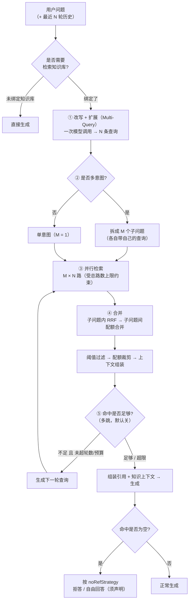

# 10 · RAG 检索策略设计

> **为什么还要单独一册**：`03 机制二` 已经定义了检索链路（三模式 · RRF · 三级启用过滤 · 阈值先于 TopN ·
> 去重 · 引用编号连续 · 上下文拼装与总长度守卫 · 无引用策略）。**那一册回答的是"怎么检"**。
>
> 但 2026-09 复盘时发现一个更根本的缺口（项目负责人原话）：
>
> > *"RAG 的整个策略还没有设计 —— 现在动手只能完成简单的问答，对于**复杂的问题扩展、多跳问题、
> > 多问题恢复**的收口整理都没有详细设计。"*
>
> 逐词核过，这个判断**成立**（见 §1.1 的对照表）：**查询扩展 / 多查询 / 子问题 / 问题分解 / 多跳 /
> 迭代检索 / HyDE / 查询路由 / 上下文压缩 / MMR / 检索缓存** —— 这些词在设计册与契约里**全部零命中**。
> 问题改写只有一个布尔开关和一句提示词，重排写的是"不做"，问答对停在 P2。
>
> **本册回答"检几次、检什么、什么时候停、失败了怎么退"** —— 也就是**策略层**。

---

## 一、缺口、目标与四条判据

### 1.1 现状对照（★ 逐词核实过，不是印象）

| 层次 | 现状 | 出处 |
|---|---|---|
| 三模式（向量 / 全文 / 混合） | ✅ 已成体系设计 | `03:138-142` |
| RRF 融合（公式 + k=60 + 为什么不用加权） | ✅ 已设计 | `03:146-159` |
| 三级启用过滤 · 阈值先于 TopN · 去重 · 引用编号连续 | ✅ 已设计 | `03:182-187` |
| 上下文拼装模板 + 总长度守卫（超窗按相关度裁剪 + 告警） | ✅ 已设计 | `03:189-212` |
| 无引用策略（拒答 / 自由回答） | ⚠️ **有两个分支，但没有"什么算无引用"的判据** | `03:195,210` |
| **问题改写** | ❌ **只有一个布尔开关 + 一句提示词** | `02:247` `rewriteEnabled`；`03:165` 流程图一个判断框；`workflow.ts` 的 `question-node.rewritePrompt` |
| **查询扩展 / 多查询** | ❌ 零命中 | — |
| **多问题分解与合并** | ❌ 零命中 | — |
| **多跳 / 迭代检索** | ❌ 零命中（`06:384` 有一句"复杂问题可多轮检索（先宽后窄）"，且紧接着写明**不实现**） | `06:372-388` |
| 重排 rerank | ❌ 现写"不做" | `09 §10.1 D` |
| 问答对（提升召回的补救手段） | ⏸ 停在 P2，作为 H1 不达标的补救 | `04:109-115` |

> **一句话**：机制二把"一次检索"做得很扎实，但**一次检索之外的东西一件都没有**。
> 而真实的企业提问往往不是"一次检索就能答"的 —— 这就是本册要补的。

### 1.2 本册要解决的三类问题

| 症 | 典型提问 | 为什么单轮检索答不好 |
|---|---|---|
| **问题扩展** | "差旅报销怎么算？"（同一件事在语料里有"差旅费标准""报销办法""出差补助"多种表述） | 用户只给了一种表述，向量与全文都按这一种去匹配 ⇒ **漏召** |
| **多问题** | "**A** 的报销标准是多少？**还有** B 的审批流程要走几步？" | 一句话两个意图。按整句检索 ⇒ 两个意图的相似度被平均掉，**两边都召不准**；即使都召到，答案也会**只答一半**（上下文被更长的那个意图挤占） |
| **多跳** | "X 公司的违约金上限是多少？"（语料里先要知道 X 的合同编号，条款再按编号索引） | **答案不在一个分段里**。第一步检索只能拿到"X 公司合同编号 = HT-2024-0813"，第二步才用这个编号去查条款 ⇒ 单轮**必然答不出** |

### 1.3 四条判据（★ 这一节是全文的约束，后面每一层都要满足）

> 策略层最容易变成"一堆调不动的旋钮"。所以先立四条**硬判据**，任何一层不满足就不许进 MVP。

| # | 判据 | 具体含义 | 反面（原项目的病） |
|---|---|---|---|
| 1 | **可关** | 每一层都有独立开关，关掉后**行为退回到机制二**（单轮单查询检索） | 策略写死在链路里，想关得改代码 |
| 2 | **可预算** | 每一层都有**上限**（次数 / 时间 / 字符），且**总预算**卡死 | 无上限的迭代，一次提问打十几次模型 |
| 3 | **可降级** | 任何一层失败，**降级到下一档继续答**，绝不因此报错 | 改写失败就整条问答失败 |
| 4 | **可解释** | 每层的产出与降级都**落在引用与日志里**（哪条引用来自哪个子问题、第几轮、哪条查询） | "为什么这条被召回"无人能答 |

> **判据 4 为什么值得单列**：`03 §2.2` 用 RRF 换来了"两路都靠前的排最前"这句可解释性。
> 策略层一上来就把它稀释了 —— **多路合并之后如果不记录来源，RRF 的可解释性就没了**。
> 所以 `SourceRef` 要带 `subQuestion` / `round` / `matchedQuery`（§8.2）。

---

## 二、总图：一次问答的检索分四层



**读这张图的四个要点**：

| # | 要点 | 说明 |
|---|---|---|
| 1 | **① 是唯一一次"必做"的模型调用** | 改写（`queryCount=1`）或改写+扩展（`queryCount≥2`）**是同一次调用的两种取值** —— 见 §3.1，这是省一次模型往返的关键。★ **同一道理：② 与 ① 也是同一次调用**（一次"查询理解"产出子问题与各自查询，见 §3.3.1）—— 图上分两层是**逻辑分层**，实现上**只有一次模型往返** |
| 2 | **②③ 是"意图展开"，④ 是"收口"** | 负责人说的"**多问题恢复的收口整理**"正落在 ④：多路合并必须**配额式**，否则问题 A 的命中会挤掉问题 B 的（§4.3） |
| 3 | ★ **⑤ 多跳全部发生在"生成前"** | 这是本册**最重要的一个选择** —— 它让 SSE 契约 **一个字都不用改**（§8.3） |
| 4 | **整条链有总预算与降级阶梯** | 见 §6：检索阶段时间预算默认 **5s**，超了就往下降一档 |

---

## 三、四层策略

### 3.1 ① 问题改写 + 查询扩展（Multi-Query）

#### 3.1.1 定：**改写与扩展是同一次模型调用**

**这是本节最省的一刀。** 两者输入相同（问题 + 历史）、目标相同（产出更好的检索输入），
**分成两次调用纯属浪费一次模型往返**：

```
输入：原始问题 + 最近 3 轮对话（多轮时）
输出（结构化）：{ "queries": ["查询1", "查询2", "查询3"] }
```

| 配置 | 行为 | 等价于 |
|---|---|---|
| `queryCount = 1` | 只返回 1 条 | **纯改写**（`rewriteEnabled` 的原文语义） |
| `queryCount = 3`（默认） | 返回 3 条语义互补的查询 | **改写 + 扩展** |
| `queryCount = 0` 或 `rewriteEnabled=false` | **不调用模型**，直接用原始问题 | 退回机制二 |

⇒ **旧的 `rewriteEnabled` 布尔不删、但语义收窄**为"要不要做这一步"，
条数由新字段 `queryCount` 控制（`02:247` 的 `RetrievalConfig` 与契约的 `RetrievalParams` 都要加，§8.1）。

#### 3.1.2 提示词要点（原来只有一句"把用户问题改写成独立、完整、可检索的一句话"）

**必须写清的六条**（缺一条就会产出坏查询）：

| # | 要求 | 为什么 |
|---|---|---|
| 1 | **消解指代与省略**（"它 / 这个 / 那笔"要按历史补全） | 多轮里这是改写的**主要价值**（`03` 的多轮场景） |
| 2 | **保留专有名词、编号、日期、金额原样** | 编号类查询正是全文检索的主场，改写改掉编号等于自毁 |
| 3 | **不改写提问意图**（不要"顺便补充"用户没问的东西） | 否则召回的是一堆看似相关的旁支 |
| 4 | **多查询之间必须语义互补**（同义改写 / 上位下位 / 口语↔书面），**不是换标点** | 这是"扩展"与"改写"的分界：重复的查询只是白花检索 |
| 5 | **语言与原名一致**（中文问题产出中文查询） | 混语言会同时污染两路检索 |
| 6 | **每条查询有长度上限**（建议 ≤ 60 字） | 长查询在全文路会退化（`tsquery` 的 AND 太严） |

**输出必须结构化**（`BeanOutputConverter<List<String>>` 或包装 record），
因为**解析失败要有明确的降级**（下一节）。这也把改写拉进了 `03 机制五` 的适用范围：
思考模式污染 JSON ⇒ 该模型按 M-I5 不该进这条链（`03 机制四`）。

#### 3.1.3 失败与降级（★ 判据 3）

| 失败 | 降级到 | 记什么 |
|---|---|---|
| 模型不可达 / 超时 | **原始问题单路检索** | 事件 + 日志 + `degradeLevel=1` |
| 结构化输出解析失败 | **同上**（并重试**一次**，仍失败才降） | 同上（"解析失败"要单独计数 —— 它是 `03 机制五` 那条可观测指标的来源） |
| 产出为空数组 / 全部重复 | 保留去重后的第一条；全空 ⇒ 原始问题 | 同上 |
| 某条查询长度超限 | 截断该条；不做替换 |  |

> **一条硬纪律**：**改写失败绝不能让问答失败。** 改写是"锦上添花"，原始问题永远是保底输入。
> 这与 `03 机制四`"端口隔离、能力缺口可局部绕过"是同一套思路 —— **把不确定性关在一层里**。

---

### 3.2 ② 多查询的检索与合并（不是"多路 × 多模式"）

#### 3.2.1 路数怎么算（★ 这条容易想错）

**错误算法**：`查询数 × 模式数`。混合模式内部本身就是"向量 + 全文两路 RRF"，
再乘上去会得到 `3 × 3 = 9` 路，**且语义重复**（同一条查询的向量路与全文路已经在混合模式里融合过了）。

**正确算法**：

| 配置的 `mode` | 一条查询产生的路数 | N 条查询的总路数 |
|---|---|---|
| 向量检索 | 1 | N |
| 全文检索 | 1 | N |
| **混合检索**（推荐默认） | 2（内部向量 + 全文，先 RRF） | 先 **每条查询各自融合成一路**，再 **N 路 RRF** |

⇒ **RRF 天然可递推**：混合模式内部是一次 RRF，多查询是第二次 RRF。
**不需要新算法**（这是选 RRF 而不是加权求和的又一个收益：融合运算满足结合律式的可叠加）。

#### 3.2.2 并行执行

- N 条查询**并行**（虚拟线程 + `CompletableFuture`，同 `09 §5.3.1` 的零件选择）
- 时间 ≈ **单次检索**（而不是 N 倍）—— 这是"多查询在延迟上几乎免费"的原因
- 数据库侧：N 条向量查询 = N 次 HNSW 查询；N 条全文 = N 次 GIN 查询。**在 MVP 规模下压力可忽略**，
  但要在 `analytics` 里能看到"平均路数"（§7.1），否则将来慢下来不知道是不是它

> ★ **落地修订（0.4.0）**：**顺序执行**，不是并行。原因：整个命中测试在一个
> **只读事务**里、共用一条 JDBC 连接，而连接不是线程安全的 —— 并行意味着"每条查询各自的事务与连接"，
> 那是另一件事（也是它在真栈上唯一能被验证的样子）。
> 代价由两个上限兜住：总路数 ≤ 6（§6.2 第 4 项）、检索阶段时间预算 5s（§6.2 第 6 项，
> **预算耗尽就按已完成的查询继续**）。并行化列为后续项。

#### 3.2.3 失败与部分成功

| 情形 | 处理 |
|---|---|
| 第 i 条查询报错 | **丢弃该路**，其余照常合并（记事件） |
| 全部查询失败 | 降级：用**原始问题**跑一次单路检索 |
| 某路返回 0 条 | 正常（不记错）—— 它可能就是没命中 |

> **为什么"部分成功"要单独设计**：多路并行下"一条失败"是常态（超时、网关抖动）。
> 若按"任一路失败即整体失败"处理，多查询会变成一个**降低可用性**的特性 —— 与初衷相反。

---

### 3.3 ③ 多问题分解与合并（★ "收口整理"就落在这一节）

#### 3.3.1 定：**分解与改写/扩展是同一次调用**（这一步省 M 次模型往返）

如果按"先改写 → 再判断多意图 → 再对每个子问题各改写一次"来做，一次多意图提问要调 **2 + M** 次模型。
**不划算，而且没必要** —— 三件事的输入完全相同（问题 + 历史），目标也都是"产出更好的检索输入"。

⇒ **定：一次"查询理解"调用，输出结构如下**（这就是 §二 总图里 ① 与 ② 的实现形态）：

```jsonc
{
  "subQuestions": [
    { "question": "A 的报销标准是多少", "queries": ["差旅费报销标准", "A 差旅补助标准"] },
    { "question": "B 的审批流程要走几步", "queries": ["B 审批流程步骤", "B 流程节点"] }
  ]
}
```

| 情形 | 产出 | 下游 M |
|---|---|---|
| 单意图 | `subQuestions` **只有一个元素**，其 `question` = 改写后的独立问题 | 1 |
| 多意图 | 每个子问题一个元素、各带自己的查询 | ≥ 2 |

**为什么这样分**：模型在同一上下文里同时做"判断意图数"与"给出各自的查询"，
比拆成两次更**一致**（拆开做时，第二次调用看不到第一次的判断依据）。

⚠️ **但要把"退路"留出来**：一次做三件事（判意图 / 改写 / 扩展）对弱模型偏难。
⇒ 配置项 `queryUnderstandingMode`：`single-call`（默认）| `two-call`（判意图与产出查询分两次调）。
**默认走省的那条，实测不行再切** —— 这与 `09 §5.3`"把解释器写成两段"是同一种留缝手法。

#### 3.3.2 分解的校验规则（★ 结构化输出必须校验，不能信模型）

| 校验 | 规则 | 失败时 |
|---|---|---|
| 子问题数上限 | `> maxSubQuestions`（默认 3）⇒ **按顺序截断** | 记事件（不要静默） |
| 子问题数下限 | 产出空数组 ⇒ 视为**单意图**，用改写后的原始问题 | 记事件 |
| 子问题去重 | 两个子问题语义重复（字符串包含关系可粗判）⇒ 合并 | — |
| 每个子问题的查询非空 | 空 ⇒ 用该子问题的 `question` 兜底 | — |
| 子问题长度 | 超限截断 | — |

#### 3.3.3 合并：**子问题内 RRF → 子问题间配额合并**（这是本节的核心）
**先说不能怎么做**：把所有子问题的所有路**丢进一个大 RRF 全局排名**。

**为什么不行**：子问题之间**本来就不该互相竞争排名**。
问题 A 的资料若与全局查询词面更近，就会**把问题 B 的名额全挤掉** —— 表现为"用户问了两个问题，系统只答了一个"。
**这正是负责人说的"多问题恢复的收口整理"要解决的事。**

⇒ **两段合并**：

| 段 | 做什么 | 参数 |
|---|---|---|
| **第一段 · 子问题内** | 某个子问题的 N 条查询 → RRF 合并 → 得到该子问题的**候选序** | RRF `k=60`（沿用，不新增算法） |
| **第二段 · 子问题间** | 每个子问题**保底配额** `q` 条进最终集合；剩余名额按**全局 RRF 分**补足 | `q = max(2, topN / M)` 向下取整 |

**配额的效果**（举例 `topN=5`、`M=2`）：`q = max(2, 5/2) = 2`
⇒ 每个子问题**至少 2 条**（共 4 条），剩下 1 条给全局最高分。
**即使 A 的相关度远超 B，B 也拿得到 2 条资料** ⇒ "两个问题都被回答"从**策略上**被保证，而不是靠运气。

> ★ **落地修订（0.4.0，第 12 周）**：第二段（子问题间**配额合并**）**没有**在这一版做。
> 这一版的行为是：子问题内 RRF 之后，**按子问题顺序拼接**、取 TopN ——
> ★ 它**不**是全局 RRF（那是本节开头明确否掉的做法），但也**还没有**保底配额，
> 所以"前一个子问题占满 TopN ⇒ 后面的子问题一条都进不了"这件事是**可能**的。
> 配额合并在第 13 周（0.4.1 `RrfQuotaJoiner`），判据是"问两个问题 ⇒ **两个都被回答**"。
> （这一版把顺序与限额都收进了 `HitTestView.trace`：`subQuestionCount` / `queryCount` / `pathCount`，
> 所以第 13 周的改动**有前后读数可比**。）

#### 3.3.4 引用编号与生成（★ 决定契约是否要改）
| 项 | 设计 |
|---|---|
| **编号** | 全局**从 1 连续递增**（契约硬要求，`stream-types.ts:107`）。顺序 = **子问题顺序 → 子问题内排名** |
| **来源标注** | `SourceRef` 加可选字段 `subQuestion`（从 1 起）⇒ 前端**可以**按子问题分组展示（不加强制，见 §8.2） |
| **生成次数** | ★ **一次生成**（一次 SSE、一次 `done`）—— 不做"每个子问题各生成一次再拼接" |
| **上下文组织** | 按子问题**分组标注**：`【问题1 的相关资料】[1][2]` / `【问题2 的相关资料】[3]` |
| **提示词要求** | **逐项回答**；某子问题资料不足 ⇒ **显式说明**（"关于 B，资料里没有找到"），**不许默默跳过** |

> **为什么坚持"一次生成"**：多次生成会与 SSE 契约（单条 `delta` 流 + `done` 里的单份 `tokens`）
> 直接冲突，且前端并没有"多问题分别回答"的交互预期。
> ⇒ **多问题的检索是并行的，但"收口"成一次回答** —— 这既是契约要求，也是产品上更自然的形态。

---

### 3.4 ⑤ 多跳迭代检索（★ 默认关闭，但实现与开关进 MVP）

#### 3.4.1 它解决什么

**答案不在一个分段里**的链式问题：

```
问："X 公司的违约金上限是多少？"
  第 1 轮检索 → 命中"X 公司合同编号 HT-2024-0813"（这是**线索**，不是答案）
  第 2 轮检索 → 用编号去查条款 → "违约金不超过合同总额的 20%"
```

单轮检索在这里**必然答不出** —— 这不是参数问题，是**信息的物理位置问题**。

#### 3.4.2 触发条件（★ 默认关，这是有意的）

| 项 | 值 | 理由 |
|---|---|---|
| `multiHopEnabled` | **false（默认）** | 它必然增加**延迟与 token**，而 MVP 的 B4 是**首字延迟 ≤10s**（`04:274`，CPU 推理）。**默认关是把这个成本留给想付的人** |
| 触发条件 | 首轮**最高分 < threshold** **或** 命中数 `< minHits`（默认 3） | 规则判定，**不额外调用模型**（省一次往返） |
| `maxHops` | 2（含首轮 ⇒ 最多再检 1 次）；上限 3 | |
| 是否用模型自评触发 | **不默认**。模型自评要额外一次调用，且弱模型自评不可靠 | |

#### 3.4.3 下一轮查询从哪来

**由模型生成**（开启多跳后，这是唯一新增的模型调用）：

| 项 | 设计 |
|---|---|
| 输入 | 原始问题 + **已命中分段的标题与前 100 字**（★ **不是全文**：省 token，且标题已足够暴露"缺什么"） |
| 输出（结构化） | `{ "sufficient": true/false, "nextQuery": "..." }` |
| 若 `sufficient=true` | **立即停止迭代**（这是最省的停止路径） |
| 若 `nextQuery` 为空且 `sufficient=false` | 停止（模型没想法了，不再硬编） |

#### 3.4.4 停止条件（**四条，任一命中即停**）

| # | 条件 | 为什么必须有 |
|---|---|---|
| 1 | `sufficient = true` | 正常路径 |
| 2 | 达到 `maxHops` | 硬上限 |
| 3 | **检索阶段时间预算耗尽**（§6） | 否则会拖垮首字延迟 |
| 4 | ★ **本轮结果与已有结果的 segmentId 集合 Jaccard 相似度 > 0.6** | **防原地打转**：模型给不出新查询时会反复问同一件事，靠重合度识别比靠"轮数"更准 |

#### 3.4.5 上下文与引用怎么累积

- 各轮的命中**累积**，最后一并参与 §四 的合并（跨轮也用 RRF —— **同一个算法，第三次复用**）
- `SourceRef` 加可选字段 `round`（从 1 起）⇒ 能看出"这条引用是靠多跳才找到的"
- **多跳与多问题可叠加**：第 2 轮检索**按"单条查询"发起**（每个查询各自决定要不要再查）
  —— ★ **这是落地时的一次修订**（原文写"按子问题分别发起"）：官方 advisor 的并行粒度是"每查询一个任务"，
  而 advisor 的 `context` **不是线程安全**的 ⇒ 跨任务共享"本轮已收集的文档"会有竞态。
  **策略意图不变**（命中不足就再检一轮），只是粒度细化到单条查询。详见 `11 §4.4.3`

#### 3.4.6 失败与降级

| 情形 | 处理 |
|---|---|
| 第 2 轮检索失败 | **用第 1 轮结果继续生成**（绝不报错） |
| 判定调用失败 | 停止迭代，用已有结果生成 |
| 第 2 轮 0 命中 | 停止，用第 1 轮结果生成（记事件：多跳未改善 ⇒ 这是 `analytics` 里判断"该策略值不值"的数据） |

> ★ **全部发生在"生成前"** —— 这是 §8.3 那条"**SSE 契约一个字都不用改**"的前提，**不能破坏**。

---

## 四、合并与后处理

### 4.1 一个 RRF，复用三次（★ 不新增任何融合算法）

| 用到的地方 | 融合对象 | 层次 |
|---|---|---|
| 混合模式内部 | 向量路 + 全文路 | 第 1 层（`03 §2.2` 已有） |
| **多查询** | N 条查询各自的结果 | 第 2 层（§3.2） |
| **多子问题 / 多跳轮次** | 各意图单元内部的候选序 | 第 3 层（§3.3.3 / §3.4.5） |

**为什么这点值得单独说**：如果每一层都用不同的融合方式（一层 RRF、一层加权、一层重排分），
**参数会互相纠缠，调不动也解释不清**。统一用 `score(d) = Σ 1/(k + rank_i(d))`，`k=60`：

- **量纲问题只解决一次**（`03 §2.2` 的原始理由）
- **排名语义可叠加**（多次出现累加 ⇒ 天然表达"在多个路数里都靠前"）
- **可解释**：任一条引用都能回溯"它在哪几路里排第几"（配合 §8.2 的 `matchedQuery`）

### 4.2 去重

| 项 | 规则 |
|---|---|
| 主键 | **`segmentId`**（同一分段在多路命中 ⇒ 累加 RRF 分，只出现一次） |
| 同文档抑制 | 见 §4.4 的廉价启发式 (i) |

> `03:186` 已写"同一分段可能被向量与全文同时命中（混合模式下），需去重" ——
> 多查询/多跳把这个需求**放大了 N×M 倍**，规则不变、只是执行次数变多。

### 4.3 配额合并

见 **§3.3.3**（子问题保底配额）。**这是"多问题收口整理"的落点，不要挪到别处实现。**

### 4.4 上下文预算分配（★ 对 `03 §2.4` 长度守卫的细化）

`03 §2.4` 的守卫是"**拼装后若超窗，按引用相关度从低到高裁剪 + 告警**"。多意图场景下这条不够，
因为它会把**整个意图单元**裁掉（那个意图的答案就没了）。

⇒ **升级为配额式分配**：

| 步骤 | 做法 |
|---|---|
| 1 | 算总预算：`模型上下文窗口 − 系统提示 − 历史 − 输出预留`（输出预留按 `maxTokens` 估计） |
| 2 | **按意图单元均分**：`每单元预算 = 总预算 / M` |
| 3 | 单元内按 RRF 序填充，超出该单元预算的**连带降权**（该分段不进上下文，但仍可能留在引用列表里 —— 见下） |
| 4 | 单元有剩余（该单元资料少）⇒ 余量**回流**给全局最高分的单元（不浪费） |
| 5 | 仍然超窗 ⇒ 才退回 `03 §2.4` 的"从低到高裁剪 + 告警" |

⚠️ **一个要显式决定的点**：**被裁掉的分段还算不算"引用"**？
⇒ **算**（保留在 `refs` 里），但**不能出现在正文的 `[N]` 标注**里 ——
否则用户点开引用看到的是"模型没读过的资料"。**契约上这由 `index` 的连续性保证**：
只对进入上下文的分段编 `index`。**这条要写进后端实现，很容易做错。**

### 4.5 重排：**MVP 仍然不做**，但补两个零成本的替代

`09 §10.1 D` 已定"rerank 不做"，**本册复核后维持**：

| 为什么不做 | 说明 |
|---|---|
| 需要一个额外模型 | cross-encoder 重排是另一个模型 ⇒ 经网关也是一个部署对象；而 60 分段的**向量模型**已经能从 RRF 里挑出顺序 |
| 收益与成本不匹配 | 我们的召回瓶颈在**语料覆盖与切分质量**（H1/H2 的假设），不在"最后 20 名的排序" |
| 触发条件（要提前记下） | ★ 当 **B1 命中率达标但 B3 引用准确率不达标**时（= 召回够了但排序不对）才值得引入 |

**替代（零新组件、纯计算）**：

| # | 启发式 | 作用 |
|---|---|---|
| (i) | **同文档分段抑制**：同一 `documentId` 在 TopN 里最多占 `ceil(topN / 2)` 条，其余顺延 | 防止一份长文档占满上下文（MMR 的廉价近似，且**不需要新参数**） |
| (ii) | **词面重合度做 tie-breaker**：RRF 分相同时，与查询**词面重合更多**的排前（全文路已经算过，直接复用） | 中文场景下，编号/专有名词类的并列很常见 |

---

## 五、无引用与拒答的判定细则

### 5.1 先定义"什么算无引用"（★ 现在是空的）

`03:195/210` 有 `noRefStrategy` 两个分支，但**没有任何判据**。补三种情形：

| 情形 | 定义 | 谁判定 |
|---|---|---|
| **A · 检索为空** | 三级启用过滤后**一条都没有** | 检索层（事实） |
| **B · 全部低于阈值** | 有候选，但**阈值过滤后为空** | 检索层（事实） |
| **C · 有资料但不支持答案** | 命中了、也过阈值了，但**资料内容回答不了这个问题** | 生成层（模型在答案里说明） |

### 5.2 判定与行为

| 情形 | `noRefStrategy = 拒答` | `noRefStrategy = 自由回答` |
|---|---|---|
| A / B | **直接返回固定话术**（不调用模型 —— 省一次无意义的生成） | 正常生成，但**必须显式声明**"以下内容不基于知识库"（提示词里给死这句话） |
| C | 提示词要求模型**明确说明资料不足**，**不得编造引用** | 同左（自由回答只是允许它超出资料作答，**不解除"不许编造引用"**） |

### 5.3 话术要固定且可行动（★ 沿用 `08 §4.1` 的 hint 哲学）

| 情形 | 建议话术（可配） |
|---|---|
| A | "知识库里没有检索到相关内容。" + hint："可以换个说法，或确认相关文档已上传并完成向量化。" |
| B | "检索到了一些内容，但相关度都没达到当前阈值（{threshold}）。" + hint："可以在应用配置里调低阈值，或补充更贴近的资料。" |
| C | 由模型在答案内说明（不设固定话术 —— 它需要结合具体缺口表述） |

> **"B 要带上当前阈值"这个细节很重要**：它把"为什么没答案"从"系统坏了"变成"**这个旋钮需要调**" ——
> 运营人员看完知道下一步做什么。**只给"未找到相关内容"等于让用户停在原地。**

### 5.4 阈值必须随向量模型重新校准（★ 一条容易埋雷的地方）

`RetrievalParams.threshold` 是**库级 / 应用级**配置，但**不同向量模型的相似度分布不同**
（同一个 0.6 在一个模型上是"很相关"，在另一个模型上可能是"随便什么都在 0.6 以上"）。

| 要求 | 说明 |
|---|---|
| 换向量模型 ⇒ **阈值要重新校准** | 建议在**应用配置页**给一句提示（前端已有 `threshold` 输入框，加 hint 即可） |
| `kb` 的向量模型有 `embeddingLocked` 保护（`api/knowledge.ts`） | 已有向量化内容时不许换模型 —— 这条**间接保护了阈值**，是好事 |
| 校准方法 | 用命中测试页（`POST /retrieval/test`）对同一批问题扫几个阈值，看 B1 的拐点 |

---

## 六、预算与降级（★ 保证它不会拖垮首字延迟）

### 6.1 为什么必须有这一节

`04:274` 定的 **B4 是"首字延迟 ≤ 10 秒"（CPU 推理环境）**。而首字延迟 =

```
首字延迟 = 检索阶段（含改写、分解、多跳的模型调用） + 模型首个 token 的时间
```

策略层每加一层，**都在往"检索阶段"里塞东西**。没有预算，多层策略会把首字延迟吃掉，
而表现是"用户觉得系统卡死了"——**与 RAG 质量无关，但用户先感受到的正是它**。

### 6.2 预算表（★ 全部可配，默认值即推荐值）

| # | 预算项 | 默认 | 上限 | 超限行为 |
|---|---|---|---|---|
| 1 | 查询理解模型调用 | **1 次** | 1 次（`two-call` 模式为 2 次） | — |
| 2 | 子问题数 `maxSubQuestions` | **3** | 5 | 按顺序截断 + 记事件 |
| 3 | 每子问题查询数 `queryCount` | **3** | 5 | 截断 |
| 4 | ★ **总检索路数** | **6** | 9 | 按子问题顺序截断（每个子问题至少保住 1 条查询） |
| 5 | 多跳轮数 `maxHops` | **2**（含首轮） | 3 | 停止迭代 |
| 6 | ★ **检索阶段时间预算** `retrievalBudgetMs` | **5000** | 8000 | **降级到"已完成的轮次"并进入生成** |
| 7 | 上下文总字符 | 按模型窗口推算 | — | 配额裁剪（§4.4）+ 告警 |
| 8 | 单次问答的模型调用总次数 | 2（理解 + 生成） | 4（+多跳判定 + 重试） | 停止继续调用，用已有结果生成 |

> **第 6 项是这一节的灵魂**：**时间预算是唯一能兜住所有层的那个上限** ——
> 因为"多少次调用"可以预估，"每次调用多久"预估不了（上游模型抖动、网关重试）。
> 所以实现上要有一个**统一的检索阶段计时器**，每一层在开始前检查余量。

### 6.3 降级阶梯（★ 判据 3 的落地）

从最好到最差，**任一步骤失败就往下一档走，绝不失败**：

| 档 | 行为 | 什么时候到这一档 |
|---|---|---|
| **D0** | 改写+扩展 + 分解 + 多跳（全开） | 一切正常 |
| **D1** | 去掉多跳 | 时间预算用掉 60% / 多跳判定失败 |
| **D2** | 去掉分解（子问题合并为一个） | 查询理解超时 / 子问题校验全败 |
| **D3** | 只做改写（单查询） | 扩展产出不可用 |
| **D4** | ★ **原始问题单路检索** | 改写/扩展完全不可用 —— **这是永不低于的底线** |

**每一步降级都必须可观测**（记 `degradeLevel` + 原因到日志与 `analytics`）。
否则表现是"这周的答案质量莫名下降"，而**没有任何地方记录当时降级了**。

### 6.4 一条必须写进后端实现的约束：**检索阶段也要发心跳**

契约 `stream-types.ts:36` 已明确："发送方在**无业务帧可发**的间隙（**模型思考、检索**）按
`HEARTBEAT_INTERVAL_MS` 发" —— **契约早就预料到检索期间会静默**。

| 项 | 值 |
|---|---|
| 心动间隔 | 20s（`HEARTBEAT_INTERVAL_MS`） |
| 前端闲置超时 | 60s（`IDLE_TIMEOUT_MS`） |
| 我们的检索预算 | **5s（默认）** ⇒ 正常路径**根本不会触发** |
| ⚠️ 但降级路径可能更久 | 所以**心跳逻辑必须覆盖"检索阶段"**，不能只在"生成阶段"发 —— 这是很容易漏的一处（生成阶段才想到心跳，检索阶段裸等） |

---

## 七、可观测与评测

### 7.1 埋点（每层都要有，否则 §6.3 的降级不可见）

| 层 | 埋什么 | 用途 |
|---|---|---|
| 查询理解 | 原始问题 / 改写后的子问题与查询 / 调用耗时 / **解析是否失败** | 判断这层到底有没有用 |
| 分解 | M（意图数）/ 是否被截断 | 多意图提问的真实占比 |
| 多查询 | 路数 / 每路命中数 / 每路最高分 | 判断"扩展"是有效还是白花 |
| 多跳 | 触发次数 / 用了几个轮次 / **停止原因**（4 种之一）/ 第 2 轮是否带来新分段 | 判断多跳的边际收益 |
| 合并 | 每单元的配额、被裁掉几条 | 解释"为什么这个子问题答得少" |
| 降级 | `degradeLevel` + 原因 | ★ 见 6.3 |
| 无引用 | A/B/C 命中哪一种 | 区分"语料缺"与"阈值高" |
| 成本 | **该次问答的全部模型调用之和**（理解 + 判定 + 生成） | 计费与配额（§8.4） |

### 7.2 `analytics/quality` 新增指标（★ 让策略可被评估）

现有 `QualityMetrics`（`api/analytics.ts`）已有 `avgRefCount` / `firstTokenLatencyP50` / `artifactFailureRate` / 赞踩数。
**本册新增（同样走可选字段，不破坏契约）**：

| 指标 | 含义 | 回答什么问题 |
|---|---|---|
| `avgRetrievalPaths` | 平均检索路数 | 扩展是不是开太大 |
| `rewriteParseFailureRate` | 查询理解解析失败率 | 当前模型能不能胜任这层（**这是模型准入的实测数据**） |
| `multiHopTriggerRate` / `multiHopGainRate` | 触发率 / 带来新分段的比例 | ★ **多跳值不值**（增益率低就该默认关掉） |
| `degradeRate` | 降级发生率 | 预算是否太紧 |
| `noRefBreakdown` | A/B/C 三情形的占比 | ★ 区分"**语料缺**"（A）与"**阈值调错**"（B）—— 这两者的处置**完全不同** |

### 7.3 ★ B1 命中率的口径必须更新

`04:271` 现在的 B1 定义是：**"问题集中，TopN=5 内包含期望分段的比例"**。

策略层上线后这个口径**不够**了，因为"期望分段"可能来自不同子问题 / 不同轮次：

| 项 | 新口径 |
|---|---|
| 分母 | 问题集中的问题数（不变） |
| 分子 | ★ **最终合并后的上下文内**包含期望分段（而不是"第一轮 TopN 内"） |
| 附带记录 | ★ **是否靠多跳才命中**、**是否靠分解才命中** ⇒ 得到策略的**边际贡献** |
| 反面 | 若新口径下 B1 明显上升、但 B2（答案可用率）没动 ⇒ 说明"召回上去了但没用上"，问题在上下文组织与提示词，不在检索 |

> **这条很重要**：口径不更新的话，策略上线会让 B1 变成"怎么调都好看"的数字，
> 而 `04:276` 的决策点（H1 不成立就进优化循环）**就失去了判据**。

### 7.4 问答对：★ 建议从 P2 **升进 MVP**

`04:109-115` 把问答对（问题 ↔ 分段关联）放在 P2，触发条件是"H1 不达标时升 P0"。
本册复核后**建议直接进 MVP**，两个理由：

| 理由 | 说明 |
|---|---|
| 它是**策略层唯一的确定性召回手段** | 改写/扩展/多跳都是"赌模型"，问答对是**人工标定的精确映射** —— 策略越复杂，越需要一个兜底的真值 |
| **早建便宜** | 它需要新表（`(question, segmentId)` 关联 + 命中计数），而 M2 正在建表的窗口期。晚做要补迁移 + 回填 |

⇒ 若采纳，M2 建表时留位（`02` 的聚合清单要加一个 `QaPair`），检索时**与向量/全文并列为第 3 路**（仍用 RRF 融合，**不新增算法**）。

### 7.5 调参方法（★ 防止"凭感觉调旋钮"）

| 步骤 | 做法 |
|---|---|
| 1 | 用 **50 个问题集**（`04:248`，业务人员标注期望分段）作为固定回归集 |
| 2 | **消融实验（Ablation）**：逐项关掉一层，测 B1/B2/B4 ⇒ 得到每层的**边际贡献** |
| 3 | 只在"边际贡献为正"的层上花时间 |
| 4 | 每次调参**记录到 CHANGELOG**（否则三个月后没人知道当前默认值是怎么来的） |

⇒ 这要求策略开关**可运行时配置**（开发/评测场景），而不是编译期常量。

### 7.6 ★ 对照实验：埋点里留「配置版本」维度（留缝，issue `#88`）

> **为什么补这一小节**：换提示词、换模型、调分段参数、调阈值 —— 这些改动今天**每次都是全量上线**，
> 改前改后**无法归因**（`#88` 现象）。全量上线后看总体指标是没用的：**总体指标同时受多个变量影响**。
>
> ★ 本节只留**一个维度**，不做分流 —— 分流要动路由与配额，与 MVP 无交集（`#88` 处置 ③）。

#### ① 结论：埋点里带「配置版本」，让同一份读数**可分组**

`§7.1` 的埋点回答的是"这层做了什么"（子问题数 / 查询数 / 路数 / 降级档 / 多跳轮次）。
它**回答不了**："这周的 B1 掉了，是提示词改的、还是阈值改的？"
⇒ 补一个维度就够：**"这一次问答是哪一套配置做出来的"**。

#### ② 位置（★ 只留维度，不做分流）

| 维度名 | 类型 | 取值来源 | 为什么是它 |
|---|---|---|---|
| ★ `configVersion` | `string` | ★ **配置快照的指纹**（不是版本号）—— 见 ③ | 一个维度就能把"改前 / 改后"分成两组 |
| `promptVersion` | `string` | 提示词模板的指纹（`prompt-configs` 那一域尚未建表 ⇒ 今天恒空） | 提示词是**改得最频繁**的那一个变量 |
| `retrievalParamsVersion` | `string` | `RetrievalParams` 那 7 个开关的指纹（`§8.1`） | 调阈值/路数是另一类改动，与提示词分开才归因得到 |

★ **落点**：`§7.1` 的埋点表新增一行（或进 `analytics` 侧的读数）。今天 `HitTestView.Trace` 是埋点口径的载体
（`10 §7.1` 的落点）—— 加维度时**它必须一起加**，否则维度只写在文档里。

#### ③ ★ 为什么取值是"指纹"而不是"版本号"

| 做法 | 今天能不能落 | 结论 |
|---|---|---|
| **版本号**（"这版提示词是 v3"） | ❌ **落不了**：提示词配置域**尚未建表**（`assistant` 侧 `prompt-configs` 零消费方），检索参数也**没有版本表** | 等配置文件的数据模型定了再说 |
| ★ **配置快照的指纹**（对"生效中的那几个值"做哈希） | ✅ **今天就能落**：`as_assistant` 与 `kb_knowledge_base` 上已经存着生效值（`retrieval_*` 那几列） | ★ **选它** —— 它**不依赖**任何尚未存在的数据模型 |

★ 指纹的**唯一要求**：**同一套配置 ⇒ 同一个值；改任何一个参与判定的值 ⇒ 值必须变**（与 `SEG-I7` 的
`content_hash` 是同一套纪律）。⚠️ 它**只用来分组**，不用来做业务判定 —— 别把它变成第二个密级/权限谓词。

#### ④ ★★ 冲突时谁赢

| # | 冲突 | 谁赢 | 为什么 |
|---|---|---|---|
| 1 | **埋点维度 vs 产品功能**（"工作流版本与回滚" `06:208` / `M5.5`） | ★ **两条路，别合并**：产品版本是**给用户的**（编排回滚），本维度是**给研发的**（改前改后归因） | `#88` 的根因就是把"版本管理"只当成产品能力，**没当成研发过程能力**。合并会让研发侧永远拿不到读数 |
| 2 | **留维度 vs 做分流** | ★ **维度现在加，分流不做** | 分流要动路由与配额（与 MVP 无交集）；而维度是**只读**的，加了不影响任何行为 |
| 3 | **`configVersion` vs 固定的 50 问回归集**（`§7.5` 步骤 1） | ★ **两者互补，不互相替代**：回归集是"**换配置前后各跑一遍**"，维度是"**生产流量按配置分组**" | 回归集是**离线快照**（`10:573` 已定），维度是**在线分组** —— 缺任一个，"改前改后"都只有一半证据 |
| 4 | **埋点维度 vs `#73` 的指标骨架** | ★ **先落维度，指标骨架随 `#73`** | 维度是**一条字段**，骨架是**一套管线**；维度先落，骨架落地时它就有地方装了 |

#### ⑤ 为什么现在不实现分流 / 不做实验平台

| # | 理由 |
|---|---|
| 1 | **分流要动路由与配额**：那会把"一次问答走哪套配置"变成运行时决策，而配额与降级阶梯（`§6`）都建立"一次问答一套配置"的前提上 |
| 2 | **没有连续两次"改了之后不知道好不好"的调整**：现在还没有那个痛点（`#88` 的触发条件写的就是它） |
| 3 | ★ **但维度必须先留**：`#88` 危害 ③ 的原话 —— 事后补要动**配置的数据模型**（"这段提示词的哪一版在服务哪个流量"），属**结构性改动** |

#### ⑥ 触发条件

**任一成立**即立项：

1. ★ 出现**连续两次"改了之后不知道好不好"的调整**（`#88` 处置 ② 的原话）；
2. `#73` 的指标骨架落地后，出现"同一指标在两个时间点差异明显、但说不清是谁改的"；
3. `#62`（advisor 链挂点）落地 —— ★ 那之后 prompt 与 advisor 链**会同时在动**，不分组就归因不了（`#88` 危害 ②）。

#### ⑦ ★ 判据（留缝做完算什么）

1. ✅ 埋点里有配置版本维度，且**取值来源写清**（③ 指纹，不是版本号）；
2. ✅ `§10.3` 的 V1 清单里有"对照实验"一行且带触发条件（见该表）；
3. ★ **一条能红的断言**：`ConfigurationVersionAbsenceTest`（`backend/src/test/java/cn/lincoln/aiplatform/caliber/`）——
   它断言 `HitTestView.Trace` 的字段清单里**没有 `configVersion` / `promptVersion` / `experimentGroup`**，
   且检索模块的类上**没有任何实验分组字段**。谁把维度（或分流）加进来，它**立刻变红**。

---

## 八、契约影响（★ 前端契约是冻结的，这一节要**先于代码**定下来）

> **好消息**：本册全部改动都是**"给已有类型加可选字段"**，**没有一个破坏性变更**。
> 这正是本项目那条纪律的适用面 —— *"冻结契约下只加可选字段，前端不读也照常工作"*（`api/identity.ts:46-47`）。

### 8.1 `RetrievalParams` 新增可选字段（`frontend/src/api/retrieval.ts`）

```ts
export interface RetrievalParams {
  mode: RetrievalMode
  threshold: number
  topN: number
  noRefStrategy: '拒答' | '自由回答'

  // ↓↓↓ 本册新增（**全部可选**；缺省 = 后端按平台默认值处理，见 §6.2）
  /** 查询理解：改写 + 扩展一次产出的查询条数。1 = 只改写；0 = 不做。缺省 3 */
  queryCount?: number
  /** 是否允许把多意图问题拆成子问题。缺省 true */
  decomposeEnabled?: boolean
  /** 子问题上限。缺省 3 */
  maxSubQuestions?: number
  /** 多跳：首轮命中不足时是否再检一轮。缺省 false（★ 见 §3.4.2） */
  multiHopEnabled?: boolean
  /** 多跳最大轮数（含首轮）。缺省 2 */
  maxHops?: number
  /** 检索阶段时间预算（毫秒），超预算即降级。缺省 5000 */
  retrievalBudgetMs?: number
  /** 单个子问题在最终上下文里保底占几条（缺省由 topN/M 推导，见 §3.3.3） */
  perIntentQuota?: number
}
```

**两条必须一起做的**：

| # | 要求 | 为什么 |
|---|---|---|
| 1 | `GET /knowledge-bases/:kbId/retrieval` **必须返回这些字段的默认值**（不是 404、不是省略） | `08 §4.6` 已定"新库的检索参数返回默认值而不是 404"；前端已有因"回落到硬编码值而被悄悄带偏"的教训 |
| 2 | `PUT` 已是 `Partial<RetrievalParams>` | ⇒ 新增可选字段**天然兼容**，前端零改动 |

### 8.2 `SourceRef` 新增可选字段（`frontend/src/api/stream-types.ts`）

> ★★ **2026-10-14 裁定（第 17 周 SSE 契约测试第一段对账时发现）：这三个字段\*不\*进契约，改走埋点。**
>
> **发现**：本节下面那段代码块写着"本册新增（可选）"，但 `frontend/src/api/stream-types.ts` 的 `SourceRef`
> **至今只有 10 个字段**（`index/title/docName/kbName/score/rank?/full?/segmentId?/documentId?/kbId?`）——
> 设计册承诺了、契约里没有。实现侧按**契约**做，并用 `containsExactlyElementsOf` **双向钉死**（谁加谁红）。
>
> **为什么裁定"不进契约"而不是"补进去"**：
> 1. ★ **这三个维度是"归因"信息，不是"回执"信息** —— 它们的用途是排查/调参（"这条引用凭什么被召回"），
>    而**接口回执的每一个字段都会长出消费者期望**（前端会想展示它、文档会想解释它、测试会钉它）；
> 2. ★ **归因维度的正确载体是埋点**（§7.1）—— 埋点不进契约、改动零成本、且已经承载同类维度
>    （`#88` 的 `configVersion` 也走埋点）。B1/B3 不达标时的归因**靠埋点读数**，不靠引用回执字段；
> 3. ★ 与 `#79` 同族的教训：**契约里多一个"没人用"的字段，与页面多一个"没人调"的端点是同一类病**（三缺一）。
>
> **⇒ 落地**：① 契约**不加**这三个字段（`SourceRef` 保持 10 字段）；② 三个维度改为**埋点维度**
> （`subQuestion` 从 1 起 / `round` 从 1 起 / `matchedQuery`），随 §7.1 的埋点一起落；
> ③ ★ **触发器**：若将来真要做"引用抽屉按子问题分组 / 按轮次标注"的 UI，那是**加可选字段**的一批（契约冻结期只加可选字段），
> 本节的代码块到那时**再启用** —— 现在它是**被取代的提案**。

```ts
// ⚠️ 历史提案（**未进契约**，见上面那段裁定；启用条件 = 真要做归因类 UI）
export interface SourceRefProposal {
  subQuestion?: number
  round?: number
  matchedQuery?: string
}
```

> **为什么值得加**：多路合并之后，**RRF 的可解释性（`03 §2.2`）会被稀释** ——
> 用户看到 `score` 但不知道它从哪来。这三个字段把"哪条查询、第几轮、哪个子问题"记下来，
> 引用抽屉（`05:528-533`）就能顺手展示，**调参时也才有依据**。

### 8.3 ★ SSE 事件：**一个字节都不用改**

| 项 | 结论 |
|---|---|
| 事件序列 | `meta → refs → delta* → artifact → done`（**不变**） |
| 为什么能不变 | 因为 **§3.4.6 把多跳全部限制在"生成前"** ⇒ 引用仍然是**一次性到达**的 |
| 心跳 | **不变**（20s / `: keep-alive`），但**必须覆盖检索阶段**（§6.4）—— 契约 `stream-types.ts:36` 早已写明"检索"间隙要发 |
| 若将来要改 | 唯一会逼我们改契约的是"**生成中插入新的引用**"（真·迭代生成）。**本册明确不做**，并把理由写在这里：它要求 `index` 支持重排，会牵动前端引用栏与已渲染的正文标注 |

### 8.4 `done.tokens` 的口径（★ 一条容易漏的账）

`StreamDone.tokens{prompt, completion, total}` —— 多查询/多跳会引入**多次模型调用**
（查询理解 + 多跳判定 + 生成）。

| 项 | 定 |
|---|---|
| `tokens` | ★ **该次问答全部模型调用的总和**（不是只有最后那次生成） |
| 为什么 | 否则 `analytics` 的 token 统计与 `04` 的成本口径**全部偏低**，且偏低幅度**随策略开关变化** —— 那是最难查的一类账 |

### 8.5 `02` 册的领域侧对应

| 项 | 改动 |
|---|---|
| `RetrievalConfig`（`02:241-248`） | 与 `RetrievalParams` 对齐（加同一批字段），保留平台内部项 `maxChars` |
| `AS-I5` 不变量（`02:261`）："检索参数必须在合法区间内" | **扩充**：新增字段的区间（`queryCount 0–5` · `maxSubQuestions 1–5` · `maxHops 1–3` · `retrievalBudgetMs 1000–8000`） |
| **新增聚合 `QaPair`**（★ 若采纳 §7.4） | `(question, segmentId)` + 命中计数 + 来源（人工沉淀 / 反馈闭环），M2 建表时留位 |

### 8.6 可选：让命中测试也能"看到策略"（建议 MVP 不做）

`POST /retrieval/test` 现在返回单模式结果。若加上 `explain?: boolean`，就能返回每层的中间产出
（改写后的查询、每个子问题的命中、多跳轮次）。

⇒ **建议 MVP 不做**：**加字段的诱惑要用"现在有没有第二个使用者"来筛**（`01 §6.3` 的纪律）。
**调参期真正需要它时再加**，且**加可选字段比加端点便宜**。

---

## 九、与其它册 / 模块的关系

| 对象 | 关系 |
|---|---|
| `03 机制二` | **上游 + 被扩充**：它定"怎么检一次"，本册定"检几次、检什么、什么时候停"。**机制二的所有规则（三级过滤/阈值先于 TopN/去重/长度守卫）一条都不变**，本册只在它外面包一层 |
| `02 领域模型` | 本册给 `RetrievalConfig` 加字段（§8.5）；`QaPair` 若采纳则是新增聚合 |
| `04 MVP 范围` | 本册把 B1 口径更新（§7.3）、把问答对从 P2 提到 MVP（§7.4）、并对 **M3 的工期给出诚实修正**（§10.2） |
| `06 版本演进` | `06 §6.4`（把检索变成工具 = 模型自主决定检索次数）**与本册不同层**：本册的策略是**平台规则驱动的迭代**，`06 §6.4` 是**模型自主驱动**。本册是它的前置 —— **先有可观测的迭代机制，才谈得上交给模型自主** |
| `08 通用能力` | 归属不变：策略实现在 `retrieval` 模块内；`08 §3.5`（retrieval 3 端点）的端点**不变** |
| `09 选型` | 所有新增模型调用都经 **JAiRouter**（`09 §3.13`）；多出的 token 成本要计入 `analytics` |
| `01 模块边界` | ✅ **已核查（写 `11` 册时）**：`01 §3.2` 的依赖矩阵里 **`retrieval` ✓ 依赖 `modelcatalog`**（`01:117`）⇒ **查询理解可以直接用 `ChatModelPort`，不需要新造端口**。⚠️ 但**反方向不允许**（`modelcatalog` 只依赖 `platform`）⇒ "检索增强"必须**由调用方注入**，接口放 `platform` —— 落地方案见 `11 §4.1` 的 `RetrievalAugmentationPort` |
| `11-RAG的SpringAI落地设计` | **下游**：本册定策略，`11` 定"挂到 Spring AI 的哪个扩展点、写哪些类"（Advisor / DocumentRetriever / DocumentJoiner / 代码组件清单） |

> ★ **模块边界这条已闭环**：`retrieval` 用模型做查询理解是**矩阵允许的**（`01:117`，不需要新端口）；
> 而 `modelcatalog` 装 advisor 时需要检索能力，**矩阵不允许它依赖 `retrieval`** ⇒
> **接口放 `platform`、实现放 `retrieval`、由调用方注入**（`11 §4.1` 的 `RetrievalAugmentationPort`）。
> **两边的依赖矩阵都不用改** —— 与 `08 §4.4` 处理 `AccessScopePort` 是同一手法。

---

## 十、范围与版本归属

### 10.1 MVP 范围（★ 已拍板：走完整档）

| 层 | 进 MVP？ | 默认状态 |
|---|---|---|
| 查询理解（改写 + 扩展，一次调用） | ✅ | **开**（`queryCount=3`） |
| 多问题分解 | ✅ | **开**（`decomposeEnabled=true`） |
| 配额合并（子问题保底） | ✅ | 开（`perIntentQuota` 由 `topN/M` 推导） |
| 多跳迭代 | ✅ **实现进 MVP** | ★ **默认关**（`multiHopEnabled=false`）—— 开关与实现都在，默认不付这个延迟代价（§3.4.2） |
| 上下文配额分配 | ✅ | 开 |
| 两个廉价启发式（同文档抑制 / 词面 tie-break） | ✅ | 开 |
| 无引用判定 A/B/C + 话术 | ✅ | 开 |
| 埋点与降级事件 | ✅ | 开（**不可关** —— 关掉就没有解释能力） |
| 问答对（第 3 路检索） | ✅ **建议进**（§7.4） | 开 |
| 重排模型 / MMR / 检索缓存 / 模型自主检索 | ❌ | 留 V1（触发条件见 §4.5 与 `06 §6.4`） |

### 10.2 ★ 对工期的影响（诚实提示，需要团队校准）

本册的内容**不是原 M3 里包含的**。`ROADMAP §四` 的 **M3（检索与命中测试，3 个端点）= 1.5 周** ——
那是"三模式 + 参数 + 命中测试页"的量。**完整档策略会把 M3 显著撑大。**

**建议拆成两段**（理由：M3a 已能让 S1/S3 场景走通，M3b 是质量提升，两者可分别验收）：

| 段 | 内容 | 估算 | 依赖 |
|---|---|---|---|
| **M3a · 基础检索** | 三模式 + 三级过滤 + 阈值 + TopN + 引用组装 + 命中测试页 + `retrieval` 与 `vectorindex` 打通 | **1.5 周**（与原 M3 一致） | M2 |
| **M3b · 策略层** | 查询理解（含提示词调试）+ 多查询并行 + 分解 + 配额合并 + 上下文配额 + 多跳 + 全部埋点与降级 | **2 – 2.5 周** | M3a |

**⇒ 净增约 2 – 2.5 周**（关键路径 M2 → M3a → M4b 会变成 M2 → M3a → **M3b** → M4b，
**除非 M4b 与 M3b 并行** —— M4b 的 SSE 与引用渲染其实只依赖 M3a 的 `refs` 形状）。

> ⚠️ 这是**估算，不是承诺**。它的价值在于：**不要让"完整档策略"悄悄吃掉 M3 的排期**。
> 若排期紧，**第一个该砍的是多跳**（它默认就是关的，砍掉省的是实现与调试），
> **不该砍的是埋点与降级**（砍了以后连"哪层有用"都不知道）。

### 10.3 V1 才做的（记下触发条件，不预留代码）

| 项 | 触发条件 |
|---|---|
| 重排模型（cross-encoder） | ★ **B1 达标但 B3（引用准确率）不达标** —— 召回够了、排序不对 |
| MMR 多样性 | 同文档抑制（§4.5 (i)）仍不够时 |
| 检索缓存（查询 → 结果） | 出现重复提问热点（看 `analytics` 的查询去重率） |
| 模型自主检索（`06 §6.4`） | 工具的注册表与安全边界（V1.0 `toolkit`）就绪之后 |
| ★ **对照实验（灰度 / A-B 分流）** | ★ **出现"改了之后不知道好不好"的连续两次调整**（`#88`）—— 详见 **§7.6**。★ 注意：**埋点的「配置版本」维度已经留了**（§7.6 ②），V1 才做的是**分流本身**；触发条件还包括 `#62`（advisor 链挂点）落地 —— 那之后 prompt 与 advisor 链会同时在动 |

---

## 十一、风险与待拍板

### 11.1 风险

| # | 风险 | 影响 | 应对 |
|---|---|---|---|
| R1 | **旋钮过多，没人调得动** | 默认值被乱改，质量不稳定 | 四条判据里的"**可关**"；**默认值即推荐值**；对外只暴露 7 个开关（§8.1） |
| R2 | **首字延迟恶化**（B4 失守） | 用户先感受到的是"卡"，与 RAG 质量无关 | §6 的预算 + 降级阶梯；`firstTokenLatencyP50` 已有指标，**接策略后要重测** |
| R3 | **结构化输出不稳**（查询理解与多跳判定都靠它） | 降级到 D4 —— 功能退化成机制二 | 解析失败重试一次 → 再不行降级（§3.1.3）；★ **M1 的模型能力探测要覆盖"能否稳定产出结构化输出"**，这是模型准入的实测依据 |
| R4 | **成本不可见** | token 用量随策略开关起伏，账对不上 | `done.tokens` 汇总口径（§8.4）+ 埋点（§7.1） |
| R5 | **多跳原地打转** | 浪费预算、延迟恶化 | Jaccard 重合度停止条件（§3.4.4 #4）+ 时间预算 |
| R6 | **配额合并被"优化"掉** | 有人觉得"全局排名更简单"而删掉配额 ⇒ **多问题又只答一个** | ★ 把理由写死在 §3.3.3（**这是"收口整理"的落点**），并在代码注释里指回本节 |
| R7 | 阈值未随向量模型校准 | 表现为"换模型后全都不命中或全命中" | §5.4 的提示 + 命中测试页校准 |

### 11.2 待拍板（三条）

| # | 事项 | 建议 | 另一条路 |
|---|---|---|---|
| 1 | **多跳默认开还是关** | **关**（`multiHopEnabled=false`）—— 保 B4 首字延迟；实现与开关都在，等实测数据出来再决定默认值 | 默认开（复杂问题立刻受益，但首字延迟与 token 成本上升） |
| 2 | **问答对是否进 MVP** | **进** —— 它是策略层唯一的确定性召回手段，且 M2 正是建表窗口期（晚做要补迁移 + 回填） | 留 P2（省 M2 的表，但 H1 不达标时要临时加） |
| 3 | **M3 是否拆 a/b** | **拆** —— M3a 已能让 S1/S3 走通；不拆的话 M3 会变成一个 4 周的大段，验收口径也会糊 | 不拆（里程碑数量少，但一段里承载两种性质的工作） |

> **三条都不阻塞 M0/M1** —— 骨架、身份与模型都不碰检索策略。
> 它们的决策 deadline 是 **M2 结束前**（M3a 开工时要知道表结构里有没有问答对）。


