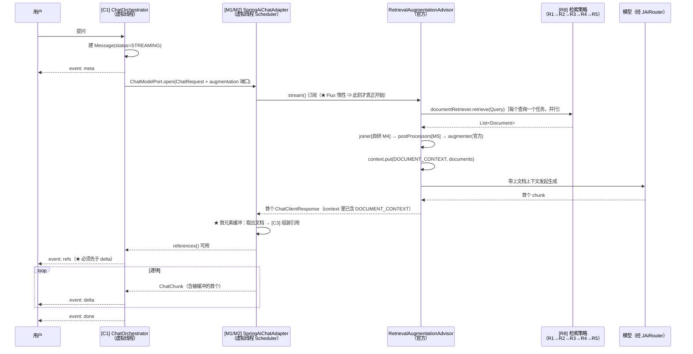

# 11 · RAG 的 Spring AI 落地设计（Advisor · 零件 · 工具 · 代码组件）

> **本册的位置**
>
> | 册 | 回答什么 |
> |---|---|
> | `03 机制一/四/五` | 流式事件契约 · 模型接入端口 · 结构化输出 |
> | `10-RAG-检索策略设计` | **策略**：检几次、检什么、什么时候停、失败了怎么退 |
> | **本册 `11`** | **落地**：这些策略挂到 **Spring AI 的哪个扩展点**上、要写哪些组件、每个组件必须完成什么功能 |
>
> ★ **本册涉及的全部 Spring AI API，都已对着 2.0.1 的 javadoc 与 v2.0.1 源码逐项核实**
> （`docs.spring.io/spring-ai/docs/2.0.1/api/`），凡"未查到"的会明确标注 —— 不凭印象写 API。

---

## 一、先读这节：本册要解决的四个矛盾

**如果直接照 Spring AI 的 RAG 示例写，会在四个地方撞墙。** 这四堵墙决定了本册的骨架。

| # | 矛盾 | 一边 | 另一边 | 解法 |
|---|---|---|---|---|
| **1** | **端口纪律 vs advisor** | `03 §4.1`：**业务模块只依赖 `ChatModelPort`，不依赖 Spring AI 类型** | Advisor 是 Spring AI 概念，必须挂在 `ChatClient` 上 | ★ **advisor 链活在 `modelcatalog` 的 Spring AI 适配器内部**；"要检索什么"由调用方经**端口**传入（§4.1） |
| **2** | **MVC + 虚拟线程 vs 流式只有 Flux** | 我们已定 **Spring MVC**（`09 §4.5`，决定性理由是 JPA/事务），SSE 用 `SseEmitter` | ★ 官方立场：**流式只走 Reactive 栈，命令式应用也必须引入 Reactive 依赖**以获得 `Flux`；**未提供 MVC + `SseEmitter` 的官方示例** | 自研 `Flux → SseEmitter` 桥接 + **线程模型必须重定**（§4.2 / §六） |
| **3** | **refs 必须在 delta 之前**（契约） | `stream-types.ts`：`meta → refs → delta*`，注释写"检索先于生成，引用先到" | Reactor 是**惰性**的：advisor 链（含检索）**在订阅时才执行**；检索在 `before()` 里发生 | 用官方给的 **`DOCUMENT_CONTEXT`** 把命中文档带出来（§4.3 / §七） |
| **4** | **官方 RAG 只认 VectorStore** | `VectorStoreDocumentRetriever` 是唯一内置检索实现 | 我们是**三模式**（向量 / PG 全文 / 混合）+ **自研 RRF** | ★ 自研 `DocumentRetriever` + 自研 `DocumentJoiner`（**官方接口的形状恰好适配我们的两层合并**，§4.4） |

> ★ **而矛盾 4 的解，正是本册最漂亮的一处对齐** —— 见 §4.4：`DocumentJoiner` 的入参
> `Map<Query, List<List<Document>>>` 是**两层嵌套**，与 `10 §3.3.3` 的"子问题内 RRF → 子问题间配额合并"**一一对应**。
> 这不是巧合，是官方为 ModoRAG / 多查询场景设计的形状，我们的策略正好长在它上面。

---

## 二、Spring AI 2.0.1 到底给了什么（★ 逐项核实过）

### 2.1 RAG 模块：六个零件接口（`org.springframework.ai.rag`，均 `Since: 1.0.0`）

| 阶段 | 接口 | 签名 | 我们要做什么 |
|---|---|---|---|
| 检索前 | `QueryTransformer` | `extends Function<Query,Query>` ·`Query transform(Query)` | **自研**：查询理解（改写 + 消解指代） |
| 检索前 | `QueryExpander` | `extends Function<Query,List<Query>>` ·`List<Query> expand(Query)` | **自研**：一次产出 M×N 条查询（含子问题维度） |
| 检索 | `DocumentRetriever` | `extends Function<Query,List<Document>>` ·`List<Document> retrieve(Query)` | ★ **自研**：三模式 + 经 `vectorindex` 路由 |
| 检索 | **`DocumentJoiner`** | `extends Function<Map<Query,List<List<Document>>>,List<Document>>` ·`List<Document> join(…)` | ★ **自研**：RRF + 子问题配额（见 §4.4） |
| 检索后 | `DocumentPostProcessor` | `extends BiFunction<Query,List<Document>,List<Document>>` | **自研**：同文档抑制 · tie-break · 上下文配额裁剪 |
| 生成 | `QueryAugmenter` | `extends BiFunction<Query,List<Document>,Query>` | **先用官方** `ContextualQueryAugmenter`（见下） |

★ **`DocumentJoiner` 的 javadoc 原文**（一手核实）：

> *"A component for combining documents retrieved based on multiple queries and from multiple data sources
> into a single collection of documents. As part of the joining process, it can also handle duplicate documents
> and **reciprocal ranking** strategies."*

⇒ **官方明确把"倒数排名（RRF）"列为 `DocumentJoiner` 的职责** —— 我们自己写 RRF，但**写在一个官方扩展点里**，
不是另起一套。这就是"用官方能力"与"自研必要逻辑"的正确分工。

### 2.2 官方实现类（★ 标 `ChatClient` 的是"要 LLM 才能工作"）

| 类 | 作用 | 用于我们哪一层 |
|---|---|---|
| `RewriteQueryTransformer` ★ | 改写冗长/歧义查询 | ★ **可作我们查询理解的底座参照**（提示词与解析方式） |
| `CompressionQueryTransformer` ★ | 历史 + 追问压成独立查询 | ★ **多轮场景的现成实现**（`10 §3.1.2` 第 1 条"消解指代"） |
| `TranslationQueryTransformer` ★ | 译到 embedding 目标语言 | 不用（单语言） |
| `MultiQueryExpander` ★ | 语义多视角扩展 | ⚠️ **评估后不用其内部实现，但采用它的两个设计**（见 §2.2.1） |
| `VectorStoreDocumentRetriever` | 向量相似检索（只读 VectorStore） | 不用（我们要三模式） |
| `ConcatenationDocumentJoiner` | 拼接 + 去重（保首现、分数原样） | 不用（我们要 RRF + 配额），但它**是降级兜底** |
| `ContextualQueryAugmenter` | 把文档上下文注入用户消息；`allowEmptyContext` 默认 **false** | ★ **直接用**（默认行为 = 空上下文时拒答，正是 `10 §5.2` 要的"拒答"） |

#### 2.2.1 `MultiQueryExpander` 的两个设计，值得照抄（★ 源码核实）

| 它的做法 | 为什么值得抄 |
|---|---|
| **一次 LLM 调用产出 N 条，按换行分隔解析**（不是 JSON） | ★ **比结构化输出更抗污染**：`03 机制五` 那条"思考正文里的 JSON 会破坏解析"在它这里**不存在**（换行分隔几乎不会被思考内容干扰）。我们自研 `QueryExpander` 时采用同样策略：**简单分隔 + 严格校验 + 数量不符则回退原查询** |
| `includeOriginal` 默认 **true**、`numberOfQueries` 默认 **3** | 默认值就是 `10 §6.2` 的推荐值（`queryCount=3`）；且"原查询始终保留"与我们"原始问题永不丢"的降级底线一致 |

> ⚠️ **但它有一个我们必须知道的限制**：`expand()` 是**单次**调用、**不并行**；
> **并行的是"多条查询的检索"** —— 在 `RetrievalAugmentationAdvisor.before()` 里用
> `CompletableFuture.supplyAsync(..., taskExecutor)` 对每条查询并发 `retrieve`。
> ⇒ 这正好印证 `10 §3.2.2` 的判断（"多查询在延迟上几乎免费"），**而且这个并行是官方替我们做的**。

### 2.3 Advisor 体系与 order（★ 决定我们的 advisor 插在哪）

| 类型 | 签名 |
|---|---|
| `Advisor extends Ordered` | `String getName()` |
| `CallAdvisor` | `ChatClientResponse adviseCall(ChatClientRequest, CallAdvisorChain)` |
| `StreamAdvisor` | `Flux<ChatClientResponse> adviseStream(ChatClientRequest, StreamAdvisorChain)` |
| `BaseAdvisor` | 同时实现上面两个；抽象 `before(req, chain)` / `after(resp, chain)`；`getScheduler()` 默认 **`Schedulers.boundedElastic()`** |

**默认 order（★ 源码实测）**：

| Advisor | 默认 `getOrder()` | 含义 |
|---|---|---|
| `MessageChatMemoryAdvisor` · `VectorStoreChatMemoryAdvisor` | `HIGHEST_PRECEDENCE + 200` | 历史拼装 |
| `ToolCallingAdvisor` | `HIGHEST_PRECEDENCE + 300` | 工具调用循环 |
| `RetrievalAugmentationAdvisor` · `SimpleLoggerAdvisor` · `SafeGuardAdvisor` · `QuestionAnswerAdvisor` | **`0`** | — |

★ `Advisor.DEFAULT_CHAT_MEMORY_PRECEDENCE_ORDER` 的 javadoc 原文说明了两者的关系：
memory advisor **"placed before (outside) `ToolCallingAdvisor.DEFAULT_ORDER` so the memory advisor wraps
the tool-call loop"**。

**order 语义**：**小的 order 先跑请求、后跑响应**（栈式）；**同一 order 的先后不保证**。

⇒ ★ **本册定：我们的检索 advisor `order = 250`**（显式写死，不用默认的 0），理由：

| 理由 | 说明 |
|---|---|
| 在 memory(200) **之后** | 查询改写**需要历史**（`10 §3.1.2` 第 1 条消解指代）。将来若引入官方 memory advisor，250 保证我们拿到的是**已并入历史**的 prompt |
| 在 tool(300) **之前** | 检索必须发生在工具循环之外（`10 §3.4` 的多跳是**生成前**的检索，不是工具循环内） |
| 不用默认 0 | 默认值**会随框架变**（2.0 就把 memory 从 +1000 改成了 +200）⇒ **显式声明**，并在注释里指回本节 |

### 2.4 context 的用法与三条硬规则（★ 本节是 §4.3 的地基）

`ChatClientRequest(Prompt prompt, Map<String,Object> context)` / `ChatClientResponse(ChatResponse, Map)` 都是 **record**。

| 规则 | 内容 |
|---|---|
| **写入方式** | **没有 `contextPut` API** ⇒ 读用 `request.context()`，写用 `request.mutate().context(k, v).build()` |
| ★ **不是线程安全的** | 底层是普通 `HashMap`（非 `ConcurrentHashMap`），官方**未承诺**线程安全。约定是"**单请求链内顺序访问**"。⚠️ 我们的检索是**并行**的（多查询用 `CompletableFuture`）⇒ **绝不能让并行任务去写 context**；并行结果只能**返回给调用者**，由调用者串行写入 |
| ★ **官方给的"把数据交给调用方"范式** | `RetrievalAugmentationAdvisor` 在 `before()` 里执行 `context.put(DOCUMENT_CONTEXT, documents)`，`after()` 再把它拷进 `ChatResponse.metadata`；**调用方从 `chatClientResponse.chatResponse().getMetadata()` 取回**。`DOCUMENT_CONTEXT` 是 `public static final String` 字段 ⇒ **引用常量，不要硬编码字符串** |

### 2.5 流式桥接：官方立场与空缺（★ 矛盾 2 的原始依据）

| 项 | 官方原文/事实 |
|---|---|
| 流式的传输前提 | ★ **"Streaming is only supported with the Reactive stack；命令式应用必须引入 Reactive 依赖（如 `spring-boot-starter-webflux`）"** ⇒ 这与 `09 §4.0` 记的"Spring AI 流式会把 `spring-webflux` **库**带进依赖树"是同一件事的两面：**依赖要有，栈仍可是 Servlet** |
| MVC + `SseEmitter` 的官方示例 | ✗ **未查到**（查过 `chatclient.adoc`、可观测章节与全文档导航） |
| 官方提到的三种消费姿势 | ① **`Flux#subscribe` + `SseEmitter`**（推荐姿势；⚠️ **`SseEmitter` 无请求量协议 ⇒ 背压丢失**，需自限如 `limitRate`）② **`toIterable()` / `blockLast()`**（占住线程直到完成）③ `ResponseBodyEmitter` / `StreamingResponseBody` |
| 官方点名的危险 | 在 `boundedElastic` / ForkJoin 上做**阻塞的工具调用或 JDBC**；`subscribe` 无线程与异常处理 ⇒ **泄漏** |

> ★ **`toIterable()` 在我们这里是可接受的，理由不是"官方推荐"，而是"我们有虚拟线程"**：
> 它占住的是**虚拟线程**（不是平台线程），阻塞成本极低。但它要求我们把 Flux 的调度器也接到虚拟线程上 ——
> 否则检索（**阻塞 JDBC**）会跑在 `boundedElastic` 的有限线程池里，**高并发时池耗尽**。这是 §六 的全部内容。

### 2.6 工具（Tool）与 ChatMemory：事实与 2.0 的删除项

| 关注点 | 核实结论 |
|---|---|
| `@Tool` | `@Tool(name, description, returnDirect=false, resultConverter=…)` + `@ToolParam(description, required)`；`MethodToolCallbackProvider` 扫 `@Tool` 方法 |
| ★ **请求级数据传给工具** | `.toolContext(Map)` / `.defaultToolContext(Map)` → `ToolContext`（**不可变 Map** + `getContext()`）。★ **它不进模型** ⇒ 这正是"把当前用户 / 知识库范围 / 检索参数传给工具"而不污染提示词的官方通道 |
| 工具调用的**预算**（官方已有） | `ToolCallingManager`：`maxCallsPerTool(40)` / `maxTotalToolCalls(150)` / `onLimitExceeded(THROW \| RETURN_ERROR_RESPONSE)`；属性 `spring.ai.tools.limits.*` ⇒ 对应 `10 §6.2` 第 8 项的"模型调用总次数"上限，**可直接配置，不必自研** |
| ⚠️ 2.0 **已删除** | `ToolCallingChatOptions.internalToolExecutionEnabled`（内部执行改由 `ToolCallingAdvisor` 承担）；`SpringBeanToolCallbackResolver` / `toolNames()`（2.0 移除）⇒ **照 1.x 示例写会编译不过** |
| ⚠️ **`PromptChatMemoryAdvisor` 在 2.0.1 不存在** | `Advisor` 的 "All Known Implementing Classes" 里只有 `MessageChatMemoryAdvisor` / `VectorStoreChatMemoryAdvisor`。**别照老文章用它** |
| `ChatMemoryRepository` 的成本 | 只需实现 **4 个方法**：`findConversationIds()` / `findByConversationId(String)` / `saveAll(String, List<Message>)` / `deleteByConversationId(String)`。官方实现含 **`Jdbc`**（支持 PostgreSQL），但 ★ **不支持 tool call 消息** |
| `MessageWindowChatMemory` 默认窗口 | **20 条**，按整 turn 驱逐 |

### 2.7 ★ 三个"官方已经有、别自研"的 advisor（我在 javadoc 的实现类清单里发现的）

| 类 | 能替掉我们什么 | 本册结论 |
|---|---|---|
| **`SemanticCacheAdvisor`** | `10 §10.3` 把"检索缓存"列为 V1，触发条件是"出现重复提问热点" | ★ **V1 时的首选实现，零自研**。现在只登记 |
| **`StructuredOutputValidationAdvisor`** | `03 机制五` 的"四层防御"里，**校验与自纠那一层**（`09 §5.2` 已定用官方 `validateSchema()`） | ★ **实现结构化输出时先看它**，不要又写一层 |
| **`SafeGuardAdvisor`** | 输入/输出的安全拦截 | ★ **已拍板（用户 2026-10-09）：以「扩展」它为主线**（原"暂不用它"的口径**作废**）。它非 final、`adviseCall`/`adviseStream` 可重写；开箱只有 `sensitiveWords`/`failureResponse`/`order` 三项（只做关键词匹配）⇒ **继承它，把密级/检索域/引用封闭性/审计挂进那两个 `advise*`**；落地详见 `13 §十二` |

> **这条小节的方法论价值**：`09 §10.1` 的做法是"先问官方替掉了什么"。
> **本册把它推进到 advisor 粒度** —— 看"All Known Implementing Classes"这一行，比读教程更快找到官方已有的能力。

---

## 三、对齐：策略层 → Spring AI 扩展点（★ 本册最重要的一张表）

`10` 册的每一层策略，都必须落到**一个明确的扩展点**上。落不上去的，才自研。

| `10` 册的层 | 落到的扩展点 | 自研还是官方 | 归属模块 |
|---|---|---|---|
| 查询理解（改写 + 扩展 + 分解，**一次调用**） | `QueryTransformer`（改写）+ `QueryExpander`（扩展/分解） | ★ **自研**，但**照抄 `MultiQueryExpander` 的两个设计**（§2.2.1） | `retrieval` |
| 多查询的**并行检索** | 官方 advisor 的 `before()` + `taskExecutor` | ✅ **官方已做** | — |
| 三模式检索（向量 / 全文 / 混合） | `DocumentRetriever` | ★ **自研**（官方只认 VectorStore） | `retrieval` |
| 子问题内 RRF + **子问题间配额合并** | **`DocumentJoiner`** | ★ **自研**（官方明写它负责 reciprocal ranking） | `retrieval` |
| 同文档抑制 · 词面 tie-break · 上下文配额裁剪 | `DocumentPostProcessor` | ★ 自研 | `retrieval` |
| 上下文拼装 + 无引用策略 | `QueryAugmenter` | ✅ **官方** `ContextualQueryAugmenter`（默认空上下文拒答） | — |
| **多跳迭代** | ⚠️ **没有官方扩展点** —— 见 §4.4.3 的落法 | ★ 自研（**落在 `DocumentRetriever` 内部**） | `retrieval` |
| 检索阶段预算与降级阶梯（`10 §6`） | 无扩展点（横切） | ★ 自研，包在上面几层里 | `retrieval` |
| advisor 编排（把上面串起来） | **`RetrievalAugmentationAdvisor`** | ✅ **官方** | `modelcatalog` 适配层 |
| 引用组装（→ `SourceRef`） | 官方 `DOCUMENT_CONTEXT` + 自研组装器 | 混合 | `conversation` |
| SSE 传输（心跳 / 终态 / 恰好一次 done） | ✗ 官方无 | ★ 自研（`03 §4.7` 已有） | `conversation` |
| 多轮历史 | ✗ **不用官方 ChatMemory**（§5.4.2 说明理由） | ★ 自研 | `conversation` |
| 工具调用循环（V1.0） | `ToolCallingAdvisor` + `ToolCallingManager` | ✅ 官方（含 `maxCallsPerTool` 等预算） | `modelcatalog` |

**读表结论**：**自研的是"检索本身"，官方的是"编排与传输"**。
这个分工不是偏好 —— 是因为★ **官方 RAG 模块的检索侧只认 `VectorStore`**，而我们的三模式（含 PG 全文）与 RRF 都在它之外。
**但接口形状它给好了**（`DocumentRetriever` / `DocumentJoiner`），所以我们自研的是**实现**，不是**框架**。

---

## 四、四个矛盾的解法

### 4.1 矛盾 1：端口纪律 vs advisor 挂在 ChatClient 上

**约束回顾**：
- `03 §4.1`：`ChatModelPort` / `EmbeddingModelPort` 是 `modelcatalog` 对外暴露的端口，**业务模块只依赖它，不依赖 Spring AI**
- `01 §3.2` 依赖矩阵：`retrieval` ✓ 依赖 `modelcatalog`（**所以查询理解可以直接用 `ChatModelPort`，不必新造端口**）；
  但 ★ **`modelcatalog` 只依赖 `platform`** ⇒ **它不能依赖 `retrieval`**

**⇒ 结论：检索增强必须由调用方注入，接口放 `platform`。**

```java
// platform —— 纯抽象，无业务语义（同 08 §4.4 的 AccessScopePort 手法）
public interface RetrievalAugmentationPort {
    /** 给定查询，返回用于增强提示词的文档。实现方（retrieval）负责三模式、策略、预算与降级 */
    List<RetrievedDocument> retrieve(RetrievalRequest request);

    record RetrievalRequest(String query, List<ChatTurn> history, int subQuestionIndex, Map<String, Object> extras) {}
    record RetrievedDocument(String id, String text, Map<String, Object> metadata, Double score) {}
}
```

| 谁 | 做什么 |
|---|---|
| `platform` | 定义 `RetrievalAugmentationPort` + 两个 record（**零业务语义、零 Spring AI 类型**） |
| `retrieval` | 实现它（内部就是 `10` 册那套：查询理解 → 三模式 → RRF/配额 → 预算降级） |
| `conversation` | 注入实现，放进 `ChatRequest`；**它也不认识 Spring AI** |
| `modelcatalog` 的 Spring AI 适配器 | 把 `RetrievalAugmentationPort` **包成一个 `DocumentRetriever`**，挂到 `RetrievalAugmentationAdvisor` 上 |

⇒ ★ **四处都不需要改 `01 §3.2` 的依赖矩阵**（这与 `08 §4.4` 处理 `AccessScopePort` 的手法完全一致），
且 **Reactor 与 Spring AI 类型被关在 `modelcatalog/infrastructure/springai` 一个包里**。

**`ChatRequest` 要加的字段**（`03 §4.1` 的端口扩展，**只加可选**）：

```java
public record ChatRequest(
    ModelId modelId,
    List<ChatTurn> turns,
    ChatOptions options,
    RetrievalAugmentationPort augmentation   // ★ 新增，可空：空＝通用问答（不检索）
) {}
```

> ⚠️ **不要在这里加工具字段**：`03 §4.3 控制点 4` 明确"MVP 阶段工具调用仅声明与展示，**不在请求结构中加工具字段**"。
> 本册遵守这条 —— 工具化在 V1.0（§5.6）再动 `ChatRequest`。

### 4.2 矛盾 2：MVC + 虚拟线程 vs 流式只有 Flux

★ **本册的解法是"把 Reactor 关在适配器里"，而不是让 `conversation` 去消费 `Flux`：**

```java
// modelcatalog/infrastructure/springai/SpringAiChatAdapter —— Reactor 只出现在这个文件里
public ChatStream open(ChatRequest request) {
    Flux<ChatClientResponse> flux = chatClient.prompt()
        .user(...)
        .advisors(a -> a.param(RETRIEVAL_PORT_KEY, request.augmentation()))  // 请求级注入
        .stream().chatClientResponse();

    return new SpringAiChatStream(flux, cancellationToken);
}
```

| 层 | 看到的类型 |
|---|---|
| `conversation`（业务） | `ChatStream`（**自己的接口**）：`Stream<ChatChunk>` + `references()` + `cancel()` |
| 适配器内部 | `Flux<ChatClientResponse>` → **在虚拟线程上 `toIterable()` 转成阻塞 `Stream`** |

**为什么这样切**：

| 理由 | 说明 |
|---|---|
| ADR-01 的原意是"**领域层不被 `Mono/Flux` 污染**" | 把 Reactor 关在适配器里，完全达成该目标 —— `conversation` 一行 Reactor 都不写 |
| **`toIterable()` 在这里是可接受的** | 官方提示它"占住线程"，但我们占的是**虚拟线程**（`spring.threads.virtual.enabled=true`），阻塞成本极低 |
| `SseEmitter` 的背压问题**不出现** | 背压问题源于"Reactor 生产快于 `SseEmitter` 消费"。我们中间隔着**阻塞 `Stream`**：消费者的拉取天然限制生产速度 ⇒ **不需要 `limitRate` 这类自限手段** |
| 心跳与终态**仍在 `conversation`** | 与 `03 §4.7` 的封装一致（心跳 20s / 恰好一次 `done`），适配器不管这些 |

⚠️ **唯一的前提是一条硬约束**（§六 详述）：**适配器的调度器必须是虚拟线程**，
否则检索的阻塞 JDBC 会跑在 `boundedElastic` 上 —— 官方点名的那种"危险用法"。

### 4.3 矛盾 3：refs 必须在 delta 之前 ⇒ 引用怎么带出来

**先说一个必须知道的坑**：★ 官方范式是
`before()` 把文档放进 context → `after()` 拷进 `ChatResponse.metadata` → **调用方从 metadata 取**。
**但 `after()` 在流式下是"流结束后"才触发的**（经 `ChatClientMessageAggregator` 聚合后调）——
⇒ **官方范式在流式下拿不到"生成前的文档"**，而我们的契约要求 `refs` 帧必须**先于**第一个 `delta`。

**⇒ 解法：从流元素自身的 `context` 里读，而不是等 `after()`。**

依据（§2.4 核实过的规则）：`before()` 修改的是**请求**，其 context 会**随链传下去**，
所以 `adviseStream` 返回的每个 `ChatClientResponse` 都带着那个 context ⇒ **`DOCUMENT_CONTEXT` 在第一个元素上就能读到**。

```
adapter 内部（伪码）：
  iter = flux.toIterable().iterator()
  first = iter.next()                                   // 第一个元素：可能是 delta，也可能只是 context
  docs = first.context().get(RetrievalAugmentationAdvisor.DOCUMENT_CONTEXT)   // ★ 引用常量，不硬编码
  this.references = referenceAssembler.assemble(docs)   // 组装成 ChatReference
  // 再把 first 与后续元素逐个作为 ChatChunk 吐出去
```

**三条实现纪律**：

| # | 纪律 | 为什么 |
|---|---|---|
| 1 | **引用常量 `RetrievalAugmentationAdvisor.DOCUMENT_CONTEXT`**，不写字符串字面量 | 名字随框架版本可能变；用常量则**编译期**就发现 |
| 2 | **首元素缓冲**：第一个元素要先取出引用，再作为 chunk 吐出 | 否则会出现"第一个字符先发、引用后到" —— 正是契约禁止的顺序 |
| 3 | **同步阻塞在虚拟线程上等第一个元素** | 检索在 `before()` 里已发生（≤5s 预算，`10 §6.2`）⇒ 等待有界。⚠️ 但**检索超预算时会偏长**，所以 `references()` 的等待要挂在**检索阶段预算 + 余量**上，超时则**发空 refs 并继续生成**（详见 §7.3 的降级） |

> **为什么不用"自研一个 advisor 主动回写"**：那会多一层自定义类型、且同样依赖 context 的可见性规则。
> **官方已经把文档放进 context 了，我们只是换个更早的读取时机** —— 少一层自研。

### 4.4 矛盾 4：自研检索怎么嵌进官方形状

#### 4.4.1 `DocumentRetriever`：把"三模式 + 路由"包进去

```java
// retrieval/infrastructure/springai/PlatformDocumentRetriever implements DocumentRetriever
public List<Document> retrieve(Query query) {
    var spec = RetrievalSpec.from(query.context());     // 从 Query.context 读请求级参数（§2.4）
    var plan = queryUnderstanding.understand(query.text(), query.history());   // 10 §3.1/§3.3
    return hybridRetriever.retrieve(plan, spec, budget); // 10 §3.2：三模式 + 索引路由
}
```

★ **关键：`Query.context()` 是"请求级参数"的官方通道** ——
`10 §8.1` 新增的那 7 个可配项（`queryCount` / `decomposeEnabled` / `maxHops` / `retrievalBudgetMs` …）
与 `kbIds` **不需要塞进 `ChatRequest`**，而是经 `.advisors(a -> a.param(k, v))` 进入 context，
由 `PlatformDocumentRetriever` 自己读。⇒ **`ChatRequest` 只加一个 `augmentation` 端口就够了**（§4.1）。

#### 4.4.2 ★ `DocumentJoiner`：官方形状与我们的两层合并**一一对应**

官方的入参是**两层嵌套**：

```
join( Map<Query, List<List<Document>>> documentsForQuery )
        └─ 外层 key：每条查询（= 多查询 / 多子问题）
             └─ 内层 List：该查询在**多个数据源**上的结果
                  └─ 最内层：文档
```

**我们的两层合并**（`10 §3.3.3`）正好映射上去：

| `10` 册的说法 | 官方形状 | 我们怎么写 |
|---|---|---|
| **混合模式的向量路 + 全文路 = 两路** | **内层 `List<List<Document>>`** | 内层做 RRF 第 1 层（同 `03 §2.2`） |
| **同一子问题的 N 条查询** | 外层按 `Query` 分组（★ 用 `Query.context` 里的 `subQuestionIndex` 归组） | 第 2 层 RRF |
| **子问题之间保底配额** | 外层跨 key 的分组 | 配额合并（`q = max(2, topN / M)`） |

⇒ ★ **一个自研 `RrfQuotaDocumentJoiner implements DocumentJoiner` 把三层合并全做了**，
且**入参就是它需要的形状** —— 不需要我们自己造"按查询分组"的数据结构。

```java
public class RrfQuotaDocumentJoiner implements DocumentJoiner {
    private static final int RRF_K = 60;                    // 03 §2.2 定过，不新增参数
    public List<Document> join(Map<Query, List<List<Document>>> forQuery) { /* 三层：内层RRF → 分组 → 配额 */ }
}
```

#### 4.4.3 多跳落在哪（★ 与 `10 §3.4.5` 的一处**落地修订**）

`10 §3.4.5` 写的是"第 2 轮检索**按子问题**分别发起"。**落地时改成"按查询"**，理由是：

| 项 | 说明 |
|---|---|
| 官方 advisor 的并行粒度 | 是**每条查询一个 `retrieve` 任务**（§2.2.1）。要按"子问题/整体"判定多跳，就需要**跨任务共享"本轮已收集的文档"** |
| 而 context **不是线程安全的**（§2.4） | 并行任务往里写 ⇒ 竞态。官方明确约定"单请求链内顺序访问" |
| ⇒ 结论 | ★ **多跳放在 `DocumentRetriever.retrieve(Query)` 内部，粒度 = 单条查询**：拿到 Query → 检索 → 若命中不足则（可选）判定 + 再检索 → 返回合并结果 |
| 成本会不会爆 | 不会：`10 §3.4.2` 的触发条件本身就是"**该查询命中不足**"，多数查询首轮即够；且多跳**默认关** |
| 好处 | 每个查询的多跳**天然并行**（官方 `taskExecutor` 已实现），无需我们造并发 |

> **这是一次诚实的落地修订，要回写 `10`**：策略意图不变（命中不足时再检一轮），
> 但**粒度从"子问题/整体"细化为"单条查询"**，原因是**官方并行模型 + context 非线程安全**这两个硬事实。
> 修订记录见 §十一。

---

## 五、组件清单（★ 逐个：包路径 · 职责 · 必须完成的功能点 · 依赖）

> **写法约定**：每条"功能点"都写成**可验收**的样子 —— 能写测试、能判对错。
> `[P]` 表示 platform，`[R]` retrieval，`[M]` modelcatalog 适配层，`[C]` conversation。

### 5.1 端口层（`[P]` `platform`）—— 业务模块与 Spring AI 之间的唯一界面

| # | 组件 | 类型 | 职责 |
|---|---|---|---|
| P1 | `RetrievalAugmentationPort` | interface | "给我文档" —— 业务侧对检索的唯一依赖 |
| P2 | `RetrievalRequest`（record） | record | 查询 + 历史 + **子问题序号** + 附加参数 |
| P3 | `RetrievedDocument`(record) | record | id / text / metadata / score |
| P4 | `ChatReference` | record | 引用（**与 `SourceRef` 同形，但不依赖 Spring AI**） |

**必须完成的功能点**：

| # | 功能点 | 验收方式 |
|---|---|---|
| 1 | ★ **P1–P4 里不出现任何 Spring AI / Reactor 类型** | 一条架构测试：扫 `platform` 包，禁止 import `org.springframework.ai.*` 与 `reactor.*` |
| 2 | `RetrievedDocument.metadata` 的键名**集中定义成常量**（`segmentId` / `documentId` / `kbId` / `subQuestion` / `round` / `matchedQuery`） | 单测：断言常量集合与 `10 §8.2` 的 `SourceRef` 扩字段一一对应 |
| 3 | `P4` 的 `index` 语义 = ★ **只有进入上下文的文档才编号，且从 1 连续**（`10 §4.4` 那条容易做错的纪律） | 单测：给 5 篇文档、预算只放 3 篇 ⇒ `index` 必为 1,2,3 |
| 4 | `ChatRequest` 加 `augmentation` 字段（可空） | 编译期：通用问答传 `null` 能跑通 |

### 5.2 策略零件（`[R]` `retrieval`）—— **这一组一行 Spring AI 代码都不写**

| # | 组件 | 职责 | 对应 `10` 册 |
|---|---|---|---|
| R1 | `QueryUnderstandingService` | 一次模型调用产出 **M 个子问题 × N 条查询** | §3.1 · §3.3.1 |
| R2 | `HybridRetriever` | 三模式检索 + 经 `vectorindex` 按维度路由 | §3.2 |
| R3 | `RrfQuotaJoiner` | **纯函数**：三层 RRF + 子问题配额合并 | §3.3.3 · §4.1 |
| R4 | `DocumentSuppressor` | 同文档抑制 + 词面 tie-break | §4.5 |
| R5 | `ContextBudgetAllocator` | 按意图单元分上下文预算 + 回流 | §4.4 |
| R6 | `MultiHopEvaluator` | 判定 `sufficient` / `nextQuery`（一次模型调用） | §3.4.3 |
| R7 | `RetrievalBudgetGuard` | 检索阶段计时 + 降级阶梯 D0→D4 | §6.2 · §6.3 |
| R8 | `RetrievalAugmentationAdapter` | 实现 `[P1]`，把 R1–R7 串起来 | — |

**必须完成的功能点**（逐组件）：

**R1 `QueryUnderstandingService`**

| # | 功能点 |
|---|---|
| 1 | 输入 = 原始问题 + 最近 N 轮历史（N 由 `DialogueConfig.historyRounds` 定）；输出 = `List<SubQuestion{text, queries[]}>` |
| 2 | ★ **照抄官方 `MultiQueryExpander` 的解析策略**：模型按**换行分隔**返回（不用 JSON）⇒ 抗"思考内容里出现 JSON"的污染；**产出数量不符 ⇒ 回退原查询**（不是报错） |
| 3 | ★ **消解指代**（多轮场景）：用 `Query.history()` 补全"它 / 这个 / 那笔" |
| 4 | 校验（`10 §3.3.2`）：子问题数超 `maxSubQuestions` 按序截断 · 空数组视为单意图 · 子问题去重 · 每条查询为空用子问题文本兜底 |
| 5 | 失败降级（`10 §3.1.3`）：模型不可达 / 超时 / 解析失败 ⇒ **原始问题单路**；解析失败重试一次 |
| 6 | 埋点：原始问题、产出、耗时、**解析失败计数**（= `10 §7.2` 的 `rewriteParseFailureRate`） |
| 7 | ★ **可切换 `single-call` / `two-call`**（`10 §3.3.1` 的留缝） |

**R2 `HybridRetriever`**

| # | 功能点 |
|---|---|
| 1 | 三种模式：向量（经 `vectorindex` 按 `modelId` 路由到对应维度表）· 全文（`chinese_zh` tsvector + GIN，`09 §10.2 #3`）· 混合（两路 RRF，`k=60`） |
| 2 | 三级启用过滤 + **数据范围**（`Specification`，`08 §4.4.3` 纪律 1：拼进查询而不是查完再筛） |
| 3 | 阈值过滤**在 TopN 之前**（`03:185`） |
| 4 | 返回的 `RetrievedDocument.metadata` 必须带全 `segmentId/documentId/kbId/subQuestion/round/matchedQuery`（`10 §8.2` 的三个新字段靠它） |
| 5 | 部分路失败 ⇒ 继续（丢弃该路 + 记事件）；**全部失败 ⇒ 空列表**（让上游走无引用策略，不是抛异常） |

**R3 `RrfQuotaJoiner`** ★ 本册最关键的自研件

| # | 功能点 |
|---|---|
| 1 | **内层**：同一查询的多数据源结果 → RRF 第 1 层（`score = Σ 1/(60 + rank)`） |
| 2 | **外层**：按 `subQuestionIndex` 归组 → 组内 RRF 第 2 层 |
| 3 | **配额**：每组保底 `q = max(2, topN / M)` 条；剩余名额按全局 RRF 补 |
| 4 | **去重**：`segmentId` 为主键，多次出现**累加**分数（不是取最大） |
| 5 | ★ **纯函数、无状态、无 IO** ⇒ 可以用"给定的排名集合 → 断言的输出顺序"写成表驱动单测（**这一条让 RRF/配额的数学可被测试**，而不是靠线上观察） |
| 6 | 配额被"优化"掉的防回归：★ **类注释里写死理由并指回 `10 §3.3.3`**（`10 §11.1 R6` 点过这个风险） |

**R4 `DocumentSuppressor`**：同 `documentId` 在最终 TopN 内最多 `ceil(topN/2)` 条（`10 §4.5 (i)`）；RRF 分相同则词面重合多的优先；★ **同文档相邻 `ordinal` 只保留 RRF 分更高的那个** —— 分块的重叠窗口会让相邻块**同时命中**（`12 §3.3`），不去重的话上下文里会出现两段几乎一样的内容。
**R5 `ContextBudgetAllocator`**：总预算 → 按意图单元均分 → 单元内填充 → 剩余回流 → 仍超窗才退 `03 §2.4` 的裁剪；★ **输出"哪些文档进了上下文"与"哪些只保留在引用里"两个集合**（R3/R4 之后的编号依赖它）。
**R6 `MultiHopEvaluator`**：输入 = 问题 + **已命中分段的标题与前 100 字**（不是全文，省 token）；输出 `{sufficient, nextQuery}`；★ 停止条件四条（`10 §3.4.4`），其中 **Jaccard 重合度 > 0.6** 用 `segmentId` 集合算（纯计算，可单测）。
★ **落地（第 14 周）**：判定**不自研 JSON 解析** —— 走 `ChatPort.completeAs`（适配器里用官方 `BeanOutputConverter`：`getFormat()` 生成格式说明与 schema、`convert(...)` 解析响应，见 §2.7 的口径）；领域侧只留三条**转换器管不了**的判定规则：字段缺失 ≠ `false`（包装类型 `Boolean`）、超长截断、空白归零。⚠️ `StructuredOutputValidationAdvisor`（校验与自纠）**要到 M1 才挂得上** —— 它是 `CallAdvisor`，没有 advisor 链就没有挂点。
**R7 `RetrievalBudgetGuard`**：★ **统一计时器**，每层开始前检查余量；降级时**必须记录 `degradeLevel` + 原因**（`10 §6.3`：否则"这周质量莫名下降"无从解释）。
**R8 `RetrievalAugmentationAdapter`**：实现 `[P1]`；编排 R1→多查询并行(R2)→R3→R4→R5；★ 全程受 R7 约束；返回 `List<RetrievedDocument>`。

### 5.3 适配层（`[M]` `modelcatalog/infrastructure/springai`）—— ★ **Reactor 与 Spring AI 只允许出现在这个包**

| # | 组件 | 类型 | 职责 |
|---|---|---|---|
| M1 | `SpringAiChatAdapter` | class | 实现 `ChatModelPort`；装配 advisor 链；把 `Flux` 变成阻塞 `Stream` |
| M2 | `SpringAiChatStream` | class | 实现 `ChatStream`：`chunks()` / **`references()`** / `cancel()` |
| M3 | `PlatformDocumentRetriever` | implements `DocumentRetriever` | 把 `[P1]` 端口**包成**官方扩展点 |
| M4 | `RrfQuotaDocumentJoiner` | implements `DocumentJoiner` | 委托 `[R3]`（保持纯函数可测） |
| M5 | `QuotaDocumentPostProcessor` | implements `DocumentPostProcessor` | 委托 `[R4]` + `[R5]` |
| M6 | `RagAdvisorFactory` | class | 装配 `RetrievalAugmentationAdvisor`（含 order / scheduler / taskExecutor） |
| M7 | `VirtualThreadAiSchedulers` | class | ★ Scheduler 与 TaskExecutor **都接到虚拟线程**（§六） |

**必须完成的功能点**：

**M1 `SpringAiChatAdapter`**

| # | 功能点 | 备注 |
|---|---|---|
| 1 | 用**单例 `ChatClient`**（不是每请求新建）；请求级差异全部走 `.advisors(a -> a.param(...))` | 官方推荐姿势 |
| 2 | 请求级参数注入：`[P1]` 端口实例、`kbIds`、`10 §8.1` 的 7 个可配项、`ChatMemory` 的会话 id（若将来用） | 参数**只放 context**，不放 `ChatRequest` |
| 3 | 调 `stream().chatClientResponse()`（**要 `ChatClientResponse` 而不是只有文本**，因为引用在它的 context 里） | ★ 这是 §4.3 的前提 |
| 4 | 组装 `M2`（把 Flux 与取消令牌交出去） | — |
| 5 | ★ **非流式路径**（V1.1 文档生成、结构化输出）同样走这条链，但取引用走 `ChatResponse.metadata`（官方范式在 `call()` 下是有效的） | 两条路径都覆盖 |
| 6 | ★ **结构化输出归这里收口**：非流式结构化（如多跳判定）已在第 14 周先用官方 `BeanOutputConverter` 落地（`ChatPort.completeAs`）；等本组件把 advisor 链装上，**`StructuredOutputValidationAdvisor`（校验 + 自纠）一并注册**（它在 `spring-ai-client-chat:2.0.1` 里已在依赖树，缺的只是挂点） | ★ 与 §2.7 同一口径：官方已有 ⇒ 不要又写一层 |

**M2 `SpringAiChatStream`**

| # | 功能点 |
|---|---|
| 1 | `chunks()` 返回**阻塞 `Stream<ChatChunk>`**：内部 `flux.toIterable()`，**在虚拟线程上迭代** |
| 2 | ★ **首元素缓冲**：第一个元素先取 `context().get(RetrievalAugmentationAdvisor.DOCUMENT_CONTEXT)` → 组装引用 → 再把它作为 chunk 吐出（`10 §4.3` 纪律 2） |
| 3 | `references()`：★ **必须在 `chunks()` 被消费之前就可用**；实现为"打开时就预取第一个元素" |
| 4 | ⚠️ **超时兜底**：等待首元素超过**检索预算 + 余量** ⇒ **返回空引用并继续生成**（不是抛错、也不是无限等） |
| 5 | `cancel()`：`Disposable.dispose()` + 置取消位；★ **已收到的 chunk 不丢**（`03 §1.5` 的"停止保留已生成内容"） |
| 6 | 异常映射：Reactor 异常 → 领域错误码（`08 §4.1` 的 `{code,message,hint}`），**保留 `retryable` 语义**（`03 §1.2` 的 `error` 帧含 `retryable`） |

**M3 `PlatformDocumentRetriever`**：从 `Query.context()` 读请求级参数 + `[P1]` 端口 → 调 `[R8]` → `RetrievedDocument` **转成 `Document`**（官方类型）并**把 metadata 原样搬过去**（★ `Document.metadata` 只支持简单类型 ⇒ `UUID` 一律 `toString()`，与 `09 §9.2` 同一条纪律）。

**M4 / M5**：只做类型转换与委托，**业务判定全在 `[R3]` / `[R4]` / `[R5]`**（保证"纯逻辑在 retrieval、类型胶水在适配层"这条分界，也让单测不必启动 Spring）。

**M6 `RagAdvisorFactory`**——★ 装配的每一处都有理由：

```java
RetrievalAugmentationAdvisor.builder()
    .documentRetriever(platformDocumentRetriever)      // M3
    .documentJoiner(rrfQuotaDocumentJoiner)            // M4（★ 官方默认是 Concatenation，必须替换）
    .documentPostProcessors(quotaDocumentPostProcessor)// M5
    .queryAugmenter(ContextualQueryAugmenter.builder() // ★ 用官方默认语义：空上下文 ⇒ 拒答
        .allowEmptyContext(false)
        .build())
    .order(250)                                        // ★ 显式，理由见 §2.3
    .scheduler(virtualThreadAiSchedulers.scheduler())  // ★ §六
    .taskExecutor(virtualThreadAiSchedulers.taskExecutor()) // ★ §六
    .build();
```

| 功能点 | 说明 |
|---|---|
| 1 | ★ **显式 `.order(250)`** —— 不用默认 `0`（`§2.3` 的三条理由） |
| 2 | ★ **显式替换 joiner**：官方默认 `ConcatenationDocumentJoiner` **不做 RRF、不做配额** ⇒ 不替换等于策略层没生效（**静默失效**，这类最容易漏） |
| 3 | `queryAugmenter` 先用官方 `ContextualQueryAugmenter`：`allowEmptyContext=false` 与 `10 §5.2` 的"拒答"分支一致 |
| 4 | ⚠️ **`queryTransformers` / `queryExpander` 不注册到这里**：我们的查询理解（R1）是**一次调用产出 M×N**，形态与"transform 后再 expand"不同 ⇒ ★ **由 `M3` 内部完成**，advisor 这一层保持"每 Query 一检索"的干净语义 |

> ⚠️ 第 4 条是**一个刻意的取舍**：官方的 `QueryTransformer`/`QueryExpander` 是两级串行（1→1→N），
> 我们的查询理解是**一级产出 M×N**（`10 §3.3.1` 省调用次数）。硬塞进官方两级会**多一次模型往返**，
> 所以放在 `M3` 内部。**代价**：这三个官方扩展点我们不用（`DocumentRetriever`/`DocumentJoiner`/`PostProcessor` 用）。
> **回退方案**：若实测弱模型一次做三件事不可靠，切 `two-call`（`10 §3.3.1`），那时就可把改写挂到官方 `QueryTransformer` 上。

### 5.4 会话侧（`[C]` `conversation`）—— Reactor 一行不写

| # | 组件 | 职责 |
|---|---|---|
| C1 | `ChatOrchestrator` | 应用服务：落库 → 打开流 → 发 `refs` → 转发 `delta` → flush → `done` |
| C2 | `SseStreamWriter` | `03 §4.7` 的封装：心跳 / 三态终态 / **恰好一次 `done`** |
| C3 | `ReferenceAssembler` | `ChatReference` → `SourceRef`（**编连续 `index`**） |
| C4 | `ChatHistoryAssembler` | 从 `cv_message` 读历史 → `List<ChatTurn>` |
| C5 | `MessageFlushScheduler` | 周期性 flush（500ms / 200 字，`03 §1.4`） |

**必须完成的功能点**：

| # | 组件 | 功能点 |
|---|---|---|
| C1 | 顺序硬约束 | ① 先建 `Message(status=STREAMING)` 并**立即**发 `meta`（`03 §1.2`：这是"停止/重生成"可用的前提）② 打开流 ③ **`references()` → 发 `refs` 帧** ④ 消费 `chunks()` 发 `delta` ⑤ 终态 `done` |
| C1 | ★ **检索阶段也要发心跳** | `10 §6.4`：心跳逻辑必须覆盖"从打开流到第一个 chunk"之间（契约 `stream-types.ts:36` 已写明检索间隙要发）。★ **很容易只写在生成阶段** |
| C1 | 取消传播 | 用户停止（显式）与连接断开（故障）**两条路径都要**（`03 §1.5`），且都要 flush → `STOPPED` |
| C3 | ★ **`index` 只给进上下文的文档** | 被 `[R5]` 裁掉但仍留在引用列表的文档**不编号**（`10 §4.4` 的显式决定） |
| C3 | 新字段透传 | `subQuestion` / `round` / `matchedQuery` 从 `metadata` 搬到 `SourceRef`（`10 §8.2`） |
| C4 | ★ **不用官方 ChatMemory**（见下） | — |
| C5 | 断连后仍要继续吗 | ⚠️ **不**：`TaskProgressOwnership`（`stream-types.ts:93`）讲的是**任务**（入库、向量化）不因断连停止；**单次生成是连接绑定的** —— 断连即停止（`03 §1.5`）。两者不矛盾，但要在代码注释里写清，免得后人拿 `TaskProgressOwnership` 来"修正"这里 |

#### 5.4.2 为什么不用官方 `ChatMemory`（★ 一个有意识的取舍）

| 事实 | 影响 |
|---|---|
| 官方 `ChatMemory` 是"**请求时读、响应后写**"（流式下经 `ChatClientMessageAggregator` 在**流结束后**写回） | 而 `03 §1.4` 要求**周期性 flush**（500ms / 200 字），因为"生成中刷新页面要看到已生成内容、崩溃不丢内容" |
| 两者并存 ⇒ **双写同一份历史** | 两套写路径、两种失败语义，且顺序不确定 ⇒ 必然出现"库里内容比 memory 多/少"的幽灵问题 |
| 我们的消息模型更重 | `cv_message` 有自己的状态机（`PENDING/STREAMING/DONE/STOPPED/ERROR`）、`references`、`artifacts`、token 统计；官方 `Message` 装不下 |
| 官方 `Jdbc` 实现**不支持 tool call 消息**（★ 核实过的限制） | 一旦 V1.0 上工具调用，它的表结构就不够用 |

⇒ ★ **定：历史由 `[C4]` 自己组装进 Prompt**（读 `cv_message` → `List<ChatTurn>`），
**不注册 `MessageChatMemoryAdvisor`**。官方 `ChatMemoryRepository`（4 个方法）**知道即可，不用** ——
若将来需要"跨请求的 memory 语义"，再实现那 4 个方法桥接 `cv_message`（成本已知，见 `§2.6`）。

### 5.5 装配与配置（`[M]`）

| # | 项 | 做法 |
|---|---|---|
| 1 | `ChatClient` | **单例 bean**：`ChatClient.builder(chatModel).defaultAdvisors(ragAdvisor, loggerAdvisor).build()` |
| 2 | 请求级差异 | 全部走 `.advisors(a -> a.param(k, v))`（`[P1]` 端口、`kbIds`、检索参数、会话 id） |
| 3 | 日志 advisor | `SimpleLoggerAdvisor`（`order=0` ⇒ 在检索之前跑请求、**之后**跑响应 ⇒ 能看到最终 prompt） |
| 4 | ★ **order 表写进配置类注释** | `250`(检索) < `300`(tool) · memory 若将来引入是 `200`（`§2.3`）⇒ 一张小表贴在代码旁，防回摆 |

### 5.6 工具（Tool）—— MVP **不暴露**，V1.0 用**同一份能力**

| 项 | 结论 |
|---|---|
| **MVP** | ★ **不做工具调用链**（`03 §4.3 控制点 4`：仅声明模型能力、**不在请求结构里加工具字段**）。本册**遵守**这条 |
| **V1.0 的价值** | ★ **`HybridRetriever`（R2）可以原样包成 `@Tool`** —— 换的只是"谁决定检索"（`06 §6.4`："模型自主决定是否检索、检索几次、用哪个知识库"） |
| 工具签名（V1.0） | `@Tool(name="search_knowledge", description="在企业知识库中检索…")` + `@ToolParam`；★ **请求级上下文走 `ToolContext`**（`.toolContext(Map)`）—— 它**不进模型**，正是放"当前用户 / 可见知识库范围 / 检索参数"的地方 |
| 预算（★ 官方已有） | `spring.ai.tools.limits.max-calls-per-tool` / `max-total-tool-calls`（默认 40 / 150）⇒ **不自己造预算**，对应 `10 §6.2` 第 8 项 |
| 候选工具清单（V1.0+） | `search_knowledge`（检索）· `list_knowledge_bases`（有哪些库）· `get_document`（拿文档详情）· `match_qa_pair`（问答对命中，若 `10 §7.4` 采纳） |
| ⚠️ 不要踩的坑 | 2.0 **删除了** `internalToolExecutionEnabled` 与 `SpringBeanToolCallbackResolver` / `toolNames()` ⇒ **照 1.x 教程写会编译不过**（`§2.6`） |

---

## 六、线程模型（★ 这一节不做对，前面全部白搭）

### 6.1 有两条线程路径，而它们都不是虚拟线程（默认情况下）

| 路径 | 默认跑在哪 | 谁在上面阻塞 |
|---|---|---|
| **advisor 逻辑**（含 `before()` 里的检索） | ★ `BaseAdvisor.getScheduler()` 默认 **`Schedulers.boundedElastic()`**（Reactor 的弹性池，**线程数有限**） | ★ **我们的检索是阻塞 JDBC** ⇒ 官方点名的"危险用法"（§2.5） |
| **多查询并行 retrieve** | `RetrievalAugmentationAdvisor` 内部 `ThreadPoolTaskExecutor`（**core 4 / max 16**） | 同上：每个并行任务都在跑阻塞 JDBC |

⇒ ★ **默认配置下，我们的 PG 检索会跑在一个 4–16 线程的池上**。单机小流量看不出问题，
**并发稍高就表现为"检索突然变慢/排队"**，而 CPU 与 DB 都很闲 —— 这是最难归因的一类现象。

### 6.2 解法：两个调度点都接到虚拟线程

```java
// [M7] VirtualThreadAiSchedulers
Scheduler scheduler()      → Schedulers.fromExecutorService(Executors.newVirtualThreadPerTaskExecutor())
TaskExecutor taskExecutor() → 基于 Executors.newVirtualThreadPerTaskExecutor() 的 TaskExecutor
```

| # | 要做的 | 理由 |
|---|---|---|
| 1 | ★ `RagAdvisorFactory` 里**两个都显式传入**（`.scheduler(...)` + `.taskExecutor(...)`） | 少传一个就退化回有限池 |
| 2 | 自研 advisor（若将来加，如 V1.0 的观测/缓存）**覆写 `getScheduler()`** | `BaseAdvisor` 的默认值是 `boundedElastic` |
| 3 | ★ **不要把 `boundedElastic` 当"通用阻塞池"用** | 它是 Reactor 为"少量阻塞调用"准备的，**不是为"每个请求都做阻塞 JDBC"准备的** |

> **一句话原则**：**凡是我们自己的阻塞代码（JDBC / 文件 / HTTP），一律跑在虚拟线程上；Reactor 的池只用来做流编排。**

### 6.3 线程清单（做完之后的样子）

| 线程 | 干什么 | 会不会阻塞 |
|---|---|---|
| Servlet 虚拟线程（请求线程） | `ChatOrchestrator`：打开流、取引用、发帧、flush | 会（等首元素 + 迭代 chunk）—— **但它是虚拟线程，阻塞便宜** |
| 虚拟线程 Scheduler（advisor） | advisor 的 `before()`/`after()`（含检索 JDBC） | 会，同上 |
| 虚拟线程 TaskExecutor | 多查询并行 `retrieve` | 会，同上 |
| Reactor 发射线程 | 只有 Flux 的编排与聚合 | 不应阻塞（我们不往里塞阻塞调用） |

### 6.4 心跳在哪个线程发

★ **在请求线程（虚拟线程）的 SSE 循环里发**，**不在 advisor 里**。
理由：心跳是**传输层**职责（`03 §4.7` / `stream-types.ts:35`），而且它必须在"检索期间（还没有任何 chunk）"也能发出去 ——
那段时间请求线程正卡在等首元素上，所以**等首元素必须带超时轮询**（或用一个独立的定时器），否则**检索期间一个心跳都发不出**。

⇒ ★ **本册定**：`M2` 等首元素时**不无限期阻塞**，而是"带超时地取"（如每 5s 检查一次），
把控制权交回 `C1` 以发出心跳。**这是"心跳覆盖检索阶段"这条要求的实现方式**（否则它就是一句空话）。

---

## 七、`refs` 的完整链路（端到端，★ 每一步都点到组件）



**三个"顺序不能错"的地方**：

| # | 约束 | 违反后的症状 |
|---|---|---|
| 1 | `meta` 必须在打开流**之前**发 | "生成中停止/重生成"在最初几秒不可用（`03 §1.2`） |
| 2 | `refs` 必须在**第一个 `delta` 之前** | 引用比答案晚出现；前端引用栏会跳一次 |
| 3 | `done` **恰好一次**（含 error 之后仍走 done） | 气泡永远转圈（`stream-types.ts` 的硬保证） |

★ **第 2 条的实现依赖 §4.3 的"首元素缓冲"** —— 这是本册最容易被写错的一处：
不缓冲的话，`flux` 的第一个元素往往就是第一个文本增量，**先发 `delta` 再发 `refs`** 就成了既成事实。

---

## 八、配置项（平台属性）

```yaml
platform:
  rag:
    advisor-order: 250          # §2.3：在 memory(200) 之后、tool(300) 之前
    # 以下与 10 §8.1 的契约字段一一对应（`RetrievalParams` 的可选字段）
    query-count: 3              # 1 = 只改写；0 = 不做（等价旧 rewriteEnabled=false）
    decompose-enabled: true
    max-sub-questions: 3
    multi-hop-enabled: false    # ★ 默认关（10 §3.4.2）
    max-hops: 2
    retrieval-budget-ms: 5000   # ★ 检索阶段时间预算（10 §6.2 第 6 项）
    per-intent-quota:           # 空 ⇒ 由 topN/M 推导
```

| 要求 | 说明 |
|---|---|
| ★ **契约里的可选字段与这些默认值必须一致** | `10 §8.1` 要求 `GET /knowledge-bases/:kbId/retrieval` **返回默认值** ⇒ 单一真源应在**一处常量类**，两边都引用它 |
| 检索参数**分两级** | 知识库级（`kb_...` 表里存的）→ 应用级（`assistant.retrieval`）→ 请求级（本次问答）。**合并规则写在一处**（`RetrievalSpec.resolve()`），不要散落 |
| 工具预算（V1.0） | 用官方 `spring.ai.tools.limits.*`，不自造 |

---

## 九、测试策略（★ 重点在"防静默失效"）

### 9.1 三处最危险的静默失效（每处都要有一条断言）

| # | 静默失效 | 症状 | 怎么防 |
|---|---|---|---|
| 1 | ★ **忘了替换 `documentJoiner`** | 官方默认 `ConcatenationDocumentJoiner` 照常工作 ⇒ **系统一切正常，只是策略没生效**（无 RRF、无配额） | 集成测试：断言"混合模式下同一分段在向量/全文都命中时分数高于只命中一次"（RRF 的可观测特征） |
| 2 | ★ **检索 advisor 根本没注册** | 变成纯生成：**答案没有任何引用**，而前端会正常显示"无引用"态（`05:205` 说明这是合法状态）⇒ 看起来像"这题本来就没资料" | 集成测试：绑了知识库的应用提问 ⇒ **必须**收到非空 `refs`；且日志里必须能查到检索耗时 |
| 3 | ★ **PG 扩展/分词配置缺失** | 全文检索"一条都搜不到"，向量路照常 ⇒ 混合模式静默退化为纯向量 | 启动自检（`09 §10.2 #3` 第 3 条）+ 断言 `to_tsvector('chinese_zh','合同违约金')` 的分词结果 |

### 9.2 分层测试

| 层 | 测什么 | 怎么测 |
|---|---|---|
| **纯函数**（`[R3]` `[R4]` `[R5]` `[R6]`） | RRF 数学、配额分配、抑制规则、Jaccard 停止 | ★ **表驱动单测**：给"排名集合 + 参数"→ 断言输出顺序与编号。**不启动 Spring、不连库** |
| **解析与回退**（`[R1]`） | 换行分隔解析、数量不符回退、空数组、超长截断、模型超时 | 假 `ChatModelPort` 注入 |
| **引用链路**（`[M2]`/`[C1]`/`[C3]`） | ★ **`refs` 先于第一个 `delta`**；`index` 连续；被裁掉的不编号 | 集成测试（假模型按固定节奏吐 chunk） |
| **框架假设**（§2 的那些结论） | ① 能从流元素的 context 取到 `DOCUMENT_CONTEXT` ② `order=250` 生效（`Advisor` 排序可断言）③ `toIterable()` 与虚拟线程搭配不丢元素 | 小而专的测试，**把我们对框架的假设锁进代码** |
| **架构边界** | ★ `platform` 包**禁止** import `org.springframework.ai.*` 与 `reactor.*`；★ Reactor 只允许出现在 `modelcatalog/infrastructure/springai` | 反射/字节码扫描的架构测试（同 `01 §5.1` 的手法） |
| **集成**（Testcontainers） | 真 PG（pgvector + zhparser）+ 假模型：三模式检索、配额合并、多跳停止 | `@ServiceConnection` |
| **流式契约** | 恰好一次 `done`、心跳在**检索阶段**也发出、断开 → `STOPPED` 且内容保留 | 同 `03 §4.7` 的既有要求 |
| **契约漂移** | `10 §8.1` / §8.2 新增的可选字段在后端真实存在 | `09 §10.2 #8` 的自研比对 |

> ★ **为什么"框架假设测试"值得单列**：本册的每一处设计都建立在 2.0.1 的具体行为上
> （`DOCUMENT_CONTEXT`、advisor 默认 order、`toIterable` 与调度器的关系）。
> 这些**不是我们的逻辑，是别人的实现** —— 升级 Spring AI 时它们可能变。
> **把它们写成断言，升级时构建就会红**；不写，就会在线上以"引用突然没了"的形式出现。

---

## 十、落地顺序（对齐 `ROADMAP` 的 M3a / M3b / M4b）

| 段 | 交付 | 依赖本册的哪些组件 | 验收（能看见什么） |
|---|---|---|---|
| **M3a · 基础检索** | 三模式检索 + 两路 RRF + 引用组装 + SSE 能出引用 | `[P1]`–`[P4]` · `[R2]` · `[R3]`（**只做内层 RRF**）· `[R8]`（最小版）· `[M1]`/`[M2]`（含首元素缓冲）· `[M3]`/`[M6]`（最小装配）· `[C1]`–`[C3]` | 问答**有引用**，点引用能溯源到分段 |
| **M3b · 策略层** | 查询理解 + 多查询 + 分解 + 配额 + 多跳 + 预算/降级 | `[R1]` · `[R3]`（补**配额/子问题维度**）· `[R4]`/`[R5]` · `[R6]`/`[R7]` · `[M4]`/`[M5]` | 复杂问题能答：多意图分别作答、`matchedQuery`/`subQuestion`/`round` 可解释 |
| **M4b · SSE 收口** | 心跳覆盖检索、恰好一次 `done`、停止/断开两条路径 | `[C1]`（心跳与顺序硬约束）· `[C2]` · `[C5]` | `03 §4.7` 的六条数值与形状全部可断言 |

★ **一个必须提前定的事**：**`[R3]` 的接口形状在 M3a 就要按"三层"设计**（即使 M3a 只实现内层），
否则 M3b 要动 `DocumentJoiner` 的签名与所有调用点 —— `10 §5.3` 那条"把解释器写成两段"是同一个道理。

★ **`[M2]` 的"首元素缓冲"必须在 M3a 做**（不能推到 M4b）：因为 `refs` 顺序是**契约**，后期补要动 SSE 时序与前端联调。

---

## 十一、对 `10` 册的修订、待确认与风险

### 11.1 ★ 对 `10-RAG-检索策略设计.md` 的修订（本轮落地时发现）

| # | `10` 册原文 | 本册修订 | 原因（硬事实） |
|---|---|---|---|
| 1 | `§3.4.5`："第 2 轮检索**按子问题**分别发起" | ★ **改为按"单条查询"**（多跳落在 `DocumentRetriever` 内部） | 官方 advisor 的并行粒度是"每查询一个任务"；而 `context` **不是线程安全**的（`§2.4`）⇒ 跨任务共享"本轮已收集文档"会有竞态 |
| 2 | `§8.1` 的 7 个新字段"放契约" | ✅ 不变，但**落地通道明确为 `Query.context`**（经 `.advisors(a -> a.param(k,v))`） | 官方通道就是 context（`§2.4`），不必进 `ChatRequest` |
| 3 | `§9` "核查 `retrieval → modelcatalog` 这条边" | ✅ **核查完毕：矩阵里本来就有**（`01 §3.2` `retrieval` 行 ✓ `modelcatalog`）⇒ **不需要新端口，也不改矩阵** | 见 `01:117` |

### 11.2 三处"我做了决定、但你可以推翻"的取舍（都不阻塞 M3a）

| # | 取舍 | 我的选择 | 若不同意，换成 |
|---|---|---|---|
| 1 | 检索 advisor 的 order | **250**（§2.3） | 用默认 `0`（但要注意未来 memory advisor 的 200 会插在前面） |
| 2 | Reactor 消费方式 | **适配器内 `toIterable()` + 虚拟线程**（§4.2） | `subscribe` + `SseEmitter`（要自己处理背压与取消，见 `§2.5` 的三种姿势） |
| 3 | 查询理解的落点 | **不进官方 `QueryTransformer`/`QueryExpander`**，放 `[M3]` 内部（§5.3 M6 第 4 条） | 切 `two-call`（`10 §3.3.1`）并把改写挂到官方 `QueryTransformer` 上 |

### 11.3 风险

| # | 风险 | 影响 | 应对 |
|---|---|---|---|
| 1 | ★ **虚拟线程上跑阻塞 JDBC 的"隐性串行"** | 以为并行了、实际排队 | §六 的两个调度点显式接到虚拟线程；压测时看并发下的检索耗时分布 |
| 2 | **`toIterable()` 的取消语义** | 用户点停止后上游没真停（继续烧 token） | `[M2]` 的 `cancel()` 必须 `dispose()` 上游订阅；集成测试断言"停止后 5s 内不再有 chunk" |
| 3 | 官方 advisor 默认值将来变（joiner/order/memory-order 都变过） | 策略静默失效 | §9.2 的"框架假设测试" 三条 |
| 4 | 一次产出 M×N 的查询理解在弱模型上不稳 | 降级到 D4 | `single-call`/`two-call` 可切（`10 §3.3.1`）；★ 这也是 `10 §11.1 R3` 那条风险的落地形式 |
| 5 | 引用与上下文不一致（引用了模型没读过的资料） | 用户点开引用发现"文不对题" | `[R5]` 输出两个集合 + `[C3]` **只给进上下文的文档编号**（`10 §4.4`） |

> **一句话总结本册**：**策略自研、编排用官方、Reactor 关在适配器里、框架假设写成测试。**
> 四句话分别对应 §三、§5.3、§4.2、§9.2 —— 这四条守住了，这个 RAG 就不会长成一个"没人敢动"的黑盒。


