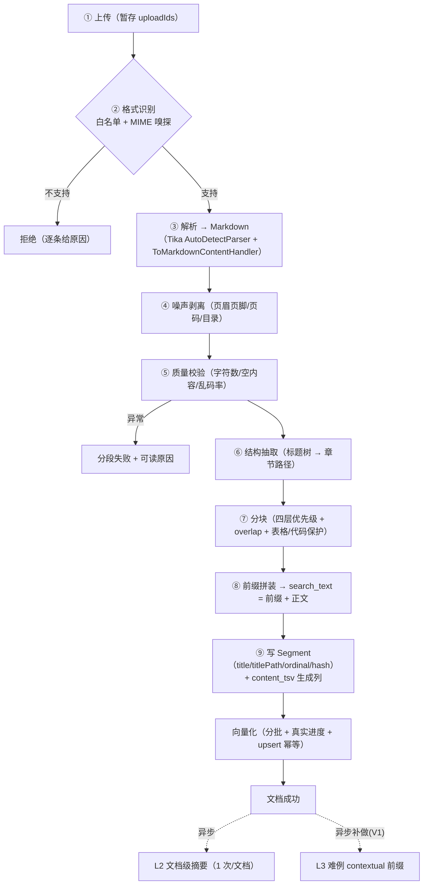

# 12 · 文档加工链设计（解析 · 分块 · 结构化 · 标签 · 摘要）

> **本册补的是什么**
>
> | 已有 | 缺的 |
> |---|---|
> | `03 机制三` 给了**流水线骨架**（上传 → 解析 → 切分 → 向量化 → 真实进度 → 失败重试） | 每一步的**具体规则与产物形态** |
> | `02 §2.3` 给了 `Segment` 聚合与 `ChunkStrategy` **参数**（字符 50–4096 / 重叠 0–1000） | **分块算法本身**（按什么边界切、结构怎么保） |
> | `10` / `11` 是**检索侧**（怎么召回、怎么挂 advisor） | **加工侧**（东西是怎么进库的） |
>
> 一句话：**`03` 定"有哪几步"，本册定"每一步怎么做、产出什么、失败怎么办"**。
>
> ★ 本册的结论建立在两轮独立查证上：**Tika 4 的 Markdown 能力**（对照 `CHANGES.txt` 与源码）与
> **召回率加工的实证证据**（Anthropic 官方数字 + arXiv）。凡"实证"与"惯例"会分开标注。

---

## 一、先纠一个错：我原来的解析方案是**有缺陷的**

`09 §10.2 #1` 我定的是"**精准组合**：`tika-core` + PDFBox 3 + POI —— **不用** `tika-parsers-standard-package`"。
**这个结论错了一半**，本轮查清后改向：

| 我原来的说法 | 事实（★ 核实过源码与 `CHANGES.txt`） |
|---|---|
| 用 `tika-core` 做 MIME 嗅探 | ✅ 对，`tika-core` 有 `Detector` |
| ~~用 `tika-core` 做 Markdown 输出~~ | ⚠️ ★ **`ToMarkdownContentHandler` 确实在 `tika-core`，但它只是一个「XHTML → Markdown」的序列化器**，**不含任何格式解析器** |
| ~~PDFBox + POI 自己抽文本~~ | ❌ ★ **只引 `tika-core` + PDFBox + POI 的话，`AutoDetectParser` 没有任何 `Parser` 实现可用** ⇒ 它只能空转或报错。**要让它工作，必须自己写 Parser 吐 XHTML** —— 那就是把 Tika 的能力**全部绕开**了 |

**⇒ 换言之：原方案会让 Tika 的解析能力一点都用不上**（只剩一个 MIME 嗅探器）。
而项目负责人这轮的偏好是对的：**尽量用 Tika 的解析能力，少引自写胶水**。

### 1.1 ★ 正确的组合：`tika-core` + **细粒度 parser 模块**（不是聚合包，也不是纯 core）

Tika 3.0 起就把解析器拆成了独立 artifact，所以"用 Tika"与"少引组件"**并不矛盾**：

```xml
<!-- 解析 MVP 的 5 种格式所需的最小集（★ 这才是"精准组合"的正确形态） -->
<dependency><groupId>org.apache.tika</groupId><artifactId>tika-core</artifactId></dependency>
<dependency><groupId>org.apache.tika</groupId><artifactId>tika-parser-pdf-module</artifactId></dependency>        <!-- PDF → PDFBox 3 -->
<dependency><groupId>org.apache.tika</groupId><artifactId>tika-parser-microsoft-module</artifactId></dependency>  <!-- docx/doc → POI -->
<dependency><groupId>org.apache.tika</groupId><artifactId>tika-parser-text-module</artifactId></dependency>       <!-- md / txt / csv -->
```

| 事实 | 意义 |
|---|---|
| ★ **`tika-parser-pdf-module` 与 `-microsoft-module` 内部锁定的正是 `PDFBox 3.0.8` 与 `POI 5.5.1`** | ⇒ 换到 Tika **不是"换一套技术"**，而是**同一批底层库上面多了一层 Tika 的统一管线**（编码检测、格式识别、SPI 装配、结构序列化） |
| `tika-parsers-standard-package` 在 4.0 起是 **POM 聚合包**（须 `<type>pom</type>`） | ⇒ 它拖 OCR / CAD / 音视频 / 邮件 / 字体 / 加密等模块，**正确规避它的方式就是引细粒度模块**，而不是放弃 Tika |
| `AutoDetectParser` **靠 SPI（`ServiceLoader`）从 classpath 装配 Parser** | ⇒ **不需要写配置、不需要 `TikaConfig`**（★ 4.0 **已删除** `TikaConfig` 的 XML 配置 API，改 JSON） |
| 4.0 的 `CHANGES.txt`：**默认 content handler 改为 Markdown**（TIKA-4663）· **Markdown 输出快约 30×**（TIKA-4868） | ⇒ 4.0 把 Markdown 当一等公民，正是我们想要的 |
| `ToMarkdownContentHandler` 引入于 **3.3.0**（`CHANGES.txt` 原话"Add a markdown option for content handlers"，TIKA-4563） | ⚠️ 其 javadoc 写 `@since 3.2` 与发布记录**不一致** ⇒ 以 3.3.0 为准（**不要**降到 3.2） |
| 4.0 要求 **Java 17+**，与 JDK 25 兼容 | ✅ |

> **诚实记录**：`09 §10.2 #1` 那段的措辞（"不用 `tika-parsers-standard-package`"）本身没错，
> 但**结论落到了"用 PDFBox/POI 自己抽文本"**，于是把 Tika 的解析能力一并放弃了。**本册改向，并回写 `09`。**

---

## 二、解析层：统一走 Tika 的 Markdown 管线

### 2.1 产物形态定成 **Markdown**（而不是纯文本）

**为什么这一步很关键**：如果解析产物是一坨纯文本，**后面的分块器就没有任何结构可依**，
只能按长度硬切 —— 而长度切分正是"把一条法规切成两半"的元凶。
**Markdown 的价值不是好看，而是它把"标题层级 / 表格 / 列表"变成了分块器可解析的信号。**

```java
// 解析入口（就是这一行，没有自写胶水）
ToMarkdownContentHandler handler = new ToMarkdownContentHandler();  // ★ 不需要 Metadata / ParseContext
try (TikaInputStream tis = TikaInputStream.get(inputStream)) {
    new AutoDetectParser().parse(tis, handler, new Metadata(), new ParseContext());
    return handler.toString();
} catch (Exception e) {
    return handler.toString();   // ★ 解析中途失败也返回已缓冲的部分（便于给出可读的失败原因）
}
```

### 2.2 ★ 逐格式保真度（必须让业务方知道上限，否则会以为是 bug）

| 格式 | 标题 | 表格 | 加粗/链接 | **列表** | 结论 |
|---|---|---|---|---|---|
| **DOCX** | ✅ H1–H6（按样式名 `Heading N`/`Title`） | ✅ **GFM 管道表格** | ✅ | ★ **❌ 不输出 `ul/ol/li`** —— 只把 `1.`/`·` 等编号**当字符写进段首**，**嵌套层级丢失** | **良**（唯一缺口是列表） |
| **`.doc`**（HWPF） | ✅ 靠样式名 | ✅ | ✅ | ❌ 同 DOCX | 良 |
| **PDF（普通）** | ❌ **只有 `<p>` + `<div class="page">`**，**无字号推断标题的启发式** | ❌ 官方明示"不计算单元格/行边界" | — | ❌ | **差**（见 §2.3） |
| **PDF（tagged / PDF-UA）** | ✅ 有 structure tags 时可出 `h1–h6` / `table` / `ul` | ✅ | ✅ | ✅ | 良（但内网 PDF 多数无 tag） |
| **`.md`** | ⚠️ **不是原样返回**：commonmark 解析 → XHTML → 再序列化 ⇒ **一次规范化重构**（空白/转义/表格格式会变） | | | | 可接受，但要知道 |
| **`.txt`** | — | — | — | — | 整篇包一层 `<p>` ⇒ 单段 |

**必丢的结构**（无论怎么配）：图片正文（只剩 `` 占位）、**页眉页脚**（降级为 `div`）、多栏阅读顺序、脚注、文本框、批注。

### 2.3 PDF 必须分级处理（★ 唯一需要"两条路"的格式）

| 层级 | 做法 | 适用 |
|---|---|---|
| **L1** | 默认路径：得到段落流（`<p>` + page div） | 全部 PDF |
| ★ **L0** | ★ **图像型（无文本层）⇒ 走 §十一 的 OCR 链** —— 判定由 Tika 原生内建（`ocr.strategy=AUTO` + `totalCharsPerPage=10`），**逐页判定、混合型 PDF 自动处理** | 扫描件、纯图 PDF |
| **L2** | ★ `PDFParserConfig.setExtractMarkedContent(true)` ⇒ 若 PDF 自带 structure tags，可直接出 `h1–h6` / `table` / `ul` | tagged PDF（可先探测） |
| **L3** | ★ **中文契约型文档的启发式**：把正文里**文本形式**的编号识别为层级 —— `第X章/第X条` · `（一）/（1）` · `1.1 / 1.1.1` | 合同、制度、报销规定 |

**为什么 L3 值得写，而且代价很低**：★ 中文企业文档的层级**本来就是写在正文里的文本**（"第一条 本制度适用于…"），
它**不依赖 Word 的自动列表、也不依赖 PDF 的 tag**。所以：

- Tika 丢"`ul/ol`"对中文合同的**实际损失小于看上去** —— 那些编号 Tika 会**原样当文本保留** ✅
- 而一条**表驱动的正则**（约 5–10 个模式）就能把 `第X条` 提升为标题层级 ⇒ **投入产出比很高**

⚠️ **但这条启发式必须用真实语料验证**：`04 R3` 说的"M0 拿 10 份真实文档做解析测试"，
这一轮要**专门量化两件事**：① Word 自动列表（会被 Tika 丢掉）在语料里的占比 ② L3 正则在真实合同上认对/认错的比例。
**若 ① 很高，退路是"DOCX 额外走一次 POI"**（见 §2.5）。

### 2.4 噪声剥离（★ 现有设计完全没有这一环）

页眉页脚、页码、水印、目录页会**污染分块与向量**（同一页眉在 50 个 chunk 里重复 ⇒ 它们互相"很像" ⇒ 召回被稀释）。

| 噪声 | 识别规则（可在解析后、分块前跑一遍） |
|---|---|
| 页眉 / 页脚 | **跨页重复行**：同一行在 ≥3 处出现且长度 < 60 字 ⇒ 判为页眉页脚，剔除 |
| 页码 | 纯数字 / 罗马数字 / "第 X 页 共 Y 页" 的独立行 |
| 目录页 | 连续 ≥5 行"…… 数字"结尾 ⇒ 整段剔除（但**保留章节标题**用于结构） |
| 水印文字 | ⚠️ 只在 PDF 文本流里以**孤立短行+高频重复**出现 ⇒ 用同一条重复行规则覆盖 |

★ **纪律**：剥离掉的噪声要**记数量**（`removedNoiseLines`），前端在"切分预览"里可显示 ——
**否则"为什么这份文档少了一页内容"没人能解释**（与 `03 §3.5` 的"失败样本留存"同一性质）。

> ### ★★ 补记（第 9 周 · 0.3.1 实测）：这条规则在真栈上**踩了两次**，两次都是"单测绿、线上没生效"
>
> | # | 现象 | 原因 |
> |---|---|---|
> | 1 | 目录行一条没剔 | 真实 OCR 输出是 `第一章 总则 ..……….….， 1`（点线与页码之间**夹着逗号**），而实现要求点线紧跟数字 |
> | 2 | 目录行仍然没剔 | ★ **Tika 的 Markdown 输出每行之间都有空行** ⇒ "连续 ≥5 行"按**物理行**判永远不成立 |
>
> 两次的共性：**判据不能按物理行写，要按"有内容的行"写**。
> 而它们之所以能溜过单测，是因为单测用的是夹具 JSON 里的**理想文本**（逐页一行行接起来，没有空行）。
>
> ⇒ **落地口径**：`NoiseStripperTest` 里必须有一份**从真栈 `parsedContent` 抄下来的形状**
> （含空行、含那个逗号）。用理想文本写单测的后果是"绿得很安心，而线上一条没生效"——
> 与本项目头号病「看起来在做、实际没生效」同源，只是这次发生在测试自己身上。
>
> 实测数据（`scanned.pdf`，3 页）：解析产物里页眉 3 次 / 页脚 3 次 ⇒ **分段正文里 0 次 / 0 次**，
> 目录行全部消失，正文（`第一章 总则` / `住宿标准为…`）一行没少。


### 2.5 ⚠️ 唯一已知缺口：DOCX 的列表（附退路）

| 项 | 内容 |
|---|---|
| 缺口 | Tika 的 Microsoft 模块**不产生 `ul/ol/li`**，只把编号写成段首字符 ⇒ 嵌套列表的**层级**丢失 |
| 影响面 | 用 Word **自动编号**的文档受影响；用**手工编号**（中文合同常见）的不受影响 ✅ |
| 现在做什么 | 先用 Tika 统一处理 + **在 M0 解析测试里量化占比**（§2.3 末尾） |
| 退路（若占比高） | **DOCX 单开一条 POI 路**：自写 `XWPFDocument` → Markdown（列表/标题/表格全可控）。★ 代价：一份 DOCX 解析两次（或用 POI 完全接管 DOCX，Tika 只管其它四种） |
| 为什么不当场做 | 它**只在实测证明有必要时才值**（`01 §6.3` 的"这个抽象现在有第二个使用者吗"）—— 现在做等于为想象的语料写代码 |

---

## 三、分块层：从 Markdown 到 Chunk（本册核心）

### 3.1 先说结论：**Spring AI 的分块器用不了**（★ 核实过源码）

| 我们的需求 | Spring AI 2.0.1 的事实 |
|---|---|
| 按**字符**切（50–4096） | `TokenTextSplitter.chunkSize` 单位是 **token**（默认 800，jtokkit `CL100K_BASE`） |
| **重叠** 0–1000 字符 | ★ **完全没有 overlap 参数**（源码零 overlap 逻辑） |
| 保留 Markdown 结构 | ★ **无结构感知**，会切开标题 / 代码围栏 / 表格行 |
| 超长在聚合层拒绝（`SEG-I1`） | 无"按字符上限拦截"的 API（`minChunkSizeChars` 只是**标点回退门槛**，不是长度上限） |
| — | ★ `transformer.splitter` 包**只有** `TextSplitter` + `TokenTextSplitter`；**无 Markdown/递归字符/代码/句子感知**分块器（已逐个排查，未查到） |

⇒ **定：自研分块器**。★ 但**继承官方 `TextSplitter`，只实现 `splitText(String)`** —— 这是"用官方能力"的正确姿势：

| 继承能白拿什么 | 说明 |
|---|---|
| chunk 的 metadata 语义 | 官方 `TextSplitter.createDocuments` 会**继承父文档 metadata** 并自动加 `parent_document_id` / `chunk_index` / `total_chunks` |
| `DocumentTransformer` 契约 | 天然可插进任何按 `Function<List<Document>, List<Document>>` 编排的链路 |
| 未来的兼容性 | 官方若改进（如加 overlap），我们的 `splitText` 仍可复用 |

### 3.2 四层切分优先级（★ 算法本体）

**原则：优先在"语义边界"切，长度只在最后兜底。**

```
L1 结构层：按 Markdown 标题（# / ## / ###）切成「章节块」
     └─ 每个块记住「章节路径」（= H1 > H2 > H3），它后面要做结构化前缀（§四）
L2 单元层：章节块内按「语义单元」切
     └─ 中文契约：第X章 / 第X条 / （一）/ 1.1  ← 法律效力单元，★ 绝不能跨条切
     └─ 通用：空行段落 / 列表项 / 代码围栏（整块保留）
L3 长度层：单元仍超 segmentLength ⇒ 按句边界切（。！？；……）
L4 兜底层：仍超长（无标点的长表格、代码、连续数字）⇒ 硬切 + ★ 打 `oversizedRisk` 标记
```

**四条硬规则**：

| # | 规则 | 为什么 |
|---|---|---|
| 1 | ★ **表格不跨块切**：整表一块；超长表按行分组但**每组重复表头** | 表格被切开后，每一半都失去意义（列名不在了） |
| 2 | ★ **代码围栏不切** | 同表格 |
| 3 | ★ **L4 兜底是必需的**（不是保险） | 因为 `SEG-I1` 是**值对象构造即拒绝** —— 若分块器产出超长 chunk，**入库会直接失败**。所以"保证不超长"是分块器的**契约**，不是优化 |
| 4 | ★ 每个 chunk 都要带 **`ordinal` + `titlePath` + `isTable`/`isCode`/`oversizedRisk`** | 后面的结构化前缀、检索过滤、质量观测都用它 |

### 3.3 重叠（overlap）怎么设

| 项 | 定 | 依据 |
|---|---|---|
| 默认重叠 | **50–100 字符**（段长的 10–15%） | 业界惯例区间是 10–20%；★ **无"越大越好"的证据**，>30% 反而增加存储与噪声 |
| 重叠的边界 | ★ **只在"同一章节内"重叠**，不跨章节 | 跨章节重叠会把上一章尾巴混进下一章，稀释语义 |
| 重叠的引用归属 | ★ **重叠区不算独立内容**，引用编号指向**主块** | 否则用户点开引用会看到"两块几乎一样" |
| ⚠️ 与检索侧的接口 | 相邻块内容重复 ⇒ 混合检索可能**同时命中相邻两块** | ⇒ 在 `11 §5.2 R4`（`DocumentSuppressor`）里加一条：**同文档相邻 ordinal 的块只保留 RRF 分更高的那个**。（这是本册与检索侧的唯一新增接口，要回写 `11`） |

> ★★ **2026-10-13 补记：`#65` 裁定为 (c)「分开排期」——本节的"不跨章节"口径暂不改，先拿读数**
>
> 缺口是真的：**上下文不受硬边界约束**。两类结构情形会静默丢召回 ——
> ① **章节边界把一句话劈开**（上一节末"…见下表" / 表在下一节，两段之间零共享文本）；
> ② **独占块**（表格/代码围栏不与相邻正文合并，表名与表头说明留在邻块）。
> 而**查询侧也不取邻段**（`JdbcSegmentSearchQuery.load` 只取命中段本身）。
>
> 裁定的落地顺序（**先口径、后代码**）：
> 1. ★ **先造对照夹具**（`#65` 判据 1）：前半在上一节末、后半在下一节首 ⇒ **关窗口 0 召回 / 开窗口命中且引用指主块**，交逐字读数；
> 2. **再决定本表第 2 行改不改** —— 若走 (a) 索引侧并邻段，就必须显式修订"只在同一章节内重叠"这一条（并同时启用本表第 4 行的 `DocumentSuppressor` 规则，否则相邻两块会同时命中）；
> 3. (b) 查询侧窗口治的是"召回了但上下文缺半句"，落点在 `11 §5.2 R4/R5` 与**第 17 周的生成链路**；
> 4. 两份窗口**共用同一份"窗口大小/上限"配置**，且要进埋点（记"并入的段数与字符数"）—— 否则"这周答案变长了"没人能解释。
>
> ★ 为什么不现在改这一行：**它约束的是索引侧的形状**，而改它的代价（语义稀释 + 相邻块抑制）只有在拿到对照读数之后才谈得上取舍。

### 3.4 ★ 分段标题（`Segment.title`）从哪来 —— 现有设计的一个**遗漏**

`02 §2.3` 定了 `Segment.title`（值对象 ≤256 字），但**没说谁生成、怎么生成**。补上：

| 情形 | `title` 取值 |
|---|---|
| 章节块内的第一个 chunk | 该章节的**最后一级标题**（如"第三章 差旅费"） |
| 同章节的后续 chunk | 同上 + 序号（"第三章 差旅费（2）"） |
| 无标题的块（PDF 段落流） | **首个句子截取 ≤256 字**（且优先在句号处断开） |
| 表格块 | 表头首行 / 表格前的最近标题 + "（表格）" |

★ 同时把**完整章节路径**存进 `titlePath`（如 `"报销管理办法 > 第三章 差旅费 > 3.2 住宿标准"`）——
**它是 §四 结构化前缀的主体**，也是"引用抽屉里显示来源位置"的最好材料。

### 3.5 切分预览（契约已冻结，本册定"返回什么"）

`POST /segmentation/preview`（`api/ingestion.ts:85-107`）已冻结了入参（`segmentLength` / `overlap` / `strategy` / `uploadIds` / `segmentationPlan`）。
本册补它的**语义**：

| 项 | 定 |
|---|---|
| 预览用什么切 | ★ **与正式入库完全同一套分块器**（否则"预览好看、入库难看"） |
| 返回的 `segments[]` | 每个给 `ordinal` / `content` / `charCount` / **`oversized`**（契约已有） |
| 用户编辑后的 `segmentationPlan` | **直接作为最终 chunk 集**（跳过分块器）⇒ ⚠️ 此时**必须仍跑 `SEG-I1` 校验**（用户可能粘贴进超长内容） |
| 预览与入库的一致性 | ★ `uploadIds` 暂存的文件在预览与导入之间**不能被清理**（`03` 机制八的"延迟删除队列"要给它留窗口） |

---

## 四、结构化：让"结构"变成召回信号（★ 本册的召回率主武器）

### 4.1 为什么结构化前缀是性价比最高的一档（★ 有实证）

| 做法 | 成本 | 实证效果 |
|---|---|---|
| **结构化前缀**（文档标识 + 章节路径，**零 LLM**） | **零模型调用** | ★ Meta-Prefix 实验：**失败率 30% → 3.3%**（Context@5 从 26.7 → 61.7），来源 arXiv:2601.11863（SEC 10-K 语料，bge-m3） |
| Contextual Retrieval（**逐 chunk 调 LLM** 生成 50–100 token 上下文前缀） | 每段 1 次模型调用 | Anthropic 官方：失败率 ↓35%（仅 embedding）；**+ 上下文 BM25 ⇒ ↓49%**；+ rerank ⇒ ↓67% |
| **通用文档摘要进 chunk** | 每段 1 次调用 | ⚠️ **Anthropic 同文明示"收益有限"**，summary-based indexing "表现低" |

★ **结论：先做零成本的那一档。** 而且它和逐段 LLM 摘要**不冲突** ——
结构化前缀是"确定性的事实"（这份文档是什么、这一段在哪一章），LLM 摘要是"推测性的概括"。
**事实先填满，推测只补难例**（§六）。

### 4.2 ★ `search_text` 这一列：一列两用（中文分词 + 结构化前缀）

**定：把"用于检索的文本"与"展示给用户的原文"分开存。**

| 列 | 内容 | 用途 |
|---|---|---|
| **`content`** | **原文**（Markdown，用户看到的、可编辑的、引用里展示的） | 切分预览、分段编辑、引用抽屉、重新向量化 |
| ★ **`search_text`** | **前缀 + 正文**（见下） | ★ **向量化的输入** + ★ **`content_tsv` 的生成源** |
| `content_tsv` | `to_tsvector('chinese_zh', search_text)` 的生成列 | 全文检索那一路 |

**前缀的构成（三层，按贡献从大到小排）**：

```
【文种 · 部门 · 文档标题 | 章节路径】正文…
   └─ L1 文档级标识（★ 消融显示"机构名+年份"贡献最大 ⇒ 这一层最重要）
   └─ L2 章节路径（H1 > H2 > H3，贡献较小但便宜）
   └─ L3 分段级标记（（表格）/（图注）等）
```

> ★ **为什么这一列是"顺水推舟"而不是新增负担**：`09 §10.2 #3` 已经为了中文分词动过 `content_tsv`
> 的生成方式。现在只是把它的**生成源**从 `content` 换成 `search_text` —— **列数不变、索引不变**，
> 多出来的是一列文本（200 万字约 8MB，可忽略）。

**三条纪律**：

| # | 纪律 | 为什么 |
|---|---|---|
| 1 | ★ **前缀绝不进 `content`** | 否则"引用里展示的原文"会带上一堆方括号前缀；用户编辑分段时也会看到它 |
| 2 | ★ **前缀里的标签一定也是"可过滤的列"** | 前缀是给**向量/全文**看的，过滤必须走 **SQL `WHERE`**（§5.2），两者不能互相替代 |
| 3 | ★ 改了前缀的组成部分 ⇒ **要重新向量化** | `contentHash` 必须**包含前缀**（否则"改了部门标签但向量没更新" ⇒ 静默不一致） |

### 4.3 表格：MVP 保留 Markdown 原形，不做"重写为陈述"

| 层 | 做法 | 依据 |
|---|---|---|
| MVP | **保留 GFM 表格原文**（Tika 对 DOCX 已能出 GFM 表格）+ 整表一块 | 简单、可溯源；表格里的数值/编号本来就是全文检索的强项 |
| V1（可选） | **表格重写为自包含陈述**（"住宿标准：一线城市 500 元/天"） | 证据强度中强（D-RAC：输出 token ↓95.7%，成本 ↓77.8–85.6%）⇒ 但要额外调模型，且**会失去原表形态**，所以**只对"检索命中率差的表"补做** |

### 4.4 图片（MVP 不做 OCR，但位置与图注要留）

| 项 | 做法 |
|---|---|
| 占位 | 保留 `` 形态，`fileId` 指向 `FileStorePort` 里的原件 |
| **图注/alt** | ★ **DOCX 的 alt text、图前后的"图 1 xxx"** 原样保留在正文里 ⇒ **它能被文本检索命中**（这已经是 MVP 能拿到的全部图片价值） |
| 检索 | 图片本身不向量化（V1.2 的 `image-understand` 节点再说） |
| 展示 | 聊天里点开引用时能显示原图（`FileStorePort` 取） |

---

## 五、标签化与数据治理（回答"为了召回率怎么安排"）

### 5.1 两层标签：**治理对象** 与 **加工产物**（★ 别混为一谈）

| 层 | 例子 | 谁产生 | 能不能重建 |
|---|---|---|---|
| **文档级标签**（治理对象） | 文种（合同/制度/报销规定）· 责任部门 · 密级 · 有效期 · 业务域 · 版本 · 来源 | ★ **人打的**（建档时填、后补） | ❌ 重建不了 —— 它是**业务事实** |
| **分段级标签**（加工产物） | 章节路径 · `ordinal` · 是否表格/代码/图注 · 是否超长风险 · 字符数 | **机器推的**（分块器输出） | ✅ 重新切分即可重建 |

⇒ ★ 这个区分的实际意义：**文档级标签改一次，代价是"重新向量化"**（因为它在 `search_text` 里）；
**分段级标签改一次，代价是"重新切分"**（更贵）。**所以文档级标签要在建档时就尽量收准**（§5.3）。

### 5.2 ★ 标签的三种用法，**必须分清**

| 用法 | 走哪条路 | 适用标签 | 依据 |
|---|---|---|---|
| **① 过滤（pre-filter）** | ★ **SQL `WHERE`**（拼进检索语句，`08 §4.4.3` 纪律 1） | **密级** · `enabled` · **有效期** · 知识库 | ★ 业界共识：**pre-filter ≫ post-filter**（post-filter 会"过滤完剩下 0 条"，且命中数不可预测）。★ **密级尤其必须 pre-filter** —— 只靠向量过滤等于漏检 + 越权 |
| **② 召回信号**（进 `search_text` 前缀 ⇒ 进向量与全文） | 拼进 `search_text` | **文种** · **部门** · **业务域**（进 L1 前缀） | ★ 实证：元数据进向量优于纯正文；但**权重只补充不主导**（α≈0.3–0.6）。它解决的是"**同一套条款在 10 个部门各有一份**"这类歧义 |
| **③ 展示与治理**（不进检索） | 普通列 | 负责人 · 归档状态 · 备注 | — |

★ **一条最容易犯的错**：把"密级"也当成召回信号（拼进前缀）就够了 —— **不够**。
前缀影响的是"排得靠不靠前"，**只有 `WHERE` 才决定"能不能被看见"**。这两件事必须**同时**做。

### 5.3 治理纪律（新增）

| # | 纪律 | 为什么 |
|---|---|---|
| 1 | ★ **建档时必填三项：文种 / 责任部门 / 密级**（其余可后补） | 这三项分别决定"召回信号最强的那部分前缀"与"安全过滤"，**不能有默认值**（默认值会让过滤形同虚设） |
| 2 | ★ **禁止"未知"作为默认值** | 密级默认"未知"= 要么全放行（泄密）要么全拦（不可用）。**让它必填，比给它一个错默认值好** |
| 3 | **标签变更的后果要写在界面上** | 改了"进前缀"的标签 ⇒ 提示"该变更会触发**重新向量化**（后台进行）" |
| 4 | **有效期到期** ⇒ 默认**不参与检索**（可配降权） | 过期的报销标准被召回出来，比召回不到更糟 |
| 5 | **标签的枚举值集中定义**（代码常量，同权限点的做法） | 散落的字符串标签 = 三年后没人知道有哪些值、哪些在用 |

### 5.4 ⚠️ 本册发现的一个**真实的权限模型缺口**：密级

引入"密级"标签后，出现了 `07` 册没有覆盖的一维：

| 维度 | 回答什么 | 现有载体 |
|---|---|---|
| 操作权限 | 能不能做这个**动作** | `Role.permissions` ✅ |
| 数据范围 | 能看到**哪些**（我的/共享的/全部） | `Role.dataScope` ✅ |
| ★ **密级** | 能看到**什么级别**的内容 | ❌ **没有载体** |
| 资源可见性 | 这条记录对谁可见 | `ownerId` + `visibility` ✅ |

⇒ **密级不是"范围"**（范围是"谁的"，密级是"多敏感"），它是**资源属性 × 角色的密级上限**。
两条路：

| 方案 | 做法 | 代价 |
|---|---|---|
| **A（建议 MVP 采用）** | 密级**只作为标签存在、只在界面展示与筛选**，**不做强制过滤** | 零改动，但**必须写清"当前不是安全边界"**（否则会给人虚假的安全感 —— 这是更危险的） |
| **B（V0.2 起）** | `Role` 加 `maxClassification`（角色密级上限）；检索时 `WHERE classification <= :me.maxClassification` | 要动 `07` 册的权限模型与契约（`Role` 加可选字段 + 角色管理页加一列） |

★ **我倾向 A + 明确记账**：MVP 的部署形态是**单客户内网私有化**（`ROADMAP §九`），
密级的真实需求通常出现在"多部门共用一套系统"时。**但"仅标签、不强制"这件事必须写在文档与界面上**，
不能让它看起来像个安全机制。

---

## 六、摘要：做不做、什么粒度、什么时机（★ 直接回答）

### 6.1 先看证据（这一节决定了答案）

| 证据 | 结论 |
|---|---|
| ★ Anthropic **官方明示**："通用文档摘要进 chunk **收益有限**"、summary-based indexing "表现低" | ⇒ **逐段摘要不是提升召回的主力** |
| 逐段 LLM 摘要与自己公布的 CR 是**两件事**：CR 产出的是"这段在说什么"的**定位信息**（50–100 token），不是概括 | ⇒ 若要做，做的是 **contextual 前缀**，不是"摘要" |
| RAPTOR（递归摘要树）作**独立召回路** +20pp | ⇒ 摘要的价值在**"另一种粒度的路"**，不在"塞进 chunk" |
| ★ 我们的硬指标 B6 = **入库 ≥3 段/秒**；2M 字 ≈ 4–6k 段 | ⇒ **CPU 环境下逐段串行调 LLM 远达不到 3 段/s** ⇒ **逐段摘要不能进主链路** |

### 6.2 ★ 定的三层方案

| 层 | 做什么 | 时机 | 模型调用 | 用途 |
|---|---|---|---|---|
| **L1** ★ 结构化前缀（`文种·部门·标题 \| 章节路径`） | **解析+分块后立即拼** | **同步**（主链路） | ★ **0 次** | 进 `search_text` ⇒ 拿 CR 的**大头收益** |
| **L2** 文档级摘要 | 每份文档 1 段摘要（≤200 字） | ★ **异步**（文档"成功"后由 `TaskScheduler` 补做，**不阻塞入库**） | **1 次 / 文档**（50 份 ⇒ 50 次） | ① 文档列表展示 ② ★ 作为**文档级第二路召回**（`10 §7.4` 的问答对是同一族思路） |
| **L3** 分段级 contextual 前缀 | 只对**难例**（无标题段 / 超长段 / 疑难表格）生成定位信息 | **异步 + 手动触发**（V1） | **0.1 × 段数** | 补 L1 覆盖不到的那部分 |

**L2 为什么值得做、且不违反 B6**：

| 项 | 说明 |
|---|---|
| 成本 | 50 份文档 = 50 次模型调用（**一次性**），不是 4–6k 次 |
| 不阻塞 | 它在文档状态变"成功"**之后**跑 ⇒ 主链路的 ≥3 段/s 不受影响 |
| 失败无害 | 摘要失败 ⇒ 文档照常可检索（只是列表页少一行摘要） |
| ★ 但**它必须进数据模型** | ⇒ `kb_document` 加 `summary` 列（+ `summary_status`），否则"异步补做"没有落点 |

**L3 为什么留到 V1**：它的收益（在 L1 之上再拿一点）与成本（0.1×N 次模型调用 + prompt caching 的实现）之比，
**要等 L1 上线后的实测数据**才能判断。**先别做，但要给它留位置**（`search_text` 的拼装点就是它未来的插入点）。

### 6.3 成本对账（★ 与 B6 的关系，一张表说清）

| 阶段 | 每 1000 段要调几次模型 | 对 B6（≥3 段/秒）的影响 |
|---|---|---|
| 解析 + 分块 + 前缀拼装（L1） | **0** | 无（纯 CPU） |
| 向量化（embedding，本来就是主链路） | 按批（如 64 段/批 ⇒ 约 16 次） | 这是 B6 的**主体**，已有设计 |
| L2 文档级摘要 | **≈ 0.01**（每文档一次，与段数无关） | 无（异步） |
| L3 分段前缀（V1，仅难例） | ≈ 1–2（10% 的难例） | 无（异步） |
| ~~逐段摘要~~ | ~~1000~~ | ★ **会直接把 B6 打穿** ⇒ **不做** |

> **一句话**：**"要不要在解析时同步做摘要"的答案是"不做"** —— 但**不是不做结构化**。
> 把预算花在**零成本的确定性前缀**上，摘要留成**异步的、文档级的、可失败的第二路**。

---

## 七、全链：从文件到可检索分段（九步）



| 步 | 谁做 | 产物 | 失败点与可观测 |
|---|---|---|---|
| ① 上传 | `ingestion` | 暂存文件 + `uploadIds` | 超限/类型不符 ⇒ **逐条** rejected（契约已有） |
| ② 格式识别 | ★ **Tika `Detector`** + 扩展名白名单 | MIME + 判定的解析器 | 改扩展名绕过 ⇒ 嗅探不匹配即拒（`09 §10.2 #2`） |
| ③ 解析 | ★ Tika 统一管线（§二） | **Markdown 文本** | 解析失败 ⇒ `failReason` + **保留已缓冲的部分**（Tika 的 handler 支持） |
| ④ 噪声剥离 | `ingestion`（自研，规则） | 干净 Markdown + `removedNoiseLines` | 剥离过量 ⇒ **要在预览里可见**（否则"内容少了"无从解释） |
| ⑤ 质量校验 | `ingestion` | 指标（字符数/段数/空内容/替换字符比例） | 空内容或乱码 ⇒ **分段失败**（不让垃圾进库） |
| ⑥ 结构抽取 | 自研（Markdown AST 遍历） | 标题树 + 每块 `titlePath` | 无标题文档 ⇒ 走"首个句子"兜底 |
| ⑦ 分块 | 自研（继承 `TextSplitter`） | `List<Chunk>` | ★ **L4 兜底必须成功**（否则 `SEG-I1` 拒绝整篇） |
| ⑧ 前缀拼装 | 自研（用文档级标签 + `titlePath`） | `search_text` | 标签缺失 ⇒ 用"未知"以外的方式（**建档必填**，§5.3） |
| ⑨ 写库 + 向量化 | `ingestion` + `vectorindex` | `kb_segment` + `vec_embedding_*` | 分段级重试（`03 §3.5`）；★ **进度覆盖写**（不是累加） |
| L2 / L3（异步） | `TaskScheduler` | `kb_document.summary` / 更新 `search_text` | 失败**不影响**文档可检索状态 |

★ **三个"顺序不能反"的地方**：**⑤ 在 ⑦ 之前**（垃圾不进分块）· **⑥ 在 ⑦ 之前**（没有章节路径就做不出结构感知切分）· **⑧ 在 ⑨ 之前**（前缀必须在写库前定稿，否则要二次更新向量）。

---

## 八、遗漏检查清单（★ 逐项核过"原设计有没有"）

> 这是本册最有实用价值的一节：**把整条加工链的环节摊开，逐项看谁被漏了。**

| # | 环节 | 原设计状态 | 本册补的 |
|---|---|---|---|
| 1 | 上传与暂存两段式 | ✅ 已有（`03` 机制三 + 契约） | — |
| 2 | 格式白名单与 MIME 校验 | ✅ 已有（`09 §10.2 #2`） | 改为 **Tika `Detector`**（管线自带） |
| 3 | **解析产物形态** | ❌ **只写了"解析"，没说产物是什么** | ★ **Markdown**（§2.1）—— 这是本册的关键转向 |
| 4 | **逐格式保真度与上限** | ❌ 无 | ★ §2.2 的表（含 DOCX 列表缺口、PDF 只有段落流） |
| 5 | **PDF 分级处理** | ❌ 无 | ★ §2.3（默认 / tagged / **中文编号启发式**） |
| 6 | **噪声剥离**（页眉页脚/页码/目录/水印） | ❌ **完全没有** | ★ §2.4（跨页重复行 + 页码模式 + 计数可观测） |
| 7 | 编码检测 | ❌ 无 | ✅ Tika `CharsetDetector`（免费得到，但要**记住中文 GBK 的场景**） |
| 8 | 语言检测 | ❌ 无 | ✅ Tika `LanguageDetector`（用于统计，不用于路由） |
| 9 | **解析质量校验** | ⚠️ 只有"失败给原因" | ★ §七 第⑤步（空内容/乱码率/字符数异常 ⇒ 主动失败） |
| 10 | **结构抽取（标题树）** | ❌ 无 | ★ §3.4（`titlePath`） |
| 11 | **分块算法** | ⚠️ 只有参数（`ChunkStrategy`），**无算法** | ★ §3.2（四层优先级 + 表格/代码保护 + L4 兜底） |
| 12 | **分段标题来源** | ❌ `Segment.title` 有字段、**没有生成规则** | ★ §3.4 |
| 13 | 重叠策略 | ⚠️ 有参数（0–1000） | ★ §3.3（默认 50–100、不跨章节、**相邻块抑制接口**） |
| 14 | **结构化前缀** | ❌ 无 | ★ §4.1/§4.2（零 LLM 的主力手段） |
| 15 | **`search_text` 与 `content` 分离** | ❌ 无 | ★ §4.2（一列两用：中文分词 + 前缀） |
| 16 | 表格处理 | ❌ 无 | ★ §4.3（整表一块 + 不跨切；重写留 V1） |
| 17 | 图片与图注 | ⚠️ 只定了"不做 OCR" | ★ §4.4（占位 + **图注可被检索**） |
| 18 | **文档级标签（文种/部门/密级/有效期/业务域）** | ❌ 无 | ★ §5.1 |
| 19 | **标签的三种用法（过滤/召回信号/展示）** | ❌ 无 | ★ §5.2（pre-filter 纪律） |
| 20 | **密级与权限模型的关系** | ❌ **缺口**（`07` 的 `dataScope` 不是密级） | ★ §5.4（方案 A + 明确记账） |
| 21 | **加密级 `Role.maxClassification`** | ❌ 无 | 留 V0.2（§5.4 方案 B） |
| 22 | **文档级摘要** | ❌ 无 | ★ §6.2 L2（异步、可失败、有落点列） |
| 23 | 分段级 contextual 前缀 | ❌ 无 | 留 V1（§6.2 L3） |
| 24 | 切分预览与用户编辑 | ✅ 契约已有 | ★ §3.5（预览与入库同一套分块器） |
| 25 | 失败与重试、分段级重试 | ✅ 已有（`03 §3.5`） | — |
| 26 | 进度真实性、覆盖写、幂等 | ✅ 已有（`03 §3.3/§3.4`） | — |
| 27 | 重新向量化（三档入口） | ✅ 已有 | ★ 本册补：**改前缀组成 ⇒ 必须重向量**（`contentHash` 含前缀） |
| 28 | **标签变更的后果提示** | ❌ 无 | ★ §5.3 纪律 3 |

**⇒ 28 项里，原设计有 9 项、只有参数没算法 3 项、完全空白 16 项。**
其中**影响召回率最大的三处空白**是：**结构化前缀（14）· 分块算法（11）· 文档级标签（18）**。

---

## 九、接口与回写

### 9.1 领域模型的增量（`02` 册要改的）

**`kb_segment` 加 5 列**（★ `content` 保持原文不动）：

```sql
ALTER TABLE kb_segment ADD COLUMN search_text  text NOT NULL DEFAULT '';   -- ★ 前缀 + 正文（向量与全文的输入）
ALTER TABLE kb_segment ADD COLUMN title_path   varchar(512) NOT NULL DEFAULT '';  -- 章节路径
ALTER TABLE kb_segment ADD COLUMN is_table     boolean NOT NULL DEFAULT false;
ALTER TABLE kb_segment ADD COLUMN is_code      boolean NOT NULL DEFAULT false;
ALTER TABLE kb_segment ADD COLUMN oversized_risk boolean NOT NULL DEFAULT false;  -- L4 硬切过的
-- ★ content_tsv 的生成源从 content 换成 search_text（列与索引不变）
ALTER TABLE kb_segment DROP COLUMN content_tsv;
ALTER TABLE kb_segment ADD COLUMN content_tsv tsvector
    GENERATED ALWAYS AS (to_tsvector('chinese_zh', search_text)) STORED;
CREATE INDEX idx_seg_tsv ON kb_segment USING gin (content_tsv);
```

**`kb_document` 加 7 列**（文档级标签 + 摘要落点 + 噪声计数）：

```sql
ALTER TABLE kb_document ADD COLUMN doc_type        varchar(32);   -- 文种：合同/制度/报销规定…
ALTER TABLE kb_document ADD COLUMN dept_id         uuid;          -- 责任部门
ALTER TABLE kb_document ADD COLUMN classification  varchar(16);   -- 密级（★ 见 §5.4：MVP 只做标签与过滤，不做强制）
ALTER TABLE kb_document ADD COLUMN effective_from  date;
ALTER TABLE kb_document ADD COLUMN effective_to    date;          -- ★ 到期默认不参与检索
ALTER TABLE kb_document ADD COLUMN summary         text;          -- L2 异步摘要
ALTER TABLE kb_document ADD COLUMN summary_status  varchar(16) NOT NULL DEFAULT 'PENDING'; -- PENDING/DONE/FAILED/SKIPPED
ALTER TABLE kb_document ADD COLUMN removed_noise_lines integer NOT NULL DEFAULT 0;
```

**新的领域不变量**（接 `02` 的 `SEG-I*` 序列）：

| # | 不变量 | 说明 |
|---|---|---|
| **SEG-I5** | `search_text` 的字符数 ≤ 向量模型上限（即 `SEG-I1` 现在**约束的是 `search_text` 而不是 `content`**） | ★ 因为进向量的是 `search_text`（含前缀）⇒ **前缀挤占预算**，`segmentLength` 的默认值要**扣掉前缀长度** |
| **SEG-I6** | `title_path` ≤512 字；`title` ≤256 字（后者 `02` 已有） | 防止异常层级把列撑爆 |
| **SEG-I7** | 前缀的组成部分（文种/部门/标题/章节路径）里的任何一项变更 ⇒ `contentHash` 必须变 | ★ 保证"改了标签一定会重新向量化"（§4.2 纪律 3） |
| **DOC-I6** | `classification` 与 `doc_type` **不允许为空**（建档必填，`05 §5.3`） | 让过滤有依据，而不是靠默认值 |
| **DOC-I7** | `effective_to` 已过期 ⇒ 文档不参与检索（默认行为，可配） | 过期信息被召回比召回不到更糟 |

### 9.2 与其它册的关系（本轮要回写的）

| 册 | 回写什么 | 为什么 |
|---|---|---|
| **`09 §10.2 #1`** | ★ **解析选型改向**：从"`tika-core` + PDFBox + POI（自己抽文本）"改为"**`tika-core` + 三个细粒度 parser 模块**" | 原方案让 Tika 的解析能力**一点用不上**（§一） |
| `09 §10.1 B` 组 | "文档解析"行同步改向；"PDF 表格抽取"行改为"**段落流 + tagged 分级**" | 保持一致 |
| `02 §2.3 / §5.2` | `Segment` / `Document` 的字段与 DDL 增量（§9.1） | — |
| `03 机制三` | 加指针：骨架在本册，**每一步的规则见 `12`** | — |
| `04 R3` | 解析器选型**关掉**；补一条**新的已知上限**：DOCX 列表层级（Tika 不产出 `ul/ol`） | 风险表不能挂"未定" |
| `11 §5.2 R4` | `DocumentSuppressor` 加一条：**同文档相邻 `ordinal` 只留 RRF 分高者** | 重叠会导致相邻块同时命中（§3.3） |
| `10 §10.3` | "检索缓存"那条旁边补一句：L2 文档摘要会成为**第二路召回**的素材 | 与 `10` 的路线图对齐 |

### 9.3 ★ 源文档更新时的**现行做法与其代价**（留缝，issue `#86`）

> **为什么补这一小节**：本册全部内容都是**单次快照**的处理链（解析 → 分块 → 结构化 → 向量化）。
> 而企业文档会迭代：制度改了、合同续签了、白皮书出了新版本。
> **"源文档更新了怎么办"这个问题，本册从来没有回答过** —— 不写下来，它就会在评审时变成一个
> "应该没问题吧"（本项目最贵的形状：**看起来在做、实际没生效**）。

#### ① 结论：知识库侧**没有"文档版本"概念**；更新 = **重新上传**

今天只有一条路径：**再上传一次**。而它会发生什么，**取决于上传的是同一份文档还是新文档** ——
`kb_document` 上没有"这份文档的前一版是谁"这个概念，`knowledge` 的建档路径也**不做重名合并**
（同名文档是两条独立记录）。

#### ② ★ 重新上传的**两种后果**（★ 本节必须写下来的那句）

| 做法 | 会发生什么 | 后果 |
|---|---|---|
| **再上传一次（同名、新内容）** | ★ **产生两份并存的文档、两套并存的分段** | ★★ **检索可能召回旧版本**：旧文档仍然 `SUCCEEDED`、分段仍然 `enabled` ⇒ 旧制度与新制度**同时**是可召回的候选。而引用看起来**完全权威**（编号、来源、溯源都对） |
| **删掉旧的、再上传新的** | ★ **旧分段被删 ⇒ 历史引用失效** | ★ 会话里那条 `refs` **还显示着**（`cv_message.references` 是 jsonb 快照），点开是空的 —— 用户看到"引用了一条不存在的分段"，**而没有任何地方报错** |

★ **两种结局都错**，而**第二种更隐蔽**：它不会出现在检索的读数里（少召回不会被看见），只会在
"用户点引用"的那一刻暴露。这正是 `#86` 危害 ② 的原话。

#### ③ 为什么不做版本链与失效传播（属 `0.5.x` 之后）

| # | 理由 |
|---|---|
| 1 | ★ **它需要"引用按版本解析"的检索侧改动**：`refs` 指向**分段**，而分段属于某次入库的文档。要说清"这条引用来自哪一版"，**引用结构本身**要带版本维度 —— 那会动 `SourceRef`（契约冻结）与 `HitTestView.Item` 的形状 |
| 2 | **它与 MVP 无交集**：`ROADMAP §二` 的三张清单里没有它；一次性语料（演示与验收用的 50 问集）不涉及版本 |
| 3 | **但字段位置现在留**（便宜），见 ④ —— 晚留要补迁移，而 `kb_document` 那时已经有数据了 |

#### ④ 位置（★ 只留位置，不建表、不实现）

`kb_document` 上未来要有的两列（**今天一个都不存在**）：

| 列 | 类型 | 语义 |
|---|---|---|
| `revision` | `integer`（或 `varchar(64)`） | 这条文档记录是**第几版**（同一份逻辑文档的多次上传之间递增） |
| `supersedes_id` | `uuid`（自引用 `kb_document.id`，可空） | 它**取代**了哪一条文档记录（`null` = 首发） |

★ **`02 §5.2` 的字段位置**：`02` 的表结构一节写了 `kb_document` 的完整列 ——
本小节**不改它**（避免一个字段两处各写一半）；`revision` / `supersedes_id` 的**落位以 `02` 为准**，
本册只负责回答"重新上传会发生什么"。

★ 与 `#81` 的区分：`#81` 的 `source_revision` 是**源系统的**版本标识（"源端改了没有"），
本节是**平台内的**版本链（"这条引用是哪一版"）。两者都要，但**不是同一列**。

#### ⑤ ★★ 冲突时谁赢

| # | 冲突 | 谁赢 | 为什么 |
|---|---|---|---|
| 1 | **新版本 vs 旧版本同时在库里** | ★ **新版本赢**（旧版本必须**退出检索**，不是"排在后面"） | ★ "旧版本排后面"仍然是**可召回的** —— 而一条已废止的制度被召回，与"没有答案"相比**更危险**（`#86` 危害 ①） |
| 2 | **旧引用 vs 已失效的分段** | ★ **引用展示要如实显示"该分段已失效"**，**不静默隐藏** | 与 `10 §5` 的拒绝哲学同源：**看不见就是看不见，不许让用户以为引用还在**。`13 §5.1` 的"静默丢弃"只适用于**越权**，不适用于"已废止" |
| 3 | **版本链 vs `content_hash` / 重新向量化** | ★ **两者独立**：换版本是**新文档**（新分段、新哈希），**不是**"旧文档的哈希变了" | `SEG-I7` 的哈希语义是"同一分段的内容变了"；把版本混进去会让"改动一次"与"新来一版"在读数上分不清 |
| 4 | **版本 vs 密级**（新版本密级更高） | ★ **密级单调不可逆**（`13 §2.1`）：升密**立刻**生效，旧版本的既有引用按 `13 §5.1` 的规则处理 | 密级是安全属性，不参与"哪个版本更新"的竞争 |

#### ⑥ 触发条件

**任一成立**即立项：

1. 出现**"源文档已更新、平台还在答旧内容"**的已复现案例；
2. 语料开始**持续更新**（不再是"上传一次就不动"的验收语料）；
3. 接入**增量同步 / 连接器**（`#81`）—— 源端一变，版本问题立刻从"偶尔"变成"每天"。

#### ⑦ ★ 判据（留缝做完算什么）

1. ✅ 本节存在，且 **② 写了"重新上传的两种后果"**、**⑤ 写了冲突时谁赢**；
2. ✅ 字段位置以 `02` 为准（只写名字与类型）；
3. ★ **一条能红的断言**：`DocumentVersionAbsenceTest.assertDocumentVersioningIsNotImplemented`
   （`backend/src/test/java/cn/lincoln/aiplatform/caliber/`）——
   它断言 `kb_document` 的字段与列清单里**没有 `revision` / `supersedes_id`**，
   且**引用侧（`HitTestView.Item` / `SegmentSearchPort.Card`）也没有版本维度**。
   谁把版本概念加进来（无论加在文档侧还是引用侧），它**立刻变红**。

---

## 十、待拍板与风险

### 10.1 待拍板（三条，都不阻塞 M2 开工）

| # | 事项 | 建议 | 另一条路 |
|---|---|---|---|
| 1 | **密级怎么落** | ★ **方案 A：MVP 只作标签 + 可过滤，不做强制**，并在界面与文档写明"当前不是安全边界" | 方案 B：`Role` 加 `maxClassification`（要动 `07` 的权限模型与契约） |
| 2 | **L2 文档级摘要进 MVP 吗** | **进**（异步、1 次/文档、失败无害、有落点列 `summary`） | 不进：省一列与一个调度任务 |
| 3 | **DOCX 列表缺口** | **先不动**：在 M0 的 10 份真实文档测试里**量化占比**再决定是否加 POI 补丁（§2.5） | 直接做 POI 补丁（提前付出双解析的复杂度） |

### 10.2 风险

| # | 风险 | 影响 | 应对 |
|---|---|---|---|
| 1 | ★ **前缀挤占向量预算**（`SEG-I1` 现在约束 `search_text`） | 前缀越长，正文能进向量的越少 | §9.1 的 `SEG-I5`；`segmentLength` 默认值**扣掉前缀长度**；前缀设长度上限（如 ≤80 字） |
| 2 | ★ **噪声剥离误杀**（把正文当页眉页脚删掉） | 内容静默缺失 | 规则要保守（≥3 次重复 + 长度 <60 字）；`removedNoiseLines` 在预览可见；★ 拿真实文档对照一次 |
| 3 | **标签质量**（乱填 / 空缺） | 前缀无效、过滤失效 | 建档必填三项 + 枚举集中定义 + 后补入口（§5.3） |
| 4 | **Tika 4.0 的规范化重构**（`.md` 不是原样返回） | 用户上传的 Markdown 被改写 | 记入已知；若比对差异明显，`.md` 走"直读"分支（跳过 Tika） |
| 5 | **Tika 升级的破坏性**（4.0 删了 `TikaConfig` XML API；Markdown handler 3.3.0 才引入） | 照旧文档写会编译不过 | 版本钉死 4.0.0；`ToMarkdownContentHandler` 的**存在性**写进启动自检/测试 |
| 6 | **分块器自研的正确性** | 切错边界比不切更糟 | ★ 四层规则**全部表驱动可单测**（给定 Markdown → 断言 chunk 边界），用真实合同当夹具 |
| 7 | **L2 摘要异步失败被忽略** | 列表页永远空着 | `summary_status` 有 `FAILED` 态 + 可手动重试（同 `03 §3.5` 的失败可见纪律） |

### 10.3 一句话总结本册

> **解析交给 Tika（统一管线 + Markdown）· 分块自己写（结构感知 + 字符单位）·
> 召回靠零成本的结构化前缀（不是靠 LLM 摘要）· 标签分"过滤"与"召回信号"两种用法，不能混。**
> 这四句分别对应 §二、§三、§四、§五 —— 它们也正好是**召回率**在这条链上仅有的四个可调点。

---

## 十一、图像型文档与 OCR 链（★ 新增章：它**推翻了一条老决策**）

> **位置说明**：这一章逻辑上属于 §二（解析层），但因为它是**在"不支持扫描件"这条老决策被推翻之后**补的，
> 所以编号放在最后 —— **读的时候与 §2.3（PDF 分级）连着看**。

### 11.1 先纠正一条老口径（并把代价说清）

| 老口径 | 出处 | 本册改为 |
|---|---|---|
| "**MVP 明确不支持扫描件**（需 OCR，属 V1.2 之后）" | `04 R3` · `ROADMAP §九` | ★ **纳入 MVP，但走异步**（§11.8） |
| `09 §10.1 B`：OCR = "**不需要**" | `09` | ★ **需要**（用 Tika 自带的 OCR 模块，零新服务、零新库） |

⚠️ **但代价必须同时说清**，否则它会变成一个"承诺了做不到"的功能：

| 事实 | 影响 |
|---|---|
| ★ CPU OCR 一页 A4 约 **1–5 秒**（`tessdata_fast`） | 一页 ≈ 30–80 段 ⇒ **同步 OCR 会把入库吞吐打到 <0.1 页/秒** |
| 而 **B6 要求 ≥3 段/秒** | ⇒ ★ **OCR 与 B6 不可调和** ⇒ **扫描件不进 B6 的吞吐 SLA**（业界同样做法，见 §11.8） |

### 11.2 ★ 选型：**Tika 4.0 自带三条 OCR 路线**（不引新库、不新增常驻进程）

| 路线 | 形态 | 结论 |
|---|---|---|
| ★ **`tika-parser-ocr-module`** | **CLI Tesseract**（经 `commons-exec` **spawn 子进程**，**非 JNI**） | ★ **主路径** —— 可配 `language=chi_sim+eng` · `tessdataPath` · `tesseractPath` · `pageSegMode` · `timeoutMillis` · `outputType: TXT\|HOCR` |
| `tika-parser-tess4j-module` | **JNI 进程内**（Tess4J 5.20.0，编译目标 Java 17 ⇒ JDK 25 兼容） | **备选**：省子进程开销，但 ⚠️ **native 崩溃会拖垮整个 JVM**（官方建议 forked JVM）⇒ 与"单体一个进程"的形态不匹配 |
| ★ **`tika-vlm` 的 `openai-vlm-parser`** | 经 **JAiRouter** 调 vision 模型，**模型直接返回 Markdown** | ★ **增强 / 兜底**（复杂版面、表格页）—— 但缺点见 §11.9 |

**明确排除的候选**：

| 候选 | 为什么不用 |
|---|---|
| RapidOCR（Java 绑定） | ★ Java 绑定 **0.0.7 / 2023-12 已停更**；且与 Tika 栈无集成，要自写→Markdown 胶水 |
| PaddleOCR | **无成熟的纯 Java 进程内调用**；前身系统的"独立 OCR 容器"违反"3 个平台进程" |
| PP-StructureV2 / MinerU / docling / layoutparser | ★ **全部是 Python 栈** ⇒ 违反"不引外部服务"（它们在"版面重建"上确实更强，但这正是我们要放弃的那部分能力） |

★ **对 3 进程约束的影响**：`tesseract` 是**短命子进程**（fork → exec → exit），**不是常驻服务** ⇒
**不违反"PG + 应用 + JAiRouter"**。这与"引一个 OCR 服务容器"是完全不同的量级。

**语言包与部署**：`chi_sim + eng`；`tessdata_fast` 仅 **+6 MB**（`best` +27 MB、更准更慢）⇒ **MVP 用 fast**。

```dockerfile
# 应用镜像里预置（离线可用；tesseract 与 tessdata 均 Apache-2.0）
RUN apt-get update && apt-get install -y --no-install-recommends \
      tesseract-ocr tesseract-ocr-chi-sim tesseract-ocr-eng \
 && rm -rf /var/lib/apt/lists/*
ENV TESSDATA_PREFIX=/usr/share/tesseract-ocr/5/tessdata
```

⚠️ **两个坑**：① `tessdata` 路径**必须显式给**（`TESSDATA_PREFIX` 或 Tika 的 `tessdataPath`）；
② CLI 模式**每图一个子进程 ⇒ 天然线程安全**，但反过来"**并发 OCR = 并发起多个 tesseract 进程**"⇒ 必须限流。

### 11.3 ★ 图像型判定：**Tika 原生内建，不用自己写**

★ 这是本轮最省的一处发现 —— `PDFParser` 自带 OCR 策略：

```json
"ocr": {
  "strategy": "AUTO",
  "strategyAuto": { "totalCharsPerPage": 10, "unmappedUnicodeCharsPerPage": 10 },
  "dpi": 300,
  "renderingStrategy": "ALL"
}
```

| 能力 | 说明 |
|---|---|
| **逐页判定** | 每页文本字符数 < 10（或未映射 Unicode < 10）⇒ **该页触发 OCR** |
| ★ **混合型 PDF 自动处理** | 有文本层的页正常解析、无文本层的页走 OCR ⇒ **不需要"整文档二选一"**（这正是我们最需要的） |
| 可观测 | 记录 `ocrPages`（哪些页走了 OCR）⇒ 用户能看到"这份文件有 12 页是扫描件" |

⇒ **不用引 `ocrmypdf`、不用自己写判定**（`ocrmypdf` 的 `--skip-text` 思路与此同构）。

### 11.4 从图像到 Markdown：链路 + **一处必须实测的假设**

```
PDF 页 → 光栅化（PDFBox PDFRenderer，300dpi，已有依赖）
       → 预处理（★ deskew + ≥300dpi 必需；二值化/去噪/多栏 Tesseract 内部已做 ⇒ **不引 OpenCV**）
       → Tesseract OCR（outputType=HOCR）
       → hOCR → Markdown
       → ★ 之后与文本型文档【完全同构】：分块 → 前缀 → 向量化
```

★ **"之后完全同构"是本设计的最大收益**：OCR 链只替换"解析"这一段，
`§三` 的分块、`§四` 的前缀、向量化**一行都不用改**。

⚠️ **一处两路查证说法冲突、必须在 M0 实测的地方** —— `tesseract` 的 hOCR 产出**能不能直接经
`ToMarkdownContentHandler` 变成 Markdown**？

| 说法 | 依据 |
|---|---|
| ✅ 能 | hOCR 是 HTML 子集，Tika 把它作为 **XHTML 事件流**发出，而 `ToMarkdownContentHandler` 消费的正是这个事件流 |
| ❌ 不能直接 | hOCR **文件**本身不是 Markdown 源；若手上是独立 hOCR 文件，需**自解析**（Jsoup + `ocr_par` / `x_size`）重建 |

⇒ **处理方式**：**主路径走 Tika 的事件流**；**M0 加一条实测**（拿一份扫描合同跑通"hOCR → Markdown"）；
**若质量不足，退路是自解析 hOCR**。**不赌它，但要先试它。**

### ★★ 11.4.1 M0 实测结论（第 9 周 · 0.3.1 补记）：**走主路径，退路不需要走**

上面那条"实测"做了，结论与本节的预设**不一样** —— 值得写下来，否则后人会重新踩一遍并再次得出"必须自解析 hOCR"：

| `OUTPUT_TYPE` | `preserveInterwordSpacing` | 中文产物（夹具 `scanned.pdf`，原文已知） |
|---|---|---|
| ★ **`TXT`（Tika 默认）** | ★ **`true`（默认）** | ★ **`某某集团内部管理制度`**（正确） |
| `TXT` | `false` | `某 某 集团 内 部 管理 制度`（逐字打散） |
| `HOCR` | `true` / `false` | `某 某 集团 内 部 管理 制度`（逐字打散） |

**根因**：chi_sim 把**每一个汉字**识别成一个 `ocrx_word`（实测 133 word / 133 字）。
TXT 路径走的是 Tesseract 自己的文本输出，**天然没有逐字空格**；
只有把产物交给 **hOCR → XHTML 事件流**时，词边界才变成空白。

⇒ ★ **打散不是 Tika 事件流的固有缺陷，是选 HOCR 造成的**（当初选 HOCR 是为了拿词级 `x_wconf`）。
**结论：主路径（事件流 + TXT）可用，`§11.4` 设想的退路不必走** ——
这同时消掉了一处**把流水线耦合到 Tesseract 格式**的风险（换引擎时不必重写 hOCR 解析器）。

**两条纪律（实测换来的，别丢）**：

1. ★ **`preserveInterwordSpacing` 必须显式写 `true`**，不能靠默认值 ——
   "不重建词间空格"听上去才是更自然的选择，是个会被后人顺手改成 `false` 的坑，
   而它的症状只是"多了些空格"，不会报错。
2. 断言必须用**精确短语**（`contains("某某集团内部管理制度")` + `doesNotContain("某 某")`）——
   "去空白后包含"这类判据**在打散的产物上也成立**，用它写测试等于没测。

★ 另外，`§11.3` 要的「记录 `ocrPages`」**标准接口已经给了**：PDF 元数据 `pdf:ocrPageCount`
（逐页判定与统计都是 Tika 内建做的）。三个页数已知的夹具实测
`structured.pdf=0` · `mixed.pdf=2` · `scanned.pdf=3` ✓ —— 不必自建。

**残余（不再是流水线问题）**：词级 `x_wconf`（`§11.6` 的"低置信度标 `needsReview`"要用）不在 TXT 路径上。
它现在的定位是**适配器内部的可选增强**：要就再配一次 HOCR 只取置信度，不要就算了。

**中间格式为什么选 hOCR**：★ Tika 只产出 `TXT | HOCR`（**不产 ALTO**），而 hOCR 恰好给了我们需要的信号：
`bbox`（位置）· `x_wconf`（**词级置信度**）· `x_size`（**像素字号**；Tesseract 不给 pt 字号）· `hardbreak`（换行类型）· `ocr_par`（段落）。

### 11.5 ★★ OCR 文本会击穿分块的四层规则（必须改）

| 层 | 受影响程度 | 调整 |
|---|---|---|
| **L1 标题** | ⚠️ **中等失效** —— OCR 断行会把一个标题**劈成多行** | `第X章/第X条` 正则 + `x_size` 相对字号；**相邻行合并**（字号相近且行尾无句末标点） |
| **L2 语义单元「第X条」** | ★ **相对最稳**（中文法规编号是高识别率模式） | **保持，并作为 OCR 路径的主锚点** |
| **L3 句边界** | ★ **大面积失效** —— 行尾无标点、行尾断词 | 改为「**按行拼接 + 尾标点推断**」；不可靠时**直接跳 L4** |
| **L4 硬切** | **成为主力** | 按 `ocr_par` 或固定长度切 ⇒ ★ 在 OCR 文档上它**不再是兜底** |

⇒ ★ **落地方式**：文档带 `source=ocr` 标记，分块器**按来源走两套规则**
（文本型：L1→L2→L3→L4；**OCR 型：L2→L1'(正则+字号)→L4**）。

### 11.6 OCR 特有的后处理

| 项 | 做法 | 依据 |
|---|---|---|
| ★ **页眉页脚去重** | **必须自己做**（Tesseract **默认不产出** `ocr_header`/`ocr_footer`/`ocr_pageno`）⇒ 按 **bbox 顶部/底部条带 + 跨页重复串** | §2.4 的规则在扫描件上**天然更容易达标**（每页都有 ⇒ 重复次数够） |
| 行尾断词 | 中文不用处理；英文按"行尾连字符/无空格"合并 | — |
| ★ **低置信度** | `x_wconf < 70` 的段落标 `needsReview`，进人工校对队列 | ⚠️ **不做自动纠错** —— 纠错会引入新错误且无法溯源 |
| ★★ **全文那一路降权** | 标 `ocrDerived=true`：**向量路照常、全文路降权** | ★ **OCR 错字对精确匹配极敏感**（"己/已"、"0/O"、"1/l"），而**向量对单字错误鲁棒**（embedding 平滑）⇒ 不能让它污染 `tsvector` 的权重 |
| 手写 / 印章 | **MVP 不做**（手写件公开基准最好约 72%） | — |
| **保留页面图片** | ✅ 保留 ⇒ 引用抽屉能**展示原页**（扫描件的溯源体验关键） | `FileStorePort` 已有 |

### 11.7 结构化前缀从哪来（扫描件没有 Word 样式）

| 来源 | 可靠度 | 用途 |
|---|---|---|
| ★ **OCR 文本正则**（`第X章 / 第X条 / 第X节`） | 中文法规类**高** | **章节路径的主体**（与 §11.5 的 L2 锚点**复用同一套正则**） |
| 字号启发（`x_size` 相对排序） | 中（中文标题常与正文字号接近） | 辅助分级 |
| ★ **文档级标签兜底** | **确定** | 文种·部门·标题**由入库元数据给**（不由 OCR 推断）⇒ §5.3 的"建档必填三项"在扫描件上**更加关键** |

### 11.8 吞吐、异步与状态（★ 与 B6 的关系）

| 项 | 定 |
|---|---|
| OCR 的位置 | ★ **流水线内的一个异步阶段** —— 必须先有文本才能分块，所以它**不能像摘要那样完全旁路**；但它**可以慢** |
| 业界排法 | ★ **"先入库、后补 OCR"**：文档记录与原件先落库（状态可见），OCR 异步补全文 → 再分块 → 再向量化 |
| B6 的关系 | ★ **扫描件不进"≥3 段/秒"的 SLA**（OCR 是 CPU 密集，与 embedding 的 SLA 分开考核） |
| **进度** | ★ 必须**按页回写**（"已识别 3/10 页"）—— 否则用户面对的是几分钟空白 |
| **状态** | ★ **不加新状态**（契约冻结）：用现有"待解析 / 分段中"覆盖；**契约加两个可选字段** `ocrTotalPages?` / `ocrDonePages?` |
| 并发 | CLI 模式**每图一子进程** ⇒ 必须**限流**（默认并发 = CPU 核数一半，可配），否则打满机器 |

### 11.9 三条已知上限（写清，别让它看起来像 bug）

1. ★ **扫描件里的表格基本救不回来** —— Tesseract 表格识别不可靠，而纯 Java 的版面分析方案**没有**（PP-Structure / MinerU / docling 全是 Python）⇒ 要么降级为纯文本，要么**交 VLM 兜底**
2. ★ **VLM 直出 Markdown 只能作增强、不能作主路径** —— 有论文证据的失败模式：**结构幻觉 · 语言先验幻觉（生成图中没有的词）· 重复行 · 表格塌陷（最强解析器 TEDS 也只有约 85）**；且★ **同图两次结果不一致是常态**（非确定性）⇒ 适合"人工点了才跑一次"的增强，不适合批量入库
3. **手写件不做**（公开基准最好约 72%）

### 11.10 本册对 `04` / `ROADMAP` / `09` 的回写（已同步）

| 文档 | 改动 |
|---|---|
| `04 R3` | "MVP 明确不支持扫描件" → **纳入 MVP 走异步**；R3 的上限清单加"扫描件表格不可救" |
| `ROADMAP §九` | "明确不做：扫描件 OCR（V1.2 之后）" → **移出"不做"清单**，改为"MVP 纳入（异步，不进 B6 SLA）" |
| `09 §10.1 B` | OCR：**不需要 → 需要**（`tika-parser-ocr-module` + tesseract/tessdata，Apache-2.0） |
| `09 §10.2` | 新增 **#9 OCR 选型**（三条 Tika 路线 + 排除清单） |
| `12 §2.3` | PDF 分级加一条 L0：**图像型 ⇒ 走本章** |

---

## 十二、表格与结构化数据的召回改写（★ 新增章：**你的实测判断有实证支持**）

> **起点**：项目负责人反馈 —— *"表格数据，就算转成 Markdown 数据仍无法召回，召回效率非常差，是否需要改写"*。
> **结论：是的，必须改写；而且这不是"调参能解决"的问题，是机理问题。**

### 12.1 为什么 Markdown 表格召回差（★ 两层实证，不是推测）

| 机理 | 证据 |
|---|---|
| ★ **序列化敏感** | 同一张表用 csv / tsv / html / markdown 等**语义等价**的写法，embedding 与 Recall@1 **差异显著**（NQ-Tables 上 range 达 0.26+）⇒ 管道符与分隔行**不只是噪声，它们改变整表向量的落点**（arXiv:2604.24040） |
| ★★ **单位与表头跟数值割裂** | READ 实测 780 页财报：**86.8% 的内容行是表行**；数字的单位继承自**中位 13 行之上**的表头；chunk 边界会把"500"与"元/天"**切开**。table-aware 分块后**仍有 27–30% 的数字 chunk 缺表头**。★ **dense 召回 15.7% vs 词法 58.8%** —— **向量对表格结构性失效**（arXiv:2608.06305） |
| 表-文分离 | 规则抽取与 OCR 会 flatten 表格、丢标题层级（D-RAC，arXiv:2609.24220） |
| 收益不对称 | layout-aware 分块**对表密集文档的收益远大于纯文本文档**（arXiv:2608.26192） |

**一句话**：表格里的"500"**脱离表头就没有意义**，而向量恰好把"500"和表头切到了不同的 chunk 里。

### 12.2 四个改写候选与推荐组合

| 方案 | 做法 | 需 LLM？ | 效果/案例 | 失败模式 |
|---|---|---|---|---|
| ① **行级陈述化** | `{表名}中，{行键}的{列名}为{值}{单位}` | ★ **否**（模板可做） | D-RAC 明确"**rewriting tables as self-contained prose statements**" | ⚠️ **chunk 数 = 行 × 列，爆炸**（必须做预算） |
| ② **列路径前缀** | `住宿标准表 > 一线城市 > 金额：500 元/天` | ★ **否** | 与我们的结构化前缀**同构**；HELIOS 细粒度 table-segment **最高 +42.6% recall**（arXiv:2603.02248） | 与自然语言提问仍有 gap（需叠加 ①） |
| ③ **LLM 表格摘要** | 摘要进索引、原表保留 | 是 | 有效 | ⚠️ **数字幻觉**；精确数值问答常**丢值** |
| ④ **双载体** | 原表供展示 · 陈述版供检索 | ①可否 | Docling 多格式导出；HC-RAG 文/表分节点路由 | 双索引维护（但我们的落法避免了，见 §12.4） |

⇒ ★ **推荐组合：④ + ①（主）+ ②（并入内容）；③ 仅超大表可选。绝不要"只做 ③"。**

### 12.3 ★ 零 LLM 的确定性改写（与"先做零成本那档"一致）

| # | 规则 | 说明 |
|---|---|---|
| 1 | **列名 + 行值拼句** | `《{caption}》中，{行键}的{列名}为 {值}{单位}` |
| 2 | **单位归一** | `元/天` / `人民币500` ⇒ 统一成 `500 元/人/天`（**原串保留为别名**，便于精确匹配） |
| 3 | **日期与金额规范化** | `2024-01-01` ↔ `2024年1月1日`；`1,500` ↔ `1500` |
| 4 | ★ **空值 / 合并单元格填充** | 行键向下填充 + 显式写"同上" ⇒ ⚠️ **不填的话陈述句会残缺**（Excel 合并单元格的值只落在左上角） |

★ **"行级陈述化"没有现成实现** —— Docling 的 `HybridChunker` 有 `repeat_table_header` / `omit_header_on_overflow`（**表跨 chunk 的工业惯例，我们要照抄**），Tika 4.x 有自己的 `MarkdownChunker` + `tk:chunks`，**但都没有"行级陈述器"** ⇒ **要自研**（好在它是纯模板，可表驱动单测）。

### 12.4 ★ 怎么落地：**不需要"双 chunk"，用 `search_text` 一列就够**

`§4.2` 已经把"检索用的文本"与"展示用的原文"分成了两列（`search_text` / `content`）—— ★ **表格正好用上它**：

| 字段 | 表格型 Segment 放什么 |
|---|---|
| **`content`** | ★ **原 Markdown 表格**（含表名/caption 作首行）⇒ 引用抽屉里展示的就是**表本身**，用户看到的是表格而不是流水句 |
| **`search_text`** | ★ **行级陈述版**（① + ②）⇒ 进向量与 `content_tsv` |
| `is_table` | `true` ⇒ 检索时按 §12.7 微调权重 |

⇒ ★ **收益**：**不需要双份 chunk、不需要回链原表、不需要改契约** —— 一个 Segment 同时满足"展示要原表"与"检索要陈述"。
这比"双载体"（④）的实现成本低得多，效果相同。

### 12.5 表格超过 `SEG-I1` 时怎么切（照抄工业惯例）

| 项 | 做法 |
|---|---|
| 分组 | ★ **按行分组 + 每组重复表头与 caption**（Docling 的 `repeat_table_header` 同款） |
| 表名位置 | ★ 表名/caption **放 `content` 首行**（不只是放前缀）—— 因为展示时用户也要看到表名 |
| `ordinal` | 用 `table_id` + `row_group_001…` 的语义；**行序不重排** |
| 超宽表 | 按**列组**纵向切，**每段都带行键**（否则看不出这行是什么） |

### 12.6 Excel / CSV：**加入上传白名单**（Tika 已支持，成本在改写层）

| 项 | 事实 |
|---|---|
| 支持 | ★ Tika 4.0 默认输出 Markdown；`xlsx` → `OOXMLParser`、`.xls` → `OfficeParser`、**csv/tsv → 直接"emitting tables"** —— ★ **我们用已有的 `tika-parser-microsoft-module` 就够**（xlsx 在里面） |
| 多 sheet | 插入 `## Sheet: {name}` 作分节 ⇒ 分块时天然成为章节 |
| 公式 | POI 读到的是**缓存值**（不是公式）⇒ 记入已知 |
| 合并单元格 | ★ **值只落左上** ⇒ **必须填充**（§12.3 规则 4） |
| 风险 | 宏、超大表（要限行数/限 sheet 数） |

⇒ ★ **定：`.xlsx` / `.csv` 进白名单**（`.xls` 后置 —— 老格式、Tika 支持较弱）。
⚠️ 这是**契约的扩展**：`GET /upload-policy` 的 `acceptedExtensions` 要加这两项（后端配置，前端自动跟随 ✅ 这正是当初把它做成后端下发的好处）。

### 12.7 表格的检索策略微调（★ 一处小参数，但方向必须写死）

★ 实证提示：**表格型内容"词法优于 dense"**（15.7% vs 58.8%）。所以：

| 项 | 调法 |
|---|---|
| 混合 RRF | ★ **表格 chunk 上调全文那一路的权重、下调向量那一路**（`10 §3.2` 的 RRF 是纯排名融合 ⇒ 这里需要**按 chunk 类型给两路不同的 k 或权重**）⇒ ⚠️ **这是对 `10` 的一处接口扩展**，要回写 |
| 数字与单位 | ★ zhparser 会把 `2010` 与 `年` **拆成不同 token** ⇒ 能命中"500"，但 **"500 元/天"与"500 元/次"会混** ⇒ 陈述版写**可分词短语**（"500 元每人每天"）+ 金额与单位另存字段 |
| 兜底 | ★ **不要把表格踢出向量**（只留全文）—— 那就丢了"语义相近但用词不同"的召回 |

### 12.8 键值对旁路：**MVP 不做，V0.2 做**

"报销标准是多少"这类问题，最稳的其实是**不走向量**：
把标准表抽成 `(table, row_key, col, value, unit)` 的键值对，用**槽位查询**直接命中（可审计、数字精确）。

| 为什么 MVP 不做 | 说明 |
|---|---|
| 契约没有载体 | 契约里没有任何"结构化查询"端点 ⇒ 要扩端点是**破坏性决定**，不该顺手做 |
| 它是新功能不是加工细节 | 要新表 + 抽取规则 + 查询路径 + 前端交互 |
| 收益待实测 | 先看 §12.2 的方案能不能把 B1 拉到 70% —— 若能，键值对就不急 |

⇒ ★ **登记为 V0.2**（触发条件：真实问题集里"数值型问题"的命中率明显低于平均水平）。
**明确不上 NL2SQL**（schema 漂移 + 口语→SQL 错误 + 注入风险，小规模内网不值当）。

### 12.9 反面清单（★ 这些都是"看起来该做但会被证明无效"的）

1. ★ **只做 LLM 摘要替代原表** ⇒ **数字丢失**（摘要必然丢精确值）
2. **整表超长直接 embed** ⇒ 截断 + 单位丢失（有实证）
3. ★ **只换序列化**（Markdown → HTML 之类）**而不改语义结构** ⇒ 向量仍然不稳（那篇论文正是证明这点）
4. **行级陈述化不做预算** ⇒ chunk 数爆炸
5. **合并单元格不填充** ⇒ 陈述句残缺
6. **把表格踢出向量、只留全文** ⇒ 丢语义召回


---

## 十三、文档版本：源文档更新时，今天会发生什么（留缝 `#86`）

> **为什么单列一章**：这不是"缺一个功能"，而是**一个会让答案看起来更权威的错误**。
> 源文件更新后，平台仍然答旧内容，而**引用编号、文档名、密级、溯源全对** ——
> 用户没有任何线索能察觉"这份资料已经过期"。这比答不出来危险得多。

### 13.1 今天只有一件事：**重新上传 = 多一条独立记录**

| 用户动作 | 今天的结果 | 旧内容的下场 |
|---|---|---|
| 同名文件**再次上传**（同一个库） | 新建一条 `kb_document`（新的 id、新的分段、新的向量） | **仍然在库里，仍然能被检索到** |
| 删掉旧的再传新的 | 旧文档软删（`deleted_at`），其分段与向量**物理删除** | 历史回答里的引用会**指向一条已删除的文档**（深链打不开） |
| 只改文件内容、文件名不变 | 与"同名再次上传"完全相同 —— **平台不认"这是同一个文档的新版"** | 同上 |

★ 那两列缝（`02 §5.1.2` 的 `revision` / `supersedes_id`）今天**恒为 1 / NULL**，
所以"哪条是新的、哪条被取代"**在数据里根本不存在**。

### 13.2 两种后果（★ 判据 ②：必须写下来，不能留给以后猜）

1. **答案重复且互相矛盾**：两份文档的分段同时进候选集，模型可能一段引用旧版、一段引用新版，
   而**两条引用看起来都很权威**。检索侧今天没有任何"只取最新版"的机制（连"最新"都无从判断）。
2. **引用失效但不报警**：用户按引用深链点进去，可能落到一条已软删的文档（"删除后再上传"那条路），
   或者落到旧版内容 —— 而界面上**没有任何"这是旧版"的标记**。

★ 两者的共同点：**失败是静默的**。这正是本项目的头号病（`silent-failure`）在文档生命周期上的形态。

### 13.3 为什么现在不做版本链

- **成本不在存储，在检索**：真做版本，检索侧必须能"按版本解析引用"，并且要定
  "只召回最新版 / 召回全部但标注版本 / 召回到某个历史时点" —— 这三种口径对 B1、B3 读数的影响完全不同。
- **与 `#75` 耦合**：版本链一旦存在，"彻底删除旧版"就必须处理引用完整性（`#75` 第二段）。
- 所以：**现在只留列 + 写下后果**（`02 §5.1.2`），实现属 `0.5.x` 之后。

### 13.4 触发条件（什么情况下这件事必须提前）

- 客户要求"文档更新后旧问答必须失效"（合规场景常见）；
- 接入**外部抓取/连接器**（`#81`）—— 源端每天都在变，没有版本概念就无法解释"为什么昨天答的和今天答的不一样"；
- `B3 引用准确率` 出现"引用能打开但内容与回答不符"的样本（那就是这条缝在冒头）。
