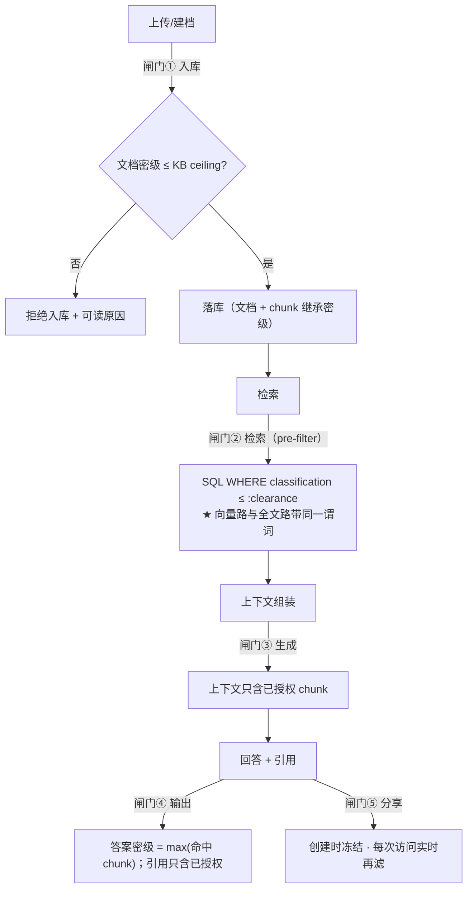

# 13 · 密级与数据隔离设计

> **本册补的是权限模型的第三轴。**
>
> | 轴 | 回答什么 | 载体 | 出处 |
> |---|---|---|---|
> | 操作权限 | 能不能做这个**动作** | `Role.permissions` | `07` ✅ |
> | 数据范围 | 能看到**哪些**（我的 / 共享的 / 全部） | `Role.dataScope` | `07` ✅ |
> | **资源可见性** | 这条记录**对谁**可见 | `ownerId` + `visibility` | `07` ✅ |
> | ★ **密级** | 能看到**多敏感**的内容 | ❌ **无载体** | **本册** |
>
> ★ **为什么密级不是"数据范围的一个取值"**：`dataScope` 回答的是"**谁的**"（归属），
> 密级回答的是"**多敏感**"（保密性）。它们**正交** —— 一份"我自己的"文档可以是"机密"，
> 一份"全平台可见"的文档可以是"公开"。**把两者混成一个字段，会出现"因为是我建的所以能看机密"这种荒谬结论。**
>
> ★ 本册的结论分两类标注：**「有规范依据」**（BLP / Biba / 等保 2.0 / 保密法 / 数据安全法 / PG 官方文档）
> 与 **「工程惯例」**（业界做法但无强制规范）。

---

## 一、密级模型：一个等级 + 若干标签

### 1.1 等级链是**偏序格**，标签是**正交维度**

| 维度 | 性质 | 例子 | 参与排序？ |
|---|---|---|---|
| **等级（level）** | ★ **有序**（偏序格） | 公开 < 内部 < 秘密 < 机密 | ✅ 参与（这是"no read up"的基础） |
| **标签（labels / compartments）** | **无序**（正交） | 财务 · 人事 · 研发 · 法务 | ❌ 不参与排序，只做**与**判断 |

★ **理论依据「有规范依据」**：
- **Bell-LaPadula（1973 / TCSEC 5200.28-STD）** 解决**保密性**：**no read up**（不能读比自己 clearance 更高的）+ **no write down**（不能把高密信息写到低密对象里）
- **Biba（1977）** 解决**完整性**，与本册方向相反，**不采用**
- 等级 + compartments 的乘积构成**军用多级安全（MLS）** 的经典模型

★ **工程上只用两个字段就够**（不必上完整格运算）：
```sql
classification_level  varchar(16) NOT NULL,   -- 公开/内部/秘密/机密（有序）
labels                text[]                 -- 财务/人事/研发…（无序，可空）
```

### 1.2 ★ 中国语境：法定密级 vs 工程惯例（**必须分清，否则会对外说错话**）

| 概念 | 规范依据 | 管什么 |
|---|---|---|
| **国家秘密三级**（绝密 / 机密 / 秘密） | ★ **《保守国家秘密法》—— 有规范依据** | **内容密级**（法定） |
| 涉密系统的分级保护 | **BMB 系列国家保密标准** | 系统建设 |
| **等保 2.0**（GB/T 22239-2019 / 22240-2020） | ★ **有规范依据** | ★ **系统的安全等级**，**不管内容密级**；但**要求访问控制、安全审计、剩余信息保护** |
| **数据分类分级** | ★ 《数据安全法》§21 + **GB/T 43697-2024** | 数据的**分类分级**治理 |
| ★ **企业四级「公开 / 内部 / 秘密 / 机密」** | ✗ **无规范依据 = 工程惯例** | 企业内非涉密文档的分级 |

⇒ ★ **一句话**：**我们做的是"企业内容分级"（工程惯例），不是"国家秘密定密"（法定）。**
**文档与界面不要写成"依据《保守国家秘密法》定密"** —— 那需要定密权限与专门流程。
但**审计能力（§八）参照等保 2.0 的要求做**，因为将来若真进涉密环境，审计是最难后补的一环。

### 1.3 ★ 角色的 clearance（**本册新增的载体**）

| 字段 | 位置 | 语义 |
|---|---|---|
| `classificationLevel` + `labels` | **Document**（原件标注，建档必填） | 这份内容的密级 |
| max(文档密级) | **KnowledgeBase**（`maxClassification`，**ceiling**） | ★ 这个库**允许装**的最高密级（§六） |
| ★ **`maxClassification` + `labels`** | **Role**（**新增**） | ★ 这个角色**能看**的最高密级与可涉标签 |
| 继承 · 不独立 | **Segment** | ★ **chunk 强制 = 文档密级**（§3.1） |

```sql
ALTER TABLE iam_role ADD COLUMN max_classification varchar(16) NOT NULL DEFAULT '公开';
ALTER TABLE iam_role ADD COLUMN labels text[];
```

★ **"no write down" 落到我们这里是什么**：**不能把高密文档上传进低密知识库**（`§4.1` 入库闸门）。
这条不是形式主义 —— 它是防止"机密内容因为被放进一个公开库而泄露"的**唯一**入口检查。

---

## 二、密级传播与漂移（★ 本册最重要的一节）

### 2.1 继承链（★ 单向、不可逆）


| # | 规则 | 为什么 |
|---|---|---|
| ① | ★ **文档密级 ≤ 知识库 ceiling**，否则**拒绝入库** | 防止"机密进了公开库" |
| ② | ★★ **chunk 密级强制 = 文档密级，且不允许单独下调** | 如果允许 chunk 比文档低，那"文档密级"就形同虚设（有人把机密文档的所有分段都标成公开即可绕过） |
| ③ | ★ **回答与引用的密级 = max(命中 chunk 的密级)** | 这是**聚合推断**的第一道防线（§2.3） |

⚠️ **我们不做"chunk 级独立密级"**（业界有这种需求：同一个文档里某段更敏感）。理由：
它会让上传者要为每段打标（**不现实**），而且**逐段标注的动机恰好是"下调"**。
若将来真需要，正确做法是**把敏感段落拆成独立文档**（然后它就自然拿到自己的密级）。

### 2.2 会话与跨轮的密级抬升

| 项 | 规则 |
|---|---|
| 单轮 | 回答密级 = max(命中 chunk) |
| ★ **跨轮** | 会话密级 = **max(该会话历史里所有引用过的 chunk)** —— 一旦引用过机密，**整个会话就是机密的**（后续回答也按机密处理） |
| 分享 | ★ 分享时冻结"**可分享的最高密级**"= 分享者当时的 clearance（§4.5） |

### 2.3 ★ 聚合推断风险（aggregation / inference）与四条应对

**问题**：多份**低密级**文档拼起来，可以推断出**高密级**的信息。
（"公开文档 A 说预算总额" + "公开文档 B 说某部门占比" ⇒ 推出该部门预算）
这属于经典信息流问题，**BLP 本身不解决"组合"**。

| # | 应对 | 强度 |
|---|---|---|
| 1 | ★ **答案级取 max**（§2.1 ③）—— 单条高密命中就整体抬升 | 强（确定性） |
| 2 | ★ **会话累计密级**（§2.2）—— 跨轮引用累计抬升 | 强（确定性） |
| 3 | 检索侧**同时限制**"单次可命中的最高密级" | 中 |
| 4 | ★ **关键结论要求单源可溯源** —— 禁止把"跨文档综合得出的结论"标为低密 | 弱（靠纪律） |

> ⚠️ **诚实说明**：**聚合推断没有便宜的完全解**（这是业界的开放问题）。
> 我们能做的是**把确定性的那两条（1、2）做掉**，并在文档与界面里**明确它不覆盖"聪明的拼接"**。
> **宁可说清边界，也不要给一个虚假的安全承诺。**

### 2.4 升密 / 降密的完整处理链（★ 最容易被漏掉的一环）

**升密**（如"内部 → 机密"）：

| 步 | 动作 | 为什么必须做 |
|---|---|---|
| 1 | 重打该文档**全部 chunk** 的密级（异步 job） | 否则旧 chunk 仍是低密 ⇒ 可被低 clearance 用户检索到 |
| 2 | **重算受影响会话的密级** | 已发生的引用会抬升会话密级 |
| 3 | ★ **撤销**该文档相关的**全部分享链接**（`ConversationShare` / `AccessCredential`） | ★ 否则"以前分享出去的链接"变成泄密通道 |
| 4 | 记**密级变更审计**（`action=RECLASSIFY`） | 事后追溯"谁在什么时候改的" |

**降密**（如"机密 → 内部"）：

| 步 | 动作 |
|---|---|
| 1 | 同链路重打 chunk 标签 |
| 2 | ★ **已产生的引用快照保留密级历史**（`citation.classificationAtQuote`）—— **避免"降密后历史引用被追溯放行"** |
| 3 | 分享链接**可保留**（但快照密级字段**不改写** —— 它记录的是"当时"的事实） |

★ **一条重要的事实**：**向量不需要重新嵌入** —— 密级是**元数据**，不进 embedding。
⇒ 升降密是**纯元数据更新 + 缓存/分享失效**，成本远低于"重新向量化"。

---

## 三、五道闸门（★ 分层隔离的设计）



| 闸门 | 位置 | 规则 | 属哪个阶段 |
|---|---|---|---|
| **① 入库** | 建档 / 导入 | ★ 文档密级 ≤ KB ceiling；**超了拒绝并给可读原因** | **P0** |
| **② 检索** | `Specification` 拼进查询 | ★ **pre-filter**（不是查完再筛）；★ **混合检索的每一条路都要带同一谓词** | **P2** |
| **③ 生成** | 上下文组装 | 上下文里只有可见 chunk（② 保证了） | P2 |
| **④ 输出** | 回答与引用 | ★ 答案密级 = max；**引用只含已授权 chunk，无权限的静默丢弃** | P1（展示）/ P2（强制） |
| **⑤ 分享** | 公开链接 | ★ **创建时冻结 + 每次访问实时再滤**（两级，见 §五） | **P2/P3** |

> ★ **闸门 ② 最重要，也最容易做漏** —— 它的实现纪律与 `08 §4.4.3` 那条**完全一致**：
> **过滤必须拼进查询（SQL），不能查完再筛**（否则 `total` 与分页全错），
> **看不见的资源返 404 而不是 403**。
> ★ 新增的一条：**RRF 的每一条路都必须带同一个密级谓词** —— 只给向量路加、忘了全文路，
> 就会出现"全文路把机密内容捞回来"的漏洞（**静默、且只在高密语料上出现**）。

---

## 四、★ RLS × HNSW：一个必须先理解的坑（决定我们选哪条路）

### 4.1 为什么"用 RLS 就安全了"是错的

「有规范依据」（PostgreSQL 官方文档 §5.9 Row Security）：

| 事实 | 后果 |
|---|---|
| ★ **表 owner 默认绕过 RLS**，除非 `FORCE ROW LEVEL SECURITY` | 用 owner 账号连库 ⇒ **策略完全不生效**，而应用"看起来一切正常" |
| `BYPASSRLS` 角色与**超级用户照样绕过** | 迁移账号、运维账号是常见例外 |
| ★ **外键与唯一约束不受 RLS 约束** | 可被用来**推断**别的行是否存在（隐蔽信道） |
| ★ **策略里带子查询时有竞态泄漏**（官方文档专门举了例子） | 并发下去的策略能看到不该看到的行 |
| 需要**事务内 `SET LOCAL`** 传当前用户/密级 | 连接池复用连接 ⇒ 忘了 `SET LOCAL` 就会**串号**（上一个请求的密级留给下一个请求） |

⇒ ★ **RLS 不能当第一道防线**。它适合当"**防漏网**"（防止有人在某条 SQL 上忘了拼 WHERE）。

### 4.2 ★ 更关键的：**pgvector 的 `WHERE` 是"后过滤"**

| 事实 | 后果 |
|---|---|
| ★ **HNSW 是近似索引：先扫图，再对候选行做 `WHERE`**（不是统一预过滤） | 高选择性过滤（如"只看公开"）时，**候选集里大部分被过滤掉 ⇒ 返回条数显著变少**，甚至**空结果** |
| pgvector **0.8+** 有 `hnsw.iterative_scan` | 可以让它**自动多扫几轮**补足条数 ⇒ ★ **我们要显式打开并调参** |
| 高选择性过滤的另一条路：**partial index** | 但 partial index 的 `WHERE` 是**固定的** ⇒ 只能对"密闭级集合"建（如"公开+内部"一个索引），**无法为"每个用户不同的 clearance"动态建** |
| ★ **官方明确建议**：多租户隔离用**分区或分表**，而不是"共享一个 HNSW 索引再过滤" | 共享索引会互相拉低召回 |

### 4.3 ⇒ 我们的选择（三层，按重要性排）

| 层 | 做什么 | 阶段 |
|---|---|---|
| **① 应用层 pre-filter（主路径）** | `Specification` 把 `classification_level <= :me.maxClassification` **拼进 SQL**（`08 §4.4.3` 纪律 1），**向量路与全文路都带**；这能被 planner 合并进向量扫描 | **P2** |
| **② 打开 `hnsw.iterative_scan`** | 高选择性过滤下自动多扫，避免"过滤后为空" | P2 |
| **③ RLS 兜底** | `FORCE ROW LEVEL SECURITY` + 事务内 `SET LOCAL`，防止"某条 SQL 漏拼 WHERE"；⚠️ 与连接池的配合要单独验证 | P3 |

★ **一句话**：**"能读什么"由应用层决定，RLS 只负责"应用层犯错时也不至于泄露"。**
这与 `07 §3.3`"可见性判定只在后端一处实现"是同一条纪律的延伸 ——
**只是那一处实现现在要同时管"归属范围"和"密级上限"两个条件。**

---

## 五、引用与分享的隔离（★ 我们特有，也最容易漏）

### 5.1 引用：**必须 pre-filter，且静默丢弃**

| # | 规则 | 为什么 |
|---|---|---|
| 1 | ★ **检索阶段就不召回**（不是"召回了但隐藏"） | 隐藏会留下**侧信道**：日志、缓存、耗时差异、`total` 计数都能反推出"这里有东西" |
| 2 | ★ **无权限的命中静默丢弃** | **不要**返回"有 3 条相关但你没有权限" —— 那本身就是信息泄露 |
| 3 | 引用只含**已授权 chunk** 的 `docId + segmentId + 受限摘录` | 与 `10 §8.2` 的 `SourceRef` 扩展一致 |
| 4 | ★ **引用抽屉里的密级徽标** | 让用户**知道自己正在读什么级别的内容**（这是防误用的最后一道人工防线） |

### 5.2 ★ 分享链接：**两级过滤**（这是我们最容易漏的一环）

我们的公开分享有 `ConversationShare`（会话/消息级）与 `AccessCredential`（应用级），
它们**绕过登录**（`08 §4.2.3` 的 `PublicTokenResolver`）⇒ 与密级的关系必须显式设计：

| 级 | 规则 |
|---|---|
| **① 创建时冻结** | ★ 分享时记录"**可分享的最高密级**" = **分享者当时的 clearance** ⇒ `share.maxClassification` |
| **② 每次访问实时再滤** | ★ 访客打开链接时，**用该链接的 `maxClassification` 重新过滤**（不是用"创建时命中的那些引用"直接放行） |
| ⚠️ 不得 | **不得因为"链接创建过"就放行** —— 内容密级在链接创建后可能被**升密** |
| 过期 | 沿用现有 `expiresAt` / `revokedAt`（契约已有） |

⇒ ★ **这条的实操含义**：**分享链接不是"内容快照"，而是"一个受限的查询凭证"**
（它每次打开都要**重新执行一次受密级约束的检索**）。这与 `08 §4.2.3`"公开面必须由一个 `PublicTokenResolver` 统一解析"是同一条线。

### 5.3 升密 / 降密对分享的影响（接 §2.4）

| 事件 | 对分享链接 |
|---|---|
| ★ **升密** | **立即撤销**该文档相关的全部分享（`revokedAt`）+ 记审计 ⇒ 否则**已发出的链接变成泄密通道** |
| **降密** | 链接**可保留**；但**引用快照里记录的"当时密级"不改写**（它记录的是历史事实） |

---

## 六、知识库与密级的关系

### 6.1 两种做法（业界都有）

| 做法 | 优点 | 代价 |
|---|---|---|
| **一库一密**（库的密级 = 库内唯一密级） | 检索与权限都简单；无库内混合风险 | ★ **建库爆炸**（每个密级 × 每个主题都要建一个库） |
| ★ **库内混合密级**（库只是容器） | 库按**主题**组织（符合人的直觉） | 权限必须**落到 chunk**；聚合风险更高 |

### 6.2 ⇒ 我们选：**混合 + 知识库置顶密级（ceiling）**

| 字段 | 语义 | 用途 |
|---|---|---|
| `KnowledgeBase.maxClassification` | ★ **这个库允许装的最高密级** | **入库校验**（闸门①）：文档密级 > ceiling ⇒ **拒绝入库并给可读原因** |
| （**不**表示"谁能看") | | ★ **"谁能看"是 `Role.maxClassification` 的事** —— 两者**正交**，不要混成一个字段 |

★ **为什么这个组合对**：
- **库按主题组织**（人的直觉，也符合 `knowledge` 域的现有设计）
- **入库时挡住越权**（机密文档进不了公开库）
- **读取时按角色 clearance 过滤**（同一个库里，有的人只看到公开部分）

⚠️ **一个必须写进界面的提示**：当用户在混合密级的库里操作时，
要显示"**该库含 N 份你看不到的内容**"吗？⇒ ★ **不显示**（同 §5.1 规则 2：计数也是侧信道）。
只在**建档**时提示上传者（"这个库的最高密级是 X，你的文档是 Y，会被拒绝"）。

### 6.3 ★★ 密级与知识库的六个耦合点（为什么它**必须早收口**）

> **起点**（项目负责人的判断）：*"密级和知识库有很大的关系，如果不收口很严格，等后续开发再加会很麻烦。"*
> **这个判断是对的**，而且可以量化 —— 下表第六列就是"晚做的代价"。

| # | 耦合点 | 结构决策 | 晚做的代价 |
|---|---|---|---|
| 1 | **库的 ceiling** | `kb_knowledge_base.max_classification` | 后加 ⇒ 已经进库的**越权文档**要逐一重新处置（移出 / 降密 / 删除） |
| 2 | **文档密级** | `kb_document.classification` + `labels`（**建档必填**） | 后加 ⇒ **人工回填全部文档标签**（几十份起，且要靠人回忆） |
| 3 | ★★ **分段密级（冗余）** | **`kb_segment.classification` + `labels`**（继承文档） | ★★ **后加 ⇒ 回填全部历史分段**（**几十万行**）并全量巡检一致性 |
| 4 | **检索过滤** | `Specification` 里加谓词（**向量路与全文路都带**） | 后加 ⇒ **改所有列表与检索查询**（同 `08 §七` 对数据范围的判断） |
| 5 | **向量侧过滤** | `vec_embedding.metadata.classification`（**加速副本，不是真源**） | 后加 ⇒ 重写全部向量 metadata，或**重建向量** |
| 6 | ★★ **分享冻结** | `ConversationShare.maxClassification`（`AccessCredential` 同理） | ★★ **后加 ⇒ 已发出的链接无法追溯其 clearance** —— 这是**不可逆**的 |

★ **第 3 与第 6 是最贵的两处**：一个要回填海量数据，一个是**信息已经泄露出去、事后补不回来**。
它们都必须在**第一次建表 / 第一次生成分享**时就在位。

### 6.4 ★ 为什么"分段冗余密级"是必须的（一个结构论证）

有人会问：密级只在 `kb_document` 上存不就行了，检索时 join 一下？**不行**，三个理由：

| # | 理由 |
|---|---|
| 1 | **向量检索返回的是 `segmentId`** ⇒ 密级若只在文档表，**每次检索都要 join `kb_document`** 才能过滤 |
| 2 | ★ **全文那一路与列表页都在 `kb_segment` 上**（`content_tsv` 就是它的列）⇒ **过滤条件必须能在 segment 表上直接生效**，否则两条检索路径的过滤写法会不一致（而"两路不一致"正是 §三 闸门② 点名的漏洞） |
| 3 | 与 `kb_segment.knowledge_base_id` 的冗余是**同一个理由** —— `02` 原文写着"**冗余，免连表**" |

**代价与应对**：

| 代价 | 应对 |
|---|---|
| 一致性（文档密级变更 ⇒ 分段要跟着变） | ★ **同一事务内更新**（`Document.markReclassified()` 的行为里带上分段）；另有**一致性巡检**（文档密级 ≠ 分段密级 ⇒ 告警） |
| 存储 | 一个 `varchar(16)` + 一个 `text[]`，可忽略 |

⇒ ★ **结论：`库 ceiling` / `文档密级` / `分段冗余` 这三处必须在 M2 建表时一次到位**（§8.3 的 M2 行）。

---

## 七、审计（★ 参照等保 2.0 的能力要求，但它是工程实现）

### 7.1 要记什么

「有规范依据」：**等保 2.0**（GB/T 22239-2019）对**安全审计**的要求是**覆盖到用户、可追溯、防篡改**；
《数据安全法》要求分类分级与全流程管理。

| 字段 | 说明 |
|---|---|
| `actorId` | 谁 |
| `action` | ★ `SEARCH` / `VIEW` / `CITE` / `SHARE` / `EXPORT` / **`RECLASSIFY`**（密级变更） |
| `resourceId` + **`chunkIds`** | 看了/引用了哪些分段（★ 高密场景要精确到 chunk） |
| ★ **`classificationLevel` + `clearanceAtAction`** | ★ **动作发生时的密级与当事人的 clearance** —— 这一条是"事后能不能说清"的关键（当事人的 clearance 会变） |
| `shareTokenId` | 走公开链接的访问要能归因到具体链接 |
| `ts` | 时间 |

### 7.2 三条纪律

| # | 纪律 |
|---|---|
| 1 | ★ **审计日志自身的密级 ≥ 被审计数据的密级** —— 否则"审计日志"自己变成泄密源 |
| 2 | ★ **高密（≥秘密）的检索与导出要即时告警**（工程惯例） |
| 3 | **保留期 ≥ 6 个月**（合规惯例）；且**不可篡改**（只追加，不提供删除接口） |

⚠️ 我们的 `pf_audit_log`（`02 §5.2`）已有基本字段 ⇒ 要补 **`classification_level` / `clearance_at_action` / `chunk_ids`**。

---

## 八、★ 落地分期：**密级与"数据范围"同批收口**（不再分"先标签、后强制"）

### 8.1 ★ 先纠正本册上一版的一个判断错误

本册最初写的是"**MVP 只做标签与展示，强制过滤放 V0.2**"。**这个判断是错的**，
而且**反证就在本项目自己的文档里**：

> `08 §七` 的落地顺序表对**数据范围**写的是：
> **"数据范围别推：它是过滤条件，后补要改所有查询"**（M1 就落）。

**密级与数据范围是同一性质的东西** —— 都是"**行级过滤条件**"（进 SQL `WHERE`），**不是展示字段**。
对同一类东西用两套标准，早晚要还债。

**更关键的是 §6.3 那六个耦合点**：密级与知识库**深度耦合** ——
库 ceiling · 文档密级 · ★★**分段冗余密级** · 检索过滤 · 向量 metadata · ★★**分享冻结**，
**其中任何一处晚做都要回头改数据形状**（回填几十万行分段 / 无法追溯已发出的分享链接）。

⇒ ★ **结论：密级的"结构性部分"全部进 MVP；只有"纯加固"留后续。**

### 8.2 ★ 一条判据（用来判断某件事能不能往后放）

> **凡是"会进 SQL 谓词"或"会改变数据形状"的，必须在第一次建表 / 第一次写查询时就做对。
> 只有"纯加固"（不改变查询与数据形状的额外防线）可以往后放。**

| 项 | 会进谓词？ | 改数据形状？ | ⇒ 结论 |
|---|---|---|---|
| 库 ceiling / 文档密级 / **分段冗余密级** / 角色 clearance | ✅ | ✅ | **MVP 必做** |
| 检索 pre-filter（**两路同谓词**） | ✅ | — | **MVP 必做** |
| **分享的 `maxClassification` 冻结** | ✅ | ✅ | **MVP 必做**（后加**不可追溯**） |
| 入库校验（文档 ≤ ceiling） | — | — | **MVP 必做**（它决定数据能不能进来） |
| 引用与回答的密级（答案级 max） | — | ✅（引用怎么存） | **MVP 必做** |
| 审计日志的**字段** | — | ✅（日志表） | **MVP 建表时留好**（写入策略可后补） |
| **RLS 兜底** | ✅（但是**第二道**） | — | **可后放**（V0.2）—— 纯加固 |
| `citation.classificationAtQuote` 快照 / 高密告警 | — | ✅ | V0.2（MVP 不存历史引用） |

### 8.3 收口表（★ 按 `ROADMAP` 里程碑落位）

| 阶段 | 做什么 | 验收 | 为什么必须**在这时** |
|---|---|---|---|
| **M1 · 身份** | `Role.maxClassification` + `labels`；★ **`ScopeFilter` 加 `maxClassification` / `labels`** —— **与 `dataScope` 同批** | 角色管理页可配 clearance；`AccessScopePort` 返回的 `ScopeFilter` 含密级上限 | ★ 与数据范围**进同一个谓词构建器**（`08 §4.4.2`）⇒ 分两次做 = 同一个函数被改两遍 |
| **M2 · 知识库与入库** | `kb_knowledge_base.max_classification`（ceiling）· `kb_document.classification` + `labels`（**建档必填**）· ★★ **`kb_segment.classification` + `labels`（冗余，继承文档）** · **入库校验**（文档 > ceiling ⇒ 拒绝 + 可读原因）· 向量写入时把 `classification` 带进 metadata | 冗余列与文档一致（有巡检）；越权入库被拒且原因可读；**`kb_segment` 上可直接过滤（不 join）** | ★★ **冗余列一旦没有，后加要回填全部历史分段**（几十万行）—— 这正是"后续再加会很麻烦"的那件事 |
| **M3 · 检索** | ★ **pre-filter 进 SQL**：`Specification` 加 `classification <= :clearance`（**向量路与全文路都带**）；打开 `hnsw.iterative_scan` | 越权检索 **0 命中**；★ **"只给向量路加谓词"的金丝雀测试必须变红** | 与数据范围的过滤**同一处**（`08 §4.4.3` 纪律 1）⇒ **晚做要改所有查询** |
| **M4a · 应用与发布** | 发布校验（应用可挂的知识库 ceiling ≤ 使用者 clearance）；★ **分享链接创建时冻结 `maxClassification`** | 分享创建即记录冻结值；**升密后原链接立即失效** | ★ **冻结字段晚加 ⇒ 已发出的链接没有 clearance 记录，事后无法补** |
| **M4b · 问答** | **引用与回答的密级**（答案级 max + 会话累计）；`SourceRef.classification`；引用抽屉徽标 | 跨轮引用后会话密级正确抬升；无权限引用**静默不出现** | 引用怎么存由它决定（改形状） |
| **V0.2 · 加固** | **RLS**（`FORCE ROW LEVEL SECURITY` + 事务内 `SET LOCAL`）· `citation.classificationAtQuote` 快照 · 高密告警 · 审计写入策略 | 漏拼 WHERE 时被 RLS 拦住；表 owner 绕过已关闭；**聚合场景红队用例**通过 | ★ 纯加固，**不改查询与数据形状** ⇒ 唯一可以安全后放的一档 |

**不做独立库/Schema 隔离**：对"单体 + 同库 + pgvector"过重（连接池、迁移、运维成本），只有强合规的物理隔离才值得。

### 8.4 ⚠️ 界面上的说明（★ 随分期变更）

| 时点 | 界面上写什么 |
|---|---|
| **M0–M2（开发期）** | "密级字段正在收口，**尚未拦截检索**" —— **只用于开发期，不进对外文档** |
| **M3 起** | ★ **"密级隔离已生效"**（此时检索已按 clearance 过滤） |
| ★ **永久适用** | **聚合推断不被完全覆盖**（§2.3）—— 这是**理论限制**，不是"还没做"，**必须一直说清** |

> **这一版修正背后的方法论**：一个决策"能不能推后"，**不看它难不难，看它是否改变数据形状或查询**。
> 密级看起来像"以后再加的权限功能"，实际上是 **过滤条件 + 冗余列 + 冻结凭证** —— 三样都改形状。
> **"不收口严格，后续再加会很麻烦"说的正是这件事。**

---

## 九、契约影响（★ 全部是"加可选字段"）

| 契约文件 | 类型 | 加什么 | 用途 |
|---|---|---|---|
| `api/ingestion.ts` | `DocumentItem` | `classification?: string` · `labels?: string[]` | 列表与详情的徽标；建档与编辑 |
| `api/knowledge.ts` | `KnowledgeBase` | `maxClassification?: string` | 库设置页（ceiling） |
| `api/identity.ts` | `Role` | `maxClassification?: string` · `labels?: string[]` | 角色管理页（clearance） |
| `api/stream-types.ts` | `SourceRef` | `classification?: string` | ★ 引用抽屉的徽标 |
| `api/types.ts` | （无需改） | — | — |

★ **全部是可选字段** ⇒ 符合"冻结契约只加可选字段，前端不读也照常工作"（`api/identity.ts:46-47`），**零破坏性变更**。

**前端要做的三件小事**：① 一个密级徽标组件（复用现有 tag 样式）· ② 建档向导与库设置各加一个下拉 ·
③ 引用抽屉显示徽标。**都不涉及交互重构。**

---

## 十、风险与待拍板

### 10.1 风险

| # | 风险 | 影响 | 应对 |
|---|---|---|---|
| 1 | ★ **标签质量（乱标 / 全标"公开"）** | 密级体系形同虚设 | 建档必填 + 枚举集中定义（同权限点做法）+ **`RECLASSIFY` 审计** + 定期抽检 |
| 2 | ★ **聚合推断无完全解** | 聪明拼接可绕过 | 做掉两条确定性的（答案级 max + 会话累计）；★ **明确声明边界，不承诺"防住所有拼接"** |
| 3 | **RLS 与连接池的配合**（`SET LOCAL` 串号） | 上一个请求的密级留给下一个 ⇒ **越权** | P3 单独验证；只在 P2 的应用层过滤已生效后才上 RLS |
| 4 | **升降密的异步 job 失败** | chunk 标签与文档不一致 ⇒ 漏洞 | job 幂等 + 可重试 + **一致性检查**（文档密级 vs chunk 密级的不一致要有巡检） |
| 5 | ★ **"分享链接是受限查询凭证"这一认知被写错** | 有人把它实现成"内容快照" ⇒ 升密后仍能看 | 文档写死 + 集成测试（升密后原链接失效）；`share.maxClassification` 是**必填**字段 |
| 6 | **密级条件与 `dataScope` 条件写在两处** | 两处真相 ⇒ 某处漏了就是漏洞 | ★ 收敛到 `AccessScopePort` 一处（`08 §4.4.2`）：它现在同时管"归属范围"与"密级上限" |
| 7 | ★ **密级进 MVP 后，M3 的工作量增加** | M3 原本只做检索，现在要同时把密级谓词接进**两路**并做金丝雀测试 | 已计入 `13 §8.3` 的 M3 行；★ **M3 本来就建议拆 M3a/M3b**（`10 §10.2`），密级归 **M3a**（基础过滤，与 dataScope 同批），**不要推到 M3b** |

### 10.2 待拍板（三条）

| # | 事项 | 建议 | 另一条路 |
|---|---|---|---|
| 1 | **用几级？** | ★ **四级：公开 / 内部 / 秘密 / 机密**（对齐保密法用语，但**声明为工程惯例、非法定密级**） | 三级（公开/内部/机密）—— 更简单，但"内部"与"秘密"之间没有过渡档 |
| 2 | **RLS 的时点** | ★ **V0.2**（纯加固；它的价值是"防漏网"，不是"实现隔离"） | 进 MVP（代价：要单独验证连接池的 `SET LOCAL` 串号问题） |
| 3 | **密级的强制隔离进不进 MVP？** | ✅ ★ **已定：进**（本册 §八 收口，M1→M4b 分摊；**用户明确要求"不收口严格，后续再加会很麻烦"**） | ~~V0.2 才做~~ —— **已否决**：它是**过滤条件 + 冗余列 + 冻结凭证**，三样都改数据形状 |

> ★ 第 3 条**不再是待拍板项**，保留在表里是为了**留痕**（记录"为什么推翻最初的分期"）。

> ★ **三条都不阻塞 M2 开工**，但 **P0 的字段必须在 M2 建表时一起落** —— 这是本册最硬的一条时序约束。


