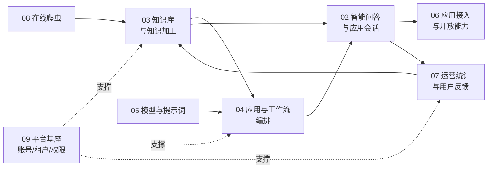
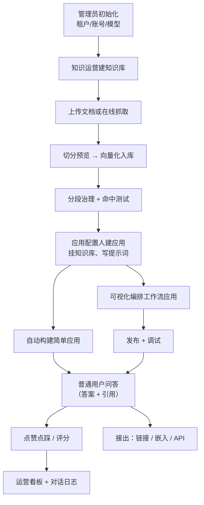

# 知识助理平台 · 需求规格说明书（总览与复现指南）

| 项 | 内容 |
|---|---|
| 产品名称 | 知识助理平台（仓库名 `ai-knowledge-platform`） |
| 文档版本 | v1.0 |
| 编制方式 | 由现有实现逆向梳理，按业务需求重新表述 |
| 适用范围 | 业务需求评审、二次开发交接、系统重建与验收 |
| 文档形态 | Markdown 套件（见文末索引） |

> 本套文档以**网站前端**为唯一入口视角梳理业务。凡前端不可达、无页面承载的能力，不列为需求，只列入第 10 册《现状缺陷与复现清单》。

---

## 一、产品定位

面向企业与机构内部的知识问答与知识运营平台。它把"散落在文档、网页和业务系统里的知识"经过采集、切分、向量化后建成知识库，再以**智能体（应用）**的形式对外提供带引用溯源的问答服务，并支持把问答能力以链接、嵌入脚本、API 三种方式接出到第三方系统。

一句话概括业务闭环：

> **采集知识 → 加工成库 → 组装成应用 → 提供问答 → 回收反馈与用量 → 反哺知识运营**

产品的差异化能力有三点：

1. **全本地部署**：大模型与向量模型由本机 Ollama 容器提供，不依赖外部 API，适配内网与隔离网络。
2. **知识与问答强绑定**：回答必须给出引用分段，可回溯到具体文档与切片（引用溯源）。
3. **多形态发布**：同一套应用既能对内做工作台问答，也能对外以公开链接、嵌入浮窗、API Key 三种方式发布。

## 二、业务角色总览

| 角色 | 主要职责 | 典型入口 |
|---|---|---|
| 平台超级管理员 | 租户、组织、账号、角色权限、菜单、License、运行监控 | 管理后台（隐藏入口） |
| 租户管理员 | 本租户内的账号授权、产品包、模型与知识库归属 | 管理后台 |
| 知识运营人员 | 建知识库、导入与治理文档、维护问答对与知识图谱、命中测试 | 工作台（可见入口） |
| 应用配置人员 | 建应用、写提示词、挂知识库、调检索参数、编排工作流、发布上线 | 工作台 |
| 普通业务用户 | 提问、看答案与引用、点赞点踩、评分反馈、分享会话 | 工作台（问答页 / 智能体列表） |
| 外部匿名访客 | 通过公开链接或嵌入浮窗直接问答，无需登录 | 分享链接 / 嵌入页 |
| 第三方系统 | 通过 API Key 调用问答接口，或嵌入组件 | 对外开放能力 |

角色与权限的完整模型见第 1 册。

## 三、业务域地图

| 序 | 业务域 | 核心问题 | 分册 |
|---|---|---|---|
| 1 | 角色与权限 | 谁能看见什么、能操作什么 | 01 |
| 2 | 智能问答与应用会话 | 用户如何提问、系统如何作答与呈现 | 02 |
| 3 | 知识库与知识加工 | 知识如何进入系统并被检索到 | 03 |
| 4 | 应用编排与工作流 | 复杂问答流程如何可视化搭建 | 04 |
| 5 | 模型与提示词管理 | 答案由哪个模型、按什么角色设定生成 | 05 |
| 6 | 应用接入与开放能力 | 问答能力如何输出给外部 | 06 |
| 7 | 运营统计与用户反馈 | 用得怎么样、答得好不好 | 07 |
| 8 | 在线爬虫与文档生成 | 知识如何自动采集、答案如何产出物 | 08 |
| 9 | 平台基座与系统管理 | 通用后台与多租户 SaaS 能力 | 09 |
| 10 | 现状缺陷与复现清单 | 复现时的坑与已知断链 | 10 |

各业务域之间的依赖关系：

## 四、端到端主流程（供复现时验证）

这是全平台最重要的一条链路，复现系统时按此顺序验证即可覆盖 80% 的核心能力：

**主流程的每一步对应一张验收清单**，见第 2、3、4、6、7 册各自的"验收标准"小节。

## 五、系统构成（业务视角）

前端是**单页应用**，所有接口经统一网关转发；业务能力由若干独立服务提供，彼此通过注册中心发现。业务上可以理解为四层：

| 层 | 职责 | 对业务的意义 |
|---|---|---|
| 表现层 | 工作台 + 管理后台两套界面共存于同一前端 | 一套系统，两种人群，入口一显一隐 |
| 接入层 | 统一网关 + 反向代理 | 对外只暴露一个地址；SSE 长连接单独放行 |
| 业务层 | 问答、知识库、知识图谱、NLP、爬虫、资源、监控 | 按能力独立部署，可单独扩容或降级 |
| 支撑层 | 关系库 + 向量库 + 图库 + 对象存储 + 消息队列 + 本地大模型 | 向量库同库不同扩展；模型在本地推理 |

对业务人员的可见影响：

- **问答是流式返回**：答案逐字出现，可中途停止。网关对问答接口的长连接超时单独放宽（600 秒）。
- **模型是本地推理**：CPU 机器上首字较慢（秒级到十余秒）属正常，不是故障。
- **向量维度是全局约束**：向量模型一旦更换必须全量重灌知识库，因此**不要随意更换向量模型**。

## 六、需求编号规则

本套文档中的需求条目采用统一编号，便于评审与追溯：

- `FR-<业务域号>-<序号>`：功能需求（Functional Requirement），如 `FR-03-07`
- `BR-<业务域号>-<序号>`：业务规则（Business Rule），如 `BR-02-03`
- `NFR-<序号>`：非功能需求，如 `NFR-01`
- `AC-<业务域号>-<序号>`：验收标准（Acceptance Criteria）

术语约定：**知识库**（知识容器）、**文档**（库内一个源文件）、**分段/切片**（检索最小单位）、**问题/问答对**（人工沉淀的 Q→分段 映射）、**应用/智能体**（对外问答的配置单元）、**会话**（一次连续问答）、**消息**（一问一答）。

## 七、交付形态与部署前提（复现必备）

| 项 | 要求 |
|---|---|
| 服务器 | Linux x86_64，内存 ≥24GB，磁盘 ≥40GB（离线导入场景 ≥60GB） |
| 部署方式 | Docker Compose 编排，约 32 个容器（17 个后端服务 + 8 个中间件 + 本地模型 + OCR + 反向代理 + 监控） |
| 网络 | 支持联网部署与**纯离线部署**两种场景，离线需跳板机预先打包镜像与模型 |
| 模型 | 随包提供 5 个本地模型，合计约 9GB；其中 2 个对话模型被后端硬编码引用，**不可删除** |
| 账号 | 演示环境内置 4 个业务账号（管理员/人事/经理/老板），初始密码统一为 `admin`；生产必须修改 |
| 前端构建 | Node 18+，`npm run build:prod` 产出 `dist/`，交由反向代理托管 |

各服务的端口、中间件控制台地址、默认凭据与排障手册不在本套需求文档范围内，见项目 `deploy/README.md` 与 `deploy/访问地址与账号密码.md`。

## 八、复现本套文档的注意事项（务必先读）

1. **两套后台共用同一套账号与鉴权**，靠 OAuth2 客户端身份区分可见菜单。业务后台与管理后台**各用一个客户端身份**（具体标识见部署配置），复现时不要混用。
2. **管理后台刻意没有导航入口**，只能通过地址栏直连（见第 9 册）。这是设计意图，不是缺陷。
3. **业务菜单树不在交付的 SQL 中**。交付包里的菜单脚本只含"问题管理""角色类别"两项；工作台其余菜单需在菜单管理页手工建立或从现有环境导出。**这是复现最大的坑**，详见第 10 册。
4. **15 张业务表的建表脚本缺失**。后端共定义 25 张业务表，交付的 `schema.sql` 只为其中 10 张提供了 `CREATE TABLE`，另 15 张（含 `qa_knowledge_base`、`qa_history_session`、`qa_history_msg`、`qa_application_info`、`vector_store_content` 等主链路表）只有 `ALTER`。新库直接执行会在 `alter table qa_knowledge_base` 处报错中断。复现前必须先从现有环境导出这些表结构，精确清单见第 10 册。
5. **回答里出现"猜你想问""引用分段""思维导图""PPT"等能力，依赖模型输出严格的结构化 JSON**。若模型输出思考过程，会破坏解析导致这些能力失效——这解释了大量"模型换了以后图表/导图生成失败"的现象。

## 九、文档索引

| 文件 | 内容 |
|---|---|
| `00-总览与复现指南.md` | 本文件：定位、角色、业务域地图、主流程、部署前提 |
| `01-角色与权限模型.md` | 角色清单、权限模型、多租户、免登录场景 |
| `02-智能问答与应用会话.md` | 问答形态、会话模型、问答主流程、消息操作、应用配置 |
| `03-知识库与知识加工.md` | 知识库创建、文档入库、分段治理、命中测试、问答对、图谱 |
| `04-应用编排与工作流.md` | 编排编辑器、节点与参数、保存发布调试 |
| `05-模型与提示词管理.md` | 模型供应商、基础模型、提示词角色 |
| `06-应用接入与开放能力.md` | 公开链接、嵌入、API Key、访问限制、对话日志 |
| `07-运营统计与用户反馈.md` | 统计看板、指标口径、反馈闭环 |
| `08-在线爬虫与文档生成.md` | 爬虫蜘蛛、任务、代理、PPT/导图生成 |
| `09-平台基座与系统管理.md` | 用户/角色/菜单/租户/字典/资源/日志/定时任务/License |
| `10-现状缺陷与复现清单.md` | 未达需求、废弃代码、断链功能、复现风险 |
