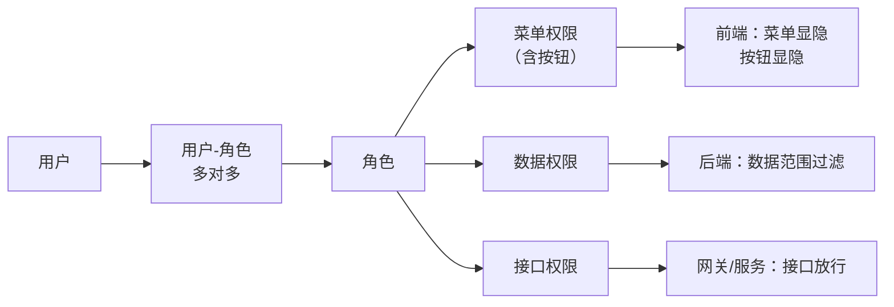

# 01 · 角色与权限模型

## 一、需求概述

平台面向两类截然不同的人群——**业务人员**与**系统管理员**——但只用一套前端、一套账号体系。需求是：两类人群各自看到自己关心的功能，互不干扰；同时系统要支持多租户 SaaS 隔离。

由此产生本平台最具辨识度的设计：**两套管理后台共存于同一个前端，入口一显一隐**。

## 二、角色定义

### FR-01-01 业务角色清单

| 编号 | 角色 | 定位 | 默认账号 | 说明 |
|---|---|---|---|---|
| R1 | 平台超级管理员 | 全平台最高权限 | `admin` / `admin` | 租户、账号、角色、菜单、License、监控 |
| R2 | 租户管理员 | 单租户内管理 | 由租户创建时生成 | 租户内账号授权与产品包 |
| R3 | 知识运营人员 | 知识资产负责人 | `hr` / `admin`（人事角色） | 建库、导入文档、治理分段、命中测试 |
| R4 | 应用配置人员 | 智能体负责人 | `manager` / `admin`（经理角色） | 建应用、编排、发布 |
| R5 | 普通业务用户 | 问答使用者 | `boss` / `admin`（老板角色） | 提问、反馈、分享 |
| R6 | 外部匿名访客 | 无账号访问者 | 无 | 经公开链接或嵌入浮窗访问 |
| R7 | 第三方系统 | 程序化调用方 | 无（用 API Key） | 经开放接口调用问答 |

> **BR-01-01**：新建用户的初始密码由系统参数 `account.initPassword` 决定（默认 `123456`）；租户管理员的初始密码由 `tenant.default.password` 决定（默认 `admin`）。演示环境的 4 个内置账号密码统一为 `admin`，**生产环境必须修改**。

### FR-01-02 两套管理后台（一显一隐）

| 维度 | 工作台（可见） | BladeX 管理后台（隐藏） |
|---|---|---|
| 面向人群 | R3 / R4 / R5，以及 R1 的日常运营 | R1 / R2 |
| 是否在导航中暴露 | 是，登录后默认进入 | **否**，刻意不提供任何菜单入口 |
| 进入方式 | 登录后落在首页 → 左侧导航进入 | 地址栏直连管理路径 |
| 功能范围 | 问答、知识库、应用、模型、爬虫、看板 | 账号、组织、角色、菜单、字典、租户、日志、License |
| 客户端标识 | `rider` | `saber3`（新版）/ `sword`（旧版） |
| 后端服务 | 业务服务组 | 平台标准服务组 |

> **BR-01-02**：两套后台**共享同一个认证中心和同一个数据库**，靠 OAuth2 客户端身份区分可加载的菜单集合。因此"看不见入口"是权限过滤的结果，不是物理隔离。
>
> **BR-01-03**：隐藏入口属于**设计意图**，不应作为缺陷修复。若需要对外交付时隐藏，需保留该行为。

### FR-01-03 普通用户注册与登录

| 编号 | 需求 | 说明 |
|---|---|---|
| FR-01-03-1 | 账号密码登录 | 主登录方式 |
| FR-01-03-2 | 手机号 + 短信验证码登录 | 需短信服务已配置 |
| FR-01-03-3 | 第三方社交登录 | 走统一认证的回跳流程 |
| FR-01-03-4 | 单点登录（SSO） | 授权码模式，回调回登录页 |
| FR-01-03-5 | 自助注册 | 注册开关可配置；未开启时不显示注册入口 |
| FR-01-03-6 | 游客注册 | 系统侧接口支持，前端未开放入口（见第 10 册） |
| FR-01-03-7 | 图形验证码 | 开关可配置，默认关闭 |
| FR-01-03-8 | 锁屏 | 系统激活锁屏后，所有页面强制跳锁屏页 |
| FR-01-03-9 | 退出登录 | 清理令牌并回到登录页 |
| FR-01-03-10 | 令牌自动续期 | 令牌过期时静默刷新并重放原请求，仅重试一次；刷新失败则提示"令牌过期，请重新登录"并回登录页 |

> **AC-01-01**：令牌过期后，用户在一次操作内（不刷新页面）能继续完成该操作，且不出现重复弹窗提示。二次失败后必须回到登录页且本地令牌被清除。

### FR-01-04 个人信息与密码

| 编号 | 需求 |
|---|---|
| FR-01-04-1 | 查看与修改个人资料（姓名、手机、邮箱、头像等） |
| FR-01-04-2 | 修改个人密码 |
| FR-01-04-3 | 管理员为指定用户重置密码、解锁账号 |
| FR-01-04-4 | 新用户注册后需审核；管理员可"审核通过 / 审核拒绝" |

## 三、权限模型

### FR-01-05 三层权限

平台采用 **菜单权限 + 数据权限 + 接口权限** 三层模型，三者都挂在"角色"上配置。

| 层 | 控制什么 | 配置入口 | 业务含义 |
|---|---|---|---|
| 菜单权限 | 能看到哪些菜单、能点哪些按钮 | 角色管理 → 权限设置 → 菜单页签 | 决定功能可见性 |
| 数据权限 | 能看到哪些数据范围 | 角色管理 → 数据权限；数据权限页 | 决定数据可见性 |
| 接口权限 | 能调用哪些接口 | 角色管理 → 接口权限；接口权限页 | 决定能力可达性 |

### FR-01-06 菜单与按钮的区分

> **BR-01-04**：菜单表中用 `category` 区分两类条目——**1 = 菜单**（出现在导航中，对应一个页面），**2 = 按钮**（不出现，对应页面内某个操作）。每条按钮记录都有自己的编码，前端据此控制按钮显隐。

按钮条目承载三类信息：

| 字段含义 | 示例 | 说明 |
|---|---|---|
| 编码 | `question_add` | 前端权限判定的键 |
| 别名 | `add` / `edit` / `delete` / `view` | 语义类别 |
| 路径 | 页面路径 或 接口地址 | 与后端接口对应时写接口地址 |

### FR-01-07 按钮级权限判定

| 编号 | 需求 |
|---|---|
| FR-01-07-1 | 用户登录后获取其全部按钮权限编码，前端据此决定按钮显隐 |
| FR-01-07-2 | 未授权的按钮不渲染（而非渲染后点击报错） |
| FR-01-07-3 | 权限编码在会话过程中缓存，退出登录后清除 |
| FR-01-07-4 | 菜单授权变更后，用户**重新登录**生效 |

> **AC-01-02**：给某角色取消"新增"权限后，该角色用户进入对应页面看不到"新增"按钮，且直接构造请求会被后端拒绝。

### FR-01-08 菜单树维护

| 编号 | 需求 |
|---|---|
| FR-01-08-1 | 菜单树增删改查，支持任意层级 |
| FR-01-08-2 | 菜单项可配置：名称、编码、别名、路径、图标、排序、缓存开关、是否开放 |
| FR-01-08-3 | 菜单可指向**内部页面**或**外部地址**；外部地址以嵌入方式打开 |
| FR-01-08-4 | 支持"顶部菜单"独立维护（一级横向导航 + 二级纵向菜单的组合布局） |
| FR-01-08-5 | 顶部菜单可单独配置其下挂载的菜单集合 |

> **BR-01-05**：菜单路径是**路由的组成部分**。系统按"视图目录 + 菜单路径"动态解析出组件。因此菜单路径必须与实际页面文件位置一致，写错会白屏。新增业务菜单前必须先确认页面文件已存在。

## 四、多租户

### FR-01-09 租户管理

| 编号 | 需求 |
|---|---|
| FR-01-09-1 | 租户增删改查，支持回收站与恢复 |
| FR-01-09-2 | 租户授权配置：账号额度、有效期 |
| FR-01-09-3 | 租户数据源配置：可指定独立数据库，实现库级隔离 |
| FR-01-09-4 | 租户产品包配置：按租户绑定可用菜单集合 |
| FR-01-09-5 | 租户管理员账号随租户创建自动生成 |

### FR-01-10 产品包

| 编号 | 需求 |
|---|---|
| FR-01-10-1 | 将一组菜单定义为一个"产品包" |
| FR-01-10-2 | 产品包可绑定到租户，从而控制该租户能看到的功能集合 |
| FR-01-10-3 | 新增租户时可直接选择产品包 |

> **BR-01-06**：平台全程启用租户模式，默认租户编号为 `000000`（管理组）。所有业务数据（知识库、应用、会话、爬虫配置等）都带租户标识，**不同租户之间数据互不可见**。
>
> **BR-01-07**：平台的本地模型、向量库等基础设施是**多租户共享**的，只有数据行级隔离，没有运行环境隔离。

## 五、免登录访问场景

有三类访问者不需要账号，但必须能用：

### FR-01-11 公开分享页

| 编号 | 需求 |
|---|---|
| FR-01-11-1 | 用户可将某次会话分享，生成分享链接 |
| FR-01-11-2 | 分享链接无需登录即可打开 |
| FR-01-11-3 | 分享页只展示问答内容，不展示工作台导航 |
| FR-01-11-4 | 分享页展示所属应用信息 |

### FR-01-12 嵌入浮窗

| 编号 | 需求 |
|---|---|
| FR-01-12-1 | 应用可生成嵌入脚本，供第三方网页挂载悬浮问答窗 |
| FR-01-12-2 | 浮窗通过访问凭证换取应用配置，无需用户登录 |
| FR-01-12-3 | 浮窗内的会话与正式会话隔离，便于统计区分 |
| FR-01-12-4 | 浮窗支持"仅问答模式"与"完整模式" |

### FR-01-13 访问限制与白名单

| 编号 | 需求 |
|---|---|
| FR-01-13-1 | 应用的公开访问可生成多个访问凭证（Token），可分别启用/停用 |
| FR-01-13-2 | 可配置来源地址白名单，只允许指定来源访问 |
| FR-01-13-3 | 可对访问凭证设置有效期与访问限制策略 |
| FR-01-13-4 | 白名单可批量保存与批量移除 |

> **BR-01-08**：免登录场景下请求不带用户令牌，改为携带访问凭证（放在专用请求头中）。**访问凭证等价于密码**，一旦泄露即可被外部直接调用问答能力，因此停用机制必须可用。
>
> **BR-01-09**：免登录场景的请求**租户标识被固定为默认租户**。这意味着跨租户使用公开链接会读到默认租户的知识库，**多租户环境下需谨慎开放公开链接**。

## 六、非功能需求（权限相关）

| 编号 | 需求 |
|---|---|
| NFR-01-01 | 未登录访问受保护页面必须重定向到登录页，并记录原目标地址，登录后回跳 |
| NFR-01-02 | 令牌与刷新令牌同时失效时才判定为登录失效，避免频繁掉线 |
| NFR-01-03 | 错误提示需去重：同一次操作链路上只提示一次"令牌过期" |
| NFR-01-04 | 所有令牌、访问凭证在传输中使用加密信道；请求体加密能力需预留（默认关闭） |

## 七、验收标准

| 编号 | 验收项 |
|---|---|
| AC-01-03 | 用 `admin` 登录后默认落在工作台首页，左侧导航看不到"系统管理"入口 |
| AC-01-04 | 地址栏直连管理后台路径，可用同一账号进入并看到系统管理菜单 |
| AC-01-05 | 新建一个只读角色（仅查看权限），该角色用户在所有业务列表页看不到新增/修改/删除按钮 |
| AC-01-06 | 新建租户 A 与 B，各自建同名知识库，互相不可见 |
| AC-01-07 | 把某应用设为公开并生成访问链接，用无痕窗口打开可正常问答；停用该凭证后立即不可访问 |
| AC-01-08 | 令牌过期后一次操作内自动续期成功，无用户感知；清空刷新令牌后操作报错并回登录页 |

## 八、与其他分册的衔接

- 管理后台的**具体页面清单**见第 9 册。
- **应用级**的公开/嵌入/API Key 配置流程见第 6 册。
- **菜单未随交付 SQL 提供**这一复现障碍见第 10 册。
