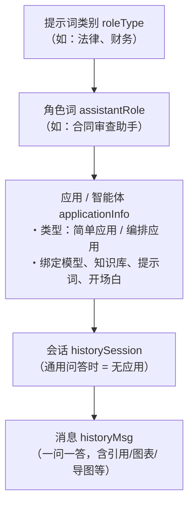
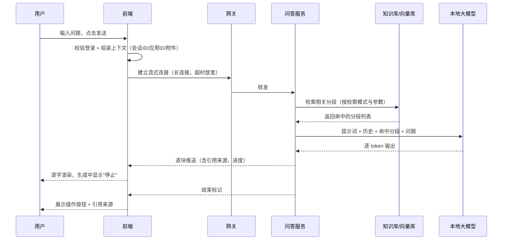

# 02 · 智能问答与应用会话

## 一、需求概述

这是平台的主营业务。用户提出一个问题，系统结合**知识库检索结果 + 历史对话上下文 + 应用的角色设定**，调用本地大模型生成答案，**流式**返回，并附上引用来源。答案可被点赞、点踩、评分、分享；会话可被改名、删除、重新生成。

业务上必须先理解三层模型，所有需求都建立在这三层之上：

> **BR-02-01**：**通用问答**是一种特殊形态——会话不绑定任何应用（应用标识为 `-1`）。用户在首页直接提问走的就是这条路。

## 二、问答入口形态

### FR-02-01 五种入口

| 编号 | 入口 | 场景 | 是否需要登录 | 是否绑定应用 |
|---|---|---|---|---|
| FR-02-01-1 | 首页问答 | 用户想快速问一句 | 是（未登录先弹登录） | 否（通用问答） |
| FR-02-01-2 | 通用问答页 | 从首页或历史进入的连续对话 | 是 | 否 |
| FR-02-01-3 | 智能体列表 → 应用会话 | 用户要完成某类专业任务 | 是 | 是（简单应用） |
| FR-02-01-4 | 编排应用会话 | 应用由工作流搭建 | 是 | 是（编排应用） |
| FR-02-01-5 | 嵌入浮窗 / 公开分享页 | 外部访客 | **否** | 是 |

### FR-02-02 首页问答

| 编号 | 需求 |
|---|---|
| FR-02-02-1 | 首页提供大输入框，输入后回车即提问 |
| FR-02-02-2 | 首页展示推荐应用卡片，点击进入该应用的会话 |
| FR-02-02-3 | 首页展示最新提示词/角色词入口 |
| FR-02-02-4 | 未登录用户点击发送时弹出登录，登录成功后继续提问 |
| FR-02-02-5 | 从首页发起的提问会新建会话并跳转到问答页 |

> **AC-02-01**：未登录用户在首页输入问题并点击发送 → 出现登录弹窗 → 登录成功 → 自动带着刚才的问题进入问答页并发问，无需重新输入。

### FR-02-03 通用问答页

| 编号 | 需求 |
|---|---|
| FR-02-03-1 | 左侧栏展示历史会话，按日期分组，点击可切换 |
| FR-02-03-2 | 进入会话时拉取历史消息回填，支持上下滚动查看多轮 |
| FR-02-03-3 | 会话可重命名、可删除（删除需二次确认） |
| FR-02-03-4 | 页面顶部展示所属应用信息（通用问答显示为通用会话） |
| FR-02-03-5 | 若从首页带了问题进来，进入后自动发问一次 |

### FR-02-04 智能体列表

| 编号 | 需求 |
|---|---|
| FR-02-04-1 | 卡片式展示全部可用应用，显示图标、名称、简介 |
| FR-02-04-2 | 支持按应用分类筛选 |
| FR-02-04-3 | 支持关键词搜索 |
| FR-02-04-4 | 列表分页加载，滚动到底自动加载下一页 |
| FR-02-04-5 | 点击卡片进入该应用的新会话页 |

### FR-02-05 应用新会话页

| 编号 | 需求 |
|---|---|
| FR-02-05-1 | 展示应用图标、名称、描述 |
| FR-02-05-2 | 展示**开场白**（应用配置的欢迎语），并以打字机效果呈现 |
| FR-02-05-3 | 展示**快速提问**（应用预设的推荐问题），点击即发送 |
| FR-02-05-4 | 编排应用可能带有**用户表单**，表单填写后才允许提问 |
| FR-02-05-5 | 发送后按应用类型分流：简单应用进入普通会话页，编排应用进入工作流会话页 |

> **BR-02-02**：应用类型（`simple` / `work_flow`）决定对话走哪条技术链路。用户侧体验一致，但**编排应用的回答由工作流节点逐步产出**，引用来源、图表等能力的表现形式不同。

## 三、问答主流程

### FR-02-06 提问与回答

| 编号 | 需求 |
|---|---|
| FR-02-06-1 | 支持多行文本输入，回车发送，换行使用组合键 |
| FR-02-06-2 | 输入框支持插入变量占位（形如 `[关键词]`），发送前需被填充 |
| FR-02-06-3 | 回答**流式逐字呈现**，并显示生成中的动态提示 |
| FR-02-06-4 | 生成过程中可**随时停止**，已生成内容保留 |
| FR-02-06-5 | 生成过程中可发送新问题？——**否**：生成未结束时输入被禁用 |
| FR-02-06-6 | 回答结束后展示可操作按钮：复制、点赞、点踩、重新生成、分享 |
| FR-02-06-7 | 回答以 Markdown 渲染，支持代码块高亮、表格、列表 |

> **AC-02-02**：提问后 1 秒内出现生成中状态；答案逐字出现；点击"停止"能在 2 秒内终止并保留已生成内容。

### FR-02-07 引用溯源

| 编号 | 需求 |
|---|---|
| FR-02-07-1 | 回答中标注引用编号（如"引用分段 1"） |
| FR-02-07-2 | 点击引用可查看该分段的原文 |
| FR-02-07-3 | 引用详情展示：分段标题、所属文档名、所属知识库名、相似度排名 |
| FR-02-07-4 | 应用调试模式下需展示命中分段的数量 |

> **BR-02-03**：引用来源是**应用是否挂载知识库**的直接体现。未挂知识库的通用问答或纯提示词应用不产生引用，这是正常现象。

### FR-02-08 猜你想问

| 编号 | 需求 |
|---|---|
| FR-02-08-1 | 回答完成后，在输入框上方展示若干推荐追问 |
| FR-02-08-2 | 点击推荐问题直接发送 |
| FR-02-08-3 | 推荐问题由模型根据当前问答生成 |

> **BR-02-04**：推荐问题依赖模型输出结构化结果。若模型输出不合规，该项能力静默失效（不报错、不展示），见第 10 册复现提示。

### FR-02-09 多轮上下文

| 编号 | 需求 |
|---|---|
| FR-02-09-1 | 应用可配置是否启用多轮对话 |
| FR-02-09-2 | 启用时需配置**携带的历史轮数** |
| FR-02-09-3 | 未启用时每轮问答互相独立 |

### FR-02-10 问题改写

| 编号 | 需求 |
|---|---|
| FR-02-10-1 | 应用可配置是否启用问题改写 |
| FR-02-10-2 | 启用后，用户口语化的问题先由模型改写为检索友好形式再检索 |

## 四、消息操作

### FR-02-11 重新生成

| 编号 | 需求 |
|---|---|
| FR-02-11-1 | 对任一回答可点击"重新生成" |
| FR-02-11-2 | 重新生成使用**同一个问题**重新请求，覆盖原回答 |
| FR-02-11-3 | 生成中允许再次停止 |

### FR-02-12 点赞与点踩

| 编号 | 需求 |
|---|---|
| FR-02-12-1 | 每条回答提供"赞"与"踩"两个互斥按钮 |
| FR-02-12-2 | 已点赞状态下再点"赞"表示取消 |
| FR-02-12-3 | 反馈即时保存，无需提交 |
| FR-02-12-4 | 反馈用于运营看板的"满意度"统计 |

> **BR-02-05**：赞/踩是**互斥且可撤销**的。三种状态的取值语义为：赞 / 踩 / 取消（无反馈）。

### FR-02-13 会话评分

| 编号 | 需求 |
|---|---|
| FR-02-13-1 | 用户可从用户菜单发起对本次会话的整体评分 |
| FR-02-13-2 | 评分范围为 1–5 星 |
| FR-02-13-3 | 可附文字意见，长度不超过 500 字 |
| FR-02-13-4 | 提交后进入管理端反馈列表 |

### FR-02-14 分享会话

| 编号 | 需求 |
|---|---|
| FR-02-14-1 | 用户可分享单条或多条问答消息 |
| FR-02-14-2 | 生成免登录的分享链接 |
| FR-02-14-3 | 分享页标注来源应用 |
| FR-02-14-4 | 分享链接可复制到剪贴板 |

### FR-02-15 附件问答

| 编号 | 需求 |
|---|---|
| FR-02-15-1 | 输入框支持上传文件随问题一起提交 |
| FR-02-15-2 | 支持格式：Word、TXT、Markdown、PPT |
| FR-02-15-3 | 上传成功后以附件标签展示，可移除 |
| FR-02-15-4 | 附件随消息一起落库，历史消息中可回看 |

### FR-02-16 生成物：图表 / 思维导图 / PPT

| 编号 | 需求 |
|---|---|
| FR-02-16-1 | 应用可分别开启图表生成、思维导图生成、PPT 生成能力 |
| FR-02-16-2 | 开启后，当问题适合可视化时，回答中直接渲染图表 / 导图 |
| FR-02-16-3 | 生成的图表/导图可保存为图片 |
| FR-02-16-4 | PPT 生成结果提供下载链接 |
| FR-02-16-5 | 生成记录可追溯（主题、类型、下载地址、状态） |

> **BR-02-06**：这三项能力都要求模型返回**严格的结构化 JSON**。平台用非贪婪方式从模型输出中截取 JSON 块后解析，因此**模型若输出了思考过程或示例 JSON，会导致抓取错误的块而生成失败**。这是复现时最容易踩的坑。

## 五、应用配置（业务规则集中区）

### FR-02-17 应用基础信息

| 编号 | 需求 | 约束 |
|---|---|---|
| FR-02-17-1 | 应用名称 | 必填 |
| FR-02-17-2 | 应用描述 | 选填，列表页展示 |
| FR-02-17-3 | 应用图标 | 上传图片 |
| FR-02-17-4 | 应用分类 | 单选，来自应用分类字典 |
| FR-02-17-5 | 是否置顶 | 置顶后排在前列 |
| FR-02-17-6 | 应用类型 | 简单应用 / 编排应用，**创建后不可变更类型** |

### FR-02-18 应用对话设定

| 编号 | 需求 | 说明 |
|---|---|---|
| FR-02-18-1 | 选择模型 | 必选，取自模型管理中"可用"的模型 |
| FR-02-18-2 | 角色设定（System） | 定义助手的身份与边界 |
| FR-02-18-3 | 提示词 | 定义回答的风格、格式与要求 |
| FR-02-18-4 | 开场白 | 用户进入会话时的欢迎语 |
| FR-02-18-5 | 快速提问 | 预设推荐问题，进入会话即可点击 |
| FR-02-18-6 | 敏感词 | 命中后按配置策略处理 |
| FR-02-18-7 | 多轮开关与轮数 | 见 FR-02-09 |
| FR-02-18-8 | 问题改写开关 | 见 FR-02-10 |
| FR-02-18-9 | 推荐问题开关 | 是否生成"猜你想问" |
| FR-02-18-10 | 图表 / 导图 / PPT 开关 | 见 FR-02-16 |

### FR-02-19 知识库检索设定

| 编号 | 需求 | 说明 |
|---|---|---|
| FR-02-19-1 | 绑定知识库 | 可多选，决定回答的引用来源 |
| FR-02-19-2 | 检索模式 | 向量检索 / 混合检索 / 全文检索 |
| FR-02-19-3 | 相似度阈值 | 低于阈值的分段不参与回答 |
| FR-02-19-4 | 返回分段数 | 参与拼装的命中分段数量上限 |
| FR-02-19-5 | 单分段最大字符数 | 控制拼装进提示词的长度 |
| FR-02-19-6 | 无引用时的处理 | 命中不足时是"拒答"还是"允许模型自由回答" |

> **BR-02-07**：检索模式的选择决定召回风格——
> **向量检索**语义相近即可命中，适合自然语言提问；
> **全文检索**依赖字面匹配，适合专有名词、编号类精确查询；
> **混合检索**两者加权，是通用场景的推荐值。

> **AC-02-03**：同一问题在三种检索模式下分别测试，能观察到命中分段列表的差异；把相似度阈值调高到 0.9 以上，引用数量明显减少。

### FR-02-20 应用调试

| 编号 | 需求 |
|---|---|
| FR-02-20-1 | 配置页右侧提供调试对话区，可即时验证配置效果 |
| FR-02-20-2 | 调试结果展示：答案、耗时、消耗 Token 数 |
| FR-02-20-3 | 调试结果展示命中的分段列表与命中数量 |
| FR-02-20-4 | 调试区分栏展示"引用分段 N"并可展开查看原文 |
| FR-02-20-5 | 配置修改后未保存时切走需提醒 |

> **BR-02-08**：调试链路与正式问答链路**必须使用同一套配置**，否则调试结果不可信。复现时需验证两者一致。

## 六、应用的生命周期管理

### FR-02-21 应用列表

| 编号 | 需求 |
|---|---|
| FR-02-21-1 | 卡片或列表展示应用，显示名称、图标、分类、类型 |
| FR-02-21-2 | 支持按名称搜索、按分类筛选 |
| FR-02-21-3 | 操作项：设置、演示、导出、删除 |
| FR-02-21-4 | 支持导入应用（上传压缩包） |
| FR-02-21-5 | 支持导出应用（下载压缩包），便于跨环境迁移 |

### FR-02-22 应用导入导出

| 编号 | 需求 |
|---|---|
| FR-02-22-1 | 导出内容包含应用配置与提示词，**是否包含知识库文档需明确** |
| FR-02-22-2 | 导入时可选择覆盖或新建 |
| FR-02-22-3 | 导入后需重新校验模型与知识库的引用是否有效 |

> **BR-02-09**：应用导出是**跨环境迁移的主要手段**，但由于导出的知识库引用是标识而非内容，目标环境必须已存在同名知识库与同名模型，否则导入后应用不可用。复现时须先准备依赖资源。

### FR-02-23 应用监控与日志

| 编号 | 需求 | 分册 |
|---|---|---|
| FR-02-23-1 | 应用概览：用户数、提问数、Token 消耗、满意度 | 07 |
| FR-02-23-2 | 对话日志：按会话查看问答明细，可导出 | 06 |
| FR-02-23-3 | 对某条回答添加"优化答案"沉淀为问答对 | 03 |

## 七、非功能需求

| 编号 | 需求 |
|---|---|
| NFR-02-01 | 问答走流式长连接，网关超时须单独放宽（约 600 秒），否则长回答会被截断 |
| NFR-02-02 | 重新生成、停止等操作须在 2 秒内响应 |
| NFR-02-03 | 会话与消息须持久化，刷新页面后能完整回填 |
| NFR-02-04 | 本地模型在 CPU 环境首字延迟属正常，界面需有一定反馈避免用户误判为无响应 |
| NFR-02-05 | 生成失败时须给出明确提示，且不残留半截脏数据 |

## 八、验收标准

| 编号 | 验收项 |
|---|---|
| AC-02-04 | 通用问答：新建会话 → 提问 → 流式作答 → 重命名 → 删除，全链路可用 |
| AC-02-05 | 应用问答：建简单应用（挂知识库）→ 演示 → 回答带引用 → 点开引用能看到原文与文档名 |
| AC-02-06 | 消息操作：对回答点赞，刷新页面后点赞状态仍在；再点一次取消成功 |
| AC-02-07 | 会话评分：提交 5 星 + 文字意见，管理端反馈列表能查到该条记录 |
| AC-02-08 | 分享：分享一条问答，无痕窗口打开分享链接可看到内容且无需登录 |
| AC-02-09 | 附件问答：上传一份 PDF 提问，历史消息中该附件标签仍可查看 |
| AC-02-10 | 停止生成：长回答生成中点停止，已生成内容保留且可继续提问 |
| AC-02-11 | 应用导入导出：导出应用 → 在另一环境导入 → 应用可正常对话 |

## 九、与其他分册的衔接

- 知识库的建立与检索参数细节 → 第 3 册
- 编排应用的搭建 → 第 4 册
- 模型与角色词 → 第 5 册
- 公开链接 / 嵌入 / API Key → 第 6 册
- 反馈与用量统计 → 第 7 册
