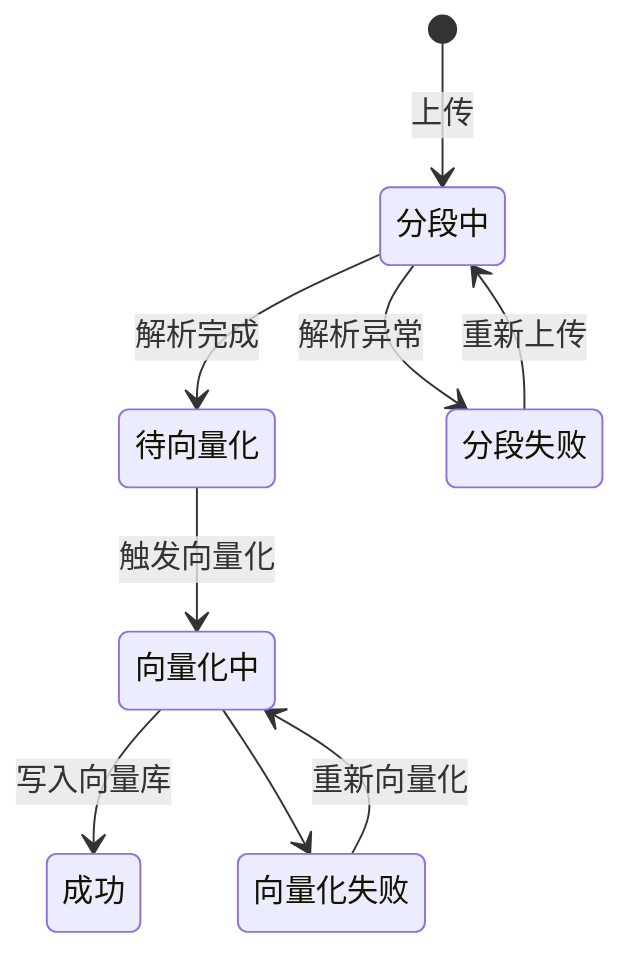

# 03 · 知识库与知识加工

## 一、需求概述

知识库是平台的知识底座：把非结构化的文档与网页，变成**可被语义检索的分段**，并在其上叠加人工校正（问答对、图谱），最终供应用问答时召回。本业务域要回答的核心问题是：**知识怎么进来、怎么切、怎么被检索到、怎么被修正。**

## 二、知识库

### FR-03-01 创建与编辑知识库

| 编号 | 字段 | 必填 | 约束 |
|---|---|---|---|
| FR-03-01-1 | 知识库名称 | 是 | ≤30 字 |
| FR-03-01-2 | 知识库分类 | 是 | 来自知识库分类字典 |
| FR-03-01-3 | 知识库描述 | 是 | ≤200 字 |
| FR-03-01-4 | 知识库图标 | 否 | 二选一：使用预设图标 或 上传图片 |
| FR-03-01-5 | 导入类型 | 是（仅新增时） | 本地文档 / 在线数据，决定后续向导的形态 |

> **BR-03-01**：**导入类型在创建时选定，之后不可更改**。选"本地文档"走向上传向导，选"在线数据"走向在线抓取向导。这是创建流程中的关键分叉点，需求评审时需明确确认。
>
> **BR-03-02**：创建成功后才进入文档导入向导。知识库与文档是**先建库再灌数据**的强顺序关系，不支持"先传文档后建库"。

### FR-03-02 知识库列表

| 编号 | 需求 |
|---|---|
| FR-03-02-1 | 卡片式展示全部知识库，显示图标、名称、描述、分类 |
| FR-03-02-2 | 支持按分类筛选、按名称搜索 |
| FR-03-02-3 | 卡片提供**启用 / 停用**开关 |
| FR-03-02-4 | 操作项：详情、重新向量化、导出、删除 |
| FR-03-02-5 | 删除需二次确认，并明确提示关联文档与分段将一并删除 |

> **BR-03-03**：**停用**与**删除**语义不同。停用后知识库不再被应用检索到，但数据保留；删除不可恢复。

### FR-03-03 知识库分类

| 编号 | 需求 |
|---|---|
| FR-03-03-1 | 分类以树形结构维护，支持多级 |
| FR-03-03-2 | 支持懒加载子节点 |
| FR-03-03-3 | 支持新增、改名、删除；仅顶级分类可新增下级 |
| FR-03-03-4 | 分类被知识库引用时，删除需拦截或给出提示 |

### FR-03-04 知识库详情（工作区）

知识库详情是一个带左侧菜单的工作区，包含五个功能页：

| 编号 | 页面 | 用途 |
|---|---|---|
| FR-03-04-1 | 文档 | 管理库内文档与分段 |
| FR-03-04-2 | 问题 | 管理问答对及其与分段的关联 |
| FR-03-04-3 | 命中测试 | 验证检索效果 |
| FR-03-04-4 | 设置 | 查看/调整知识库配置 |
| FR-03-04-5 | 知识图谱 | 查看知识关联 |

## 三、文档入库主流程

这是知识加工的核心流程，采用**三步向导**：

### FR-03-05 第一步：上传或抓取

| 编号 | 需求 | 约束 |
|---|---|---|
| FR-03-05-1 | 支持拖拽上传与点击上传 | 单次最多 50 个文件 |
| FR-03-05-2 | 支持格式：TXT、DOC、DOCX、PDF、Markdown、HTML | 其他格式拒绝 |
| FR-03-05-3 | 单文件大小上限 100MB | 超限拒绝并提示 |
| FR-03-05-4 | 上传后可**重命名**文件 | 便于后续识别 |
| FR-03-05-5 | 上传后可删除误传文件 | 删除同时清理已解析内容 |
| FR-03-05-6 | 在线抓取：输入目标网址，系统按规则抽取正文入库 | 网址必填且需符合 URL 格式 |
| FR-03-05-7 | 在线抓取支持按知识领域归类 | 知识领域来自字典 |

> **BR-03-04**：上传动作**同时触发解析与切分**（由服务端完成），因此上传成功不代表可以检索——必须完成第三步向量化才真正可被召回。这是复现时最容易误解的一点。

### FR-03-06 第二步：分段设置

| 编号 | 需求 | 约束 |
|---|---|---|
| FR-03-06-1 | 选择分段规则：**智能分段**（推荐）或**自定义分段** | 默认智能分段 |
| FR-03-06-2 | 自定义时配置分段标识符（可多选） | 如按换行、按标题 |
| FR-03-06-3 | 自定义时配置**分段长度** | 50–4096，默认 500 |
| FR-03-06-4 | 自定义时配置**重叠长度** | 0–1000，默认 0 |
| FR-03-06-5 | 生成预览，展示切分后的分段列表 | 切换规则时重新生成 |
| FR-03-06-6 | 预览中可**直接编辑某一个分段的文本** | 修正切分错误 |
| FR-03-06-7 | 预览中可删除不参与检索的分段 | 如页眉页脚 |
| FR-03-06-8 | 切分参数变更需重新生成预览方可生效 | 防止参数与结果不一致 |

> **BR-03-05**：**分段质量直接决定问答质量**。分段过短会丢失上下文，过长会被向量模型截断（当前向量模型上下文仅约 1K token），且单分段字符数上限也约束了可拼装长度。因此分段长度是需要按文档类型调优的经验参数。
>
> **BR-03-06**：**重叠长度**用于避免跨段落的语义被切断，但会增加存储与检索冗余。默认 0 表示不重叠。

### FR-03-07 第三步：数据导入（向量化）

| 编号 | 需求 |
|---|---|
| FR-03-07-1 | 收集本次导入的文档，提交向量化任务 |
| FR-03-07-2 | 提交后进入完成页，告知已开始处理 |
| FR-03-07-3 | 向量化在**服务端异步执行** |
| FR-03-07-4 | 处理结果通过文档状态体现 |

> **BR-03-07**：向导第三步的"进度条"是**前端模拟**，不代表真实进度。真实进度必须回到文档列表看状态字段。**这是需求与实现的偏差，复现时需按"以文档状态为准"来实现。**

### FR-03-08 文档状态机

| 状态值 | 含义 | 可执行操作 |
|---|---|---|
| 0 | 分段中 | 等待 |
| 1 | 待向量化 | **需人工触发向量化** |
| 2 | 分段失败 | 重新上传或重新解析 |
| 3 | 向量化中 | 等待 |
| 4 | 成功 | 正常使用 |
| 5 | 向量化失败 | 重新向量化 |

> **AC-03-01**：上传一份 PDF → 文档列表出现该文档，状态从"分段中"变为"待向量化" → 触发向量化 → 状态经"向量化中"变为"成功" → 此时命中测试才能检索到该文档的内容。

> **BR-03-08**：文档列表**不自动刷新**（轮询能力存在但未启用）。复现时需人工刷新或补上轮询。这是已知的体验缺口，见第 10 册。

## 四、文档与分段治理

### FR-03-09 文档管理

| 编号 | 需求 |
|---|---|
| FR-03-09-1 | 分页展示库内文档：文件名、分段数、字符数、导入方式、状态、启用开关 |
| FR-03-09-2 | 支持按文件名/内容搜索 |
| FR-03-09-3 | 支持切换文档启用/停用 |
| FR-03-09-4 | 支持重新向量化单个文档 |
| FR-03-09-5 | 支持删除文档（连同其分段） |
| FR-03-09-6 | 支持批量导出文档 |
| FR-03-09-7 | 支持将文档迁移到其他知识库 |
| FR-03-09-8 | 支持关联"在线知识库文档"（爬虫任务产出的数据） |
| FR-03-09-9 | 点击"查看分段"进入分段详情页 |

> **BR-03-09**：**迁移是"从源库删除、写入目标库"的搬移语义，不可逆**。需求评审时须确认这是期望行为，而不是复制。

### FR-03-10 分段详情与管理

| 编号 | 需求 | 约束 |
|---|---|---|
| FR-03-10-1 | 卡片网格展示该文档的全部分段，分页 | 每页 12 条 |
| FR-03-10-2 | 支持按标题/内容搜索 | |
| FR-03-10-3 | 支持新增分段 | 标题 ≤256 字，内容 ≤100000 字 |
| FR-03-10-4 | 支持编辑分段（Markdown 编辑器） | 同上 |
| FR-03-10-5 | 支持启用/停用单个分段 | 停用后不参与检索 |
| FR-03-10-6 | 支持删除分段 | |
| FR-03-10-7 | 支持多选批量删除 | |
| FR-03-10-8 | 支持多选批量迁移到其他文档/知识库 | 同为搬移语义 |

> **BR-03-10**：分段是**检索的最小单位，也是引用的最小单位**。分段级的启停是知识治理最有效的抓手——发现某段内容陈旧或有误，停用它即可立即生效，无需重新处理整篇文档。

## 五、命中测试（检索效果验证）

### FR-03-11 命中测试

| 编号 | 需求 |
|---|---|
| FR-03-11-1 | 输入一个问题，回车即执行检索 |
| FR-03-11-2 | 支持三种检索模式：向量检索 / 混合检索 / 全文检索 |
| FR-03-11-3 | 可配置相似度阈值（步进 0.1） |
| FR-03-11-4 | 可配置返回分段数 |
| FR-03-11-5 | 结果卡片展示：分段标题、排名、内容摘要、所属文档名 |
| FR-03-11-6 | 点击结果可查看分段完整内容 |
| FR-03-11-7 | 支持在**知识库维度**测试（指定库）与**系统维度**测试（全库） |

> **BR-03-11**：命中测试是**知识运营的核心工具**。上线一个知识库前，必须用真实业务问题在命中测试中验证召回质量；问答答不好时，第一步排查也应回到命中测试，判断是"没检索到"还是"检索到了但模型没答好"。
>
> **AC-03-02**：同一问题分别用三种检索模式测试，结果集存在差异；把相似度阈值从 0 调到 0.8，结果数量显著减少。

## 六、问答对（问题管理）

### FR-03-12 问题与分段关联

| 编号 | 需求 |
|---|---|
| FR-03-12-1 | 支持创建问题，支持多行批量创建（一行一个问题） |
| FR-03-12-2 | 支持行内改名 |
| FR-03-12-3 | 支持删除问题，删除时同时解除其全部分段关联 |
| FR-03-12-4 | 支持为问题**关联若干分段**：左侧选文档、右侧选该文档下的分段 |
| FR-03-12-5 | 支持查看问题详情：编辑问题、查看已关联分段、取消关联 |
| FR-03-12-6 | 详情支持"上一条/下一条"连续浏览，可跨页 |
| FR-03-12-7 | 问题列表展示关联分段数量 |

> **BR-03-12**：问答对是**人工提升召准率的关键手段**——把"用户会这样问"和"答案就在这段里"显式绑定，弥补纯语义检索的召回不足。它也可由对话日志中的"优化答案"反向沉淀（见第 6 册）。
>
> **BR-03-13**：删除问题是**物理解除关联**（而非标记），复现时需注意数据一致性——一个分段可能被多个问题关联，取消其中一个不应影响其他。

## 七、知识图谱

### FR-03-13 知识图谱查看

| 编号 | 需求 |
|---|---|
| FR-03-13-1 | 以力导向图形式展示知识库的实体与关系 |
| FR-03-13-2 | 节点与关系按类别着色、分类展示 |
| FR-03-13-3 | 支持按"属性"或"标签"维度搜索图谱 |
| FR-03-13-4 | 图谱支持缩放与拖拽 |
| FR-03-13-5 | 图谱为**只读展示**，不支持在界面上编辑实体或关系 |

> **BR-03-14**：知识图谱的构建由后端在文档处理过程中完成，前端只做呈现。因此图谱为空通常意味着文档尚未处理完成或该文档类型不支持抽取，而非前端故障。

## 八、导出与迁移

### FR-03-14 导出

| 编号 | 需求 |
|---|---|
| FR-03-14-1 | 支持导出整个知识库 |
| FR-03-14-2 | 支持导出选定的文档 |
| FR-03-14-3 | 导出为文件下载，需有进度或等待提示 |

> **BR-03-15**：导出用于**跨环境迁移与备份**。需明确导出是否包含向量化结果——若不含，目标环境必须重新向量化，而向量模型必须与源环境一致（维度 768）。

## 九、业务规则汇总

| 编号 | 规则 |
|---|---|
| BR-03-16 | 知识库必须先创建后导入，导入类型创建时确定且不可更改 |
| BR-03-17 | 文档"上传成功"≠"可检索"，必须完成向量化 |
| BR-03-18 | 分段是检索与引用的最小单位，分段级启停即时生效 |
| BR-03-19 | 迁移是搬移（源删除+目标写入），不可逆，需二次确认 |
| BR-03-20 | 停用（可逆，保留数据）与删除（不可逆）语义必须区分 |
| BR-03-21 | 向量模型维度固定为 768，更换需全量重灌所有知识库 |
| BR-03-22 | 单分段内容长度上限 100000 字，但受向量模型 1K token 上下文约束，实际应远小于此 |

## 十、非功能需求

| 编号 | 需求 |
|---|---|
| NFR-03-01 | 大文件（近 100MB）上传需分块或至少给出明确进度与超时保护 |
| NFR-03-02 | 向量化为耗时操作，必须异步执行且状态可查 |
| NFR-03-03 | 解析失败必须记录失败原因，便于运营定位（当前仅状态码，见第 10 册） |
| NFR-03-04 | 知识库、文档、分段列表在数据量大时需分页 |

## 十一、验收标准

| 编号 | 验收项 |
|---|---|
| AC-03-03 | 完整走通三步向导，文档最终状态为"成功" |
| AC-03-04 | 命中测试能检索到刚导入的文档内容 |
| AC-03-05 | 停用一个分段后，同一问题再测试不再命中该分段 |
| AC-03-06 | 新建问答对并关联分段，观察其对召回的影响 |
| AC-03-07 | 文档迁移到另一知识库后，源库不再有该文档，目标库可检索到 |
| AC-03-08 | 在线抓取一个网页，抓取结果作为文档出现在列表并可向量化 |
| AC-03-09 | 知识库图谱页面能看到节点与关系（若文档支持实体抽取） |

## 十二、与其他分册的衔接

- 在线知识库与爬虫 → 第 8 册
- 检索参数在**应用侧**的配置 → 第 2 册 FR-02-19
- 向量模型约束 → 第 5 册与第 10 册
