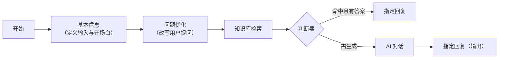

# 04 · 应用编排与工作流

## 一、需求概述

简单应用（第 2 册）只能"一段提示词 + 一个知识库"地回答。当业务需要**多步推理**时——先判断意图、再查知识库、按条件分支、最后指定回复——就需要可视化编排。

需求是：让业务配置人员用**拖拽连线**的方式搭建一条问答流程，并能在发布前实时调试。

## 二、编排编辑器

### FR-04-01 编辑器基础能力

| 编号 | 需求 |
|---|---|
| FR-04-01-1 | 提供画布，支持拖拽添加节点、连线、缩放、平移 |
| FR-04-01-2 | 自动布局（从左到右的分层排布） |
| FR-04-01-3 | 节点支持选中、拖动、缩放尺寸、删除 |
| FR-04-01-4 | 支持框选多节点 |
| FR-04-01-5 | 支持复制粘贴节点 |
| FR-04-01-6 | 提供快捷键（删除、撤销等） |
| FR-04-01-7 | 提供右键菜单 |
| FR-04-01-8 | 支持撤销/重做 |

### FR-04-02 连线规则

> **BR-04-01**：连线有**方向约束**——只能从节点的右侧输出锚点连出，只能连入节点的左侧输入锚点。
>
> **BR-04-02**：**禁止成环**。编辑器必须拒绝形成循环依赖的连线，否则流程无法终止。

> **AC-04-01**：尝试从某节点的输出连回它自身或它的上游节点，连线被拒绝。

### FR-04-03 节点类型

编辑器内置的**实际可用**节点如下（这是需求基线）：

| 编号 | 节点 | 业务作用 | 是否必填 |
|---|---|---|---|
| FR-04-03-1 | 开始节点 | 流程入口 | 必须有且唯一 |
| FR-04-03-2 | 基本信息节点 | 定义应用名称、描述、开场白、文件上传设置、用户输入字段 | 必须有且唯一 |
| FR-04-03-3 | AI 对话节点 | 调用大模型生成回答 | 否 |
| FR-04-03-4 | 知识库检索节点 | 从指定知识库检索相关分段 | 否 |
| FR-04-03-5 | 判断器节点 | 按条件走不同分支（IF / ELSE IF / ELSE） | 否 |
| FR-04-03-6 | 指定回复节点 | 输出固定内容或引用上游变量 | 建议有（否则用户看不到结果） |
| FR-04-03-7 | 问题优化节点 | 用模型改写用户问题，提升检索命中 | 否 |

> **BR-04-03**：**需求基线是上述 7 个节点。** 产品规划中还包含函数库、函数、重排、应用调用、文档提取、图片理解、表单、语音合成、语音识别、图片生成等 10 类节点，但**编辑器未实现、界面上不可见**。复现时应按 7 个节点交付，其余视为未实现需求。

### FR-04-04 节点配置

| 节点 | 可配置项 |
|---|---|
| 基本信息 | 应用名称（必填）、应用描述、开场白、文件上传开关（最大文件数、单文件大小上限、允许的文档/图片/音频/视频类型）、用户输入字段定义、API 输入字段定义 |
| 开始节点 | 只读展示全局变量：当前时间、历史聊天记录、对话 ID，以及基本信息节点定义的输入字段 |
| AI 对话 | 模型（必填）、角色设定、提示词（必填）、历史聊天记录（来源节点 + 携带轮数）、是否作为最终回复（必填）、模型参数（温度等） |
| 问题优化 | 模型（必填）、角色设定、提示词（必填）、携带历史轮数、是否作为最终回复 |
| 知识库检索 | 选择知识库（可多选）、检索参数（检索模式、相似度阈值、返回分段数、单分段最大字符数）、**检索问题来源**（必填，引用上游变量） |
| 判断器 | 若干分支（IF / 若干 ELSE IF / ELSE），每分支由条件列表组成；每个条件 = 变量 + 比较符 + 比较值；条件之间可取"且/或"；**每个分支都必须连线**（无论是否配置条件） |
| 指定回复 | 回复内容来源：引用变量 / 自定义内容；是否作为最终回复（必填） |
| 公共 | 节点名称、输出变量定义（供下游节点引用）、节点尺寸 |

> **BR-04-04**：**"检索问题来源"必须引用上游变量**，不能是自由文本。这意味着知识库检索节点必须在"问题优化"或"用户输入"之后，否则无变量可引。复现时须保证变量引用链完整。

> **BR-04-05**：**"是否作为最终回复"是输出控制开关**。一条流程可以有多个 AI 节点，但只有被标记为最终回复的节点输出才会呈现给用户。漏配会导致"流程跑通了但用户看不到回答"。

> **BR-04-06**：判断器的分支条件支持丰富的比较符（包含、等于、大于、正则匹配等十余种），并支持在同一分支内组合多个条件。

## 三、变量与数据流

### FR-04-05 变量引用

| 编号 | 需求 |
|---|---|
| FR-04-05-1 | 节点可定义输出变量，供下游节点通过变量选择器引用 |
| FR-04-05-2 | 全局内置变量：当前时间、历史聊天记录、对话 ID |
| FR-04-05-3 | 基本信息节点定义的输入字段自动成为全局可引用变量 |
| FR-04-05-4 | 变量选择器按"节点 → 字段"层级展示可选变量 |
| FR-04-05-5 | 引用不存在的变量时校验应报错 |

> **BR-04-07**：编排的数据流是**单向的、按连线传播的**。节点只能引用其**上游**节点的输出，下游或旁支的变量不可见。

## 四、保存、发布与版本

### FR-04-06 保存

| 编号 | 需求 |
|---|---|
| FR-04-06-1 | 手动保存：把当前画布结构保存为应用配置 |
| FR-04-06-2 | 自动保存：可开启，按固定周期（约 60 秒）自动提交 |
| FR-04-06-3 | 自动保存开关状态需持久化（刷新后保持） |
| FR-04-06-4 | 保存失败需明确提示，且不清空画布 |

### FR-04-07 校验

| 编号 | 需求 |
|---|---|
| FR-04-07-1 | 校验开始节点存在且唯一 |
| FR-04-07-2 | 校验基本信息节点存在且唯一 |
| FR-04-07-3 | 校验节点必须处于流程中（不与主链路脱离、不孤立） |
| FR-04-07-4 | 校验判断器的每个分支都已连线 |
| FR-04-07-5 | 校验必填配置项已填写（模型、提示词等） |
| FR-04-07-6 | 校验失败时定位到问题节点并给出原因 |
| FR-04-07-7 | **发布动作必须先通过全部校验** |

> **AC-04-02**：删除基本信息节点后尝试发布，被拒绝并明确指出缺少基本信息节点。

### FR-04-08 发布与版本

| 编号 | 需求 |
|---|---|
| FR-04-08-1 | 发布时先自动保存，再逐节点校验，通过后提交发布 |
| FR-04-08-2 | 发布生成一个版本快照 |
| FR-04-08-3 | 支持查看历史版本列表 |
| FR-04-08-4 | 支持从历史版本恢复（回滚） |
| FR-04-08-5 | 已发布版本与当前草稿可并存，草稿修改不影响线上 |

> **BR-04-08**：**保存 ≠ 发布**。保存只写草稿，发布才对外生效。这是编排应用最重要的业务规则——运营可以在不影响线上会话的前提下反复调整流程。
>
> **AC-04-03**：修改流程并保存但不发布，线上会话行为不变；发布后新会话使用新流程。

### FR-04-09 调试

| 编号 | 需求 |
|---|---|
| FR-04-09-1 | 编辑器内提供调试对话区，可即时运行当前画布 |
| FR-04-09-2 | 调试前先执行校验 |
| FR-04-09-3 | 调试以流式方式输出，与正式会话一致 |
| FR-04-09-4 | 支持查看回答、引用来源、表单填写 |
| FR-04-09-5 | 调试过程**不产生正式会话记录**（或有明确标识区分） |

> **BR-04-09**：调试走**独立的测试链路**，与正式会话链路分离。这保证调试数据不污染运营统计与对话日志。

## 五、与对话的联动

### FR-04-10 编排应用的对话

| 编号 | 需求 |
|---|---|
| FR-04-10-1 | 用户进入编排应用时，系统先建立流程会话（取得会话标识） |
| FR-04-10-2 | 用户提问后交给流程执行，逐节点推进 |
| FR-04-10-3 | 执行结果流式返回 |
| FR-04-10-4 | 支持停止、重新生成 |
| FR-04-10-5 | 支持查看历史流程会话记录 |
| FR-04-10-6 | 支持删除历史流程会话 |
| FR-04-10-7 | 若流程含用户表单，提问前先要求用户填写 |
| FR-04-10-8 | 公开链接与嵌入浮窗走同一条流程链路（带访问凭证） |

> **BR-04-10**：编排会话的会话标识分为两层：**聊天窗口标识**（一次访问）与**流程记录标识**（一次执行）。历史记录按流程记录组织，这与简单应用的"会话即历史"不同。
>
> **AC-04-04**：建一个"问题优化 → 知识库检索 → AI 对话 → 指定回复"的流程，发布后在会话页提问，能得到带引用的回答；在记录页能看到该次执行。

## 六、非功能需求

| 编号 | 需求 |
|---|---|
| NFR-04-01 | 画布在数十个节点规模下需保持流畅（拖拽不卡顿） |
| NFR-04-02 | 自动保存不得阻塞用户操作，失败需静默重试或提示 |
| NFR-04-03 | 流程结构以 JSON 持久化，需保证向后兼容性，避免反序列化失败导致应用打不开 |
| NFR-04-04 | 调试与正式执行的链路必须一致，避免"调试通过但线上失败" |

## 七、验收标准

| 编号 | 验收项 |
|---|---|
| AC-04-05 | 从空白画布搭建 7 节点流程并存盘，刷新后结构完整还原 |
| AC-04-06 | 判断器的两个分支分别走通，输出不同结果 |
| AC-04-07 | 自动保存开启后等待一个周期，未手动保存的修改未丢失 |
| AC-04-08 | 发布后用公开链接访问该应用，行为与工作台内一致 |
| AC-04-09 | 从历史版本恢复后，画布内容变为该版本，线上行为在重新发布前不变 |
| AC-04-10 | 含用户表单的流程，未填表单时无法提问，填写后可正常走通 |

## 八、与其他分册的衔接

- 编排应用的对外发布（链接 / 嵌入 / API）→ 第 6 册
- 知识库检索节点的参数含义 → 第 3 册与第 2 册 FR-02-19
- 未实现的 10 类节点 → 第 10 册
