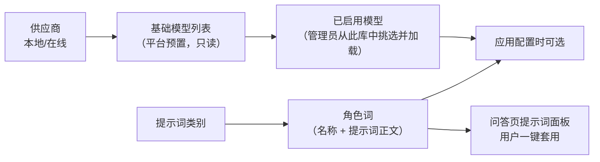

# 05 · 模型与提示词管理

## 一、需求概述

平台不产生模型，只**管理和调度模型**。本业务域解决两个问题：答案由**哪个模型**生成（模型管理），以及答案按**什么身份和风格**生成（提示词管理）。

## 二、模型管理

### FR-05-01 模型列表

| 编号 | 需求 |
|---|---|
| FR-05-01-1 | 卡片式展示已配置模型，每页约 39 条 |
| FR-05-01-2 | 卡片展示：模型图标、模型名称、模型类型、基础模型、运行状态 |
| FR-05-01-3 | 支持按**供应商**筛选 |
| FR-05-01-4 | 支持按模型名称搜索 |
| FR-05-01-5 | 操作项：重新加载、编辑、删除 |

### FR-05-02 模型状态

| 状态 | 含义 | 可执行操作 |
|---|---|---|
| 加载中 | 模型正在拉取或初始化 | 等待 |
| 加载成功 | 可被应用选用 | 编辑、删除、重新加载 |
| 加载失败 | 拉取或初始化失败 | **重新加载**、删除 |

> **BR-05-01**：模型状态是**运行态**而非配置态。加载失败通常由网络（在线模型）、显存/内存不足、模型名错误引起，界面必须提供"重新加载"这一恢复手段。

### FR-05-03 新增与编辑模型

| 编号 | 字段 | 必填 | 说明 |
|---|---|---|---|
| FR-05-03-1 | 供应商 | 是 | 来自供应商字典（排除"全部"项） |
| FR-05-03-2 | 模型名称 | 是 | ≤20 字 |
| FR-05-03-3 | 模型类型（用途） | 否 | 来自模型类型字典，用于区分对话/向量/其他 |
| FR-05-03-4 | 基础模型 | 是 | 从右侧基础模型列表中选 1 个 |
| FR-05-03-5 | API 域名 | 条件必填 | **供应商非本地时必须填写** |
| FR-05-03-6 | API Key | 条件必填 | **供应商非本地时必须填写** |
| FR-05-03-7 | Secret Key | 条件必填 | **仅特定供应商（如千帆）需要** |

> **BR-05-02**：**供应商与基础模型的平台必须一致**。选了某供应商却挑了属于另一平台的模型，提交时报"供应商与平台不匹配"。这是防止配置错误的关键约束。
>
> **BR-05-03**：**本地模型不需要 API 域名与密钥**。这是平台默认部署形态——模型在本机推理，无外部依赖。

### FR-05-04 基础模型库

| 编号 | 需求 |
|---|---|
| FR-05-04-1 | 右侧展示平台可选的**基础模型清单**，分页加载，滚动加载更多 |
| FR-05-04-2 | 支持按模型名搜索 |
| FR-05-04-3 | 用标签区分**离线模型**（可本地运行）与**在线模型**（需外部 API） |
| FR-05-04-4 | 可查看基础模型的描述信息 |
| FR-05-04-5 | 只能选中一个；选中后自动带出相关信息 |

> **BR-05-04**：**本地基础模型的命名需带标签**（形如 `模型名:版本`），否则加载会失败。

### FR-05-05 模型加载流程

| 编号 | 需求 |
|---|---|
| FR-05-05-1 | 提交新增/编辑后，若为本地模型则进入"下载/加载中"状态 |
| FR-05-05-2 | 提示"模型下载中，确认后转入后台下载" |
| FR-05-05-3 | 加载结果通过模型状态体现 |
| FR-05-05-4 | 加载失败可重新加载，无需重新配置 |

> **AC-05-01**：新增一个本地模型 → 状态为"加载中" → 等待后变为"加载成功" → 该模型出现在应用配置的模型下拉中。

### FR-05-06 模型使用统计

| 编号 | 需求 |
|---|---|
| FR-05-06-1 | 运营看板展示正在运行的模型数量与活跃模型 |
| FR-05-06-2 | 展示模型调用的成功率与状态分布 |

（指标口径见第 7 册。）

> **BR-05-05**：平台**支持多家供应商**（本地推理 + 多个在线大模型厂商）的配置能力，但**默认部署只使用本地推理**。在线供应商的接入属于可选项，需要外网与密钥。

> **BR-05-06（重要约束）**：**向量模型是不可替换的**。
> 向量模型决定向量维度（当前为 768 维），而向量库表在首次运行时按该维度创建。更换向量模型会导致维度不匹配，必须**删除向量表、重建、并重灌所有知识库的全部文档**。
> 因此：**更换向量模型是一项全量数据迁移操作，不是配置变更。** 当前平台的向量模型上下文仅约 1K token，这也决定了分段长度上限的实际取值。

> **BR-05-07（重要约束）**：有若干模型名被**后端代码硬编码引用**（用于知识图谱的抽取与消歧等场景），**不可从模型库中删除**，否则相关功能会报"模型不存在"。运维时须保留这些模型。

## 三、提示词管理

### FR-05-07 提示词类别

| 编号 | 需求 | 约束 |
|---|---|---|
| FR-05-07-1 | 维护提示词类别，作为角色词的分组 | 类别名必填 |
| FR-05-07-2 | 类别可配置图标 | 支持上传图片 |
| FR-05-07-3 | 支持新增、修改、删除类别 | |
| FR-05-07-4 | 类别以列表/卡片形式展示 | |

### FR-05-08 角色词（提示词正文）

| 编号 | 需求 | 约束 |
|---|---|---|
| FR-05-08-1 | 在类别下维护角色词 | |
| FR-05-08-2 | 字段：所属类别、角色名称、提示词正文、描述、图标 | 提示词 ≤500 字，描述 ≤500 字 |
| FR-05-08-3 | 图标支持上传图片 | 限 JPG/PNG，≤5MB |
| FR-05-08-4 | 支持新增、修改、删除 | 删除需二次确认 |
| FR-05-08-5 | 卡片式展示 | |

> **BR-05-08**：角色词是**"一段可复用的身份设定"**。它同时服务两个场景：
> ① 在问答页作为**提示词面板**，用户点选后把该角色的提示词套用到本轮提问；
> ② 作为应用配置时的**提示词素材**，减少重复撰写。
>
> **BR-05-09**：角色词**不含知识库绑定**。它只提供"怎么说"，不提供"依据什么说"——知识来源始终由应用决定。

### FR-05-09 问答页的提示词套用

| 编号 | 需求 |
|---|---|
| FR-05-09-1 | 问答输入框上方提供提示词入口 |
| FR-05-09-2 | 按类别分组展示角色词 |
| FR-05-09-3 | 点击角色词即把其提示词填充/套用到当前提问 |
| FR-05-09-4 | 套用后仍可继续编辑问题 |
| FR-05-09-5 | 展示最近使用的角色词 |

> **AC-05-02**：建一个类别 + 一个角色词，在问答页提示词面板中能看到并成功套用，观察回答风格变化。

## 四、业务规则汇总

| 编号 | 规则 |
|---|---|
| BR-05-10 | 供应商与基础模型必须同平台，否则拒绝保存 |
| BR-05-11 | 非本地供应商必须提供 API 域名与密钥 |
| BR-05-12 | 模型必须先"加载成功"才能被应用选用 |
| BR-05-13 | 被后端硬编码引用的模型不可删除 |
| BR-05-14 | 向量模型更换等同于全量数据迁移，非配置变更 |
| BR-05-15 | 角色词只定义风格，不定义知识来源 |

## 五、非功能需求

| 编号 | 需求 |
|---|---|
| NFR-05-01 | 模型加载为耗时操作（本地模型可达数 GB），必须异步并展示状态 |
| NFR-05-02 | 模型密钥属敏感信息，展示时须脱敏，传输须加密 |
| NFR-05-03 | 模型列表与基础模型列表需分页/懒加载，避免一次拉取过多 |
| NFR-05-04 | 模型加载失败需记录可读原因，便于运维判断（网络、显存、名称错误） |

## 六、验收标准

| 编号 | 验收项 |
|---|---|
| AC-05-03 | 新增本地模型并成功加载，应用配置的模型下拉中出现该模型 |
| AC-05-04 | 故意选择不匹配的供应商与模型，保存被拒绝并提示原因 |
| AC-05-05 | 删除一个正在被应用使用的模型，系统应拦截或提示影响范围 |
| AC-05-06 | 新增提示词类别与角色词，问答页提示词面板可见并可套用 |
| AC-05-07 | 模型管理页能看到模型运行状态并成功执行一次"重新加载" |

## 七、与其他分册的衔接

- 模型使用指标 → 第 7 册
- 应用里如何选用模型与提示词 → 第 2 册 FR-02-18
- 本地模型的部署与不可删清单 → 第 10 册
