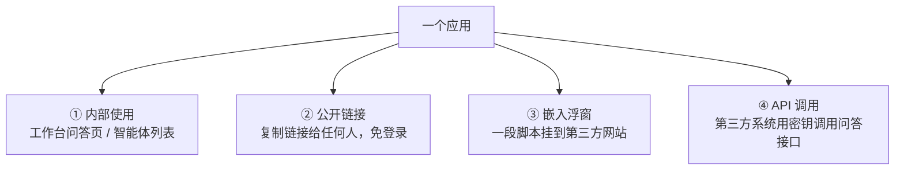

# 06 · 应用接入与开放能力

## 一、需求概述

应用建好之后，业务需求是把它"发出去"。平台提供**四种输出形态**，覆盖从内部使用到第三方集成的全部场景：

四种形态**共用同一套应用配置**——改一次配置，四种入口同时生效。

## 二、公开链接

### FR-06-01 公开访问开关

| 编号 | 需求 |
|---|---|
| FR-06-01-1 | 应用默认不对公网开放，需显式开启 |
| FR-06-01-2 | 开启后可复制一条公开访问链接 |
| FR-06-01-3 | 关闭开关后，原链接立即失效 |
| FR-06-01-4 | 界面需明确提示"开启后外部无需登录即可访问" |

> **BR-06-01**：公开链接**免登录**且**使用默认租户身份**。因此开启前必须确认：该应用挂载的知识库内容是否可对外公开。这是内容安全责任点，需求评审必须确认。

### FR-06-02 访问凭证（Token）管理

| 编号 | 需求 |
|---|---|
| FR-06-02-1 | 一个应用可生成**多个**访问凭证 |
| FR-06-02-2 | 每个凭证可独立启用/停用 |
| FR-06-02-3 | 凭证可配置有效期 |
| FR-06-02-4 | 凭证可删除 |
| FR-06-02-5 | 可查看每个凭证的使用情况 |
| FR-06-02-6 | 可复制凭证值 |

> **BR-06-02**：**多个凭证的意义是"可分别撤回"**。给不同渠道各发一个凭证，某个渠道需要停用时可单独撤回，不影响其他渠道。这是凭证设计的关键需求。
>
> **BR-06-03**：凭证等价于密码。一经泄露即可被外部无限制调用问答能力，界面须提供显式的停用与删除入口，且停用应即时生效。

> **AC-06-01**：为应用生成两个凭证，分别访问均可问答；停用凭证 A 后其访问被拒绝，凭证 B 仍正常。

## 三、嵌入浮窗

### FR-06-03 嵌入能力

| 编号 | 需求 |
|---|---|
| FR-06-03-1 | 生成一段可复制的嵌入代码（脚本标签形式） |
| FR-06-03-2 | 第三方页面粘贴该脚本后，右下角出现悬浮问答按钮与浮窗 |
| FR-06-03-3 | 浮窗内可正常问答，行为与应用一致 |
| FR-06-03-4 | 浮窗通过访问凭证换取应用配置，无需用户登录 |
| FR-06-03-5 | 支持**仅问答模式**（只展示对话，隐藏工作台相关入口） |
| FR-06-03-6 | 浮窗支持收起与展开 |

> **BR-06-04**：嵌入浮窗的会话与工作台会话**隔离记录**，便于区分"外部访客"与"内部用户"的用量。运营分析时两者应分开看。

> **AC-06-02**：在一张空白 HTML 页面粘贴嵌入脚本，打开后浮窗可用，可完整问答并看到引用。

## 四、API Key 与接口开放

### FR-06-04 API Key 管理

| 编号 | 需求 |
|---|---|
| FR-06-04-1 | 为应用生成 API Key |
| FR-06-04-2 | 支持生成多个 Key |
| FR-06-04-3 | 每个 Key 可独立启用/停用、重命名、删除 |
| FR-06-04-4 | Key 值支持复制 |
| FR-06-04-5 | Key 列表展示创建时间与最近使用时间 |
| FR-06-04-6 | 提供接口文档下载入口（地址由系统参数配置） |

> **BR-06-05**：API Key 面向**程序化调用**，与公开链接的访问凭证是**两套不同机制**（用途不同、携带方式不同），不要把二者混为一谈。复现时须分别实现。

### FR-06-05 开放接口能力

| 编号 | 需求 |
|---|---|
| FR-06-05-1 | 提供问答接口，返回答案与引用来源 |
| FR-06-05-2 | 支持流式返回 |
| FR-06-05-3 | 支持携带会话标识以维持多轮上下文 |
| FR-06-05-4 | 支持编排应用的接口调用 |
| FR-06-05-5 | 调用需鉴权（API Key） |
| FR-06-05-6 | 提供接口文档与示例 |

> **BR-06-06**：开放接口的鉴权与内部用户令牌是**平行的两套**。第三方系统不应使用内部用户令牌调用，避免权限外溢。

## 五、访问限制与白名单

### FR-06-06 来源限制

| 编号 | 需求 |
|---|---|
| FR-06-06-1 | 可配置允许访问的来源地址清单（白名单） |
| FR-06-06-2 | 支持批量添加与批量移除白名单 |
| FR-06-06-3 | 白名单外的来源访问被拒绝 |
| FR-06-06-4 | 白名单可整体启用/停用 |
| FR-06-06-5 | 可配置访问限流策略 |

> **BR-06-07**：白名单是**公开链接与嵌入浮窗的补充防护**。仅靠凭证不足以防止凭证被转抄到其他站点使用，来源白名单可再加一层约束。两者应组合使用。

> **AC-06-03**：配置来源白名单后，从白名单内地址访问成功，从其他地址访问被拒绝。

## 六、对话日志（运营与质检）

### FR-06-07 对话日志

| 编号 | 需求 |
|---|---|
| FR-06-07-1 | 按会话维度展示应用的问答记录 |
| FR-06-07-2 | 支持按时间段筛选 |
| FR-06-07-3 | 支持按关键词搜索 |
| FR-06-07-4 | 列表字段：会话标识、问答轮数、点赞数、点踩数、优化数 |
| FR-06-07-5 | 点击可查看该会话的完整问答明细（抽屉或详情页） |
| FR-06-07-6 | 明细中展示每次回答的引用来源、Token 消耗、耗时 |
| FR-06-07-7 | 明细中支持"上一条/下一条"连续浏览 |
| FR-06-07-8 | 支持导出对话日志 |
| FR-06-07-9 | 支持对某条回答执行**"优化答案"** |

> **BR-06-08**：对话日志是**知识运营的闭环入口**。当发现某个问题答得不好时，运营人员在此处执行"优化答案"，把该问题沉淀为问答对（第 3 册），下次同类提问即可命中人工沉淀的答案。**这条路径是平台提升问答质量最有效的运营手段，必须在需求中显式保留。**

> **AC-06-04**：在对话日志中找出一个答得不好的问题，执行"优化答案"并关联分段，之后用同一问题再次提问，回答改善。

## 七、会话分享

### FR-06-08 分享（已在第 2 册定义，此处补充管理视角）

| 编号 | 需求 |
|---|---|
| FR-06-08-1 | 分享是**用户侧自发行为**，不需要管理员审批 |
| FR-06-08-2 | 分享内容为选定的问答消息，非整个会话 |
| FR-06-08-3 | 分享链接长期有效（无过期机制——需在评审中确认是否可接受） |
| FR-06-08-4 | 分享页不暴露会话的其他轮次 |

> **BR-06-09**：**分享链接目前没有撤销机制**。这是一个需要在评审中确认的需求缺口：一旦分享，内容即长期可由持有链接者访问。若业务要求可撤回，需新增需求。

## 八、业务规则汇总

| 编号 | 规则 |
|---|---|
| BR-06-10 | 公开访问默认关闭，开启即对外免登录可用，须显式确认 |
| BR-06-11 | 访问凭证与 API Key 是两套机制，用途与携带方式不同 |
| BR-06-12 | 多凭证设计的目的是可分别撤回，不是冗余 |
| BR-06-13 | 嵌入浮窗会话与内部会话分开统计 |
| BR-06-14 | 公开访问使用默认租户身份，跨租户共享需谨慎 |
| BR-06-15 | 分享链接无过期与撤回机制（需求缺口） |

## 九、非功能需求

| 编号 | 需求 |
|---|---|
| NFR-06-01 | 开放接口须具备限流与防滥用能力 |
| NFR-06-02 | 凭证与密钥在界面上须可复制但不可明文回显（或明确标注可见性） |
| NFR-06-03 | 嵌入脚本须足够轻量，不拖慢宿主页面 |
| NFR-06-04 | 对话日志量大时须分页并支持导出，导出不应阻塞交互 |
| NFR-06-05 | 取消公开访问必须在秒级生效（凭证缓存需可控） |

## 十、验收标准

| 编号 | 验收项 |
|---|---|
| AC-06-05 | 开启公开链接 → 无痕窗口可访问并问答 → 关闭 → 链接失效 |
| AC-06-06 | 生成两个凭证，分别可用；停用其一，另一不受影响 |
| AC-06-07 | 嵌入脚本在第三方页面加载成功，浮窗可问答 |
| AC-06-08 | 生成 API Key 并用其成功调用一次问答接口 |
| AC-06-09 | 配置白名单后，非白名单来源被拒绝 |
| AC-06-10 | 对话日志可按时间与关键词筛选，可查看明细并导出 |
| AC-06-11 | 对话日志中"优化答案"成功后，问答对出现在知识库的问题列表中 |

## 十一、与其他分册的衔接

- 应用本身的创建与配置 → 第 2 册
- 问答对与知识库 → 第 3 册
- 使用量统计与满意度 → 第 7 册
- 权限与免登录模型 → 第 1 册
