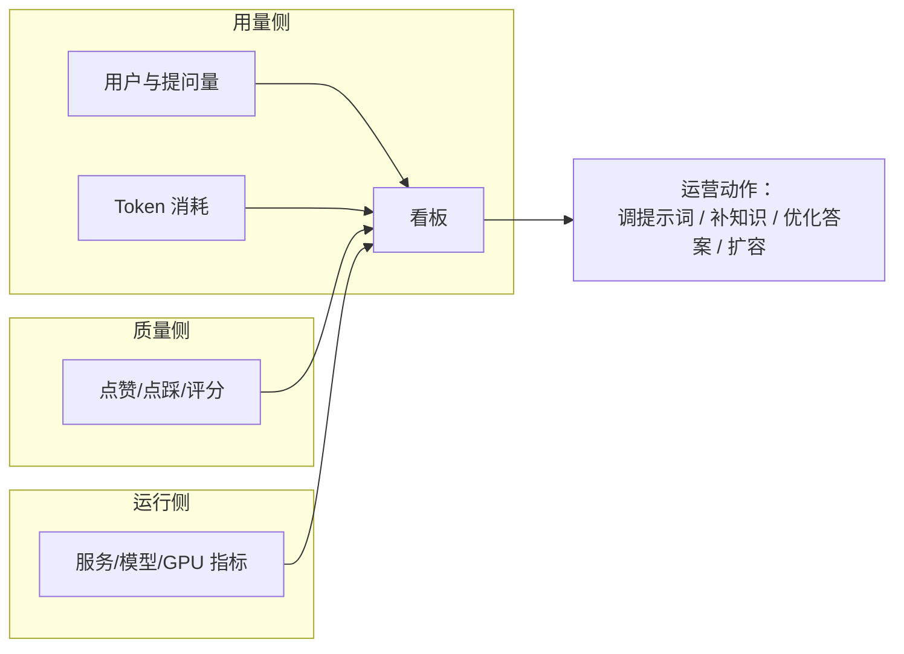

# 07 · 运营统计与用户反馈

## 一、需求概述

平台需要回答两类运营问题：**"用得多不多、值不值"（用量与成本）** 和 **"答得好不好"（质量与满意度）**。本业务域把这些指标组织成两块看板，并把用户反馈收成一条闭环。

## 二、运营大屏（系统级）

### FR-07-01 用户与问答指标

| 编号 | 指标 | 口径 | 展示形式 |
|---|---|---|---|
| FR-07-01-1 | 今日问答数 | 当日提问总次数 | 指标卡片 |
| FR-07-01-2 | 今日新增用户 | 当日新注册/新建用户数 | 指标卡片 |
| FR-07-01-3 | 今日问答用户数 | 当日产生过提问的**去重用户数** | 指标卡片 |
| FR-07-01-4 | 上述三项的**趋势** | 支持时间范围切换（今日 / 近 7 天 / 近 30 天） | 折线图 |

> **BR-07-01**：指标名称与展示文案由**指标配置**驱动，不写死在页面里。新增一个指标只需在指标配置中登记（指标键、类型、描述、单位），看板即可展示。这是需求上的扩展点。

### FR-07-02 基础设施指标

| 编号 | 指标 | 说明 |
|---|---|---|
| FR-07-02-1 | Redis 内存使用量 | 近 1 小时趋势 |
| FR-07-02-2 | Redis 未过期 Key 数量 | 近 1 小时趋势 |
| FR-07-02-3 | 服务器 CPU 基本指标 | 表格，按服务实例列出参数、描述、当前值 |
| FR-07-02-4 | GPU 基本信息 | 表格（型号、显存总量等） |
| FR-07-02-5 | GPU 基本指标 | 显存使用量、显存总容量、温度、性能状态 |
| FR-07-02-6 | GPU 指标变化趋势 | 内存利用率、资源利用率、温度、时钟频率 |
| FR-07-02-7 | JVM 指标 | 堆各区使用量、活动线程数、守护线程数等，按实例与应用分组 |

### FR-07-03 模型运行指标

| 编号 | 指标 | 说明 |
|---|---|---|
| FR-07-03-1 | 正在运行的模型数 | 当前驻留内存/显存的模型数量 |
| FR-07-03-2 | 活跃模型 | 实际被调用的模型清单 |
| FR-07-03-3 | 模型调用成功率 | 按模型区分 |
| FR-07-03-4 | 聊天接口请求成功率 | 问答主接口的成功率 |
| FR-07-03-5 | 聊天接口状态分布 | 按 HTTP 状态码分布（饼图） |
| FR-07-03-6 | 模型对话调用状态分布 | 模型侧调用的状态分布（饼图） |

### FR-07-04 服务与异常

| 编号 | 需求 |
|---|---|
| FR-07-04-1 | 展示被监控的服务实例清单：地址、监控组、标签、健康状态、最近错误 |
| FR-07-04-2 | 支持按健康状态筛选（全部 / 正常 / 异常） |
| FR-07-04-3 | 展示**异常接口信息**：问答接口中返回 500 的调用记录 |
| FR-07-04-4 | 点击异常记录可查看该次调用的详情（异常堆栈） |

### FR-07-05 看板交互

| 编号 | 需求 |
|---|---|
| FR-07-05-1 | 提供"立即刷新"操作，重新拉取全部指标 |
| FR-07-05-2 | 窗口尺寸变化时图表自适应重绘 |
| FR-07-05-3 | 所有趋势图支持时间范围切换 |

> **BR-07-02**：运行指标依赖**监控中间件与指标暴露**。若监控组件未部署或指标未采集，看板相应区块为空——这属于环境问题而非功能缺陷，复现时须先确认监控链路可用。

> **BR-07-03（复现提示）**：运营大屏的菜单入口当前**处于关闭状态**，只能通过直接访问路由到达。若需要开放给运营人员，需在菜单中启用。见第 10 册。

## 三、应用级概览

### FR-07-06 应用概览指标

| 编号 | 指标 | 口径 |
|---|---|---|
| FR-07-06-1 | 用户总数 | 使用过该应用的去重用户数 |
| FR-07-06-2 | 提问次数 | 该应用累计提问数 |
| FR-07-06-3 | Token 总数 | 该应用累计消耗的 Token 数（成本核心指标） |
| FR-07-06-4 | 用户满意度 | 基于点赞/点踩的满意度 |

### FR-07-07 应用趋势图

| 编号 | 需求 |
|---|---|
| FR-07-07-1 | 上述四项指标各自提供趋势折线图 |
| FR-07-07-2 | 支持时间范围切换（7 / 30 / 60 / 90 天） |
| FR-07-07-3 | 满意度趋势需同时展示"满意"与"不满意"两条曲线 |

> **BR-07-04**：**Token 消耗是本地部署形态下衡量资源压力的主要指标**。CPU 推理环境下 Token 总量直接对应响应时长与机器负载，运营看板须把它与用量并列展示，而不是仅看次数。

### FR-07-08 应用概览页的开放配置

应用概览页同时是**开放能力的操作台**，集成以下配置（详见第 6 册）：

| 编号 | 需求 |
|---|---|
| FR-07-08-1 | 公开访问开关与公开链接复制 |
| FR-07-08-2 | 嵌入第三方代码生成 |
| FR-07-08-3 | 访问限制与白名单配置 |
| FR-07-08-4 | API Key 管理 |

> **BR-07-05**：概览页的指标体系**跟随作用范围变化**——从应用维度进入时统计该应用；从系统维度进入时统计全平台。这是同一套组件复用两种口径的设计，复现时须保证作用范围为空的处理正确（不报错、显示全局或提示暂无数据）。

## 四、用户反馈闭环

### FR-07-09 反馈产生（用户侧）

| 编号 | 需求 | 分册 |
|---|---|---|
| FR-07-09-1 | 对单条回答点赞 / 点踩（互斥、可撤销） | 02 |
| FR-07-09-2 | 对整次会话评分（1–5 星）+ 文字意见（≤500 字） | 02 |

### FR-07-10 反馈管理（管理侧）

| 编号 | 需求 |
|---|---|
| FR-07-10-1 | 列表展示反馈记录：内容、评分、提交时间、提交用户 |
| FR-07-10-2 | 支持按反馈内容搜索 |
| FR-07-10-3 | 支持查看反馈详情 |
| FR-07-10-4 | 分页展示 |
| FR-07-10-5 | 反馈列表为**只读消费**（当前无处理状态流转） |

> **BR-07-06（需求缺口）**：反馈列表**没有处理状态**（如待处理/已处理/已忽略），也没有指派与回复能力。运营人员只能"看"，不能"办"。
> 若业务要求形成"受理 → 处理 → 回访"的完整闭环，需新增需求：反馈状态字段、状态流转、处理人、处理记录。

> **AC-07-01**：用户在问答页提交一条 3 星 + 文字反馈，管理端反馈列表能查到该记录，且按内容搜索可命中。

### FR-07-11 反馈到质量的闭环

平台的反馈消费有两条路径，二者互补：

| 路径 | 入口 | 产出 | 适用 |
|---|---|---|---|
| 单条回答层 | 对话日志 → 优化答案 | 问答对（Q→分段） | 具体问题答错，需立即修正 |
| 会话整体层 | 反馈列表 → 定位会话 | 人工分析后调整提示词/补知识 | 体验性问题，需成批优化 |

## 五、指标口径汇总表（复现基准）

这张表是**指标实现的唯一依据**，复现时按此口径计算：

| 指标 | 指标键前缀 | 类型 | 计算口径 |
|---|---|---|---|
| 今日问答数 | 今日问答数 | 用户 | 当日提问次数，按自然日归零 |
| 今日新增用户 | 今日新增用户 | 用户 | 当日新建用户数 |
| 今日问答用户数 | 今日问答用户数 | 用户 | 当日有过提问的**去重用户数** |
| 趋势系列 | 同上 | 用户 | 按所选范围的日粒度序列 |
| Redis 内存 | 内存使用量 | Redis | 近 1 小时采样（步长 5 分钟） |
| Redis Key | 未过期 Key 数 | Redis | 同上 |
| CPU | CPU 基本指标 | CPU | 按服务实例列出 |
| GPU 系列 | GPU 基本指标 / 变化 | GPU | 内存利用率、资源利用率、温度、时钟 |
| JVM 系列 | JVM 相关 | JVM | 按实例 + 应用分组 |
| 模型运行 | 运行模型 / 成功率 | 模型 | 驻留模型数、调用成功率 |
| 状态分布 | 状态分布 | 接口 | 按 HTTP 状态码分组计数 |
| 满意度 | 满意度 | 应用 | 满意 / 不满意（点赞 / 点踩） |

> **BR-07-07**：所有指标**以"指标配置"表为准绳**——展示的标题取配置中的描述字段，单位取配置中的单位字段。因此**新增指标不需要改前端**，只需在指标配置中登记。这是平台在运营侧的扩展设计。

## 六、非功能需求

| 编号 | 需求 |
|---|---|
| NFR-07-01 | 看板首屏加载需可控（指标多、聚合重），必要时按区块懒加载 |
| NFR-07-02 | 趋势图在窗口尺寸变化时须自适应 |
| NFR-07-03 | 指标接口失败时单个区块降级展示，不影响其他区块 |
| NFR-07-04 | 反馈列表与日志导出在大数据量下不得阻塞页面 |

## 七、验收标准

| 编号 | 验收项 |
|---|---|
| AC-07-02 | 产生若干问答后，大屏"今日问答数/问答用户数"数值增加 |
| AC-07-03 | 应用概览的"提问次数/Token 总数/满意度"随问答行为变化 |
| AC-07-04 | 点赞一条回答后，应用满意度与趋势图中的"满意"曲线变化 |
| AC-07-05 | 提交一条会话评分，管理端可查到并支持搜索 |
| AC-07-06 | 大屏各区块均可加载出数据（在监控链路正常的前提下） |
| AC-07-07 | 权限不足的用户访问大屏应被拒绝或菜单不可见 |

## 八、与其他分册的衔接

- 点赞点踩与评分的**用户侧交互** → 第 2 册
- 对话日志与"优化答案" → 第 6 册
- 指标配置的数据结构 → 第 10 册附录
- 大屏入口未开放的问题 → 第 10 册
