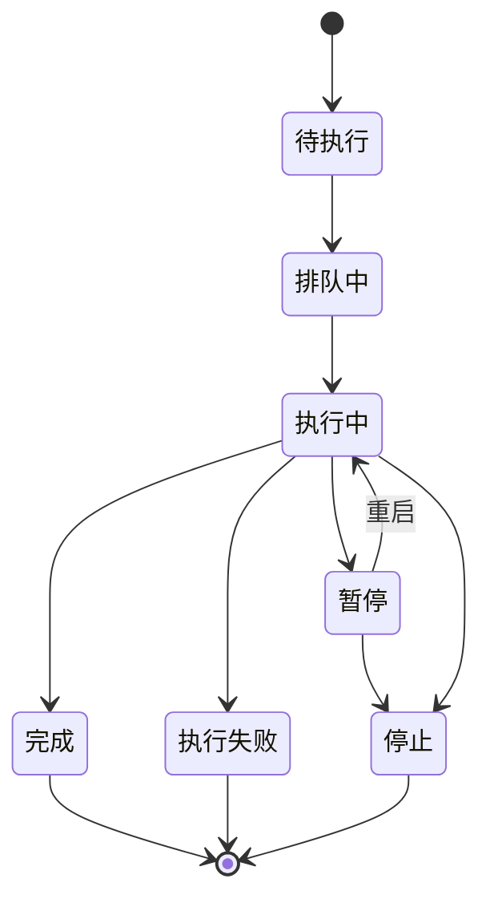

# 08 · 在线爬虫与文档生成

## 一、需求概述

本册覆盖两类"自动化生产内容"的能力：

1. **在线爬虫**——把互联网上的公开信息批量采集为知识库文档，解决"知识从哪来"的问题。
2. **文档生成**——把问答结果转化为 PPT、思维导图、图表等**可交付物**，解决"答案如何带走"的问题。

两者共同点是：**都用结构化配置描述一个"生产任务"，异步执行，结果可追溯。**

## 二、在线爬虫

### FR-08-01 蜘蛛（采集规则）管理

爬虫的核心是**蜘蛛配置**——用一组规则描述"从哪个网站、抓什么、怎么抓"。

| 编号 | 配置项 | 必填 | 说明 |
|---|---|---|---|
| FR-08-01-1 | 蜘蛛名称 | 是 | 便于识别 |
| FR-08-01-2 | 数据存储表名 | 是 | 采集结果落库的表，系统自动加固定前缀 |
| FR-08-01-3 | 渲染方式 | 是 | **静态抓取 / JS 渲染 / 模拟点击分页** 三选一 |
| FR-08-01-4 | 知识领域 | 否 | 多选，来自知识领域字典，决定采集结果的归类 |
| FR-08-01-5 | 入口页地址 | 是 | 起始 URL |
| FR-08-01-6 | 列表页正则 | 条件必填 | 用于匹配列表项链接 |
| FR-08-01-7 | 正文提取规则 | 是 | 正文的 XPATH |
| FR-08-01-8 | 列表页字段 | 否 | 采集哪些列表字段（JSON 结构） |
| FR-08-01-9 | 正文页字段 | 否 | 采集哪些正文字段（JSON 结构） |
| FR-08-01-10 | 分页范围 | 条件必填 | 模拟点击模式下需配置起止页 |
| FR-08-01-11 | 翻页按钮标识 | 条件必填 | 模拟点击模式下需配置翻页元素 class |
| FR-08-01-12 | 备注 | 否 | |

> **BR-08-01**：**渲染方式决定抓取策略**——
> **静态抓取**最快，适合服务端渲染的页面；
> **JS 渲染**能执行页面脚本，适合前端渲染的单页应用；
> **模拟点击分页**在 JS 渲染基础上模拟用户点击翻页，适合"点击加载更多"式列表。
> 选择错误会抓不到内容，这是爬虫配置最常见的失败原因。

### FR-08-02 运行参数配置

| 编号 | 参数 | 说明 |
|---|---|---|
| FR-08-02-1 | 线程数 | 并发抓取数。过高易被目标站封禁 |
| FR-08-02-2 | 睡眠间隔 | 每次请求的间歇。过低易触发反爬 |
| FR-08-02-3 | 失败重试次数 | |
| FR-08-02-4 | 重试睡眠间隔 | 重试之间的等待 |
| FR-08-02-5 | 循环重试次数 | 失败后重新入队的次数 |
| FR-08-02-6 | 超时时间 | 单次请求超时 |

> **BR-08-02**：**线程数与睡眠间隔需要在"速度"与"不被封禁"之间权衡**。默认值应偏保守；面对有反爬机制的站点，应配合代理使用。

### FR-08-03 代理管理

| 编号 | 需求 |
|---|---|
| FR-08-03-1 | 支持维护代理渠道清单 |
| FR-08-03-2 | 支持两种代理类型：**免费代理**（填写 IP 列表）与**商业代理服务**（填写服务商 Token） |
| FR-08-03-3 | 代理可配置名称、编码、备注、有效截止时间 |
| FR-08-03-4 | 代理配置与蜘蛛绑定 |
| FR-08-03-5 | 支持新增、修改、删除代理 |

> **BR-08-03**：免费代理**稳定性差、寿命短**，只适合低频小规模采集；正式的知识采集应使用商业代理服务。

### FR-08-04 蜘蛛调试工具

爬虫配置必须**可试错**，因此提供一组调试能力：

| 编号 | 需求 |
|---|---|
| FR-08-04-1 | 测试入口页是否可访问 |
| FR-08-04-2 | 测试列表页正则是否匹配到预期链接 |
| FR-08-04-3 | 测试正文 XPATH 是否能提取到正文 |
| FR-08-04-4 | 测试正文页字段提取 |
| FR-08-04-5 | **根据正文内容反推推荐 XPATH**（联想能力），降低配置门槛 |
| FR-08-04-6 | 每个测试都需展示原始返回与提取结果对比 |

> **BR-08-04**：调试工具是爬虫功能的**必备配套**。需求评审时须确认：没有调试能力，业务人员无法独立完成蜘蛛配置。

### FR-08-05 蜘蛛的常用操作

| 编号 | 需求 |
|---|---|
| FR-08-05-1 | **运行**：立即触发一次采集 |
| FR-08-05-2 | **克隆**：复制已有配置快速派生新蜘蛛 |
| FR-08-05-3 | **导出 / 导入**：以 JSON 形式导出配置，便于跨环境迁移与备份 |
| FR-08-05-4 | **查看任务**：跳转到该蜘蛛的任务列表 |
| FR-08-05-5 | **配置代理**：为蜘蛛绑定代理 |
| FR-08-05-6 | **设置运行参数**：调整线程、重试等 |
| FR-08-05-7 | **操作手册**：提供帮助文档下载入口 |

> **BR-08-05**：**导出/导入 JSON 是蜘蛛配置跨环境迁移的唯一手段**。复现时须验证导出文件能在目标环境完整还原配置。

### FR-08-06 采集任务管理

| 编号 | 需求 |
|---|---|
| FR-08-06-1 | 分页展示采集任务：蜘蛛名、表名、开始时间、结束时间、耗时、状态 |
| FR-08-06-2 | 支持按蜘蛛名、表名搜索 |
| FR-08-06-3 | 支持暂停运行中的任务 |
| FR-08-06-4 | 支持停止运行中或已暂停的任务 |
| FR-08-06-5 | 支持重启已暂停的任务 |
| FR-08-06-6 | 可查看任务采集到的数据明细 |
| FR-08-06-7 | 明细支持导出为 Excel |
| FR-08-06-8 | 运行中的任务，明细**自动刷新**（约每 2 秒） |
| FR-08-06-9 | 任务可关联为知识库的"在线知识库文档" |

**任务状态机：**

| 状态 | 含义 |
|---|---|
| 1 待执行 | 已创建未排队 |
| 2 排队中 | 等待资源 |
| 3 执行中 | 正在采集 |
| 4 完成 | 采集结束 |
| 5 暂停 | 可重启 |
| 6 执行失败 | 需查看原因 |

> **AC-08-01**：配置一个蜘蛛 → 用调试工具验证规则 → 运行 → 任务列表出现执行中的任务 → 明细 2 秒自动刷新 → 完成后可导出 Excel。

### FR-08-07 采集结果入知识库

| 编号 | 需求 |
|---|---|
| FR-08-07-1 | 采集任务可作为"在线知识库文档"关联到知识库 |
| FR-08-07-2 | 关联后，采集到的内容参与知识库检索 |
| FR-08-07-3 | 关联关系可查询 |

> **BR-08-06**：这是**爬虫与知识库的衔接点**。爬虫本身只负责"抓到"，抓到的内容必须经关联才进入问答链路。复现时须完整验证这条链路，否则爬虫只是一个孤立工具。

## 三、文档生成

### FR-08-08 PPT 模板管理

| 编号 | 需求 | 约束 |
|---|---|---|
| FR-08-08-1 | 维护 PPT 模板清单 | |
| FR-08-08-2 | 模板字段：模板名称、类型、首页、尾页、章节页、目录页、正文页、正文条目数、封面图 | |
| FR-08-08-3 | 首页/尾页/章节页为**单个 PPT 文件** | |
| FR-08-08-4 | 目录页支持**多个文件** | |
| FR-08-08-5 | 正文页支持**多个 PPT 文件**，文件名需标注该页适用的"条目数" | |
| FR-08-08-6 | 正文条目数配置 1–9 | |
| FR-08-08-7 | 封面图支持 JPG/PNG，单文件 ≤5MB | |
| FR-08-08-8 | 支持新增、修改、删除、查看 | |
| FR-08-08-9 | 支持按模板类型筛选 | |

> **BR-08-07**：**模板本质是"版式素材库"**。生成 PPT 时，系统按内容条目数从正文页素材中挑选匹配的版式，把模型生成的结构化内容填入。因此**素材越齐全（各条目数都有对应版式），生成效果越稳定**。
>
> **BR-08-08**：模板文件必须由**业务人员用 PowerPoint 预先制作好版式**上传，系统不生产版式。这决定了 PPT 生成的质量上限取决于模板质量。

### FR-08-09 PPT 生成

| 编号 | 需求 |
|---|---|
| FR-08-09-1 | 在会话中触发 PPT 生成（应用需开启该能力） |
| FR-08-09-2 | 生成过程为异步，耗时较长（可达数分钟） |
| FR-08-09-3 | 生成记录可追溯：主题、类型、下载地址、简化版地址、状态 |
| FR-08-09-4 | 生成成功后可下载 |
| FR-08-09-5 | 生成状态：生成中 / 成功 / 失败 |

> **BR-08-09（关键约束）**：PPT 生成依赖模型输出**严格的结构化 JSON**（大纲结构）。平台以非贪婪方式从模型输出中截取 JSON 块并解析，因此：
> - 若模型输出**思考过程**，其中的示例 JSON 会被误抓 → 生成失败；
> - 若模型输出不合规 → 生成失败。
> **这是"图表/导图/PPT 生成失败"的首要排查方向，而非模板问题。**

### FR-08-10 思维导图生成

| 编号 | 需求 |
|---|---|
| FR-08-10-1 | 在会话中触发思维导图生成（应用需开启该能力） |
| FR-08-10-2 | 以思维导图形式渲染层级结构 |
| FR-08-10-3 | 支持收起/展开节点 |
| FR-08-10-4 | 支持导出为图片 |
| FR-08-10-5 | 生成记录可追溯 |

### FR-08-11 图表生成

| 编号 | 需求 |
|---|---|
| FR-08-11-1 | 在会话中按需生成图表（应用需开启该能力） |
| FR-08-11-2 | 支持常见图表类型（折线、柱状、饼图等） |
| FR-08-11-3 | 图表数据由模型从问答内容中提取 |
| FR-08-11-4 | 支持导出为图片 |

> **BR-08-10**：图表、导图、PPT 三者**共用同一套"模型输出结构化 JSON → 前端渲染"的机制**，因此它们**同成败**：模型输出不合规时三者一起失效。排查时应先看模型，而不是分别查三个模块。

## 四、业务规则汇总

| 编号 | 规则 |
|---|---|
| BR-08-11 | 爬虫渲染方式选错是最常见的采集失败原因 |
| BR-08-12 | 线程数/间隔需权衡速度与封禁风险，默认应保守 |
| BR-08-13 | 蜘蛛配置必须可导出导入，作为跨环境迁移手段 |
| BR-08-14 | 抓取到的内容必须关联为"在线知识库文档"才进入问答链路 |
| BR-08-15 | PPT 模板需人工预制作，系统只做填充 |
| BR-08-16 | PPT/导图/图表共用模型输出解析机制，同成败 |
| BR-08-17 | 三类生成均需可追溯（记录主题、状态、产物地址） |

## 五、非功能需求

| 编号 | 需求 |
|---|---|
| NFR-08-01 | 爬虫任务须异步执行，支持暂停/停止/重启 |
| NFR-08-02 | 采集明细在运行中须自动刷新，但需控制频率避免压力 |
| NFR-08-03 | 采集数据量可能很大，明细须分页，导出须走异步或流式 |
| NFR-08-04 | 抓取需遵守目标站点的 robots 与访问频率，避免被封禁 |
| NFR-08-05 | PPT 生成耗时数分钟，接口超时须单独放大并给出等待提示 |
| NFR-08-06 | 生成内容须落库，避免用户下载链接失效 |

## 六、验收标准

| 编号 | 验收项 |
|---|---|
| AC-08-02 | 蜘蛛调试四项测试全部通过后再运行，采集成功率显著提高 |
| AC-08-03 | 任务执行中可暂停并重启，状态正确流转 |
| AC-08-04 | 采集明细在运行中每约 2 秒刷新一次 |
| AC-08-05 | 采集结果导出 Excel 可正常打开 |
| AC-08-06 | 采集任务关联为在线文档后，能在知识库命中测试中检索到 |
| AC-08-07 | 上传一套 PPT 模板，在会话中生成 PPT 并成功下载 |
| AC-08-08 | 生成一张思维导图并导出为图片 |
| AC-08-09 | 蜘蛛配置导出为 JSON 后在另一环境导入，配置完整还原 |

## 七、与其他分册的衔接

- 知识库与在线文档 → 第 3 册
- 应用是否开启 PPT/导图/图表能力 → 第 2 册 FR-02-18
- 生成记录与知识图谱 → 第 3 册
- 模型输出解析导致的生成失败 → 第 10 册
